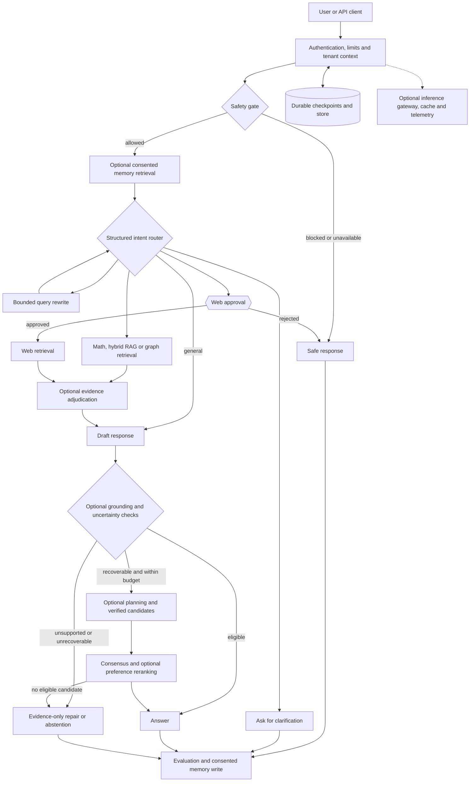
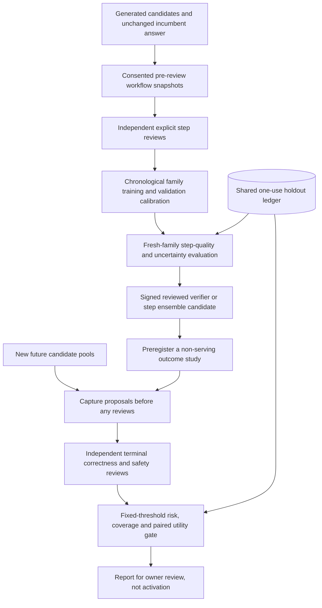
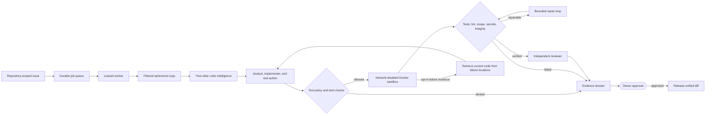

# AgentForge

A reliability-first platform for building, evaluating, and operating AI agents.

[](https://github.com/Theepankumargandhi/Multi-Agent-Orchestration/actions/workflows/ci.yml)
[](https://github.com/Theepankumargandhi/Multi-Agent-Orchestration/actions/workflows/cd-release.yml)

AgentForge began as a LangGraph research assistant. It has grown into a practical AI-engineering platform that answers a harder question: *how do you let an agent use retrieval, memory, tools, and additional inference without silently releasing an unsafe or unsupported answer?*

The repository contains two working agent systems:

- an evidence-aware research agent with hybrid RAG, durable human approval, memory, grounding, calibrated uncertainty, and adaptive test-time compute;
- a sandboxed coding agent that retrieves repository context, proposes a patch, tests it in an isolated container, and produces a reviewable evidence dossier without modifying the source repository.

Around those agents are an inference gateway, evaluation suites, adversarial testing, trace-based observability, release gates, persistence, and FastAPI, Docker, and Kubernetes deployment assets. These are reference implementations, not a claim that the repository is ready for unrestricted production traffic.

The checked-in evaluations cover control flow, isolation, accounting and failure handling. They are not an official benchmark result or a production factuality guarantee. See the [evaluation limits](#what-the-results-do-not-claim) for the scope of each result.

## Start with one workflow

The new [AgentForge Workbench](docs/workbench.md) brings research chat and
owner-scoped coding-task review and document evidence into one React/TypeScript frontend. It connects
to the existing FastAPI service, preserves explicit model consent and patch
approval, and keeps unavailable integrations clearly labeled. The opt-in
[Document Evidence Workbench](docs/document-workbench.md) adds private PDF/image
uploads, isolated local OCR, source-region inspection, literal citations, table
arithmetic and version-bound owner reviews—without a model call. Broader SDK and
evaluation workflows remain available through their CLIs and Streamlit dashboards.
The [version-impact workflow](docs/document-workbench-versions.md) now links
replacement reports explicitly, detects affected evidence, and refreshes saved
answers/calculations in resumable steps with a separate new-version review queue.
The [cross-document fact workspace](docs/document-workbench-reconciliation.md) adds
frozen evidence sets, exact-label numeric agreement/conflict checks, source-page
citations and arithmetic that withholds results when reports disagree. Owner review
cannot override a conflict. These document controls use no model calls. See the
new [numeric claim audits](docs/numeric-claim-audits.md) to check explicit expected
values against saved facts/calculations in resumable batches, then inspect or
export the private evidence report. Exact numeric checks do not verify prose.
When reports change, [audit replay](docs/change-aware-claim-replay.md) reruns those
same assertions on an explicitly comparable target and shows lost or newly gained
support without changing the source audit or copying its reviews.
The [evidence-fragility diagnostic](docs/evidence-fragility-stress-tests.md) now
tests every single-source omission with the same assertions and corroboration
policy. It shows support loss and selective-evidence risk without dropping a
source from the real audit or turning stability into approval.
The [portable replay bundle](docs/portable-claim-replay.md) lets a reviewer
recompute every numeric check using the SDK alone, without the running service,
Docker or a provider. Full extraction export is separately consented; reproducible
checks are not a source-authenticity certificate.
The [source-backed replay](docs/source-backed-replay.md) now checks original file
hashes, re-extracts one stored source in the isolated parser and compares it with
the frozen audit snapshot. It can expose a rewritten extraction that ordinary
snapshot replay accepts, without overwriting evidence or claiming publisher truth.
The [cross-engine cell check](docs/pdf-cell-concordance.md) now reads cited native
PDF headers and values with PDFium, without supplying expected text to that
worker. It flags different or uncheckable cells at their physical locations;
text agreement never changes claim verdicts or becomes an approval.
The [rendered-cell OCR check](docs/pixel-evidence-concordance.md) goes beyond
native text agreement: it reads cited cell pixels with separately consented local
OCR. An authored hidden-text control makes both native text paths agree on 999
while the visible page shows 125; the pixel diagnostic exposes that disagreement
without correcting or approving the original audit.
See the [frontend quickstart](frontend/README.md) for local or Docker startup and the
current verification limits.

For a quick review, start with the [offline document SDK](docs/document-sdk.md):
retrieve evidence, inspect a literal citation, and verify its provenance without
an API key. For the coding workflow, use the [portable patch verifier](docs/portable-patch-verification.md)
to compare a proposed change against owner tests and behavioral contracts in
Docker. The research graph is the broader service workflow described below.

The [release-readiness review](docs/release-readiness-2026-10-16.md) records the
latest code-quality fixes, measured optimization, verification scope and remaining
release concerns. It is not a production-security certification.

## Why this project exists

Most agent demos stop after the model produces a plausible answer. AgentForge treats generation as the middle of the workflow, not the end.

A request may need to be rejected by a safety policy, clarified, routed to a tool, approved by a person, grounded in several sources, repaired, or withheld when confidence is too low. Each of those decisions must be observable and testable. AgentForge makes those decisions explicit in the graph and attaches evaluation evidence to them.

That makes the project useful for demonstrating the work expected from an AI engineer:

- designing agent workflows rather than a single prompt;
- building and measuring retrieval systems;
- controlling hallucination, uncertainty, cost, and tool risk;
- evaluating complete trajectories, not only final text;
- operating model calls behind stable service boundaries;
- shipping with tests, telemetry, persistence, and deployment controls.

## System at a glance

The research workflow is an 18-node LangGraph state machine. This diagram groups the stages for readability; optional controls are shown where they operate, not as features that are all enabled by default.



Native LangGraph interrupts persist web-approval state in the checkpointer, so an approval can survive an API restart when persistent checkpointing is configured. Repair is evidence-only trimming or abstention, not an unchecked second model answer. Query rewriting returns to routing; the full graph includes hybrid retrieval and fallback paths omitted from this overview.

The line-by-line graph description lives in [the runtime flow](docs/architecture/agent_runtime_flow.md), and important trade-offs are recorded as [architecture decisions](docs/architecture/decisions.md).

## What is implemented

| Area | What the implementation demonstrates |
|---|---|
| Developer text-evidence SDK | Lightweight standalone Python wheel, shared production retrieval primitives, typed immutable evidence/citations, read-only store adapters, offline literal answers and explicit custom-backend consent |
| Agent orchestration | Typed LangGraph state, structured routing, clarification, bounded repair, native interrupts, and route-scoped evidence |
| Coding validation | Isolated specialist repair teams, optional execution-guided adaptive dispatch, pre-patch behavioral probes, shared inference budgets with verification reserves, fresh execution gates, and human-reviewed diffs |
| Portable patch verification | External diffs and batch predictions, repeated offline Docker execution, owner-scoped integer/structured JSON generation, isolated counterexample reduction and pinned replay specs |
| External evidence workflow | Frozen regression comparisons, artifact-bound independent-review intake, consented migration pilots, and human-reported outcomes kept separate from local verification |
| Retrieval | Semantic chunking, deterministic document IDs, vector + BM25 fusion, reranking, graph predicates, multi-hop retrieval, hard-negative learning-to-rank, caching, evidence-span coverage, and family-aware retrieval ablations |
| Evidence intelligence | Prompt-injection quarantine, source-independence checks, cross-domain duplicate detection, freshness policy, and numeric/negation conflict graphs |
| Trustworthy generation | Claim-to-evidence alignment, citation allowlisting, high-risk thresholds, conformal selective answering, and fail-closed abstention |
| Test-time compute | Confidence-aware early exit, offline-RL or search-distilled PUCT priors, learned action-conditioned world-model rollouts, calibrated PRM ensembles, uncertainty penalties, OOD fallback/abstention, active learning, and measured quality/compute curves |
| Execution-to-learning loop | Consented content-free candidate observations, keyed tenant isolation, immutable delayed labels, request-grouped calibration/test splits, coverage/risk gates, and candidate-only recalibration |
| Prospective AI validation | Pre-execution task-family IDs, frozen chronological cohorts, embargo and label-availability cutoffs, one-use family exposure tracking, live-lineage checks, distribution-shift holds, and paired bootstrap comparisons |
| Preference learning | Human-reviewed candidate pairs, family-bootstrap Bradley–Terry metadata reward models, training-only feature scaling, conservative margin/OOD fallback, tenant-bound artifacts, safety-gated runtime reranking, and future-family evaluation |
| Controlled AI rollout | Preregistered non-serving selector comparisons, actual PRM/release eligibility snapshots, disagreement plus audit review, missing-label sensitivity bounds, fresh-family holdout gates, and optional expiring model/policy/scope-bound approvals |
| Post-activation preference control | Optional tenant-scoped signed deployment revisions, live approval-source checks, atomic serving provenance, fixed review deadlines, family-deduplicated sequential error monitoring, immediate reviewed-unsafe holds, and irreversible-per-approval baseline rollback |
| Reviewed workflow supervision | Frozen runtime workflow features, independent immutable step annotations, explicit-label-only PRM training, chronological family splits, validation-only temperature calibration, constant/weak-credit ablations, and conservative missing-review gates |
| Verifier outcome validation | Preregistered non-serving PRM comparisons using the actual selector, unchanged eligibility, retained abstentions, descriptive risk/coverage curves, fixed primary thresholds, paired terminal-utility bounds, and source-revocation checks |
| Reviewed verifier uncertainty | Whole-family bootstrap step ensembles, explicit labels only, validation-calibrated member predictions, training-feature support guards, missing-review-aware family-macro risk/coverage curves, single-model ablation, and signed offline candidates |
| Step-to-answer validation | Conservative step-correctness ranking heuristic, all-step deferral, prospective guarded/unguarded same-pool answer shadows, independent terminal reviews, retained abstentions, fresh-family outcome gates, and unchanged serving behavior |
| Long-term memory | Episodic, semantic, preference, and procedural memory with consent, tenant isolation, provenance, TTLs, corrections, deletion, and poisoning controls |
| Model operations | Tenant budgets, provider deadlines, circuit breakers, fallback, isolated semantic caching, constrained contextual-bandit routing, canaries, shadow evaluation, and online rollback decisions |
| Evaluation | Versioned datasets, fingerprints, trace replay, confidence intervals, failure slices, Pareto analysis, human-review provenance, adversarial arenas, and CI gates |
| AI failure investigation | Consented encrypted reproduction snapshots, budgeted one-factor replays, independent trial reviews, abstaining repair proposals, and non-serving fresh-family shadow checks |
| Runtime RAG debugging | Opt-in actual-pipeline capture, production BM25/RRF/formatting replay, leased investigation workers, cancellation/unknown-usage holds, and frozen paired family comparisons |
| Observability | Content-free OpenTelemetry GenAI spans, Prometheus metrics, LangSmith hooks, request/node latency, privacy checks, and reliability fault injection |
| Deployment | FastAPI + SSE, PostgreSQL/SQLite, Redis, Docker Compose, non-root containers, health checks, Kubernetes manifests, and network policy |

When enabled, evidence adjudication filters suspicious or redundant material before synthesis, grounding checks claims afterward, and calibrated uncertainty can withhold an answer. Adaptive compute spends extra inference only within its configured budget. These mechanisms have dependencies and mode restrictions; enabling every flag is not a supported setup recipe.

### What runs, and what is still an experiment?

The basic application provides research routing, retrieval, web approval, and API/UI serving. Memory, the inference gateway, evidence/grounding gates, uncertainty calibration, adaptive compute, learned planning, coding execution, and learning observers are opt-in. Artifact-dependent controls also need the matching model/calibrator and private integrity keys. See [.env.example](.env.example) for the complete configuration.

The reviewed workflow-supervision stack closes the gap between predicting a reviewed step and selecting a good final answer:



Workflow steps are typed views of grounding metadata, not captured hidden reasoning. Step ensembles use explicit labels, whole-family bootstrap sampling, validation-only calibration, and training-feature support guards. The step-to-answer adapter requires every step to be supported, accepted, and predicted correct; its minimum penalized score is a ranking heuristic, not a calibrated answer-correctness probability.

Verifier and ensemble-outcome shadows leave the served answer unchanged and make no extra LLM calls, though they add local scoring/storage work. They require replay consent, process snapshots, a registered study, and `PREFERENCE_RANKING_ENABLED=false`. Reviewed step ensembles have no serving activation path. A passing real outcome report means only `ready_for_owner_review`; a synthetic drill pass proves control behavior, not production readiness.

Preference reranking has a separate optional owner-activated deployment registry. Its live guard checks lineage and delayed outcomes at admission and can revert to the baseline. That capability does not activate reviewed step ensembles or outcome-shadow candidates. Prefer the subsystem guides over mixing these modes.

## Use document evidence in your own application

The [developer SDK](docs/document-sdk.md) packages the working **text** retrieval
core without requiring the agent service, Docker, LangGraph or a model account.
Its standalone wheel needs Pydantic; embedded-PDF text extraction is optional.

```bash
python -m pip install ./sdk
python -m agentforge_sdk
```

`DocumentRAG` accepts explicit document pages or read-only SQLite/Chroma records,
returns typed evidence and literal excerpts, and binds citations to source,
version, page and quote offsets. The service and SDK share the existing chunking,
BM25, fusion and heuristic-reranking implementation. They do not maintain two
separate ranking algorithms. A runnable technical-report example and localhost
FastAPI integration are in [examples](examples/README.md).

Default execution is offline, with no `.env` loading, telemetry, store seeding,
model download or automatic persistence. Custom embeddings/evidence selectors
require explicit configuration; external processing requires separate consent.
`evidence_found` means literal evidence was retrieved, not that the answer is
factually verified. The text API does not generate summaries or interpret charts.
See [the original text SDK audit](docs/document-sdk-audit-2026-10-16.md) for its
implementation evidence.

SDK 0.2 adds a separate [multimodal evidence path](docs/multimodal-evidence-sdk.md):
local OCR for PNG/JPEG/scanned PDFs, native ruled-table cells, normalized page-region
citations and replayable Decimal calculations. Install `./sdk[multimodal]` and
provide a caller-installed local Tesseract backend explicitly. An incomplete page,
weak OCR word or ambiguous native table holds the document instead of silently
discarding evidence. It reuses the text retrieval core, with no cloud call required.
It does not understand charts, reconstruct scanned table grids or prove OCR accuracy.
See [the multimodal audit](docs/multimodal-sdk-audit-2026-10-17.md) for offline
execution evidence and the real-document validation gap.

SDK 0.3 adds a [review-and-correction loop](docs/reviewed-document-evidence.md):
explicit full-page transcriptions, manually reviewed scan table grids and
source-bound, expiring/revocable approvals. It preserves the original extraction
and labels citations as machine-extracted or reviewer-supplied. Reviewed
calculations use the same bounded Decimal tool. This is a trusted application
review capability, not an autonomous approval agent or automatic scanned-table
recognition. Revocation is local to the authority instance.

SDK 0.4 adds [document-version impact analysis](docs/document-version-impact.md).
It aligns extracted pages and labelled table cells, reports which old citations
and calculation dependencies changed, and can explicitly replay calculations
with new version-bound receipts. Ambiguous labels, incomplete extraction and
parser-profile drift hold replay. It does not transfer review approvals or claim
that a preserved quote makes an old answer safe to reuse.

SDK 0.5 adds [batch revalidation](docs/document-revalidation.md) for applications
that save multiple answers and metrics. Assessment is the default; fresh
retrieval and calculation replay are explicit, bounded operations. Checkpoints
support application-managed resume, and a content-minimal queue highlights
changed results, abstentions and blocked work. Current review authority is
rechecked on resume. This is not an automatic approval workflow, exactly-once
job runner or provider-spending cap.

The [SDK 0.5 execution audit](docs/document-revalidation-audit-2026-10-17.md)
records **206 standalone SDK tests**, **89/89 authored controls** and an installed
wheel check outside the repository. These verify implementation and evidence
lineage, not live-model accuracy or a complete-platform release.

SDK 0.6 adds [cross-document numerical reconciliation](docs/evidence-reconciliation.md).
Applications can compare explicit table facts across selected reports, retain
row/column/value citations, and run Decimal calculations only on agreed facts.
Conflicting values, unsupported units, ambiguous labels and unavailable review
authority hold the result. There is no majority-vote truth rule or general
semantic contradiction claim. The local regression run passed **251 SDK tests**
and **22/22 new actual-PDF controls**; the
[execution audit](docs/evidence-reconciliation-audit-2026-10-17.md) records the full scope.

SDK 0.7 adds a [bounded document reasoning agent](docs/document-reasoning-agent.md).
A model proposes a plan over locally retrieved candidate IDs; the SDK releases
only literal quotations, reconciled fact lookups or checked Decimal calculations.
It can widen retrieval after an invalid plan, but cannot invent source scopes,
execute arbitrary tools or retry a conflict until it disappears. External model
calls require explicit consent. A frozen real-document pilot compares ordinary
RAG with the verified path using the same model and initial evidence. Its
[execution audit](docs/document-reasoning-audit-2026-10-17.md) keeps provider
failures, abstentions and pending human quality review visible; citation integrity
is not presented as answer accuracy.
The local run passed **293 standalone SDK tests** and **127/127 authored workflow
controls**, including an installed-wheel check. The Qwen pilot completed eight
pairs within eighteen total Groq requests (including earlier diagnostics): the
verified path returned one quote and seven abstentions. Quality labels are still
pending; this is an honest execution result, not a claimed accuracy improvement.

The initial SDK audit passed **50 focused SDK/HTTP tests**, **10/10 authored workflow
controls**, and a standalone-wheel application with network/platform imports
blocked. The wider related suite passed **191 tests**, with one explicit Windows
directory-symlink skip. A real localhost request check also passed. These are
implementation checks without live model calls, not real-world QA results.

## UpgradePilot: a concrete migration workflow

UpgradePilot applies the coding team to dependency upgrades. Its first bounded
profile migrates Pydantic 1.10.24 to 2.12.4, compares against the actual
`bump-pydantic` baseline, and checks owner-defined input/output contracts in both
environments. A unit-test pass is not enough: a changed JSON type, validator
exception or unapproved contract difference holds the patch.

The workflow pins documentation and image identity, protects owner tests and
contracts, updates the dependency pin through the controller, and can request
budgeted specialist repair only with explicit provider authorization. It produces
a private diff and evidence for owner review; it never edits the source repository,
opens an unsolicited PR, merges or deploys. The frozen authored controls exercise
a codemod-sufficient case and two semantic/signature repair cases with scripted
specialists—not a live AI accuracy or maintainer-adoption result.

Local verification on October 15, 2026 passed **122 selected tests with no skips**
and all three frozen migration controls in real Docker containers. The actual CLI
also produced a codemod-only patch whose saved bytes and report fingerprint were
checked independently. No live provider calls were made. These are scoped checks,
not a claim that the entire repository or real-world AI repair accuracy was tested.

See [UpgradePilot's design, commands and honest limits](docs/upgradepilot.md).

The optional [counterexample-guided workflow](docs/counterexample-migration.md)
goes beyond supplied examples: deterministic boundary inputs expose old/new
behavioral drift, bounded reduction produces standalone witnesses, and a separate
final set checks the finished patch without feeding another repair attempt. A
frozen pilot runner compares three arms on owner-supplied local snapshots; live
execution requires separate authorization. Authored scripted controls are not
evidence of real-model improvement or maintainer adoption.

The October 16 counterexample upgrade passed **143 selected tests with no skips**
and all four real-Docker control expectations. Discovery-guided scripted repair
passed the independent final set; an intentionally overfitted repair was held.
The new guide records the earlier failed attempts, final evidence and the still-
unmeasured real-repository/live-model pilot.

The next optional layer is [schema-guided migration intelligence](docs/schema-guided-migration.md):
Docker-only model introspection reaches nested fields absent from examples,
declaration diffs flag changes such as newly required fields, and observed
counterexamples still gate repair even when schemas look identical. Source-schema
identity also enters frozen pilot admission. Its authored ablation is separate
from any future real-repository or live-model result.

Its local verification passed **167 selected tests with no skips** and all four
Docker control expectations. On the one authored nested-model task, schema guidance
reached 13/24 source-value cases versus 2/24 for blind mutation. The scripted repair
passed the shared final set; a revoked campaign was rejected before agent admission.
These are pipeline controls, not a claimed real-world AI success-rate improvement.

[Stateful migration verification](docs/stateful-migration-verification.md) extends
those checks across a sequence of actions on the same session. Fresh-process
old/new replays catch state drift after successful calls or matching exceptions;
bounded trace reduction gives the repair team a shorter discovery failure. A
separate withheld session set gates the finished patch without another repair.
This opt-in mode preserves the existing sandbox and owner-approval boundary.

The stateful upgrade passed **194 selected tests with no skips** and all four
authored real-Docker control expectations. A six-step discovery failure reduced
to two actions; a compatible scripted repair passed, while a discovery-only
overfit was rejected by the final session. No live model or real-repository
migration outcome was measured.

[Metamorphic workflow verification](docs/metamorphic-workflow-verification.md)
adds owner-declared correctness rules beyond old/new agreement. It generates
retry, observation, rollback and operation-order variants, rejects uninformative
no-op evidence, and checks the source oracle before allowing repair. Discovery
violations inform the existing team; a separate final campaign gates the exact
finished patch. Laws are explicit owner assertions, not AI-inferred guarantees.

Verification passed **212 selected regression tests plus one additional Docker
oracle test**, all without skips, and **5/5 authored Docker control expectations**.
Matching old/new traces still failed a deliberately broken rollback law. A
compatible scripted repair passed; an overfit and an invalid source oracle were
held. No live-model or real-repository quality outcome was measured.

[Crash-safe migration studies](docs/crash-safe-migration-studies.md) make those
comparisons resumable at arm boundaries. Completed successes and quality holds
are reused, complete saved receipts can be adopted without another repair, and
uncertain requests retain their call reservations. Explicit retry and immutable
budgets prevent an interrupted run from silently repeating paid work. This uses
the existing checkpoint foundation, not an exactly-once API or billing guarantee.

Local verification passed **255 selected tests without skips** and **6/6 recovery
control expectations**. The primary study used real Docker execution and scripted
specialists; additional storage faults used labelled receipt replays. An uncertain
16-call reservation stayed visible after completion. No live provider was called.

## Verify an external agent's patch

[AgentForge Verify](docs/portable-patch-verification.md) accepts a patch without
requiring the agent that wrote it. It applies exact scoped Python edits only in
temporary copies, repeats original/candidate tests in fresh offline Docker
containers and checks explicit owner-preservation contracts. Generated boundary
inputs can expose a behavior change even when the original tests stay green.
Results distinguish a found regression, passing declared checks and inconclusive
execution. Passing checks are not a correctness proof or permission to merge.

The [patch-regression benchmark](docs/patch-regression-benchmark.md) compares
tests-only, owner-contract and generated-domain verification under matched frozen
inputs. Its public starter dataset contains **four authored controls, not real
upstream patches**. Independently reviewed real-case intake includes exact
source/license/patch/spec hashes, separate reviewers and family-disjoint splits;
authored fixtures cannot satisfy the real-case admission threshold.

[Maintainer migration pilots](docs/maintainer-migration-pilots.md) add explicit
consent, pinned snapshots, one-attempt execution admission, integrity-bound human
review records and revocation around the existing UpgradePilot profile. There
are no automatic contacts, PRs, pushes or merges. Review/merge attestations are
labelled self-reported, not authenticated GitHub facts.

These are local tools, not a public submission service. **Zero independently
reviewed real benchmark cases and zero real maintainer acceptances are claimed.**
Those require external curation, consent and review; the reproducible controls
exercise the implementation without inventing adoption or live-model gains.

[Structured regression discovery](docs/structured-regression-discovery.md) goes
beyond the existing examples: generate nested JSON edge cases, catch changed
behavior behind green unit tests, reduce one failure, then confirm it alone in
fresh containers. A private replay spec pins the source, patch and image. Optional
AI domain suggestions require separate owner review and cannot authorize themselves.
The [local verification record](docs/structured-regression-audit-2026-10-16.md)
distinguishes actual Docker controls from model mocks and untested real-world claims.

[Real-patch validation](docs/real-patch-validation.md) now connects that workflow
to four pinned forward changes across Boltons, Humanize and more-itertools.
It preserves selected upstream tests, binds source/license bytes and runtime
images, compares all three strategies, and independently replays reduced findings.
These are public development replays with local curation assumptions—not an
independently reviewed holdout or a production detection-rate claim. The strict
review gate remains separate. See the [local results](docs/real-patch-validation-2026-10-17.md).

The [earlier October 16 local audit](docs/portable-verification-audit-2026-10-16.md)
passed **293 selected regression tests without skips**, **12/12 authored
case/strategy expectations** and **6/6 pilot lifecycle expectations**. The normal
prediction-import CLI also passed against an explicitly authored fixture. These
checks used real Docker but no live provider; the new GitHub CI job has not been
dispatched as part of this local run.

## Sandboxed coding agent

The coding workflow is deliberately separated from the research graph because code execution has a different risk model.



Code intelligence uses Tree-sitter for Python, TypeScript, JavaScript, Java, Go, and Rust, including unchanged-file reuse and incremental reparsing. A decomposed query searches symbols, files, tests, and dependencies using BM25, embedding similarity, graph propagation, and reranking. The credential-free defaults are hashing embeddings and a feature reranker; learned Sentence Transformers and cross-encoder adapters require optional dependencies and model loading. Hard-negative mining trains an integrity-sealed pairwise fusion model, with optional bi-encoder and cross-encoder fine-tuning. Context is deduplicated, compressed to an approximate token budget, and accompanied by provenance receipts. Parser coverage is not a promise of six-language execution support: the supplied sandbox image contains Python tools.

The worker never edits the original repository. It operates on a filtered temporary copy and executes tests inside a non-root container with no network, a read-only root filesystem, dropped capabilities, and CPU, memory, PID, and time limits. Jobs are transactional and recoverable: submissions are deduplicated, workers hold expiring leases, abandoned jobs can be reclaimed, and completed artifacts are checked by digest.

See [the coding-agent design](docs/code-agent.md), [code intelligence](docs/code-intelligence.md), and [coding-agent evaluation](docs/coding-agent-evaluation.md).

[Execution-guided retrieval](docs/execution-guided-retrieval.md) makes the next repair
attempt responsive to failing tests. Known failure locations drive bounded local
hybrid retrieval; file-hash reuse avoids re-parsing unchanged code, and edits
invalidate old dynamic evidence. Every attempt has a source-hash receipt. This is
opt-in, adds no provider calls, and keeps permissions and owner approval unchanged.
Its six-language authored localization controls are not coding-resolution scores.

[Execution-spectrum fault localization](docs/spectrum-fault-localization.md)
helps when a traceback only points to a test assertion. Two fresh Docker runs
compare production lines covered by passing and failing tests; an Ochiai ranker
packs suspicious current-source lines for the repair agent. Edits invalidate old
spectra, unstable or insufficient evidence abstains, and budgets bound the extra
execution. The feature is opt-in, Python/pytest-only, and advisory. PR dossiers and
paired benchmark reports expose its receipts and context-selection counts without
turning a suspicious line into proof of a cause.

[Reviewed repair memory](docs/reviewed-repair-memory.md) adds cross-task lesson
retrieval: a human can approve a short lesson backed by a verified patch, and later
coding stages can retrieve it within the same tenant, deployment project, and
repository. Local ranking, expiry, revocation, integrity checks, and source-path
applicability keep this separate from an agent saving its own claims. Memory is
opt-in and advisory; mutable stores are excluded from frozen benchmarks. This is
retrieval-based learning from reviewed experience, not automatic model training.

[Frozen repair-memory experiments](docs/frozen-repair-memory.md) make that feature
testable on held-out tasks. Owners export versioned lessons with source lineage;
case, family, dataset, and text-overlap checks reject detectable contamination
before model calls. Memory-on/off variants use the same locked tasks, with pinned
content and scoped exposure receipts. This is a controlled comparison path, not
proof that memory improves live coding success or that all leakage is detectable.

[Counterfactual regression verification](docs/counterfactual-regression-verification.md)
checks whether changed agent-authored tests actually distinguish the original code
from its patch. Four fresh Docker runs hold the tests constant, require stable
original assertion failures and patched passes, and reject errors, skips, flaky
outcomes, and source drift. The opt-in gate feeds bounded repair and keeps evidence
in the PR dossier. It adds no model calls itself and does not replace full-suite
verification or establish that the test's behavioral oracle is correct.

[Cycle-aware agent control](docs/agent-cycle-control.md) detects repeated
tool/result/source cycles, including short edit oscillations. Shadow mode records
evidence without changing prompts; enforcement warns before stopping a stage.
Distinct source edits are not stopped just because the failure message repeats.
Tests and independent review still decide whether the patch is useful. Its eight
scripted controls are not a claim of live-model cost savings.

[Patch-targeted mutation testing](docs/patch-targeted-mutation-testing.md) asks
whether the agent's new assertions catch nearby bugs in its fix. Bounded one-token
changes on modified Python function lines run twice each in fresh Docker copies,
after two clean controls. Only stable assertion failures count as detections;
errors, skips, flaky runs, and source drift cannot inflate the score. Advisory
reporting and optional fail-closed enforcement feed independent review and bounded
repair, with receipts in dossiers and paired benchmark reports. It is off by
default, adds no provider calls itself, and measures conditional sensitivity rather
than proving correctness.

[Execution-guided patch minimization](docs/execution-guided-patch-minimization.md)
addresses oversized AI-generated fixes. After the existing gates pass, repeated
sandbox experiments test whether extra production-file changes can be restored
while preserving the same passing test identities. A confirmed smaller diff is
committed with a rollback reserve, then tested and independently reviewed again.
Tests and recognized configuration files are not pruned. The feature is opt-in
and file-level; it does not prove semantic equivalence or global minimality.

[Provider-aware recovery](docs/provider-recovery.md) addresses a practical production
failure: exhausted credits are not a reason to launch more agents. Coding workflows
share a per-solve provider hold, temporary failures use bounded deadline-aware retries,
and opt-in benchmark checkpoints preserve completed cases. Resume checks source,
configuration, runtime and image bindings; unknown interrupted usage stays explicit.
Paused or retried runs cannot become published Pass@1 comparisons.

The [evidence-span evaluator](docs/evidence-span-retrieval.md) asks a more practical retrieval question: did the code needed to solve the task survive compression? It checks source-hashed line ranges against the actual context, compares strategies with paired task-family intervals, and reports missing evidence across fixed token budgets. In its authored 12-query/six-family fixture, both strategies retrieve every relevant file but retain only 83.3% of required spans. That is a useful compression failure, not a claimed model improvement. Synthetic studies stay held and cannot activate a model.

The opt-in [query-aware context packer](docs/query-aware-context-packing.md) prioritizes declarations, guards, and exits, emits complete source lines, and preserves provenance across files. Holding the ranker constant, its authored-fixture span recall is 100% versus the legacy packer's 83.3% across three budgets. The paired family interval includes zero; this is a regression control, not proof of general coding-quality improvement. The default remains `legacy` and no serving policy is automatically changed.

## Evaluation evidence

The [AI failure-investigation workflow](docs/ai-failure-investigation.md) adds a
practical debugging loop: preserve a failed-answer snapshot, vary retrieval,
reranking, packing or generation separately, and ask an independent reviewer
which answers actually improved. Ambiguous results abstain; supported proposals
still need fresh-family shadow checks and owner review. Nothing changes serving
automatically. Private content is encrypted separately from content-free telemetry.

[Runtime RAG investigation](docs/runtime-rag-investigation.md) connects that workflow
to supported local-RAG requests, preserving actual rankings, packed context, model
inputs and reported usage. Investigations run through a durable leased worker;
frozen family comparisons report correctness, abstention, regressions, uncertainty,
latency and usage completeness. The local controls use authored data and test-double
generation, not measured production lift. Runtime capture and live inference stay
off by default, and no repair changes serving automatically.

The runtime upgrade passed **364 distinct selected tests with no skips**, after
deduplicating overlapping HTTP checks across focused, research and coding suites.
Its three actual-SQLite/worker controls and five manual-snapshot controls passed
with zero live provider calls and no real human labels. The measured eight-module
incident subset has 90% combined statement/branch coverage. This is local Python
3.13 verification, not a whole-repository rerun or a new GitHub Actions result.

The earlier October 14 coding/incident integration run passed **323 selected tests with no skips**,
including authenticated incident API journeys and real Docker checks. Five authored
incident controls passed. A scripted four-role coding workflow also completed
targeted edits, specialist stages, and exact-patch tests in a fresh container.
These checks used **zero live provider calls**: they validate implementation and
failure handling, not real-user diagnosis accuracy or live coding-quality gains.
The upgrade also wires explicit provider selection, strict original tool-call
validation, and fresh-delivery evidence into the normal coding API/worker defaults.

The [October 4 end-to-end audit](docs/live-upgrade-audit-2026-10-04.md) ran the
complete suite and every credential-free CI command, then exercised real Docker,
live Groq coding, and a 17-check authenticated HTTP journey. The combined,
deduplicated inventory has **1,194 passing tests and one Windows symlink skip**;
the original full run had two failures, followed by targeted repairs/rechecks,
not a second full-suite run. Initial whole-project statement/branch coverage was
**75.66%**, and all **62 offline CI commands** passed after two audit-runner
argument corrections.

The live smoke candidate passed internal gates, but independent replay found a
missing-newline patch-packaging bug. The emitter was repaired and the same
generated code passed fresh owner tests plus a 20-combination boundary grid after
framing-only repackaging. The adaptive follow-up stopped on a provider schema
rejection; a real Requests issue reproduced correctly but inference was held by
the Free-plan token reservation. These are documented failures, not a solved
SWE-bench score or proof that every specialist ran live. The HTTP check replayed
the saved live result and simulated approval in an isolated database; it did not
test a browser or production deployment.

The following paragraphs record **historical per-upgrade checks**. Their earlier
Docker-unavailable statuses are superseded by the audit's successful container
checks, not rewritten as if those earlier attempts had passed.

The patch-mutation upgrade passed 606 targeted checks with eight skips on Python
3.13, and 464 affected checks with thirteen skips on Python 3.11. The focused suite
passed 42 tests with one Docker skip and 90.61% combined controller statement/branch
coverage. Nine authored acceptance controls passed, the three-arm/five-task matrix
validated as frozen, and Ruff/compilation passed. The actual Docker mutation drill
reported unavailable; no mutation-based coding-quality improvement is claimed.
The refreshed retrieval artifact reproduces exactly on both Python versions but
remains held for holdout NDCG regression. See
[the patch-mutation guide](docs/patch-targeted-mutation-testing.md).

The October 4 Groq readiness probe returned a schema-valid coding action with
402 actual provider tokens. Generated code was not executed: Docker's engine was
unavailable. This is inference readiness, not a real-task resolution result. See
[the live-attempt record](docs/real-task-benchmark-attempt.md).

The cycle-controller upgrade passed 427 affected tests with seven skips on Python
3.13 and 422 with twelve skips on Python 3.11, plus 137 additional
security/retrieval/dispatch/service checks on Python 3.13. The focused suite passed
55 tests with 100% controller statement/branch coverage. All eight scripted
comparisons passed, and the three-arm/five-task matrix validated as frozen.
No live-model cost or quality improvement was measured. The refreshed retrieval
candidate reproduces exactly on both versions but remains held for NDCG regression.
See [the cycle-controller guide](docs/agent-cycle-control.md).

The patch-minimization upgrade passed 387 affected tests with seven skips on
Python 3.13 and 382 with twelve skips on Python 3.11, plus 137 additional
security/retrieval/dispatch/service checks on Python 3.13. The controller reached
97.38% combined statement/branch coverage; embedded harness code is excluded and
tested separately on trusted literal fixtures. All eight authored controls passed.
Docker was unavailable, so container execution and live-model improvement remain
unverified. The refreshed learned retrieval candidate regressed NDCG and remains
held; serving still uses fixed weights. See
[the patch-minimization guide](docs/execution-guided-patch-minimization.md).

The spectrum-localization upgrade passed 334 affected tests with six skips on
Python 3.13 and 329 with eleven skips on Python 3.11, plus 137 additional
security/retrieval/dispatch/service checks on Python 3.13. All eight authored
controls passed. Controller statement/branch coverage was 100%, excluding the
embedded instrumentation harness; its five trusted-fixture cases ran on Python
3.13 but were skipped on 3.11 because its isolated interpreter lacks Coverage.py.
Docker was unavailable, so no live repair-quality gain is claimed. See
[the localization guide](docs/spectrum-fault-localization.md) for the full limits.

The counterfactual regression upgrade passed 278 affected tests with five skips on
each of Python 3.11 and 3.13, plus 137 additional security/retrieval/dispatch/service
checks on Python 3.13. The new controller module reached 96.63% statement/branch
coverage with 44 focused passes and one Docker-dependent skip. All nine authored
outcome controls passed. The optional container drill reported Docker unavailable;
no live-model coding-quality improvement was measured. See
[the counterfactual guide](docs/counterfactual-regression-verification.md).

The frozen repair-memory upgrade passed 233 affected tests with four skips on each
of Python 3.11 and 3.13, plus 133 additional security/retrieval/dispatch checks on
Python 3.13. The two new snapshot modules reached 95.15% combined statement/branch
coverage with 34 focused tests, and all eight authored snapshot controls passed.
These validate contamination checks and experiment wiring, not live performance.
See [the frozen-memory guide](docs/frozen-repair-memory.md) for setup and limits.

The reviewed repair-memory upgrade passed 199 affected tests with four skips on
each of Python 3.11 and 3.13, plus 133 additional security/retrieval/dispatch checks
on Python 3.13. Its two new modules reached 91.35% combined statement/branch
coverage, and all 11 authored memory controls passed. These validate scoped lesson
retrieval and lifecycle behavior, not live coding-success improvement; see
[the memory guide](docs/reviewed-repair-memory.md).

The execution-guided retrieval upgrade passed 162 affected tests with four skips
on each of Python 3.11 and 3.13, plus 133 additional security, retrieval-CI, and
dispatch-control tests on Python 3.13. The new retrieval module reached 98% combined
statement/branch coverage. Six authored localization controls and the frozen
comparison matrix passed; no live-model resolution improvement was measured.
See [the retrieval guide](docs/execution-guided-retrieval.md) for the evidence limits.

The [October 3 real-task benchmark attempt](docs/real-task-benchmark-attempt.md) prepared
three frozen Requests tasks from SWE-bench Lite. After Docker was restarted, all 11
focused readiness tests passed, including real-container execution with a scripted
model. A single capped live API probe was rejected for exhausted credits. Real-issue
model repairs and official grading remain unexecuted: this is documented readiness
evidence, not a real-world performance score.

The provider-recovery upgrade's frozen affected/retrieval suite passed 135 tests with
four skips on both Python 3.11 and 3.13 (three Docker checks and one Windows symlink
check). This verifies controlled quota handling,
cross-agent stopping, checkpoint recovery, cost accounting and publication holds.
Docker was unavailable during this iteration and no paid inference was retried;
see [the recovery guide](docs/provider-recovery.md) for the operating boundaries.

The [reviewed specialist-dispatch advisor](docs/reviewed-dispatch-learning.md) adds an
offline learning loop to the adaptive supervisor: label-free execution snapshots,
separate independent reviews, family-balanced categorical training, chronological
family-disjoint evaluation, and support-aware abstention. A pinned advisor can record
recommendations in shadow mode but cannot change actual dispatch. Reports include
review-agreement risk/coverage and paired family-bootstrap intervals, not claims of coding
resolution lift. Synthetic controls remain held and serving defaults are unchanged.

[Active dispatch supervision](docs/dispatch-active-supervision.md) strengthens that
learning loop with budgeted, family-diverse review selection, a separate blinded reviewer
packet, unanimous independent labels or explicit adjudication, and family-balanced coarse
distribution-shift diagnostics. Conflicts stay unresolved and synthetic provenance cannot
be converted into human evidence. Resolved labels are training-only, not an unbiased test
cohort. No provider calls, automatic retraining or serving changes are introduced.

The active-supervision iteration's full local Python 3.13 run passed 814 tests with five
Docker/Windows-dependent skips across 819 cases. Its 137 affected tests passed on both
Python 3.11 and 3.13, with 97.9% combined statement/branch coverage across the three new
supervision modules. The complete authored control bundle reproduces exactly across both
versions. These checks do not measure live coding-quality or annotation-efficiency gains.

The dispatch-learning iteration's final affected checks passed 96 tests on both Python
3.11 and 3.13, with approximately 92% combined statement/branch coverage across its three
new learning/CLI/evaluator modules. A broader Python 3.13 run passed 739 tests with five
Docker/Windows-dependent skips, plus 14 service/schema tests. That broader run preceded
a final evaluation-ordering correction; affected checks were rerun afterward, not the
entire suite. These are local verification results, not live-model quality claims or a
completed GitHub run.

The optional [multi-agent repair tournament](docs/multi-agent-repair-tournament.md) explores fixes with three specialist teams in isolated sandboxes, adds a separate challenge review, and selects only from patches that pass fresh execution gates. Teams share bounded inference budgets and branch from one frozen source snapshot. The winner's diff remains behind owner approval; competing patches are never combined. The default workflow is still `verified_pr`.

Its seven authored one-team/three-team controls test fallback, veto, timeout, and budget behavior. The focused runtime/control suite passed 33 tests with 96.3% combined statement/branch coverage. These are orchestration checks, not real-world coding-quality results. A frozen live benchmark matrix is provided but has not been run with providers or Docker locally.

The optional [adaptive coding supervisor](docs/adaptive-coding-supervisor.md) starts with one team, then routes recoverable execution failures to an unused boundary, compatibility, or defensive specialist. It stops on a verified candidate, repeated failures, safety/provider holds, or exhausted resources. Repair calls cannot consume the final challenger's reserved call/prompt headroom, and a time reserve protects final verification. Each attempt still starts from the original snapshot; owner approval remains required. A frozen three-way matrix compares verified PR, fixed teams, and adaptive dispatch. Seven authored controls exercise these contracts, but no live-model resolution or cost improvement is claimed. Missing provider usage or unset prices explicitly disable dollar comparisons. The default remains `verified_pr`.

The optional [regression-challenge agent](docs/regression-challenge-agent.md) designs a common behavioral suite before seeing any candidate patch. It emits bounded JSON calls to operator-selected Python functions, not executable test code. Baseline discrimination, repeated execution, metamorphic comparisons, workspace integrity, and fresh owner tests control candidate eligibility. Exact expectations remain available for review because a generated oracle can be wrong. The authored weak-patch/full-fix ablation runs in Docker in CI; it has not been executed locally and no live-model gain is claimed.

The optional [reference-calibration gate](docs/oracle-calibration.md) evaluates the generated tests themselves. Before teams start, their expectations must agree with a pinned, operator-approved reference in a private verification workspace. Bounded AST mutations then measure which controlled faults the suite catches. Wrong expectations, weak sensitivity, unstable execution, reference changes, and cleanup failures hold the job. Reference and mutant source never enter model prompts or candidate patches. The kill matrix and greedy probe-cover diagnostic appear in the owner dossier; they do not establish general correctness or automatically reduce the suite.

The reference-calibration iteration's affected Python 3.13 regression passed **238 tests with five skips across 243 cases**: four Docker-dependent tests and one Windows directory-symlink check. Its runtime and evaluator separately passed **27 tests with one Docker skip** on both Python 3.11 and 3.13, with **95.7% combined statement/branch coverage**. The preceding full Python 3.13 run passed 607 tests with four skips across 611 cases. These counts describe those specific validation runs, not a test-count or coverage claim for every later change. Repository-wide Ruff and collection passed. Exact retrieval artifact reproduction passed on Python 3.11; it remains separate from promotion or serving activation. The refreshed candidate only matches the fixed baseline on the five-query holdout, with no measured gain.

These are historical local test results, not a completed GitHub run. Some earlier runs lacked Docker or reported host dependency mismatches. The [release-readiness review](docs/release-readiness-2026-10-16.md) records the later successful runtime image builds and the remaining environment/security limitations. No live-provider quality result is implied.

CI runs on Python 3.11 with independent jobs for pytest and coverage, offline AI
evaluation gates, Ruff, and service dependency auditing. Tests and AI evaluations
each have a 35-minute budget and provision their own sandbox images and parsers;
lint and auditing do not wait for either job. Container build checks follow the
test job. The configured coverage minimum is 30%, not a test-count floor. CI
uploads coverage and evaluation artifacts; inspect the run before claiming those
checks passed on a particular commit.

The table records historical focused branch-coverage measurements, not whole-project coverage or live-model quality. The latest step-to-answer measurement is documented in [its validation guide](docs/ensemble-outcome-validation.md).

| Module | Focused coverage |
|---|---:|
| Adaptive test-time compute | 94% |
| Verifier-guided search | 93% |
| Calibrated verifier ensemble | 90% |
| Reviewed step ensemble + offline evaluator (combined) | 96% |
| Step-to-answer adapter + outcome control runner (combined) | 98% |
| Evidence quality | 97% |
| Conformal uncertainty | 95% |
| Grounding verification | 94% |
| Inference gateway | 94% |
| Agent memory | 92% |
| Online quality controller | 89% |

The deterministic evaluation suites cover more than happy-path output. They exercise evidence injection, copied-source laundering, stale and contradictory evidence, fabricated citations, unsafe high-risk claims, calibration drift, compute-budget violations, process-level reward failures, unsafe trajectory selection, cross-tenant memory access, poisoning, provider failures, cache isolation, canary rollback, contextual-policy support and propensity errors, unsafe tool calls, worker-lease recovery, artifact tampering, and retrieval regressions.

After installing the development dependencies below, run a subset of the checks used in CI:

```bash
python -m pytest -q --cov --cov-report=term-missing --cov-report=xml
python -m evals.run_offline_evals --min-score 0.95
python -m evals.run_experiments --no-store --min-score 0.95
python -m code_agent.context_evaluation --repository-root . --top-k 8 --min-recall 0.90
python -m evals.contextual_bandit evals/datasets/contextual_bandit_feedback.jsonl --require-promotion
python -m evals.process_reward_evaluation evals/datasets/process_reward_trajectories.jsonl --require-promotion
python -m evals.search_planning_evaluation --check evals/experiments/search_planning.report.json --require-promotion
python -m evals.verifier_uncertainty_evaluation --check-artifact evals/experiments/process_reward_ensemble.json --check-report evals/experiments/verifier_uncertainty.report.json --require-promotion
python -m evals.world_model_evaluation --require-promotion
python -m evals.offline_rl_evaluation --require-promotion
python -m evals.distillation_evaluation --require-promotion
python -m evals.replay_calibration --drill --require-gate
python -m evals.prospective_evaluation drill --require-gate
python -m evals.preference_evaluation drill --require-gate
python -m evals.preference_shadow_evaluation drill --require-gate
python -m evals.preference_deployment_evaluation drill --require-gate
python -m evals.process_supervision_evaluation drill --require-gate
python -m evals.verifier_shadow_evaluation drill --require-gate
python -m evals.reviewed_verifier_uncertainty_evaluation drill --require-gate
python -m evals.ensemble_outcome_evaluation drill --require-gate
python -m ruff check agent client code_agent evals post_training schema scripts service tests
python -m pip check
```

The full command list and artifact uploads are in [.github/workflows/ci.yml](.github/workflows/ci.yml). These drills use authored/synthetic controls and do not activate models. Real reviewed studies require private signed inputs and fresh task families; reusing an exposed holdout with a new policy is rejected. Some output paths are immutable, so use a new output path for a genuinely different experiment rather than overwriting its evidence.

Retrieval artifact reproducibility and model activation are different checks. Offline evaluation at a Git root uses tracked source/configuration, excludes private repositories and prose, and normalizes checkout line endings. After the October 19 pixel-concordance refresh, baseline/candidate recall is `1.00`/`0.90`, MRR is `1.00` for both, and NDCG is `0.9594`/`0.8820`. The unchanged five-query non-regression gate rejects promotion for both recall and NDCG regression. Serving still uses the fixed baseline. The local refresh used a temporary prospective public-source index without staging files; after tracking the new source files, run the ordinary exact check. These repository-retrieval metrics do not measure document-claim accuracy. See [code intelligence](docs/code-intelligence.md) before considering activation.

Ordinary CI requires exact artifact reproducibility and publishes the experimental retrieval decision as a job summary and downloadable report. A valid quality hold does not fail code CI; missing, tampered, or inconsistent evidence does. The separate manual **Retrieval Candidate Promotion** workflow retains `--require-promotion` and fails whenever the candidate is held. Passing the small non-regression check is not evidence of general improvement. Neither workflow activates a model. A green code check is not model approval.

The contextual-bandit check uses a different numerical contract: exact integrity and training/configuration identity, with at most `1e-12` absolute roundoff in learned coefficients. It records both independently verified fingerprints rather than rewriting the reference artifact. The previously failing routing step passed locally on Python 3.11 and 3.13, with 22 regression tests on each. Process-reward and verifier-ensemble checks follow the same bounded-weight contract; their report comparisons still require exact lineage, behavioral outcomes, safety metrics, and promotion decisions. Promotion thresholds remain unchanged; see [the evaluation protocol](docs/evaluation.md) for the distinction and local-environment limits. Inspect the PR's current GitHub checks before merging.

Generate an evidence-span comparison and a readable review card with a fresh output name:

```bash
python -m evals.retrieval_span_evaluation --plan evals/experiments/retrieval_span_plan.json --output data/evaluations/retrieval-spans/my-study-v1.json
```

CI uploads the same synthetic study as `evidence-span-retrieval-comparison`. The strict `--require-gate` option still fails a held study; the default synthetic labels are intentionally ineligible for owner-review readiness. Reports are source/protocol fingerprinted and are not overwritten by a second run.

Run the reliability command center locally:

```bash
python -m evals.reliability --output data/evaluations/reliability/latest.json
streamlit run evals/reliability_dashboard.py --server.port 8506
```

It combines experiment results, retrieval ablations, security attacks, failure recovery, model-gateway behavior, memory governance, grounding, uncertainty, adaptive compute, and evidence-quality results in one place. Every report retains configuration and dataset fingerprints so a result can be tied back to the exact experiment that produced it.

For the evaluation methodology and measured case studies, read the [evaluation strategy](docs/evaluation.md) and [AgentForge case study](docs/agentforge-case-study.md).

## Quick start

### 1. Create the environment

Python 3.11–3.13 is supported.

```bash
python -m venv .venv
```

Activate it with the command for your shell:

```powershell
.venv\Scripts\Activate.ps1
```

```bash
# macOS or Linux
source .venv/bin/activate
```

Then install the application and its dependencies:

```bash
python -m pip install --upgrade pip
python -m pip install -r requirements-service.txt -r requirements-app.txt
python -m pip install --no-deps --editable .
```

Run commands from the repository root. The editable install registers the local packages and `agentforge-*` entry points; installing dependencies alone is not the same as installing this project. For tests, lint, and coverage, also install `python -m pip install -r test-requirements.txt`. Alternatively, a fresh development environment can install `requirements.txt` and then the same editable project install.

### 2. Configure a model provider

```bash
cp .env.example .env
```

On Windows PowerShell, use `Copy-Item .env.example .env`. Copy only if `.env` does not already exist; do not overwrite an existing configuration. Add at least one of `OPENAI_API_KEY` or `GROQ_API_KEY` for model responses and replace `USER_AUTH_SECRET` with a long random private value. Provider/model availability must be checked with your own account; the example IDs are configuration examples, not an availability promise. Chroma's configured OpenAI embedding path needs OpenAI credentials for ingestion; a Groq chat key alone does not supply embeddings.

Model credentials stay in the service; clients discover only configured model IDs through `/capabilities`. Real `.env` files, local repositories, evaluation outputs, and the configured checkpoint/store, replay, and process-supervision paths have ignore rules. New private paths need their own rules; check them with `git check-ignore` before staging. Git ignores protect against accidental staging, not disclosure, encryption failures, or previously tracked secrets.

The advanced reliability controls are opt-in so the basic application can start without calibration artifacts or signing keys. Their defaults and explanations are in [.env.example](.env.example).

### 3. Start the API and UI

Use two terminals:

```bash
python run_service.py
```

```bash
streamlit run streamlit_app.py
```

Open `http://localhost:8501`. API documentation is available at `http://localhost:8000/docs`.

### Docker Compose

```bash
docker compose up --build
```

The default [compose.yaml](compose.yaml) stack starts the API, UI, PostgreSQL, Redis, Prometheus, and Grafana. Its explicit `environment` values override matching `.env` values, including several disabled AI controls and coding execution. To enable those in containers, use a reviewed Compose override with the correct artifact mounts and keys; changing `.env` alone is not sufficient. The stock stack has neither a coding worker nor a Docker-socket mount.

Evaluation dashboards are behind the `evaluation` profile and read reports from host-mounted `data/evaluations/`. Starting them does not run evaluations or create quality evidence:

```bash
docker compose --profile evaluation up --build
```

| Service | URL |
|---|---|
| API documentation | `http://localhost:8000/docs` |
| Agent UI | `http://localhost:8501` |
| Coding-agent evaluation | `http://localhost:8502` |
| Post-training lab | `http://localhost:8503` |
| Code-context lab | `http://localhost:8504` |
| Security lab | `http://localhost:8505` |
| Reliability command center | `http://localhost:8506` |
| Prometheus | `http://localhost:9090` |
| Grafana | `http://localhost:3001` |

Change the example PostgreSQL, Grafana, authentication, and integrity-signing secrets before exposing the stack outside a local environment.

For local Kubernetes, follow [k8s/README.md](k8s/README.md). That stack differs from Compose: it uses a single API replica with SQLite and does not deploy PostgreSQL, Redis, coding workers, or evaluation dashboards.

## Try the main workflows

### Research agent

After registering through `POST /auth/register`, call `POST /invoke` or `POST /stream` with a stable `thread_id`. Current-information questions pause at a native graph interrupt. Resume with `approve` or `reject: reason` on the same user and thread; the service verifies that an active checkpoint interrupt exists before accepting the decision.

Useful demo prompts:

- `Calculate (125 * 8) / 4` — deterministic routing and tool execution.
- `local: explain the checkpoint implementation` — source-grounded local RAG.
- `How does FastAPI connect to LangGraph in this project?` — relationship and graph retrieval.
- `What changed in AI news this week?` — web approval, evidence adjudication, and durable resume.

Local/graph questions require an ingested corpus; the service does not automatically index this repository. Evidence adjudication and the other advanced controls appear only when configured. Run live prompts deliberately: they can incur provider charges, and web retrieval needs network access.

### Ingest local documents

Place PDFs in `rag_docs/` or `graph_rag_docs/`, then run:

```bash
python scripts/ingestion/ingest_local_rag_pdfs.py --pdf-dir rag_docs
python scripts/ingestion/ingest_graph_rag_pdfs.py --pdf-dir graph_rag_docs
```

Ingestion is idempotent for unchanged content. Chunks receive deterministic IDs, and stale chunks for a changed source are removed only after the replacement write succeeds.

### Run a coding task

Put an authorized repository beneath `repositories/` and build the purpose-specific sandbox image:

```bash
docker build -f docker/Dockerfile.code-sandbox -t agentforge-code-sandbox:local .
```

For a local API on a trusted Docker-capable host, set `CODE_AGENT_ENABLED=true`, `CODE_AGENT_REPOSITORY_ROOT=repositories`, and keep `CODE_AGENT_NETWORK_ENABLED=false`. Restart the API after configuration changes. Submit an authenticated issue to `POST /code/tasks` with an `Idempotency-Key`, a relative repository name such as `sample`, and a trusted fixed test command. Poll the task, inspect its event history and evidence dossier, then explicitly approve or reject the verified patch. Approval releases a diff; it never applies it to the original repository.

See [repositories/README.md](repositories/README.md) for copy exclusions and [the coding-agent guide](docs/code-agent.md) for exact requests and external-worker setup. Do not give a public API container access to the host Docker daemon.

## Repository map

```text
agent/          LangGraph runtime, retrieval, memory, grounding, and model controls
code_agent/     Sandboxed coding workflow, code intelligence, security, and benchmarks
service/        FastAPI endpoints, authentication, persistence, and streaming
evals/          Datasets, experiment runners, graders, dashboards, and release gates
repositories/   Git-ignored authorized repositories for coding tasks
data/           Local runtime stores and outputs; sensitive subpaths are Git-ignored
post_training/  Reviewed SFT/DPO preparation, LoRA/QLoRA training, and model lineage
monitoring/     Prometheus and Grafana configuration
docker/         Runtime and hardened coding-sandbox images
k8s/            Kubernetes deployment, storage, secrets, and network policy
docs/           Architecture decisions, threat model, subsystem guides, and case studies
tests/          Unit, integration, security, and evaluation tests
```

## Design choices worth discussing

**Why several release gates?** Evidence quality, grounding, uncertainty, and adaptive compute answer different questions. A source can be suspicious before synthesis; a generated claim can be unsupported afterward; a supported answer can still fall outside the calibrated release region; and extra inference is useful only for uncertain cases that have enough evidence to recover.

**Why are most advanced controls opt-in?** Some require a calibration artifact, a dedicated integrity key, or an operational policy that should be owned by the deploying team. Silent defaults would make a demo easier but would hide those dependencies.

**Why deterministic evaluations?** Credential-free tests are stable enough for every pull request. They validate control flow, isolation, accounting, and failure behavior. Live-model and human-labelled evaluations remain a separate layer because they are slower, more expensive, and statistically variable.

**Why not let the coding agent apply changes?** The project keeps generation and authorization separate. A verified patch is evidence for a human decision, not permission to mutate the source repository.

## What the results do not claim

The checked-in datasets are intentionally useful for regression testing, but several are authored or synthetic. They prove that the mechanisms behave as designed; they do not prove broad real-world model quality.

- Evidence, grounding, conformal, and adaptive-compute results need larger human-labelled, multilingual, temporal, and live-model datasets before they support production quality claims.
- The behavioral arena uses synthetic seed scenarios and deterministic policy simulators; it is not a substitute for repeated adversarial testing with real models and calibrated judges.
- Retrieval uses an embedded Chroma deployment and hashed embeddings by default in some offline paths. Larger deployments should use managed/shared indexes and evaluated production embeddings.
- The inference gateway, online event stream, memory store, coding queue, and artifact store are durable single-host reference implementations, not distributed control planes.
- The Docker sandbox provides process isolation for the single-host implementation. Hostile multi-tenant execution needs isolated microVM workers and an external immutable artifact store.
- Kubernetes manifests are a secure starting point, not a complete managed-cloud architecture.
- Post-training plumbing is implemented, but no fine-tuned-model quality claim should be made without reviewed data, accelerator training, and a frozen holdout evaluation.
- Process-reward results use a small synthetic seed to test learning, pruning, integrity, and promotion behavior; they are not evidence that the verifier generalizes to unseen live-model reasoning traces.
- Independently reviewed process learning predicts correctness of typed workflow proxies, not hidden reasoning or chain-of-thought. Its synthetic controls test leakage prevention and evaluation holds; final-answer lift still needs diverse reviewed runtime data and a separate selective-release evaluation. No model is activated automatically.
- Verifier shadows evaluate frozen same-pool selections, not changes to generation or randomized traffic lift. Their curve thresholds are registered before collection; only the fixed primary threshold gates owner review. Small synthetic controls are not evidence of live factuality or token-cost savings.
- Reviewed step ensembles are offline prediction artifacts, not answer-release models. Their feature envelopes cannot detect semantic shift, and bootstrap percentiles are not finite-sample risk guarantees. The repetitive clean control matches the single-model baseline; it does not demonstrate an ensemble accuracy gain or activate a verifier.
- Step-to-answer outcome shadows test a preregistered ranking heuristic on the same generated pool. Synthetic unsafe-shift and deferral controls are not live factuality or causal traffic lift. Conservative deferral can reject correct answers; an independent terminal-outcome gate is still required, and no ensemble model is served automatically.
- Verifier-guided search results use deterministic synthetic transitions. They validate planning, budgets, fail-closed behavior, and replay integrity—not real-world reasoning quality or provider cost savings.
- Verifier-ensemble shift results use one controlled behaviorally inverted member and only three calibration traces. They validate disagreement detection, conservative scoring, and active-learning plumbing—not production OOD coverage.
- Learned world-model results use a small, mostly authored transition dataset. They validate action-conditioned prediction, conservative rollouts, artifact integrity, and OOD abstention—not general real-world environment modeling.
- Conservative offline-RL results use eight authored test episodes with synthetic propensities. They validate CQL, sequential off-policy estimators, PUCT priors, safety masking, and promotion plumbing—not real-traffic policy lift.
- Reviewed preference reranking learns metadata correlations, not answer semantics. Its synthetic 40-family test demonstrates selection and OOD fallback; offline pools do not reconstruct every live eligibility/PRM decision, so the result is not an end-to-end factuality or live-selector improvement claim.
- Preference shadow mode compares selectors on already-generated candidates without changing served answers; synthetic controls are not randomized traffic lift. File-only approvals are offline leases. The optional deployment registry adds live source checks and delayed-outcome revocation at each admission or operator check, but has no background watchdog and cannot retract an answer already committed.

These boundaries are intentional. Good AI engineering includes knowing what the evidence supports—and what it does not.

## Documentation

- [October 19 validation results and remaining merge gates](docs/validation-2026-10-19.md)
- [Publication security check](docs/publication-security-check-2026-10-19.md)
- [Unified browser Workbench: scope, architecture and verification](docs/workbench.md)
- [Document Evidence Workbench: private uploads, citations and owner review](docs/document-workbench.md)
- [Document version impact, resumable revalidation and fresh-result review](docs/document-workbench-versions.md)
- [Cross-document fact checks, guarded arithmetic and scoped owner review](docs/document-workbench-reconciliation.md)
- [Numeric claim audits: exact checks, resumable batches and private evidence reports](docs/numeric-claim-audits.md)
- [Change-aware claim replay: fresh evidence and before/after support comparisons](docs/change-aware-claim-replay.md)
- [Evidence fragility: policy-preserving source omissions and diagnostic matrix](docs/evidence-fragility-stress-tests.md)
- [Portable claim replay: private snapshots and an offline SDK verifier](docs/portable-claim-replay.md)
- [Source-backed replay: original bytes, fresh extraction and shared runtime leases](docs/source-backed-replay.md)
- [PDF cell concordance: blind second-engine reads and disagreement diagnostics](docs/pdf-cell-concordance.md)
- [Pixel evidence concordance: rendered-cell OCR, hidden text and bounded withholding](docs/pixel-evidence-concordance.md)
- [Frontend quickstart and security boundaries](frontend/README.md)

- [Developer document SDK: installation, Python API, adapters and privacy](docs/document-sdk.md)
- [Multimodal evidence SDK: local OCR, spatial citations and cell calculations](docs/multimodal-evidence-sdk.md)
- [Multimodal SDK local execution audit](docs/multimodal-sdk-audit-2026-10-17.md)
- [Reviewed evidence: corrections, scan grids and revocable use](docs/reviewed-document-evidence.md)
- [Reviewed evidence SDK execution audit](docs/reviewed-evidence-audit-2026-10-17.md)
- [Document versions, dependency impact and calculation replay](docs/document-version-impact.md)
- [Document-change SDK execution audit](docs/document-changes-audit-2026-10-17.md)
- [Saved-answer batch revalidation and review queue](docs/document-revalidation.md)
- [Batch revalidation execution audit](docs/document-revalidation-audit-2026-10-17.md)
- [Cross-document numerical evidence reconciliation](docs/evidence-reconciliation.md)
- [Numerical reconciliation execution audit](docs/evidence-reconciliation-audit-2026-10-17.md)
- [Bounded document reasoning and real-document comparison](docs/document-reasoning-agent.md)
- [Document reasoning execution audit](docs/document-reasoning-audit-2026-10-17.md)
- [Document SDK standalone-wheel and integration audit](docs/document-sdk-audit-2026-10-16.md)
- [Portable verification for external AI-generated patches](docs/portable-patch-verification.md)
- [Patch-regression comparisons and independently reviewed case intake](docs/patch-regression-benchmark.md)
- [Consented maintainer migration pilots and human outcome records](docs/maintainer-migration-pilots.md)
- [UpgradePilot: execution-verified dependency migration](docs/upgradepilot.md)
- [Schema-guided migration intelligence and nested-model ablation](docs/schema-guided-migration.md)
- [Stateful migration verification and reduced failure traces](docs/stateful-migration-verification.md)
- [Metamorphic workflow laws and source-oracle calibration](docs/metamorphic-workflow-verification.md)
- [Crash-safe migration studies and uncertain-usage accounting](docs/crash-safe-migration-studies.md)
- [Actual-pipeline RAG capture, durable replays and paired comparisons](docs/runtime-rag-investigation.md)
- [AI failure investigation, private replays and reviewed repair proposals](docs/ai-failure-investigation.md)
- [Patch-targeted mutation testing for generated regression tests](docs/patch-targeted-mutation-testing.md)
- [Full implementation audit, live coding attempts and user-style checks](docs/live-upgrade-audit-2026-10-04.md)

- [Architecture and runtime flow](docs/architecture/agent_runtime_flow.md)
- [Architecture decision records](docs/architecture/decisions.md)
- [Evaluation strategy](docs/evaluation.md)
- [AgentForge case study](docs/agentforge-case-study.md)
- [Evidence intelligence](docs/evidence-intelligence.md)
- [Grounding verification](docs/grounding-verification.md)
- [Uncertainty calibration](docs/uncertainty-calibration.md)
- [Adaptive test-time compute](docs/adaptive-test-time-compute.md)
- [Process reward modeling](docs/process-reward-modeling.md)
- [Verifier-guided reasoning search](docs/verifier-guided-search.md)
- [Uncertainty-aware verifier ensemble](docs/verifier-uncertainty.md)
- [Learned world-model planning](docs/learned-world-model-planning.md)
- [Conservative offline-RL planning](docs/conservative-offline-rl-planning.md)
- [Search policy distillation and compute curves](docs/search-policy-distillation.md)
- [Execution feedback and gated recalibration](docs/execution-feedback-calibration.md)
- [Forward-time AI validation and holdout governance](docs/prospective-ai-validation.md)
- [Reviewed preference learning and conservative reranking](docs/reviewed-preference-reranking.md)
- [Non-serving preference shadows and prospective approval gates](docs/preference-shadow-validation.md)
- [Revocable preference deployments and delayed-outcome sentinel](docs/preference-deployment-sentinel.md)
- [Independent workflow supervision and verifier retraining](docs/reviewed-process-supervision.md)
- [Verifier shadows, risk/coverage curves, and final-outcome validation](docs/verifier-shadow-validation.md)
- [Independently reviewed verifier ensembles and selective step uncertainty](docs/reviewed-verifier-uncertainty.md)
- [Step-to-answer aggregation and prospective ensemble outcome validation](docs/ensemble-outcome-validation.md)
- [Agent memory](docs/agent-memory.md)
- [Inference gateway](docs/inference-gateway.md)
- [Online AI governance](docs/online-ai-governance.md)
- [Code agent](docs/code-agent.md)
- [Code intelligence](docs/code-intelligence.md)
- [Evidence-span retrieval evaluation](docs/evidence-span-retrieval.md)
- [Query-aware context packing](docs/query-aware-context-packing.md)
- [Multi-agent repair tournament](docs/multi-agent-repair-tournament.md)
- [Adaptive coding supervisor](docs/adaptive-coding-supervisor.md)
- [Provider-aware inference and benchmark recovery](docs/provider-recovery.md)
- [Execution-guided code retrieval](docs/execution-guided-retrieval.md)
- [Human-reviewed repository repair memory](docs/reviewed-repair-memory.md)
- [Frozen repair-memory snapshots and paired evaluation](docs/frozen-repair-memory.md)
- [Counterfactual regression verification](docs/counterfactual-regression-verification.md)
- [Execution-spectrum fault localization](docs/spectrum-fault-localization.md)
- [Cycle-aware agent control](docs/agent-cycle-control.md)
- [Execution-guided patch minimization](docs/execution-guided-patch-minimization.md)
- [Reviewed specialist-dispatch learning](docs/reviewed-dispatch-learning.md)
- [Active dispatch supervision and shift audits](docs/dispatch-active-supervision.md)
- [Independent regression-challenge agent](docs/regression-challenge-agent.md)
- [Private-reference calibration and mutation sensitivity](docs/oracle-calibration.md)
- [Retrieval query robustness](docs/retrieval-robustness.md)
- [Security threat model](docs/security/threat-model.md)
- [GenAI observability](docs/genai-observability.md)
- [Self-improvement flywheel](docs/self-improvement-flywheel.md)
- [Post-training](docs/post-training.md)
- [Kubernetes setup and deployment boundaries](k8s/README.md)
- [Local coding repositories](repositories/README.md)
- [Private holdout handling](evals/datasets/private/README.md)

Contributions are welcome; see [CONTRIBUTING.md](CONTRIBUTING.md). AgentForge is released under the [MIT License](LICENSE).
