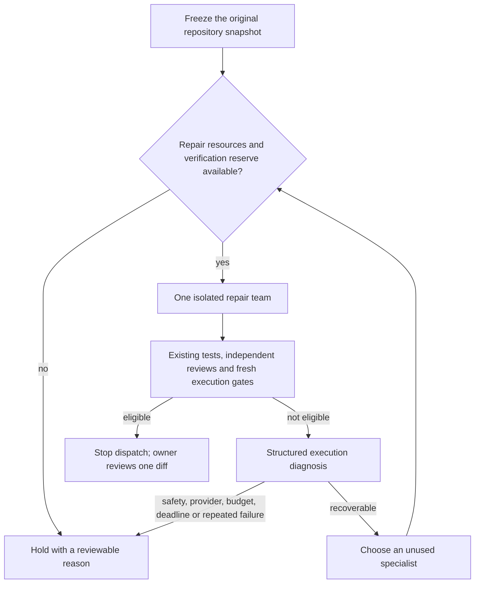

# Adaptive coding supervisor

The fixed repair tournament explores several fixes whether a task needs them or not. The
adaptive supervisor starts with one minimal-change team and spends more inference only
when the first attempt leaves recoverable execution evidence. It is an opt-in controller
around the existing verified-PR pipeline, not another model that votes on correctness.

The [October 4 live audit](live-upgrade-audit-2026-10-04.md) attempted this actual
controller with Groq. The initial minimal team's analyst received a schema
rejection, diagnosis recorded `provider_error`, and the other teams were not
dispatched. This confirms a live fail-closed stop, not successful boundary or
compatibility specialists or a measured adaptive repair improvement. Scripted
controls below remain a separate evidence level.



Each attempt branches from the original frozen snapshot. A specialist does not inherit
the previous team's edits. Only a trusted diagnosis category crosses branches; raw failing
logs and losing patches are not inserted into peer instructions. The candidate still has
to pass the same independent challenge, optional behavioral probes, fresh owner tests,
scope/security gates, and repository-integrity checks. Passing does not apply or merge a
patch: release remains behind owner approval.

## How escalation works

| Observed signal | Heuristic diagnosis | Next unused specialist |
|---|---|---|
| A failing production traceback points outside the patch | Wrong localization | Compatibility, then boundary |
| Owner assertions fail or behavioral probes disagree | Incomplete fix | Boundary, then defensive |
| Failed execution reports import or interface exceptions | Dependency or contract problem | Compatibility, then boundary |
| Owner tests passed on the baseline but fail after the patch | Regression | Defensive, then compatibility |
| Evidence is insufficient | Unknown | Boundary, then compatibility |
| Integrity/security failure, provider failure, budget exhaustion or timeout | Terminal hold | None |

These labels are deliberately conservative heuristics, not independently verified root
causes. In particular, an import failure can mean a bad import rather than a missing
package. The compatibility team must investigate without network access; the controller
does not install dependencies or expand its authority. Repository text cannot directly
name an agent or override the dispatch policy.

Repeating the same diagnosis, signals, owner-command fingerprint and patch fingerprint
twice stops further attempts by default. Different failures can reach another specialist,
but the configured maximum number of teams remains a hard bound. Once a candidate is
eligible, future branches are not started. There are no speculative adaptive branches to
cancel; caller cancellation cancels the active attempt and waits for cleanup. A deadline
or cleanup failure cannot produce a publishable winner.

## Resource contract

The adaptive policy reserves one logical model call and 4,096 approximate prompt tokens
for the final independent challenger. Repair calls cannot consume this headroom. The
controller also shortens each repair attempt's deadline by 30 seconds for challenge and
fresh execution. These are minimum reservations, not a guarantee that every oversized
patch or slow test suite fits: final verification still fails closed under hard limits.

All attempts share the tournament's call/prompt limits and fixed per-team write quotas.
The reserve is not a dollar budget. Prompt estimates omit schema overhead and output;
hidden provider SDK retries are not counted as separate logical calls. Cleanup of a
blocking operation can outlast its deadline, because cancellation cannot stop its thread.

Reported input/output tokens include every dispatched branch and challenge. Reports record
how many logical calls returned usable provider usage. Missing usage is explicit; zero
tokens are not presented as free inference. Benchmark dollar comparisons require complete
usage and configured input/output prices in both arms. Estimates are not billing receipts.

## Enable deliberately

The default remains `CODE_AGENT_WORKFLOW=verified_pr`. On an operator-controlled,
Docker-capable worker, select:

```dotenv
CODE_AGENT_WORKFLOW=adaptive_supervisor
CODE_TOURNAMENT_CANDIDATES=3
CODE_TOURNAMENT_MAX_MODEL_CALLS=64
CODE_TOURNAMENT_PROMPT_TOKEN_BUDGET=100000
CODE_ADAPTIVE_DISPATCH_POLICY_JSON={"verification_model_calls":1,"verification_prompt_tokens":4096,"verification_seconds":30,"repeated_failure_limit":2}
```

The environment builder forces sequential dispatch (`max_parallel=1`). Explicit benchmark
policies must declare it themselves. An optional fourth slot permits all three specialist
perspectives after the minimal team. Optional regression/oracle policies retain their
existing pre-dispatch gates and private-reference boundary.

## Compare it honestly

Run the credential-free controls with a fresh output path:

```bash
python -m evals.adaptive_supervisor_evaluation --output data/evaluations/adaptive-supervisor/my-controls-v1.json
python -m code_agent.benchmark_release validate evals/experiments/adaptive_supervisor_matrix.json
```

Seven authored scenarios compare verified PR, the fixed three-team tournament, and adaptive
dispatch. They exercise successful early exit, escalation, unsafe attempts, provider
failure, challenge veto, deadline and budget exhaustion. They use scripted models and
authored command outcomes: no provider, Docker or fixture-code host execution. A control
pass remains `held`; `--require-gate` cannot promote these controls.

The checked-in matrix locks the same five smoke tasks for all three workflows. For a real
study, prepare a separate development pilot, freeze the policy, and lock independently
reviewed held-out tasks before executing the matrix. Set current provider prices and
operator-approved repository images. Provider calls can incur charges and are not run by CI.

```bash
python -m code_agent.benchmark_release run evals/experiments/adaptive_supervisor_matrix.json
```

The existing release reports resolution, regressions, paired outcome uncertainty, latency,
logical model calls, token usage and cost per resolved task. Infrastructure failures remain
in the denominator. Missing usage/prices make cost comparisons unavailable; ranking then
omits cost. The fixed and adaptive arms share global call/write limits, not equal per-team
compute; verified PR has its own iteration limits and no extra challenger. Report these
differences alongside results. Use independent official evaluation before claiming an
official SWE-bench score. No live-model improvement has been measured in this iteration.

Final-result regression rate and observed candidate regressions are separate fields: a
losing patch can regress a passing baseline even when the selected patch is safe. Candidate
counts cover returned execution evidence, not unknown outcomes from aborted attempts.

The owner dossier includes dispatch triggers, heuristic diagnoses, skipped branches,
stopping reason, usage coverage and the selected candidate. Fingerprints detect changed
receipts and semantic checks reject inconsistent schedules; they do not attest that an
external container actually executed the tests.

The optional [reviewed dispatch advisor](reviewed-dispatch-learning.md) exports coarse,
label-free snapshots, learns from separate reviews, and compares recommendations in
non-serving shadow mode. It does not replace this heuristic or change resource gates.
