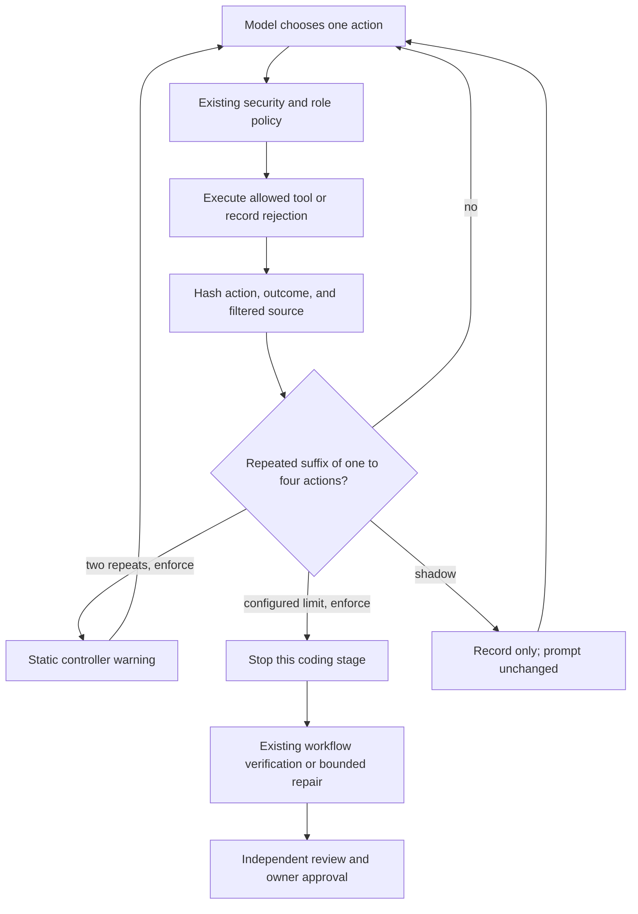

# Cycle-aware coding agents

An agent can spend its whole budget rereading a file, rerunning the same failing
test, or switching a patch between two states. More inference does not necessarily
help. This controller makes those short, repeated tool/source cycles visible and
offers a bounded way to stop a coding stage while leaving verification intact.



## What counts as a cycle

After each nonterminal action, the guard hashes its effective arguments, success
flag, bounded tool output, and current filtered file manifest. Test events also
include exit status and timeout state. A write hashes its content; a search hashes
its pattern. Model rationale, unused arguments, iteration numbers, and measured
duration are excluded. Only pytest's terminal timing summary is normalized;
assertion values, failing test names, and other output are retained in the digest.

The controller checks the shortest repeated suffix, up to four actions long.
Three identical cycles stop a stage by default; a two-action cycle therefore
needs six action executions. Full source digests allow `A → B → A → B → A → B`
edit oscillation to be detected. The same failure after genuinely distinct edits
is not enough to stop. Neither a matching failure message nor a repeated diagnosis
alone is considered proof that the agent cannot succeed.

Source is hashed afresh within existing file/repository bounds. If a manifest is
unavailable or exceeds limits, history and warning context are cleared and an
abstention receipt is recorded. The guard does not interpret missing evidence as
stagnation. It never imports repository code, changes files, starts containers, or
makes additional model calls. Cancellation waits for its active hashing operation
before workspace cleanup.

## Start in shadow mode

```dotenv
CODE_AGENT_LOOP_GUARD_MODE=shadow
CODE_AGENT_LOOP_GUARD_REPETITION_LIMIT=3
CODE_AGENT_LOOP_GUARD_MAX_CYCLE_LENGTH=4
```

Restart API and worker after configuration changes. Modes are:

- `off` (default): no controller hashing, receipts, or warning.
- `shadow`: record warning-level and limit detections without changing prompts or
  terminating the stage. Hashing still adds latency and can affect existing deadlines.
- `enforce`: add a fixed system-level controller warning after two cycles and stop
  the stage at the configured limit. Warnings contain no repository text or model rationale.

The repeat limit is bounded to three through five; maximum cycle length is one
through four. History contains at most twenty event digests. Receipts are bounded
by the existing stage iteration limit; equivalent rotated cycles can yield more
than one warning/limit record, so receipt counts are not unique-loop counts.

All coding workflows support this policy. Each implementation, test-author, or
repair stage has its own history. A stage stop returns `failed`, not `completed`.
The verified-PR controller can still verify an already useful patch or perform its
ordinary bounded repair; it does not accept or reject the whole issue solely from
a loop detection. Tests, security gates, independent review, write/call budgets,
and human approval are unchanged. No stopped branch is automatically retried with
new permissions or a new budget.

## Evidence you can review

`CodeAgentResult.loop_guard` retains mode, stage/iteration, disposition/reason,
configured limits, cycle length/repetitions, source digest, the repeated event
digest witness, and a fingerprint. `valid_loop_receipt` checks seal and witness
self-consistency. It does not authenticate tool outcomes or prove correctness.
Receipts omit raw paths, file contents, queries, and logs; ordinary trajectories
retain their existing privacy risks. PR dossiers expose JSON evidence and a short
Markdown summary.

Verified-PR results aggregate all retained stage receipts. Tournament results
aggregate completed branch receipts, including losing teams, and bind/reseal each
with its controller-assigned candidate ID. Timed-out branches without returned
results do not have reconstructed receipts. Benchmark outcomes, checkpoints,
reports, and release cards preserve `loop_guard_status_counts` across resume.
These are detection counts in each case's latest retained outcome, not saved
calls, discarded-attempt history, unique loops, or a repair-quality metric.

## Compare before enforcing broadly

```bash
python -m evals.loop_guard_evaluation --output data/evaluations/loop-guard/controls.json
python -m code_agent.benchmark_release validate evals/experiments/loop_guard_matrix.json
```

Eight authored scenarios run the actual coding loop with a scripted action model,
static owner-command outcomes, and real confined workspace files. They cover
repeated reads, read/search cycles, edit oscillation, repeated failing tests,
policy rejections, distinct edits, repeated failures on distinct source, and
escaping after a warning. No fixture code executes on the host and no provider or
Docker is involved. All eight controls pass. The repeated-read control uses three
action calls with enforcement versus twelve without it; that is a scripted
control result, not real-model cost savings or demonstrated success on user issues.

The frozen five-task matrix holds model, workflow, retrieval, and tasks constant
while comparing `off`, `shadow`, and `enforce`. A provider/Docker-capable operator
can run an explicitly billable study:

```bash
python -m code_agent.benchmark_release run evals/experiments/loop_guard_matrix.json
```

The standalone coding evaluation CLI also accepts `--loop-guard shadow` or
`--loop-guard enforce`. Compare resolution, regressions, all logical calls,
latency, and cost per resolved issue—not just how often the guard stopped.
Missing provider usage and unconfigured prices remain unavailable, not free.
Development tuning should use separate tasks before a frozen held-out comparison.

## Local verification — October 4, 2026

The affected suite passed 427 tests with seven skips on Python 3.13 and 422 with
twelve skips on Python 3.11. An additional security/retrieval/dispatch/service
suite passed 137 tests on Python 3.13. The focused controller/checkpoint suite
passed 55 tests with 100% combined statement/branch coverage of the new controller
(70 statements and 24 branches). It covers enforcement, shadow prompt equivalence
apart from independently measured durations, source-change discrimination, policy
rejections, source-hash abstention, receipt tampering, verified-PR re-verification,
losing-team aggregation, dossier/release reporting, and checkpoint resume.

The eight scripted comparisons passed, and the three-arm/five-task matrix
validated as frozen. Docker-dependent tests were skipped because the engine/image
was unavailable; a Windows directory-symlink check also skipped. Python 3.11
additionally skips five earlier spectrum-harness cases whose isolated interpreter
lacks Coverage.py. No paid inference or live-container benchmark was run.

Source-bound fusion training reproduces exactly on Python 3.11 and 3.13. The
refreshed learned candidate's five-query NDCG@8 `0.9433` remains below the
fixed-weight baseline `0.9594`, so promotion is held. Improved pairwise training
accuracy (`90.91%`, 44 pairs) does not override held-out evidence or activate it.

## Limits

Repeated observation is sometimes deliberate: diagnosing flakiness, validating
stateful services, or thinking through the same code. Enforcement can stop a repair
that would have succeeded on its next call. Shadow mode is the starting point,
not deployment approval. Cycles longer than the cap, noisy outputs, non-periodic
stagnation, and continually different but useless edits can evade detection.
Source snapshots cover the filtered copy view, not external state, hidden files,
planner thoughts, or all runtime resources. Bounded outputs may omit differences.
The guard is a cost-control heuristic, not a security boundary or semantic
progress detector. Hashing adds work, and stopping one stage can cause later
repair stages; total workflow inference might increase. No live-model improvement
is claimed by this upgrade.
