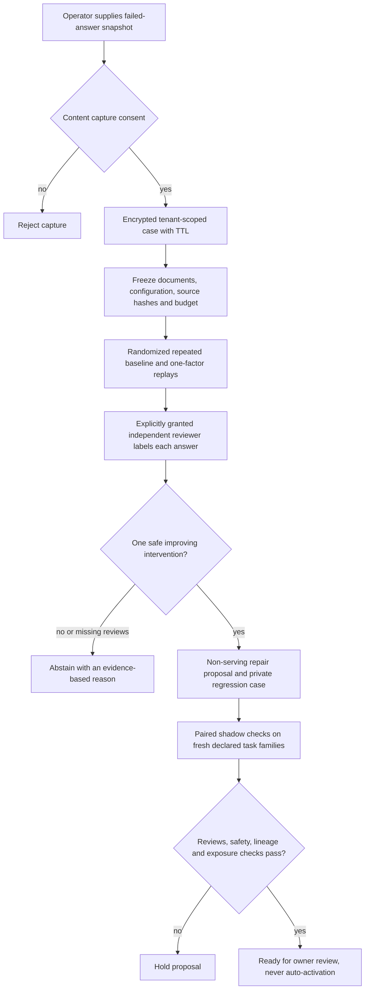

# Investigate a bad AI answer before changing the system

An incorrect answer does not tell you which component failed. Retrieval might
miss the relevant document, reranking might bury it, packing might remove the
important sentence, or generation might ignore evidence that was present.

This opt-in workflow preserves an explicitly consented reproduction snapshot,
compares one component change at a time, and asks an independent reviewer to
judge the resulting answers. It proposes a configuration change only when one
tested intervention consistently fixes a reproduced failure without unsafe
outcomes. Otherwise it abstains. Nothing automatically changes serving, edits
application code, opens a PR, or deploys a model.



## Manual snapshot adapter

The [runtime RAG integration](runtime-rag-investigation.md) additionally supports
automatic consented `/invoke` and SSE capture, production BM25/RRF/formatting helpers,
leased workers, and frozen paired family reports. The manual adapter below remains
available for operator-supplied cases.

The adapter accepts a bounded document snapshot, captured retrieval/ranking IDs,
the query and observed answer, prompt, model identifier, application revision,
and pipeline configuration. Document content must match its declared SHA-256.
The snapshot adapter supports these specific alternatives:

| Component | Captured/baseline behavior | Alternative under test |
|---|---|---|
| Retrieval | Captured document-ID pool | Query-term-overlap retrieval over the frozen snapshot |
| Reranking | Captured ranking | Query-term-overlap reranking within the same retrieved pool |
| Packing | Prefix truncation | Query-relevant line window, including its following line |
| Generation | Captured prompt | A fixed evidence-only/cite-or-abstain instruction |

If the baseline already uses an alternative, that arm tests the other supported
choice. All other configuration fields stay fixed. These are concrete snapshot
adapter operations, not replacements for every production vector database or
reranker. Lexical overlap here is not neural semantic retrieval or BM25. The
application's existing research retrieval stack remains unchanged.

There is no automatic extraction of arbitrary production traces. Manual cases
require an operator snapshot; runtime capture is limited to supported local-RAG
requests. Public capture rejects client assertions
of `runtime` origin; external inputs use `operator` or `synthetic`. Application
revision and family declarations remain operator attestations. A replay that
improves an answer is conditional evidence about this snapshot, not proof of a
universal root cause or identical reproduction of proprietary model weights.

## Budget and failure behavior

A normal case preregisters five arms and two repeats: ten calls. A shadow case
uses the frozen baseline and candidate, with two repeats each. Order is randomized
in complete repeat blocks using the captured seed; results are not reordered
after observation. Requests, output caps, timeouts and conservative byte-based
input reservations are checked before admission. A case that cannot fit its
declared budget or remaining TTL makes no calls.

The live adapter uses the explicit provider identifier from capture, for example
`groq:<account-supported-model-id>` or `openai:<account-supported-model-id>`.
It uses schema-validated function calls and disables SDK retries. The first failed
trial stops all remaining branches. Admission is stored before inference;
interrupted/unknown-usage cases cannot be silently rerun. Missing provider usage
stays missing, not a zero-cost estimate. These are per-case request/reservation
limits, **not a dollar ceiling or a guarantee of Free-plan billing**. Configure
account limits separately before authorizing live requests.

Private live replays suppress inherited LangSmith tracing for their model calls.
Ordinary reports retain fingerprints and usage counters, not raw reproduction
content. Provider-side retention still follows the provider's account policy;
encryption here does not make sending private material to a provider anonymous.

Adapter source hashes and installed provider/schema-library versions are bound
at capture and checked before admission. Install dependencies before capturing
a live study. Changing the adapter or installing a different provider version
requires a newly declared case; it is not an unnoticed resume of the old study.

## Reviews and repair proposals

The owner explicitly grants a different authenticated account access to the
private reproduction content. Each review binds one immutable completed trial
fingerprint and records `correct`, `incorrect`, or `ambiguous`, a safety verdict,
and a rationale. Neither the owner nor an LLM automatically supplies independent
labels. Different account identities do not prove different human reviewers;
organizations still need reviewer governance.

Both baseline repeats must be reviewed incorrect. Exactly one intervention must
be correct and safe on every repeat. Missing or ambiguous labels, an unreproduced
failure, multiple improving interventions, unsafe outcomes, or an incomplete run
withhold the diagnosis. A synthetic origin or extractive-control execution can
exercise these mechanics but cannot produce a live repair recommendation.

A proposal contains a single configuration-field change and its source/plan
lineage. The owner can export a private regression-case artifact, but its reviewed
labels are not a machine-readable universal correctness oracle. Golden answers
or organization-specific independent graders require additional review.

Shadow cases must keep the same model, prompt, application revision, base policy,
protocol, and candidate while using different declared families. Exact duplicate
query/document snapshots are rejected even under a new family name. Exposure
records survive child deletion, so deleting a failed or expired case cannot turn
an incomplete comparison green. Semantic duplication and honest family assignment
still require operator review; this is not an automatic contamination detector.

The shadow gate requires at least three declared fresh families, complete
independent reviews, safe/correct candidate repeats, no paired regressions, and
unchanged candidate lineage. Every registered case counts; missing/deleted
evidence holds the gate. Passing only means `ready_for_owner_review`. Three
families are a small engineering check, not statistical non-inferiority or a
production release approval. Reviewer revocation also withholds dependent results.

## Private storage and configuration

This is separate from the existing content-free telemetry. Query, passages,
prompts, answers and rationales are encrypted in the private SQLite store using
AES-GCM, fresh random nonces, and authenticated tenant/case/expiry metadata.
The encryption subkey is derived separately from the configured master key.
Principal and exposure identifiers are keyed hashes. The implementation follows
the [cryptography AEAD API](https://cryptography.io/en/46.0.3/hazmat/primitives/aead/).
At-rest encryption does not protect against a compromised application process,
stolen keys, unauthorized backups, or sensitive content a user deliberately shares.

Ordinary reports contain configuration, counters, decisions and fingerprints,
not raw prompts, answers or document text. Private review and regression-export
endpoints deliberately contain sensitive data and require owner/granted access.
Known credential patterns are rejected at capture, but this is not comprehensive
PII anonymization or an organization-specific DLP policy.

```dotenv
INCIDENT_INVESTIGATION_ENABLED=true
INCIDENT_LIVE_REPLAY_ENABLED=false
INCIDENT_DB_PATH=data/incidents/private.db
INCIDENT_ENCRYPTION_KEY=<private random 32-byte key encoded as 64 hex characters>
```

Generate the key privately, store it through your ignored environment or secret
manager, and never paste it in chat. Do not reuse a provider key, user-auth secret,
or an example/test key. Keys are not automatically written by the application.
Changing the key without a migration makes old cases undecryptable; it is not an
implemented key-rotation strategy. The default path and `.env` are Git-ignored;
custom private paths need their own ignore rules and filesystem permissions.

Capture requires explicit consent and a TTL between one minute and seven days.
Expired cases are inaccessible immediately. Capture purges expired rows, and
`IncidentStore.purge_expired()` is also available for operator maintenance. No
background purge scheduler is installed. Deletion is logical SQLite deletion;
external backups and secure erasure need separate retention controls. Deleting a
parent deletes its child content; its content-free exposure history expires on
the parent retention deadline. Disabling capture/live replay does not discard data.

## API journey

All endpoints require authenticated user mode, even if ordinary application
authentication is disabled. The entire feature is off by default.

1. `POST /investigations` with `bundle`, `consent: true`, optional `plan`, and TTL.
2. `POST /investigations/{id}/run` with `execution: "extractive_control"` for plumbing,
   or `execution: "live_provider"` plus `authorize_provider_requests: true` after
   enabling live replay and configuring provider limits privately. This returns
   202 with a durable queued job; start `python -m agent.incident_worker` separately.
3. `POST /investigations/{id}/reviewers` with the reviewer ID and
   `consent_to_share_content: true`. This grants access to private query/evidence.
4. The granted reviewer reads `GET /investigations/{id}/private-review-bundle`
   and submits per-trial `POST /investigations/{id}/reviews`.
5. The owner reads `GET /investigations/{id}` and exports the private
   `GET /investigations/{id}/regression-case` when appropriate.
6. Create shadow cases using the supported parent case's `parent_id`, then run
   and independently review them. Read `GET /investigations/{id}/shadow-gate`.
7. Revoke sharing with `POST /investigations/{id}/reviewers/revoke`, or delete a
   case using `DELETE /investigations/{id}`. Revocation preserves immutable labels
   but withholds their use; it does not recall content a reviewer already downloaded.

API-submitted replay requests now run behind a leased worker. Poll ordinary case
reports for job state, or `POST /investigations/{id}/cancel` to stop work. Cancellation
and lost leases are fail-closed, not transparent resumption. There is no model/tool
permission to apply proposed repairs or access another tenant's content.

## Run the controlled study

```bash
python -m evals.incident_investigation_evaluation --output data/evaluations/incident-investigation/my-controls.json
python -m pytest -q tests/test_incident_investigation.py tests/test_incident_api.py tests/test_targeted_delivery.py
```

The authored study contains retrieval-miss, reranking-loss, packing-loss,
already-correct baseline, and absent-answer snapshots. It runs actual snapshot
transformations and a deterministic extractive generator. Its exact-fact labels
are simulated assertions, not human reviews. Reports explicitly mark zero live
provider calls, no measured live diagnosis accuracy, and no measured production
impact. CI runs and uploads this provider-free control report.

This upgrade also completes the earlier coding integration:

- `read_lines` returns bounded source and a byte hash; `edit` requires an observed
  current hash and one exact, unique block. Stale, ambiguous, overlapping, no-op,
  protected-path and out-of-workspace edits are rejected. Publication is atomic.
- API/worker defaults enable targeted mode, specialist completion, and fresh
  delivery verification. Programmatic `SandboxPolicy` defaults remain compatible
  with earlier authored controls; explicitly enable these controls in experiments.
- Fresh delivery copies the original repository again, safely applies exact diff
  bytes, compares the replayed candidate manifest, executes owner tests in Docker,
  and verifies source preservation. No generated repository code executes on the
  host. Unsupported patch paths/formats and unavailable Docker hold completion.
- Explicit provider routing recognizes `groq:<model>` and `openai:<model>`, with
  validated original tool-call arguments, bounded outputs/timeouts and zero SDK
  retries. The same provider identity is used by telemetry. Invalid schemas are
  terminal failures, not guessed/defaulted required fields.
- Reports now record which specialist stages completed. Required incomplete
  stages cannot be presented as a completed verified-PR team.

## Validation and honest next evidence

The October 14 verification receipts are under the ignored
`data/evaluations/incident-20261014/` directory. These are local Python 3.13 checks,
not a new whole-repository or GitHub Actions run:

| Check | Observed result | Receipt |
|---|---|---|
| Final affected integration suite, real Docker available | 323 passed, zero skips | `final-integration.xml` |
| Focused new-feature suite | 58 passed; selected seven-module statement/branch coverage 89% | `focused-final.xml`, `focused-coverage.xml` |
| Five authored incident cases | 5/5 controls passed; zero provider calls | `controls-final.json` |
| Scripted analyst/implementer/test-author/reviewer | All four stages completed; seven scripted invocations | `scripted-docker-workflow-v2.json` |
| Exact patch in a fresh container | Apply and owner tests exit 0; candidate, protected files and original preserved | Same scripted workflow receipt |
| Retrieval retraining and exact reproduction | All three commands exit 0 under a prospective source index; actual index unchanged | `retrieval-refresh-receipt.json` |
| Retrieval holdout | Candidate NDCG 0.9433 below baseline 0.9594; promotion rejected | Checked-in fusion holdout report |
| Private-data and documentation checks | Configured secret values absent from versionable files/new audit artifacts; private paths ignored; local links valid | `private-data-safety.json` |

The integration suite covers authenticated capture, tenant isolation, explicit
sharing, independent reviews, revocation, expiry, deletion, budget holds, interrupted
runs, source drift, ambiguous diagnoses, unsafe shadow outcomes, exact edits,
provider adapter contracts, specialist completion and fresh patch verification.
The live adapter and positive shadow-gate tests use clearly labelled test doubles,
not real provider inference or human judgments. The existing coverage-capable
Docker audit image was used without replacing the user's original image.

Earlier failed authoring runs and environment failures are retained alongside
their rechecks. Read the latest receipt rather than adding overlapping suite
totals. Current controlled and API tests do not establish live provider reliability,
real-user diagnostic accuracy, or a reduction in incident resolution time.

The initial native pytest-cov attempt crashed during Windows imports; the focused
coverage recheck used Coverage.py's pure-Python tracer (`--timid`) and passed.
One restricted-process standalone control rerun stalled and was stopped after
checking its exact process identity; the separate unrestricted rerun passed all
five controls. These were local execution failures, not successful first attempts.

The next genuine study needs privately configured, budget-approved live inference,
consented incidents, independently reviewed labels, declared fresh-family shadow
cases, and operator acceptance. Evaluate diagnosis quality, abstention, repair
success, regressions, latency, reported usage completeness, and reviewer effort.
A successful synthetic control does not establish improved production outcomes.
