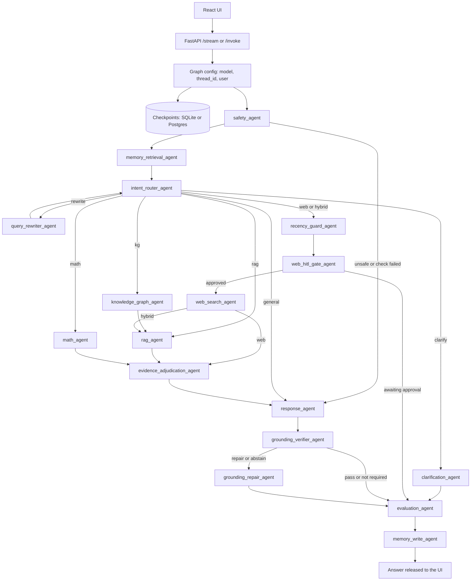

# Agent Runtime Flow

How one question moves through CiteRight (`agent/research_assistant.py`, `service/service.py`,
`frontend/src/Research.tsx`).

## Notes

- Safety runs first and fails closed: if the moderation call errors, the request is refused.
- Web searches pause the graph with a native LangGraph interrupt. The UI shows Approve/Reject; the
  service resumes the same checkpoint, so approval survives an API restart.
- Evidence quality and grounding verification are switched on with `EVIDENCE_QUALITY_ENABLED` and
  `GROUNDING_VERIFICATION_ENABLED`. When they are off, the graph skips those nodes and the response
  streams token by token.
- With grounding on, `response_agent` streams each sentence only after its claims and citation URLs
  are checked against the evidence for this route. `grounding_verifier_agent` then verifies the
  whole draft and releases it, removes unsupported or contradicted claims, or abstains. See
  [grounding-verification.md](../grounding-verification.md).
- Memory is opt-in (`AGENT_MEMORY_ENABLED`). Recalled memory is tenant-scoped, token-bounded and
  passed to the model as untrusted data.
- `rag_agent` reads the local document index (`chroma_db`); `knowledge_graph_agent` reads the graph
  index (`graph_chroma_db`). Ingest with the scripts in `scripts/ingestion/`.
- A `local:` prefix forces local retrieval instead of the web.
- Conversations and approval decisions are stored per user (`/store/threads`, `hitl_events`).
