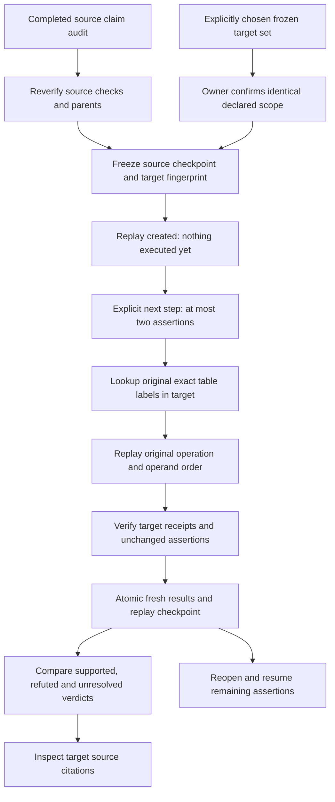

# Recheck the same claims when the evidence changes

A saved audit is a statement about a particular evidence set. Uploading a newer
report should not silently make yesterday's supported claim look current.
Workbench 0.6 adds an explicit replay: keep the assertions fixed, choose another
frozen evidence set, rerun the original fact/calculation recipes, and inspect
what changed.

The workflow reuses SDK 0.8's numeric verifier. It does not add a new model,
infer that two reports describe comparable facts, or turn a verdict transition
into proof that an answer improved.

## A practical walkthrough

Start with the [Document Workbench](document-workbench.md), create a
[frozen evidence set](document-workbench-reconciliation.md), then complete a
[numeric claim audit](numeric-claim-audits.md). The document runtime remains
operator-disabled by default. No provider key or model-request consent is needed
for this local workflow.

For example, two reports show Requests of 100 then 125. Save the facts and a
percent-change calculation, then check an assertion of `25` with unit `%`.
The source audit records support for that numeric assertion.

Upload the replacement reports and create a **new** frozen evidence set. In the
completed source audit, open **Replay against changed evidence**. Choose the
target set, inspect its versions and declared scope, and explicitly confirm
comparability. Both sets must declare the exact same entity, reporting period,
metric definition, units and scale. A different quarter needs its own intentional
audit, not an implicit carry-over of assertions.

Choose **Create audit replay**. This freezes the source audit checkpoint and
target collection fingerprint; it does not look up facts, run calculations or
advance work. Then choose **Replay next two claims**. Each step reuses the original
literal row/column labels, operation and operand order, checks the fresh receipts,
and persists target results with progress in one transaction.

If the replacement reports show 100 then 150, growth is now 50%. The unchanged
25% assertion becomes refuted and the comparison shows **support_lost**. The
application does not edit the assertion to 50%, rewrite the old audit, transfer
an old owner review or choose a winner when reports disagree. Missing, held or
ambiguous evidence can make the new assertion unresolved instead.

Navigate away or restart the backend, then reopen the saved replay to resume.
After an uncertain response, refresh before retrying. Stale step fingerprints
are rejected. There are no automatic advances, background polling workers,
provider calls or mutation retries in this workflow.

## Read the comparison conservatively

The report shows the old verdict/value, new verdict/value, unchanged assertion,
and target citations. Citation navigation uses the application version ID, even
when linked versions share a logical SDK document ID. Values are shown only when
the underlying evidence released them; a missing value is never interpreted as
zero. The original audit above the replay retains its original source citations.

| Transition | Meaning for this fixed assertion |
| --- | --- |
| `support_lost` | Supported before; refuted or unresolved on the target |
| `new_support` | Refuted or unresolved before; supported on the target |
| `became_unresolved` | Refuted before; target evidence cannot resolve it |
| `new_refutation` | Unresolved before; target evidence now contradicts the number |
| `unchanged_verdict` | Same verdict category; the observed number can still differ |

Observed-value change is unknown when either side has no released value. These
categories do not measure semantic answer quality, transcription accuracy or
publisher truth. Scope confirmation is an owner assertion, not machine-verified
comparability. Display labels remain descriptive, not parsed or entailed.

“Replay complete” means all selected assertions were rechecked. The all-supported
summary additionally requires support for every target assertion. Partial results
remain explicitly partial; no success is inferred for unchecked work. No replay
outcome grants patch access or permission to release an AI answer.

## Persistence and budgets

Migration adds one private SQLite table and index. The original files, manifests,
source audit, checks and reviews are not rewritten. Target facts/calculations
are normal saved receipts, deduplicated with the existing reconciliation workflow;
they can be inspected independently, with no owner review copied across.

- A source audit must be complete and currently verifiable. Existing audits hold
  at most ten assertions. Both source and target must be owned by the caller.
- At most two assertions per explicit step, twenty replay reports per owner and
  one hundred per library. Identical creation retries return the same report,
  including when its owner is at quota.
- A preflight count bounds distinct target fact queries plus calculations to
  twenty. Existing target results also consume its twenty-result capacity.
- Replay checkpoints are capped at 150 KB and returned reports at 3 MB. Existing
  source, parser and per-result byte limits remain in force.
- SQLite serializes advancement. If a step hits a target-result or checkpoint
  limit, the entire step rolls back, including its fresh target results. Earlier
  completed steps remain visible; the report is not marked complete.

If a target is full, use an intentionally smaller source audit or a fresh evidence
set. The application does not delete existing evidence to make room. Row/column
renames are not guessed or fuzzily aligned; an unavailable literal fact abstains.
This is not the separate extraction-region alignment used by version revalidation.

Deleting a replay report preserves its saved target results, source audit and
documents. Deleting a source audit or target set removes dependent replay reports;
deleting the source audit does not remove target results. The confirmation text
states this relationship. This is bounded local persistence, not immutable
archival storage or an erasure guarantee for exports, snapshots and backups.

## API and verification

Routes sit under
`/workbench/documents/reconciliations/{source_set}/audits/{audit}/replays`.
They require verified owner authentication, reject extra JSON fields, use no-store
responses and do not echo private input in validation errors.

| Method and suffix | Purpose |
| --- | --- |
| `GET /` | Minimal owned replay history for a completed audit |
| `POST /` | Freeze target, source checkpoint and comparability attestation |
| `GET /{replay}` | Reverified progress, before/after checks and target citations |
| `POST /{replay}/advance` | Explicit next step with expected checkpoint fingerprint |
| `DELETE /{replay}` | Remove the replay report only |

The root has no trailing slash. Clients cannot provide claim overrides, numeric
values, replacement receipts, expressions, operations or tool commands. Reopened
reports recheck source/target contexts, parent digests, target recipe identity
and SDK claim-check receipts. Digests are change detectors, not signatures or
authentication against a malicious database administrator.

Authored controls cover unchanged assertions, all verdict transitions, missing/
held/conflicting targets, noncommutative operand order, restart/resume, stale and
concurrent steps, cross-owner/cross-set IDs, strict scope confirmation, quotas,
rollback and cascade behavior. A forged link to another otherwise valid fact is
rejected if its literal recipe differs.

The actual integration extracts four authored PDFs: two source reports show 125;
two linked replacements show 150 with their tables moved to page two. A saved
25% growth assertion must change from supported to refuted, cite the new physical
page and preserve the old logical-document lineage. This is an integration
control, not a held-out document-quality or live-model benchmark. Local evidence
is private under `data/evaluations/workbench-claim-replay-20261018/`.

The October 18 final local run passed **38 frontend tests**, **132 affected backend
tests**, and **269 SDK regressions**. Four host-Tesseract checks skipped; English
OCR passed in Docker. Typechecking, production build, Prettier, scoped Ruff,
Compose validation and the non-root, read-only static Nginx HTTP smoke passed.
The replacement table PNG was inspected and showed readable headers and values
100/150 on physical page two.

The first aggregate run passed 131 tests but failed the new integration's initial
PDF extraction. That attempt did not capture a runtime error code, so its cause
remains unconfirmed. A diagnostic isolated rerun and then all 132 tests passed.
No automatic production retry, timeout relaxation or parser-limit change was
introduced to conceal the failure; extraction failures remain visible records.

The source-bound retrieval snapshot was refreshed against a temporary prospective
public-source index. Exact reproduction and the unchanged strict regression-gate
test passed, with the real Git index untouched. Baseline/candidate NDCG remains
0.9594/0.9229 on five queries, so promotion stays rejected and serving keeps the
fixed baseline. These metrics do not measure claim-verification accuracy. Run the
normal exact check after intentionally tracking the new source files.

Configured-secret-value scanning found no matches in public source or built
assets, no private versionable paths and no broken relative Markdown links.
This does not certify all possible secrets or the Git history. No Git staging,
commit, push, cloud publication or provider call was performed in this iteration.

Verification covered authored claim replay, component interactions, builds,
HTTP behavior and rendered source PNGs. It made no live provider calls.
