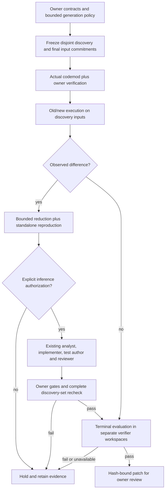

# Find the input that breaks the migration

The frozen comparison runner now has [arm-boundary recovery](crash-safe-migration-studies.md).
New studies use numbered attempt directories and a private checkpoint; completed
holds are not retried, and uncertain requests remain reserved. Earlier results
below describe their original, non-resumable runs.

UpgradePilot originally checked the examples an owner wrote down. That leaves a
familiar gap: the example with an integer passes, while a numeric string or a
fractional number behaves differently after the dependency upgrade.

The optional counterexample workflow explores those gaps, supplies reproducible
failures to the existing repair team, and evaluates the finished patch on inputs
that were not supplied to the team. It reuses the pinned Pydantic profile, codemod,
offline Docker boundary and owner-approval rules from [UpgradePilot](upgradepilot.md).



There is no repair edge out of final evaluation. A failed final gate withholds the
patch. It is not fed back into another attempt within that campaign.

## What is generated

The optional [schema-guided profile](schema-guided-migration.md) can discover
nested input shapes that owner examples never showed. It uses a separately
attested Docker probe and source-schema-bound campaigns; the example-only mode
described here remains the default.

The versioned `json-boundaries-stratified-v1` generator changes one location in a
JSON call at a time. It explores missing keys, nulls, booleans, integer and
fractional values, numeric strings, Unicode, empty strings, lists, nested values
and unexpected keys. It preserves existing alias names found in owner examples.
It does not import application code on the host, ask an LLM to invent executable
tests, infer arbitrary model schemas, or perform exhaustive Hypothesis-style search.

The default campaign has 24 discovery and 16 final cases. Sampling is deterministic
and stratified by input shape/type without looking at execution outcomes. Original
owner inputs are excluded, and the two generated sets cannot overlap. Generation
uses at most eight owner seeds, 64 traversed locations per seed and 512 attempted
variants per seed, with traversal depth capped at five. Insufficient distinct
inputs hold the run; duplicates never inflate the test count.

Both input sets and the generation policy are fingerprint-bound before inference.
Final input bodies stay in controller memory and disposable verification copies,
not the repair workspace, model messages or emitted patch. Their hashes are
retained in the private report. This is an operational separation, not a claim
that public deterministic generators are impossible to infer or that malicious
application code cannot recognize tests.

## Execute, reduce, then repair

Each input batch runs twice in fresh Python processes under each dependency
version. The same strict result parser checks JSON types, dependency identity,
case membership and result hashes. Import failures, timeouts, unstable observations,
serialization failures and source changes are unavailable evidence, not successful
regression detections. Docker stdout is explicitly decoded as UTF-8 on Windows.

For up to two discovered failures, the reducer tests at most 12 smaller inputs each.
It excludes owner inputs and all final inputs from that search. A chosen witness
is then reproduced alone under both versions, twice each, so an order-dependent
batch result cannot masquerade as a standalone example. Reports include input byte
sizes, exact results, search usage and the parent discovery case. The result is a
bounded reduction, **not a guarantee of a globally smallest counterexample**.

With explicit provider authorization, those inputs enter the existing repair
team's structured context. Source values remain in the private report rather than
being copied wholesale into prompts. One bounded team attempt is followed by owner
gates, a recheck of the entire discovery set, then terminal final evaluation. Model
admission reserves additional time for generated rechecks; time or usage exhaustion
holds the result. Existing per-call limits, token reservations, protected tests,
exact dependency updates and fresh patch replay still apply.

Old behavior is a reference, not a definition of correctness. An intentional
semantic change needs owner review and a new frozen recipe/campaign. Existing
exact owner waivers are not broadened to cover newly discovered inputs.

## Try it locally

Build the migration image as described in the base guide, then run:

```bash
python -m code_agent.upgrade_cli run --repository tests/fixtures/upgradepilot/union --spec tests/fixtures/upgradepilot/union/migration.json --counterexamples
```

Without an explicitly authorized provider this union example should hold, return
exit code 2, and preserve discovery evidence under ignored `data/upgradepilot/`.
Add `--counterexample-seed` to choose a different reproducible campaign. Changing
seeds after seeing final outcomes is tuning, not an independent final result.

The real-container authored comparison is:

```bash
python -m evals.upgrade_counterexample_evaluation --output data/evaluations/upgrade-counterexamples/my-controls.json
python -m pytest -q tests/test_upgrade_inputs.py tests/test_upgrade_study.py
```

It deliberately gives all arms only an ordinary integer owner contract. The same
frozen generated inputs then compare codemod-only, existing repair and discovery-
guided repair. A fourth, deliberately overfitted scripted repair must pass discovery
but fail final evaluation. Corrections and approvals are scripted and know the
authored task. This is one family, not a real-repository or live-model success rate.
CI runs the comparison and retains its report without making provider requests.

## Measured local verification: October 16, 2026

Host verification used Python 3.13.9, with application imports confined to the
existing pinned Python 3.11 Docker image. These are selected local checks, not a
whole-repository run or a GitHub CI result.

| Check | Observed result |
|---|---|
| New input/pilot tests and affected coding, security and provider regressions | 143 passed, zero failures or skips; 133.97 seconds |
| Real-container authored study | All four control expectations passed; one task family, no live model |
| Codemod-only and existing-repair arms | Owner gates passed but final evaluation found two regressions; both patches withheld |
| Discovery-guided scripted repair | Four discovery regressions detected; six scripted calls; discovery recheck and all 16 final cases preserved behavior |
| Deliberate overfit | Discovery recheck passed, final evaluation found two regressions, patch withheld without further repair |
| Bounded reduction | Both retained witnesses reproduced standalone; one reduced from 21 to 20 serialized input bytes, the other remained 21 bytes |
| Actual provider-free CLI | Discovery hold, saved report fingerprint verified, no diff emitted, original source unchanged |
| Evidence integrity | All four study report fingerprints and the accepted patch's final-evaluation hash binding checked |
| Static/privacy checks | Ruff, Python compilation and whitespace checks passed; no configured secret values found in 498 versionable files or new audit/run artifacts |

The input generator, isolated differential verifier and pilot runner have 82%
combined host statement/branch coverage in that selected suite. The real-container
study is additional execution evidence outside that coverage run; coverage is not
a migration-correctness score. Neither final case IDs nor final results entered
the scripted repair messages. This check does not establish adversarial secrecy.

Receipts are private under `data/evaluations/upgrade-counterexamples-20261016/`:
`final-selected.xml`, `controls-final.json`, and `private-data-safety.json`. Earlier
attempts remain under `data/evaluations/upgrade-counterexamples-20261015/`. The first
study found the Windows output-decoding bug and held correctly; it was fixed and
regression-tested. A later long-running attempt timed out in Docker, leaving two
held tests; the complete selected suite was rerun successfully once Docker was
responsive. Failed attempts are not relabeled as passing runs.

The refreshed retrieval artifact passed exact reproduction using a temporary
prospective public-source index, without changing the real index. Its five-query
quality gate still rejected promotion: NDCG remained `0.9433` versus baseline
`0.9594`, despite `88.64%` pairwise training accuracy on 44 pairs. Serving was not
changed. That refresh receipt is in the earlier counterexample directory; ordinary
Git-root reproduction requires the new public source files to be tracked, as
explained in [code intelligence](code-intelligence.md).

No live inference, real-repository migration, independent human review, automatic
activation, commit, push or external PR was part of this verification. The frozen
real-repository runner is implemented and tested with local authored snapshots;
its actual live pilot still requires selected repositories and a separately
approved provider/account budget.

Schema-aware tasks may now include a `schema_policy` beside their migration
`spec`. Such freezes execute schema extraction in disposable Docker copies;
"no inference" does not mean "no application execution." Source schemas and the
actual run's input commitment are rechecked before model admission. The earlier
143-test verification above predates this extension; see the schema guide for
its separate verification evidence.

## Prepare a real-repository pilot without inventing results

`code_agent.upgrade_study` freezes up to ten explicitly supplied local snapshots
under ignored `repositories/`. Each task requires an owner authorization assertion,
an upstream URL/commit, a bounded license file and identifier, and a migration
recipe. Upstream and license metadata are owner-attested, **not independently
verified permission or provenance**. Source and license hashes, resolved image IDs,
model identity, policy, input commitments and three comparison arms are frozen.

A request JSON contains `study_id`, `model`, `policy`, and `tasks`. Each task has
`task_id`, `repository` such as `repositories/my-snapshot`, `upstream_url`,
`upstream_commit`, `license_file`, `license_identifier`, `owner_authorized: true`,
and the full `spec` from the base guide. Freeze and run use separate commands:

```bash
python -m code_agent.upgrade_study freeze --manifest data/my-study-request.json --output-dir data/upgradepilot/my-frozen-study
# Later, only after inspecting the manifest and approving provider/account limits:
python -m code_agent.upgrade_study run --manifest data/upgradepilot/my-frozen-study/manifest.json --output-dir data/upgradepilot/my-pilot-results --authorize-provider
```

Freeze makes no inference calls. Run checks every snapshot before the first call
and at each arm admission. All arms use the same source, image, owner contracts,
generation policy, final cases and per-task budgets; discovery feedback alone is
enabled for the third arm. Failed attempts remain in the denominator. Reports
separate review-ready rate, final-case regressions, latency, calls and usage
completeness. Missing billing stays null, so cost per review-ready task is unavailable
without complete billed costs. Owner acceptance and production impact remain
unmeasured; a passing patch is not a resolved, maintainer-accepted issue.

The synchronous pilot now has [arm-boundary recovery](crash-safe-migration-studies.md).
Completed holds and successes are reused; saved receipts can be adopted, and an
unresolved interruption requires explicit retry while keeping its call reservation.
Unknown in-flight usage is not zero spend. No command clones repositories, installs application dependencies at
runtime, opens PRs, merges, deploys or edits original snapshots. Larger applications
still need an owner-built compatible image. No real-repository/live-model pilot is
claimed by the authored controls.
