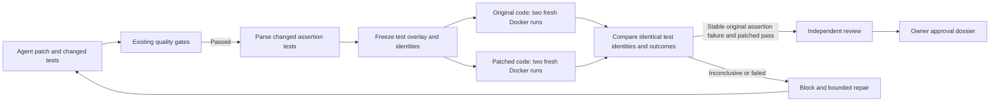

# Counterfactual regression verification

A coding agent can produce a correct-looking patch and a test that proves very
little. The ordinary test suite and independent reviewer remain essential, but
neither establishes that the agent's changed test actually detects the pre-fix
behavior. This opt-in gate asks a narrower, executable question: does the same
test fail on the original code and pass on the candidate?

It uses four fresh Docker copies, without additional model calls. Changed tests
are held constant; original and patched code each run twice. A stable assertion
failure in the changed test, followed by stable passing results on the patch,
provides regression evidence. Exceptions, collection failures, skips, flaky
outcomes, and unrelated unchanged tests do not satisfy the gate.



## Enable it deliberately

The feature is off by default. For the durable service and worker, set:

```dotenv
CODE_AGENT_COUNTERFACTUAL_VERIFICATION_ENABLED=true
CODE_AGENT_COUNTERFACTUAL_TIMEOUT_SECONDS=180
CODE_AGENT_WORKFLOW=verified_pr
```

In library code, use `SandboxPolicy(counterfactual_verification_enabled=True)`.
Verified-PR-based fixed/adaptive tournaments inherit the gate through their
candidate policy. Single-agent benchmarks and durable single-agent configurations
reject it rather than silently ignoring it; the legacy in-memory manager does not
support it. Direct `CodingAgent` is a stage executor, not this verification workflow.

This initial implementation supports only the owner commands `python -m pytest -q`,
`python3 -m pytest -q`, or `pytest -q`. The policy must allow `python` and disable
networking. Keep the normal full-suite command: the extra focused runs do not
replace it, coverage, security checks, source integrity, review, or owner approval.
Custom commands, async-only tests, external plugins, and other language runners
are not supported by this first version.

## What is selected and executed

The controller parses Python source with `ast`; it never imports user repository
code on the host. It selects newly added or structurally changed synchronous
`test_` functions, including methods in `Test*` classes, that contain assertions.
Line/comment-only changes do not create eligibility. The cap is six changed test
files, forty eligible functions, and two hundred collected parametrized cases.
Deleted tests, unsafe paths, invalid/ambiguous syntax, and oversized sources hold
verification. Changing only fixtures or imports does not create an eligible test.

The original arm copies the original repository and overlays the complete selected
candidate test files. It does **not** overlay production code, configuration, or
`conftest.py` changes. The patched arm copies the candidate workspace. Every copy
uses the existing filtered, non-root, resource-limited Docker sandbox and the
same configured image. The candidate and original repositories remain read-only
inputs to this operation.

A fixed controller-authored Python harness invokes pytest. It clears ambient
`PYTEST_ADDOPTS`, overrides configured `addopts`, disables automatic third-party
plugin discovery and cache writes, fixes the root directory, and selects only the
eligible test identities. Repository `conftest.py` hooks still execute as untrusted
code **inside Docker**. Fresh processes and bytecode-cache isolation avoid reuse of
an old source variant. The harness records collection and setup/call/teardown
outcomes using the [documented pytest report hooks](https://docs.pytest.org/en/stable/reference/reference.html).

Only an `AssertionError` whose final traceback frame is inside the eligible test
function counts as discrimination. Import errors, fixture failures, production
exceptions/assertions, `pytest.fail`, skipped/xfail outcomes, missing receipts,
changed test identity sets, or inconsistent repeats cannot pass. All selected
candidate cases must pass; the original cases must contain at least one qualifying
assertion failure and no errors/skips. Repository mutation during a trial or source
drift across the overall check also blocks verification.

The time budget is **admission-based**, not a hard whole-operation wall-clock kill.
Before each trial, the controller reserves a bounded command plus thirty seconds
for verification/review/cleanup. Each extra command is capped at thirty seconds
or the smaller operator command timeout. Docker startup/cleanup have their existing
bounded calls; an admitted trial can finish after the soft deadline. Cancellation
waits for an in-flight blocking operation before cleaning its workspace. There is
no host-execution fallback when Docker is unavailable.

## Evidence and publication

Each verification round retains a `counterfactual` report: reason/status, original
and candidate fingerprints, selected file/function digests, four arm/repeat
receipts, hashed per-case outcomes, discriminating case digests, and integrity
flags. Trial duration is command runtime; overall benchmark duration includes
startup/cleanup. Raw test output, source text, assertion values, and parametrized
case names are not retained in these extra receipts. Digests are not encryption
and can still leak information through guessing.

The blocking `counterfactual_regression` gate feeds the existing bounded repair
loop and is rerun on the new candidate; review approval cannot override it. The
JSON dossier includes every round's evidence, and its Markdown view summarizes
the result. A benchmark result claiming successful completion must have a complete,
intact passing report. Missing/invalid success evidence becomes
`counterfactual_evidence_invalid`, holds quality publication, and withholds cost
per resolved issue. An honestly failed gate remains a measured failed attempt,
not a reason to erase that task from the denominator.

Receipts detect accidental drift; they are not authenticated against a malicious
repository/container forging reports. This check also cannot prove the test's
oracle is correct, attribute improvement to a particular production line, or rule
out every flaky/order-dependent behavior with only two repetitions. A new API that
raises on original code may be a valid feature change but still fails this strict
assertion-only admission. Keep those limitations visible during review.

## Evaluate before claiming improvement

```bash
python -m evals.counterfactual_evaluation \
  --output data/evaluations/counterfactual/controls.json

python -m evals.counterfactual_evaluation --docker \
  --output data/evaluations/counterfactual/container-drill.json

python -m code_agent.benchmark_release validate \
  evals/experiments/counterfactual_matrix.json
```

The first command runs nine authored outcome controls, not repository execution
or live-model repairs. The optional Docker command runs one literal, authored
bug/fix fixture with the actual harness and no provider. It exits nonzero on
unavailability/failure and records the reason; it never substitutes host execution.
Unit tests also execute the fixed harness on literal trusted fixtures on the host
to test the pytest protocol, explicitly separate from production verification.

The frozen two-arm smoke matrix keeps tasks, model, image, retrieval, and prices
the same and changes only `counterfactual_verification_enabled`. Actual model runs
require Docker readiness, credits, and reviewed prices. Zero placeholder prices
are not evidence that inference is free. CI validates the matrix and uploads the
authored controls; it does not launch paid models. Five authored smoke tasks are
not a real-world resolution benchmark or proof that the gate improves agent quality.

On October 4, the frozen-source affected suite passed **278 tests with five skips**
on each of Python 3.11 and 3.13. Another **137 security/retrieval/dispatch/service
checks** passed on Python 3.13. The new controller module reached **96.63%
statement/branch coverage** with 44 focused passes and one Docker-dependent skip;
this is not whole-project coverage. Embedded harness code is exercised by the
literal-fixture subprocess tests, not separately measured by that controller-module
coverage metric.

All nine authored counterfactual controls, the eight frozen-memory controls, and
eleven existing memory controls passed. Matrix validation, repository-wide Ruff,
compilation, diff checks, and refreshed retrieval-artifact reproducibility also
passed. Four real-container tests were skipped because Docker/the image was
unavailable; one Windows directory-symlink check was skipped. The optional Docker
drill explicitly reported `unavailable/docker_unavailable` with both inputs
unchanged. The whole repository suite was not rerun. No paid model calls or live
coding-task comparison were executed, and no live performance gain is claimed.

Later October 4 follow-up: the real Docker drill passed all four repeated arms
with source integrity preserved. The bounded live smoke candidate also produced
stable original-fail/patched-pass assertion evidence. Its exported patch still
failed independent application until a separate framing repair, so this is not
a correctness or transport guarantee. The [full audit](live-upgrade-audit-2026-10-04.md)
supersedes Docker readiness above while retaining those historical results.
