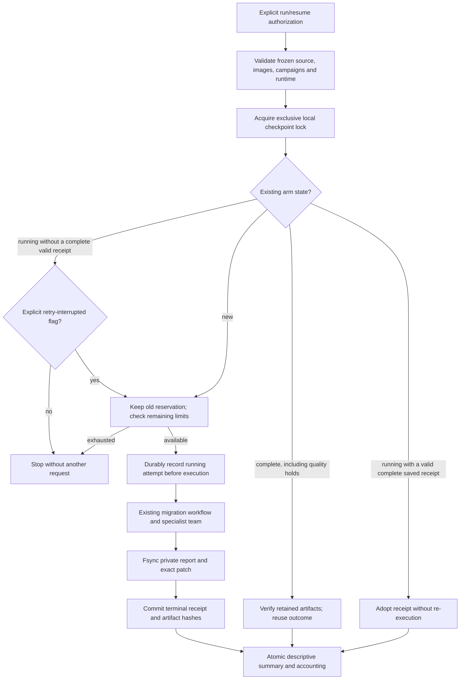

# Crash-safe migration studies: an interrupted request is not automatically free

The frozen three-arm study can now resume at arm boundaries. It reuses the
existing benchmark checkpoint's OS lock, atomic journal and artifact hashes,
adding migration-specific receipts and a shared admission budget. This is not
a second checkpoint framework or an exactly-once model API.



## Keep failures, not just successful outcomes

Each task has codemod-only, existing-repair and discovery-guided arms. Every
returned report is terminal, including quality and provider/quota holds. Resume
reuses both successes and failures; it never generates more candidates until the
final test happens to pass. Unlike the generic coding benchmark, this migration
adapter deliberately has no provider-hold retry flag.

Changed source, owner contracts, campaigns, images, controller code, interpreter/
package environment, or bound endpoint/retrieval configuration blocks resume
before new inference. Secret credentials are not written in plaintext. Endpoint
binding does not prove billing state or account continuity after key rotation.
Every resume still requires separate provider authorization.

An OS-released lock prevents concurrent admission through the same local study
directory. It is not a distributed lease or an account-wide budget.

## Reserve calls before the uncertain work

`StudyRunBudget` limits total admitted attempts and provider-call admissions.
Before a model-enabled arm begins, it reserves its full task `max_model_calls`.
Codemod-only reserves zero provider calls. Initial limits are committed with the
first checkpoint; the running marker is durable before execution can begin.

A valid returned receipt supplies the admitted call count and releases unused
reservation. Without a valid complete receipt, an interrupted attempt retains
its *entire* reservation. A retry consumes a new attempt and another reservation.
Unknown usage never silently becomes zero or funds its own retry.

For one task capped at 16 calls, defaults allow three attempts and 32 provider
calls. A reviewed four-attempt/48-call budget can leave room for one uncertain
model-enabled retry. This explains admission arithmetic, not recommended spending.
Limits cannot be increased silently on resume; use the stored limits or provide
exactly the same ones. More headroom requires a new reviewed study, preserving
the old history.

These are **request-admission limits, not dollar caps, billing reconciliation or
a promise of free-tier availability**. Unknown provider tokens/costs stay null.

## Recover a receipt, not a half-alive agent

Reports and any released byte-exact diff are saved after the migration workflow
returns and cleanup finishes. Files are flushed and fsynced before their hashes
are committed. A crash between those steps can leave a complete saved receipt.
Resume adopts it only after checking task/spec/image identity, fingerprint, call
accounting and patch/evaluation hashes, avoiding another repair invocation.

Partial, missing or invalid uncommitted files cannot be adopted. They require
`--retry-interrupted` and sufficient remaining budget for a new numbered attempt.
Earlier files and uncertain reservations are preserved. Committed artifact
tampering blocks resume even with the retry flag; every retained committed
attempt is checked, not just the latest winner. Source-integrity failure
permanently revokes admissions for that study.

Recovery starts an arm in a fresh workspace. It does not continue a partly
executed agent, reuse a live container, reconcile remote requests or guarantee
orphan-container removal after a hard kill. It makes no power-loss guarantee
or protection claim against a hostile host owner who can rewrite files and hashes.

## Distinguish outcomes from admissions

`recorded_attempts` counts task/arm outcomes. In contrast,
`resource_accounting.admitted_attempts` includes interrupted history. Accounting
also exposes known provider calls, interruptions, unresolved reservations and
the consumed call upper bound.

A resumed study can be complete while `quality_metrics_valid` is false. Its final
readiness rates are descriptive, not a first-attempt model score. Per-arm
accounting preserves interruptions; unknown earlier costs keep cost-per-ready-task
unavailable. Source-integrity failure also invalidates quality metrics. Consumers
must honor these flags instead of publishing only successful final rows.

## Commands and compatibility

The commands below can contact the provider in the reviewed frozen manifest.
Use them only with configured credentials and an approved request/spending budget.
No live provider was used to verify this implementation.

```powershell
python -m code_agent.upgrade_study run `
  --manifest data/upgradepilot/frozen/manifest.json `
  --output-dir data/upgradepilot/study-run `
  --authorize-provider --max-attempts 4 --max-provider-calls 48
```

Reuse completed work; unresolved interruptions stop without automatic retry:

```powershell
python -m code_agent.upgrade_study run `
  --manifest data/upgradepilot/frozen/manifest.json `
  --output-dir data/upgradepilot/study-run `
  --authorize-provider --resume
```

After reviewing the uncertainty and limits, add `--retry-interrupted` to permit
an incomplete arm to run again. It requires `--resume` and does not retry
completed quality failures. Omit limits on resume to load the saved limits.

New runs require new directories. Artifacts now live in `attempts/<number>/`,
with paths in outcome records, rather than the older `task-arm/` layout.
`checkpoint.json` is authoritative; `study.json` is an atomically replaced,
fingerprinted summary. Old non-checkpoint studies are preserved but cannot be
resumed or silently imported into this protocol. The single-task migration CLI
remains a fresh-run workflow, now using the same fsynced report/diff writer.

## Offline verification

```powershell
python -m evals.upgrade_recovery_evaluation `
  --control-root data/upgradepilot/recovery-control `
  --output data/evaluations/upgrade-recovery/controls.json
```

Both destinations must be new. The primary control uses actual pinned Docker
environments and the existing scripted specialist team, injects an interruption,
and resumes through the real study runner. Additional storage fault windows use
explicitly labelled replays of those real receipts, not additional AI executions.

Tests cover partial files, historical tampering, explicit retry, reservations,
budget exhaustion, runtime drift, locking, immutable limits, sticky revocation,
and byte-exact patch adoption. Measured results are recorded after verification.
They establish single-host recovery, not model quality or real repository success.

## Measured local verification: October 16, 2026

The selected suite passed **255 tests**, with zero failures, errors or skips in
**232.24 seconds**. It includes recovery failure injection, the shared benchmark
checkpoint, existing migration/session/law checks, coding agents, delivery,
security and provider reliability. This is not a full repository test run.

All **6/6 recovery control expectations** passed:

| Control | Result and evidence scope |
| --- | --- |
| Implicit retry | Stopped before another executor invocation after an injected interruption |
| Explicit resume | Actual Docker study retained codemod hold and completed two scripted specialist repairs |
| Completed resume | No completed success or quality hold was re-executed |
| Historical tampering | Altered receipt in a private control copy blocked resume |
| Saved-receipt adoption | Pre-commit fault with labelled real-receipt replay; no duplicate arm admission |
| Unknown-usage budget | Labelled receipt-replay fault retained the reservation and blocked the retry |

The primary study made **12 scripted specialist calls and zero live provider
calls**. It finished with three task/arm outcomes and four admission attempts.
One unresolved attempt retained its 16-call reservation. `quality_metrics_valid`
stayed false despite completion; neither its admission arithmetic nor the known
zero API calls in this controlled experiment establishes real provider billing.
The storage-replay controls are not counted as additional AI repair executions.

Private evidence is under `data/evaluations/upgrade-recovery-20261016/selected.xml`
and `controls-first.json`. Numbered study artifacts and a deliberately corrupted
control copy remain under `data/upgradepilot/recovery-control-20261016/` for audit.
Configured-secret containment and local documentation-link checks passed.

Host coverage for the recovery adapter, study/CLI and shared checkpoint scope was
78% combined; the adapter alone was 87%. Separate Docker study controls were not
included in that host coverage calculation. No project coverage threshold changed.

The source-bound retrieval candidate was retrained and exactly reproduced using
a temporary prospective public-source index; the real Git index was unchanged.
Artifact `9333fc828da32a15243c02d5cd7bfff89a251a8b5141629f71a7c079ad1818d9`
binds index `e595e1a0e9f3143f812ab85566cbc2a9d302a763eb1937ba16e0d591b74c40cf`.
The unchanged five-query gate still rejects promotion: learned NDCG `0.9433`
versus baseline `0.9594`, despite 88.64% training pair accuracy on 44 pairs.
No serving model was activated. Run the ordinary exact check after tracking the
intended new public source; prospective-index verification is not green GitHub CI.

Recovery controls are included in the existing isolated 20-minute migration
reliability CI job, with a separate uploaded report. Workflow syntax was checked
locally; no GitHub run was dispatched or observed. Nothing was committed or pushed.

See [UpgradePilot](upgradepilot.md), [frozen comparisons](counterexample-migration.md),
[stateful verification](stateful-migration-verification.md), and
[metamorphic laws](metamorphic-workflow-verification.md).
