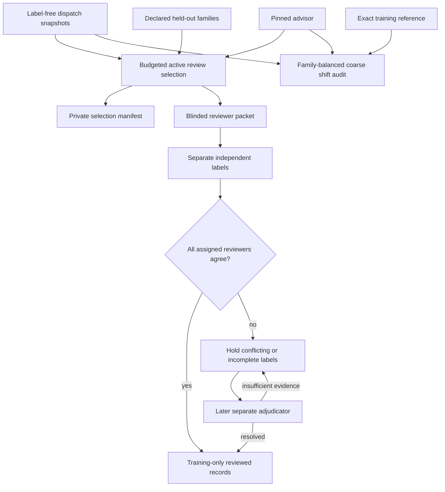

# Active supervision for the dispatch advisor

The advisor can learn a reviewer's preferred specialist, but a growing pile of labels is
not automatically a useful dataset. This upgrade adds a practical supervision loop:
choose what deserves review, keep the model's answer away from reviewers, resolve label
conflicts explicitly, and inspect whether incoming task families look different.

Everything here is offline and opt-in. It makes no model calls, contacts no reviewers,
and cannot replace the supervisor's serving heuristic. The outputs are review artifacts,
not a production labeling service or a new model release.



## Spend the human-review budget deliberately

The queue prioritizes unseen contexts, thin support, low label agreement, and disagreements
between the advisor and the serving heuristic. These are review opportunities, not
predictions of incorrect patches. Priority weights are engineering heuristics, not a
learned acquisition model or measured annotation-efficiency gain.

The default budget is 24 human review slots, with two reviewers per selected decision and
two slots reserved for adjudication. A slot means one declared human annotation, not a
provider call, token allowance, dollar cap, or invitation. At most one decision per family
is selected and at most three per exact context. Quotas can leave slots unused.

One quarter of the available decision capacity is reserved for a seeded, hash-ordered
audit sample before targeted selection fills the remaining capacity. The seed and quotas
are frozen in the private batch. This deterministic quota-constrained sample is not an
unbiased evaluation cohort or a logged propensity distribution.

Training families in the pinned artifact are automatically excluded. Independently frozen
validation/test families must also be declared in `reserved_families` by the study owner.
Their identity and completeness cannot be inferred from the artifact. Do this before
queue creation; changing a declaration later does not retroactively protect a holdout.

Example queue policy:

```json
{
  "review_budget_slots": 24,
  "reviewers_per_record": 2,
  "adjudication_reserve_slots": 2,
  "max_per_context": 3,
  "audit_fraction": 0.25,
  "seed": 17,
  "reserved_families": ["frozen-test-family-001"]
}
```

## Keep the review blinded

```bash
python -m code_agent.dispatch_supervision_cli queue --pool data/evaluations/new-pending.json --artifact data/evaluations/study-v1/advisor.json --artifact-fingerprint <advisor-fingerprint> --policy data/evaluations/review-policy.json --created-at 2026-10-03T12:00:00Z --output-dir data/evaluations/dispatch-supervision/batch-v1
```

The pool is an array of `DecisionSnapshot` objects exported by the
[dispatch-learning CLI](reviewed-dispatch-learning.md), or a directory of JSON snapshots.
Inputs are bounded and lineage checked. Future observations, changed snapshots, duplicate
decision IDs, and mixed scope/policy fail before outputs are created.

Keep `private-batch.json` with the operator. Give reviewers only `reviewer-packet.json`.
The packet contains the batch digest and label-free snapshots in record-ID order. It omits
proposed roles, baseline recommendations, ranking, selection reasons, priorities and the
artifact pin. This separates machine hints from the annotation workflow; it does not prove
that a reviewer has never seen them elsewhere.

Snapshots contain only coarse metadata, not enough evidence to judge a real repair alone.
Reviewers must inspect appropriate owner-controlled execution evidence through a separate,
private process. This tool does not distribute code, issue text, raw logs or credentials.
For a pre-dispatch preference, limit that evidence to what was available at the decision;
seeing later specialist outcomes can introduce hindsight bias. The packet does not enforce
the owner's evidence-access rules.

```bash
python -m code_agent.dispatch_supervision_cli annotate --packet data/evaluations/dispatch-supervision/batch-v1/reviewer-packet.json --record-id <selected-record-id> --reviewer-id reviewer-01 --preferred-role boundary --independent-review --label-source human --reviewed-at 2026-10-03T14:00:00Z --output data/evaluations/reviews/label-001-reviewer-01.json
```

Save a separate label for each assigned reviewer. IDs are bounded pseudonyms. Packet and
snapshot digests bind labels to one batch. Reviewer identity, independence and timestamps
are declarations, not authentication or external attestation. Files are immutable by the
CLI, but hashes are not signatures or an external append-only ledger.

## Resolve disagreement without manufacturing consensus

```bash
python -m code_agent.dispatch_supervision_cli consensus --batch data/evaluations/dispatch-supervision/batch-v1/private-batch.json --reviews data/evaluations/reviews --output-dir data/evaluations/dispatch-supervision/consensus-v1
```

All assigned reviewers must agree; there is no silent majority-label fallback. Missing
reviews and conflicts remain unresolved. Duplicate reviewer IDs, wrong batch/snapshot
bindings, labels for already-used roles, reviews before queue creation and over-budget
annotations are rejected. The audit retains contributing digests and pairwise agreement.
Pairwise agreement is descriptive and is not correctness or chance-corrected reliability.

A conflicting decision can use a reserved adjudication slot. The adjudicator must have a
different reviewer ID and a declared timestamp after every original review. They may pick
an unused role with an explicit evidence reason, or abstain with `insufficient_evidence`:

```bash
python -m code_agent.dispatch_supervision_cli adjudicate --packet data/evaluations/dispatch-supervision/batch-v1/reviewer-packet.json --record-id <conflicting-record-id> --reviewer-id adjudicator-01 --preferred-role compatibility --reason contract_evidence --independent-review --label-source human --reviewed-at 2026-10-03T16:00:00Z --output data/evaluations/adjudications/adjudication-001.json
```

Pass `--adjudications` to a new `consensus` output. For an evidence abstention, omit
`--preferred-role` and use `--reason insufficient_evidence`. A saved adjudication is only
accepted after consensus checks it against the private batch and complete conflicting
labels. It cannot resolve an incomplete review set or replace unanimous labels.

`training-reviews.json` contains only resolved `ReviewedDecision` records with `split=train`.
If any contributing label or adjudication is synthetic, the resulting record remains
synthetic—even if a human adjudicator agrees. The companion `consensus-audit.json` records
provenance, unresolved decisions and actual review-slot counts. Nothing activates a model.

Do not evaluate general accuracy on this actively selected cohort. A new training round
requires separately frozen, later validation/test families under the existing temporal
protocol; previously exposed evaluation families cannot be recycled to tune the next model.

## Inspect coarse distribution shift

```bash
python -m code_agent.dispatch_supervision_cli shift --reference data/evaluations/training-reviews.json --pool data/evaluations/new-pending.json --artifact data/evaluations/study-v1/advisor.json --artifact-fingerprint <advisor-fingerprint> --output data/evaluations/dispatch-supervision/shift-v1.json
```

The reference must reproduce the pinned artifact exactly from training-only reviews.
Current families must be disjoint from training and observed after its labels were
available. Each family contributes equal mass even when it has many attempts.

The report compares category, used-role mask, patch-size, changed-file and call-headroom
marginals using total variation distance. It also records exact-context novelty. Default
thresholds require five reference families and twenty current families, flag feature
distance above 0.35 or novelty above 0.4, and return `insufficient_data` below the sample
requirements. Empty current data has unavailable distances, not a fabricated stable score.
Use `--policy` to declare different diagnostic thresholds before inspecting a cohort.

These are coarse covariate-shift indicators, not calibrated hypothesis tests, semantic OOD
detection, or evidence of quality loss. `stable` is not safety or release approval. There
is no automatic retraining, label assignment, rollback, activation, or serving change.

## Run the controls

```bash
python -m evals.dispatch_supervision_evaluation --output-dir data/evaluations/dispatch-supervision/controls-v1
```

The authored control schedules four decisions within eight annotation slots plus reserved
adjudication, holds a disagreement, resolves it with a third scripted reviewer, preserves
synthetic provenance, and tests stable, shifted and undersized cohorts. It makes zero
provider calls and needs no Docker or fixture-code host execution. All outputs remain
`held`; `--require-gate` deliberately returns nonzero. CI publishes the bundle for review.
