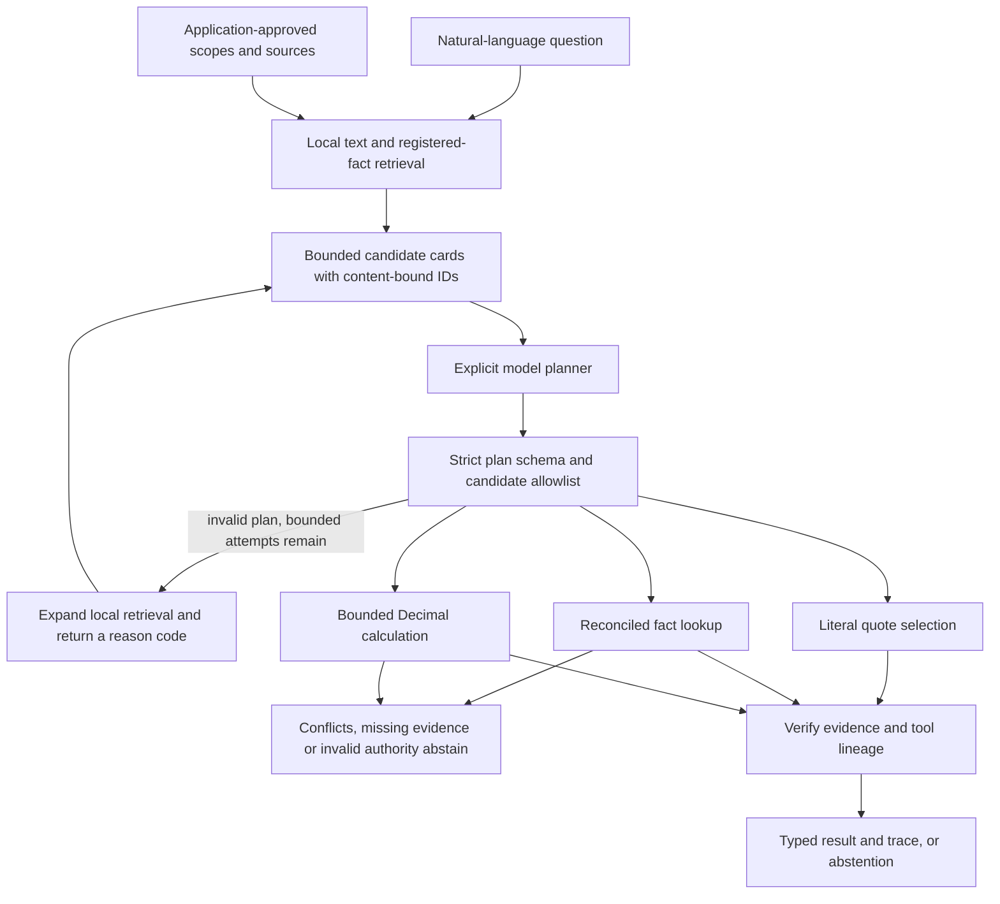

# From a question to a checked document answer

SDK 0.7 connects local retrieval, a model-proposed plan, and the existing evidence
tools. The useful change is not another agent persona: a question can now select
literal evidence or registered numeric facts without the application hand-writing
each plan. Execution remains constrained and inspectable.



## What the model may do

The planner returns JSON with `action`, `candidate_ids` and `operation`. There
are four actions: `quote`, `lookup`, `calculate` and `abstain`. It cannot supply
new values, invented source IDs, arbitrary code, SQL, tools, scopes or units.
Numeric candidates come from an explicitly constructed `EvidenceSet`; the model
does not authorize comparisons merely by writing a plausible reporting period.

Quote results are literal excerpts, not generated summaries. Lookup and calculation
results are rendered from verified receipts. Calculations support the same four
Decimal tools as [numerical reconciliation](evidence-reconciliation.md).
Different values in the same declared scope are unresolved, not resolved by vote.

Recovery is limited to invalid plans or unavailable candidate IDs. It expands
local retrieval and supplies a typed failure code, not a traceback or private
provider message. A conflict, unit failure, model abstention or provider exception
is terminal. There is no retry-until-success loop, autonomous approval or external
tool execution.

## Configure explicitly

```python
from agentforge_sdk import (
    DocumentPage, DocumentRAG, DocumentReasoningAgent, ReasoningConfig,
)
from agentforge_sdk.groq_reasoning import GroqJSONClient, GroqReasoningPlanner

documents = DocumentRAG([
    DocumentPage(document_id="atlas", source="atlas.pdf", page=2,
                 text="Atlas p95 latency is 180 ms.")
])
# Obtain api_key privately in the application; never paste it in source or chat.
# Choose a model currently available to YOUR project. There is no model fallback.
client = GroqJSONClient(api_key, model="qwen/qwen3.8-27b", max_requests=20,
                        reasoning_effort="none")
agent = DocumentReasoningAgent(documents, GroqReasoningPlanner(client),
    config=ReasoningConfig(allow_external_processing=True))
result = agent.run("What is Atlas p95 latency?")
assert agent.verify_result(result, question="What is Atlas p95 latency?")
print(result.status, result.answer)
```

The Groq module is opt-in and uses the fixed HTTPS chat endpoint. It loads no
environment file, provider SDK or credentials at import. JSON object mode is not
schema enforcement: local Pydantic validation remains necessary. The client has
no automatic retries, redirect following or ambient proxy use. Keys are excluded
from its representation and error messages. Actual reported input/output tokens
are retained; absent usage and unknown prices remain `None`.
Optional request spacing is bounded to thirty seconds. The pilot uses fifteen
seconds between request starts; this is pacing, not a rate-limit guarantee.
The Qwen adapter sets `reasoning_effort="none"` explicitly; see the
[provider's model documentation](https://console.groq.com/docs/model/qwen/qwen3.8-27b).

For numeric questions, pass `evidence=registered_evidence_set` to the agent.
`EvidenceSet.query_catalog()` exposes bounded, currently authorized literal table
axes, not values. Incomplete grids and overlong axes are not proposed. Ambiguity
and coverage are checked again at lookup, not inferred from catalog membership.
The model can choose among the candidates but cannot create a new approved scope.

Retrieval must use a local-only `DocumentRAG`; the reasoning consent does not
silently authorize a separate external embedder. The default allows two planner
calls, six retrieval hits per stream initially and twelve on recovery. Caps are
three calls, twenty hits per stream and 1,000 registered fact candidates. Prompt
data is bounded by characters, not a fabricated provider-token estimate. The
provider adapter separately bounds request bytes, response bytes, output tokens
and timeout. Its request counter is in-process, not a durable billing ledger.

## What verification does not prove

`verify_result` rechecks frozen evidence membership, literal citations, plan
allowlists, arithmetic and current numeric review authority without calling the
planner. It does not prove that a selected quote answers the question, that an
operation is the right interpretation, or that a source is true. An irrelevant
but genuine quotation can pass provenance checks. A quote answer does not assert
that every report agrees. Numeric conflicts are checked for the referenced
facts, not through an arbitrary-prose contradiction detector.

Traces contain retrieved excerpts and fact labels. Protect serialized results.
Invalid model JSON and private provider exceptions are not copied into traces.
Usage is adapter-reported, and fingerprints are integrity bindings, not signed
proof of model execution or billing. Existing process-local review and frozen
machine-manifest boundaries remain unchanged.

## Real-document comparison

`evals.financebench_pilot` freezes up to twenty cases by the SHA-256 order of case
IDs from a pinned [FinanceBench source snapshot](https://github.com/patronus-ai/financebench/tree/cc39aeb4afdf33909ee1412188bf89035950c2eb).
The question file, case order, gold file and downloaded PDF bytes are bound by
hashes. Data stays under ignored `data/evaluations/`; no dataset/PDF redistribution
permission or official benchmark score is claimed.
The public [cohort record](../evals/experiments/document_reasoning_pilot_cohort.json)
contains only IDs and integrity metadata, not question text, answers or PDFs.

```bash
python -m evals.financebench_pilot prepare \
  --output-dir data/evaluations/document-reasoning/cohort --count 20
python -m evals.financebench_pilot run \
  --cohort data/evaluations/document-reasoning/cohort \
  --output-dir data/evaluations/document-reasoning/admission
```

Offline mode is admission/control evidence, not a live model baseline. In live
mode, the ordinary RAG baseline and verified agent share the same model, corpus,
initial candidate cards and temperature. Only the agent may make bounded recovery
calls. Gold answers, evidence-page labels and rationales never enter either
prompt. Both variants are given the task's document: this is provided-document
retrieval, not document-discovery accuracy over the entire collection.

```bash
# Only after confirming a Free-plan project for a $0 pilot.
# This example is a NEW run, not authorization to repeat an earlier pilot.
python -m evals.financebench_pilot run \
  --cohort data/evaluations/document-reasoning/cohort \
  --output-dir data/evaluations/document-reasoning/live \
  --live --confirm-free-plan --model qwen/qwen3.8-27b \
  --env-file .env --max-requests 20
```

The baseline and agent share one request counter. The runner reserves three
requests before starting a pair and stops the cohort on provider errors. It does
not resume automatically or switch models. An explicit `.env` path is read only
by this CLI; the SDK never loads it. Outputs are created exclusively so an old run
cannot be overwritten. A crash before recording results can still lose work;
the counter is not a cross-process exactly-once guarantee.

All twenty selected cases remain in the denominator record. Missing files,
unsupported/blank-page PDFs and unexecuted cases are not removed. PDF input
admission and indexing are separate from model/retrieval latency; input time is
recorded per case. The strict loader does not silently discard empty pages. The
optional `pdf` extra now includes FontTools for supported embedded font decoding.

The first financial pilot does not invent a numeric fact registry from unruled
financial PDFs. Numeric planning can therefore abstain; native/reviewed table
tools are separately exercised on authored actual-PDF controls. This limitation
must remain visible rather than being converted into a claimed financial
reasoning gain. Public benchmark data may have appeared in model training.

## Review before claiming accuracy

Reports contain coverage, latency, actual request attempts and token usage where
available. Pure-number exact-match diagnostics apply only to a small supported
numeric grammar. They are not semantic answer accuracy. `answer_accuracy` and
unsupported-answer rate remain null until predictions are reviewed.

Each run writes `review-template.json`. Review `cases.json`, full receipts and
the source documents against the private gold file, then complete the fields:

```bash
python -m evals.financebench_pilot score-reviews \
  --run-dir data/evaluations/document-reasoning/live \
  --reviews data/evaluations/document-reasoning/reviews.json \
  --output-dir data/evaluations/document-reasoning/reviewed
```

Review intake binds each label to its exact prediction, rejects duplicate/foreign
labels and does not let an abstention count as a correct answer. Metrics identify
the reviewed subset. A reviewer ID is an operator assertion, not authenticated
proof of human work. No script manufactures human labels.

See the [execution audit](document-reasoning-audit-2026-10-17.md) for actual results,
provider failures, request accounting and remaining validation work.
