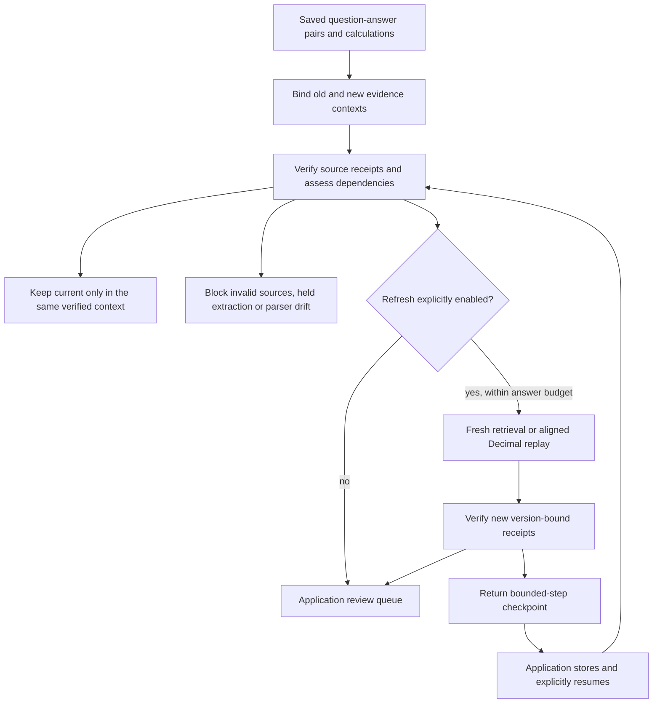

# Revalidate saved evidence when a report changes

A document assistant rarely answers a question just once. Applications save
answers, populate reports, and calculate metrics that need checking when the next
document arrives. SDK 0.5 adds `RevalidationBatch` for that workflow: assess a
bounded set of saved receipts, explicitly refresh selected work, and give the
application a queue of changed or unresolved results.

It builds on [document-version impact](document-version-impact.md), rather than
introducing another agent that can approve its own output. Answers remain literal
evidence excerpts. There is no generated summary, automatic publishing, or claim
that a valid citation proves the underlying statement is true.



## One batch, two kinds of saved work

Install `./sdk[multimodal]` from the full checkout. Assume `old` and `new` are
`MultimodalRAG` or authorized `ReviewedRAG` readers for two versions of the same
logical document. The saved receipts must come from `old`.

```python
from agentforge_sdk import (
    RevalidationBatch, RevalidationConfig, SavedAnswer, SavedCalculation,
)

question = "Atlas p95 latency"
saved = [
    SavedAnswer(item_id="latency", question=question,
                receipt=old.answer(question, top_k=1)),
    # saved_calculation is an existing verified Calculation/ReviewedCalculation.
    SavedCalculation(item_id="request-growth", receipt=saved_calculation),
]

# Safe default: assessment only. No target answer backend or calculation replay.
assessment = RevalidationBatch(old, new, saved).advance()

# Explicit execution: a fresh retrieval and a bounded deterministic tool replay.
batch = RevalidationBatch(old, new, saved, config=RevalidationConfig(
    refresh_answers=True,
    replay_calculations=True,
    max_items_per_step=1,
    max_answer_attempts=1,
    answer_top_k=1,
))
checkpoint = batch.advance()
serialized = checkpoint.model_dump_json()  # Contains evidence: keep it private.
# The application persists this value in its own protected store.
checkpoint = batch.restore(serialized)
while not checkpoint.complete:
    checkpoint = batch.advance(checkpoint)
    # Persist each returned checkpoint before starting the next step.

assert batch.verify_checkpoint(checkpoint)  # Does not call answer backends.
for task in batch.review_queue(checkpoint):
    print(task.item_id, task.category, task.reason)
```

`SavedAnswer` binds the original question, not just a response string. A wrong
question or unverifiable source receipt blocks execution. `SavedCalculation`
preserves the original tool operation and operand order; callers do not have to
guess new cell IDs. Duplicate table labels block replay instead of selecting a
row by position. Mixed currencies keep the tool's abstention receipt.

An old abstention can be retrieved again: new evidence may now answer the saved
question. Fresh answer retrieval does not require carrying old region IDs into
the new corpus. Invalid source receipts, incomplete extraction, comparison-budget
exhaustion, unavailable target review authority and extraction-profile drift
still block execution. New reviews must already exist; this API cannot issue or
renew them.

## States and review

| Entry state | Meaning |
| --- | --- |
| `current` | Positive receipt verified in the same context; no reissue required. |
| `refresh_required` | Refresh is disabled or the answer-attempt budget is exhausted. |
| `refreshed` | New answer or calculation receipt verified against the target reader. |
| `blocked` | Source, extraction, authority or calculation alignment needs attention. |
| `abstained` | Fresh retrieval returned no validated evidence, or the replayed tool abstained. |
| `failed` | An SDK answer execution failed; the attempt is recorded, with no retry. |

`refreshed` is not approval. Changed results and changed/uncertain source
dependencies remain in the review queue. Answer change detection compares the
literal rendered answer, not semantic equivalence. Calculation change detection
compares value and unit. Even unchanged results receive new version/review-bound
receipts when the evidence context changes.

The queue contains IDs, fingerprints, categories and reason codes, not questions,
excerpts or numeric values. Use opaque application IDs if labels are sensitive.
Blocked and failed work sorts ahead of changed results and unexecuted refreshes.
A partial checkpoint's queue covers only processed items: `complete=False` must
never be displayed as "all documents checked." No queue action approves or
publishes evidence.

The full entry retains the answer/tool receipt. A selector failure or rejected
selection can produce an abstained answer; inspect its underlying text receipt
to distinguish that from a genuine lack of retrieval hits. `failed` records an
SDK exception rather than discarding it into an apparently successful refresh.

## Bounded work, honest usage

There are at most 64 unique saved items and 2 MB of serialized saved input per
batch. A step processes at most 64 items (default eight), in stable input order.
The answer-attempt budget is batch-wide and survives a valid resume. Zero blocks
answer execution without preventing enabled calculation replay. Checkpoint JSON
admission and returned serialization are capped at 16 MB.

An **SDK answer attempt is not a provider request**. It can invoke embeddings and
a selector, including multiple adapter operations; it can also remain entirely
local. Existing external-processing consent remains mandatory. The SDK does not
know a custom adapter's billing: unknown cost is `None`, including a failed
attempt with no usable receipt. Purely built-in offline runs report zero.
Checkpoint cost is the sum of recorded known answer costs, or `None` if any is
unknown. This is not a spend cap, token meter, wall-clock deadline or provider
timeout. Configure those controls in the adapter/application.

## Resume without pretending to guarantee exactly-once execution

Checkpoints bind the ordered inputs, questions, complete receipts, old/new
evidence contexts, comparison settings and execution settings. Reconstructing a
batch with the same inputs supports resume; changing any of those bindings
rejects it. Completed entries and aggregate counters are verified again. Answer
verification does not rerun selectors or embedding requests; calculation replay
verification runs only the bounded local tool.

Reviewed evidence is checked against current approval/source state. Revocation,
expiry or source changes invalidate affected checkpoints, including a change
during a step. Plain machine-extracted readers retain their frozen-manifest trust
model; this API does not authenticate publishers or reread their source files.

Persistence, access control and concurrent-worker coordination belong to the
application. Fingerprints detect accidental alteration and are checked against
the evidence, but **are not signatures or authenticated execution logs**. Do not
accept arbitrary client-supplied checkpoints as billing or authorization proof.
Serialize advancement per batch. Restarting an old checkpoint or racing two
workers can repeat calls. If a process crashes after an external request but
before returning/persisting a checkpoint, the SDK cannot know that request
happened. An application needs a durable job journal and provider idempotency,
where supported, for stronger delivery guarantees. There are no background jobs,
automatic retries, disk writes, telemetry or new mandatory dependencies here.

## Run the controls

```bash
python -m pytest tests/test_document_revalidation.py -q
python -m evals.document_revalidation_evaluation \
  --output-dir data/evaluations/document-revalidation/example
```

The actual-PDF control run moves a table to page two, reorders rows, refreshes a
saved answer and changes request growth from 25% to 50%. It also checks mixed-unit
abstention, ambiguous labels, budgets, private queues, and resume on a reconstructed
batch. These are authored lifecycle controls, not a live-model or held-out
real-world accuracy benchmark. The [execution audit](document-revalidation-audit-2026-10-17.md)
records the tested environment and limitations.

For a separate guard against inconsistent numeric reports, SDK 0.6 adds
[cross-document reconciliation](evidence-reconciliation.md). It compares explicit
table facts within caller-declared scopes; it does not automatically approve or
modify this batch workflow.
