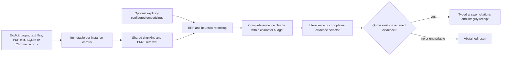

# Use AgentForge text evidence in another Python application

You should not need to start the agent service, configure a model account or
parse a formatted tool message just to retrieve document evidence. The document
SDK exposes the existing text-RAG chunking, BM25, reciprocal-rank fusion and
heuristic reranking through a small, typed interface.

This guide covers the **text-evidence API**. Its default answer is a set of literal
excerpts with source/page/version references, not a generated summary or a claim
that the cited document is factually correct. SDK 0.2 also offers a separate,
optional [multimodal evidence API](multimodal-evidence-sdk.md) for local raster OCR,
native table cells, spatial citations and bounded calculations. `DocumentRAG` and
the embedded-text `load_pdf` adapter keep their existing text-only behavior.

SDK 0.8 also includes [numeric claim verification](numeric-claim-audits.md) over
the separate reconciled spatial fact/calculation receipts. It checks explicit
expected values and units; it does not change this text API into a claim extractor
or make literal citation validity a correctness guarantee.

SDK 0.9 adds [policy-preserving source omission views](evidence-fragility-stress-tests.md)
for `EvidenceSet`. These diagnostic views retain corroboration thresholds and
live reviewed-reader authority; they do not mutate the original set or approve
excluding a source.

SDK 0.10 adds [portable numeric replay bundles](portable-claim-replay.md): bounded
plain snapshots with fixed query/calculation recipes, original numeric checks,
an offline verifier and CLI. Replay needs no optional PDF parser, provider or
service, but does not authenticate source files or reconstruct live review authority.



## Install only what the integration needs

From this repository root:

```bash
python -m pip install ./sdk
python -m agentforge_sdk
```

The SDK-only distribution is `agentforge-document-sdk`; the Python import is
`agentforge_sdk`. Its only required third-party dependency is Pydantic. The
existing full-platform install also includes this namespace, but has the
platform's larger dependency set. These two distributions share implementation
files: choose one installation style per environment rather than installing both
into the same environment and uninstalling one underneath the other.

Optional extras are `./sdk[pdf]` for embedded-PDF text extraction and
`./sdk[fastapi]` for the HTTP integration example. Importing the SDK does not
import LangGraph, Chroma, provider clients, tracing or `agent.research_assistant`.
It does not load `.env`, seed a store, inspect a directory or make a model call.
`./sdk[multimodal]` adds the separate spatial ingestion path; it is not required
for any of the text-only examples below.
SDK 0.3 also offers [explicit reviewed corrections](reviewed-document-evidence.md),
without changing `DocumentRAG` or enabling automatic approvals.
SDK 0.4 adds [spatial document-version impact](document-version-impact.md), without
changing the text-only API or automatically reusing previous answers.
SDK 0.5 adds [bounded batch revalidation](document-revalidation.md) of saved spatial
answers and calculations, with explicit refresh, resume and a review queue. It
does not change `DocumentRAG` or introduce implicit persistence/model requests.
SDK 0.6 adds [cross-document numerical reconciliation](evidence-reconciliation.md)
for explicitly scoped table facts. This deterministic guard does not claim
general semantic contradiction detection or change the text-only answer API.
SDK 0.7 adds a [bounded document reasoning agent](document-reasoning-agent.md):
an explicitly configured model selects literal quotes or registered numeric
tools, with allowlisted plans, typed recovery and replayable evidence lineage.
It does not enable network calls by default or turn provenance into semantic
answer correctness. The [execution audit](document-reasoning-audit-2026-10-17.md)
separates local controls from the limited live Groq comparison.

The standalone build intentionally uses the single implementation in the parent
checkout. Build from the complete repository, or distribute the resulting
`py3-none-any` wheel. Copying only `sdk/`, or distributing its source archive
without the parent implementation, is unsupported in this prerelease. Nothing
has been published to a package index.

## A complete offline technical-report example

```python
from agentforge_sdk import DocumentPage, DocumentRAG

rag = DocumentRAG([
    DocumentPage(
        document_id="atlas-report",
        source="atlas-report.pdf",
        version="r1",
        page=2,
        text="Atlas p95 latency is 180 ms at 100 requests per second.",
    )
])

result = rag.answer("What is Atlas p95 latency?", top_k=1)
assert result.status == "evidence_found"
assert rag.verify_answer(result, question="What is Atlas p95 latency?")
print(result.answer)
print(result.citations[0].page)  # 2
```

Run the full repository example with
`python examples/document_sdk_quickstart.py`. Both examples use authored data,
not results obtained from a model or an independent QA dataset.

Use `rag.search(question)` if your application only needs evidence. Use
`await rag.asearch(question)` or `await rag.aanswer(question)` in async code.
Objects are frozen typed models. They can be exported with `model_dump_json()`
and restored with `AnswerResult.model_validate_json(payload)`. Exported answers
contain private excerpts; the SDK never persists or uploads them automatically.

## Bring existing documents

```python
from pathlib import Path
from agentforge_sdk import (
    DocumentRAG, load_text, load_pdf, load_sqlite, load_chroma_records,
)

# Explicit files only: no recursive ingestion or automatic source discovery.
pages = load_text(Path("guide.md"), document_id="guide", version="r3")
rag = DocumentRAG(pages)

# Optional pypdf dependency; physical page numbers start at one.
pages = load_pdf(Path("report.pdf"), document_id="report", version="r1")

# Existing AgentForge local-RAG docs table: read-only, no seeding or migration.
pages = load_sqlite(Path("local_rag.db"))

# Data already fetched by YOUR configured Chroma client. The SDK makes no store call.
pages = load_chroma_records(payload)
```

Each call above is a separate alternative, not a command to merge all stores.
Construct one corpus from the authorized records you actually intend to use.

Legacy SQLite records have no page metadata, so their page is `None`, never an
invented page 1. Existing AgentForge Chroma ingestion uses one-based page metadata;
zero-based or ambiguous metadata is rejected rather than silently shifted. Each
Chroma chunk remains a separately identified input record. Its input-text hash
does not pretend to be a hash of the complete original PDF page or file.

Sources are labels, not URLs the SDK fetches. File adapters default to a basename
instead of exposing the absolute input path. Credential-bearing URLs and source
query strings are rejected. Sanitize sensitive data inside ordinary document
text yourself; there is no claim that arbitrary credentials are automatically
detected or removed.

The PDF adapter reads embedded text only. An encrypted, over-budget or text-empty
page holds the import, including blank/image-only pages, rather than pretending
the whole PDF was read. It is intended for trusted local PDFs. File/page/text
limits are not a memory or execution sandbox: [pypdf's extraction guidance](https://pypdf.readthedocs.io/en/stable/user/extract-text.html)
explains that content-stream parsing can consume substantial memory and does not
perform OCR. Process hostile PDFs behind a separate resource-isolation boundary.

## Understand the result before trusting it

`evidence_found` means that literal source excerpts were retrieved and their
provenance was validated. It does **not** mean the question was answered correctly,
the sources agree, the evidence is current, or an LLM judged it true. An unrelated
question without hits returns `abstained` with `no_evidence`.

Every citation identifies the document, caller-declared source/version/page,
input-text hash, normalized chunk hash and literal quote. `chunk_start` and
`chunk_end` are Python character offsets into the returned `Evidence.text`, not
PDF coordinates or offsets into the original page. The shared chunker normalizes
paragraph/sentence whitespace. No bounding box or visual-region claim is made.

`verify_citation()` and `verify_answer()` check these bindings against the current
immutable corpus and validate receipt integrity. They detect accidental drift or
corruption; an unkeyed hash is not a signature against a malicious host. The
original source/page labels are supplied metadata, not independently authenticated
upstream provenance. Different document versions must be selected deliberately;
the SDK does not guess which version is authoritative or newest.

## Configure limits and optional backends explicitly

```python
from agentforge_sdk import DocumentRAG, RAGConfig

rag = DocumentRAG(pages, config=RAGConfig(
    max_pages=200,
    max_corpus_bytes=5_000_000,
    max_chunks=2000,
    max_context_chars=6000,
))
```

The context limit counts evidence-text characters, not tokenizer tokens, JSON
metadata or a complete model prompt. Complete chunks are retained or omitted;
their text is not truncated after hashing. Sentence-aware overlap may make a
chunk larger than the nominal `chunk_size`, within the bounded evidence contract.

`EmbeddingBackend` accepts `encode_documents()` and `encode_query()` methods.
Return finite Python numeric sequences with consistent nonzero dimensions;
convert NumPy arrays with `.tolist()` in your adapter. The default lexical
tokenizer is the existing ASCII-oriented implementation, not a claim of measured
multilingual retrieval quality.
`EvidenceSelector` accepts `select(question, evidence)` returning typed
`Selection(evidence_id=..., quote=...)` objects. Both declare a bounded `name` and
an `external_processing` boolean. You may wrap an already configured local model
or provider client; the SDK does not construct clients, download models or read
credentials. Corpus embeddings are computed lazily and cached only in that SDK
instance. Query vectors are not silently reused across users or clients.
The immutable corpus also owns a precomputed BM25 postings index, so repeated
queries do not tokenize all source chunks again. Backend names are pinned for
that instance: replacing an embedding model or selector requires a new
`DocumentRAG`, rather than mixing a new query vector with cached old embeddings
or recording an obsolete selector identity.

An external backend requires `RAGConfig(allow_external_processing=True)`, after
separate data-sharing/spending approval. Embeddings can disclose the entire
bounded corpus; the selector receives the question and only packed evidence.
Backend declarations are a guard against accidental use, not a network sandbox
for untrusted Python plugins. Treat adapters as trusted application code.

The selector cannot invent source IDs or paraphrase evidence: unknown IDs,
nonliteral quotes, excessive selections and duplicates are held. Selector failure
does not trigger an unchecked generation fallback. This supports evidence
selection, **not unrestricted generated prose**. A future summarizer needs its own
measured grounding contract.

Embedding failures are explicitly reported as `degraded` lexical fallback unless
`allow_lexical_fallback=False` requests an error. There are no automatic SDK
retries. Invocation counts describe SDK method calls, not authenticated provider
requests/tokens. Provider cost is zero on the wholly offline path and unknown
(`None`) once a custom backend is called. Configure backend deadlines, account
budgets and retry policy yourself. Cancelling an async wrapper cannot undo a
threaded backend request that has already started or refund unknown spend.

## Connect an application

`examples/document_sdk_fastapi.py` demonstrates an injected corpus and typed
`POST /answer` result without changing the existing service API:

```bash
python -m uvicorn examples.document_sdk_fastapi:app --host 127.0.0.1 --port 8011
```

Send `{"question": "What is Atlas p95 latency?", "top_k": 1}`. Invalid requests
receive a content-free error instead of an echoed private input. The example is
localhost-only documentation, not an authenticated production deployment. Add
authentication, request-size/rate limits, authorized per-tenant corpus selection
and operational controls before exposing it. A `DocumentRAG` instance is not a
multi-tenant authorization service.

The full LangGraph workflow, generated answers, approvals and production API
remain available through the existing platform and `AgentClient`. The SDK does
not silently inherit every research-graph policy or claim equivalent safety.

## Reproduce implementation checks

From the complete checkout and its test environment:

```bash
python -m pytest tests/test_document_sdk.py tests/test_document_sdk_integration.py -q
python -m evals.document_sdk_evaluation \
  --output data/evaluations/document-sdk/example-controls.json
python -m evals.document_sdk_packaging \
  --output-dir data/evaluations/document-sdk/example-package
```

The packaging control builds a lightweight wheel, installs it into a private
target and runs another application outside the checkout with platform/provider
imports and network socket creation blocked. It checks the installed module,
literal answer, page citation, receipt verification, abstention and tamper hold.
Only existing Pydantic is used; no package/model downloads or publication occur.

The ten workflow controls use authored reports and labelled selector doubles.
They are implementation checks, not a real-document QA benchmark or evidence of
model-quality gains. Public benchmark evaluation and consenting external users
remain separate work. See [the local integration audit](document-sdk-audit-2026-10-16.md).
