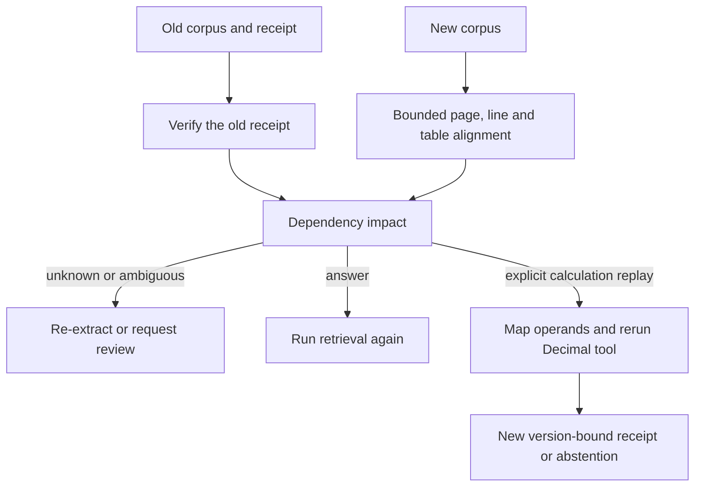

# Know what a new document version invalidates

An answer can have valid citations and still become stale when the next report
arrives. SDK 0.4 compares extracted versions, traces old answer/calculation
dependencies, and explicitly replays supported calculations on the new corpus.
It never silently carries citations or approvals forward.

For an application with multiple saved answers and metrics, SDK 0.5 provides
[batch revalidation](document-revalidation.md): explicit fresh retrieval/tool
replay, bounded steps and answer attempts, resumable checkpoints, and one review
queue. This lower-level API remains available for individual receipts.



This is extraction-level change intelligence, not a semantic or rendered-pixel
diff model. It uses no LLM, model download, provider call or new mandatory
dependency. Chart meaning, source truth and confidently missed OCR content remain
outside its guarantees.

## Compare and assess

```python
from pathlib import Path
from agentforge_sdk import DocumentRevision, MultimodalRAG, load_multimodal

old = MultimodalRAG(load_multimodal(Path("report-v1.pdf"), document_id="atlas",
                                  source="atlas.pdf", version="v1"))
new = MultimodalRAG(load_multimodal(Path("report-v2.pdf"), document_id="atlas",
                                  source="atlas.pdf", version="v2"))
answer = old.answer("What is Atlas p95 latency?", top_k=1)
revision = DocumentRevision(old, new)
impact = revision.assess_answer(answer, question="What is Atlas p95 latency?")
assert revision.verify_impact(impact, answer, question="What is Atlas p95 latency?")
print(impact.status, impact.reasons, impact.requires_reissue)

# Preserved words do not authorize reuse of an old answer or citation.
fresh = new.answer("What is Atlas p95 latency?", top_k=1)
assert new.verify_answer(fresh)
```

Versions require the same explicit logical document ID. Labels are caller
metadata, not authenticated publisher identity. `compare_documents(before, after)`
also returns a typed diff directly from manifests. Reports include hashes,
addresses, boxes and flags, not excerpts; they still expose structural metadata.
`verify_changes` compares a report with the frozen inputs. Unkeyed fingerprints
are integrity bindings, not signatures or proof of semantic alignment.

## Conservative alignment

Pages match unique extracted-content signatures first. Remaining pages may use
mutually unique best exact anchors appearing on only one page in each document.
Duplicate pages and tied anchors stay unmatched, with no order-only fallback.

Tables require unique header sets and first-column labels. Cells follow those
labels rather than array indices, allowing ordinary row/column reordering.
Duplicate or changed headers, duplicate labels and indistinguishable tables
require manual alignment. First row/column labels are a convention, not learned
header detection.

Text lines match unique literals, then unique mutual-best spatial overlap for
remaining nonduplicate lines. The default intersection-over-union floor is 0.6.
Spatial matching is a reported heuristic. Splits, merges, paraphrases or major
layout changes can remain unmatched.

Flags distinguish text, recognized Decimal value, recognized unit, page, grid
address, geometry, method and confidence changes. `125` versus `125.0` is a text
change, not a changed numeric value. Unknown numeric/locale forms are not guessed.
Geometry includes normalized boxes and page dimensions, not rendered pixels.

`complete` means ready extraction inputs and a finished bounded comparison,
**not** complete alignment, source truth or proof that no change was missed.
Unknown regions retain their explicit status. Held extraction or budget exhaustion
makes the report `held`, never a clean empty diff. Spatial work defaults to
100,000 candidate comparisons and is capped at one million through `ChangeConfig`;
existing manifest bounds also cap pages, regions and characters.

## Impact does not imply safe answer reuse

The old reader must verify the receipt and optional question. Reviewed readers
also require current source/approval state; expired historical review receipts
are unverifiable for this current-use workflow, not evidence of changed text.

States are `dependencies_unchanged`, `dependencies_changed`, `needs_review` and
`invalid_receipt`. Calculation dependencies include row/column labels even when
the original tool only cited operands. Unmatched dependencies, absent positive
evidence, held inputs, parser/config/OCR-profile drift or unavailable review
authority require review.

Unchanged dependencies do not mean an unchanged best answer: uncited new evidence
can introduce contradictions. Changed corpora request a retrieval rerun.
`requires_reissue` is true for a changed document/review context or an invalid/
review-needed result. New source hashes, versions and approvals cannot inherit
old receipts just because words match.

## Replay explicitly

```python
# saved_calculation is a Calculation/ReviewedCalculation verified by old.
replay = revision.recalculate(saved_calculation)
if replay.status == "recalculated":
    assert revision.verify_recalculation(replay, saved_calculation)
    print(replay.result, replay.value_changed)
else:
    print(replay.reason)
```

Unambiguously mapped operands and labels are required. Operand order survives
column reordering. The existing bounded Decimal tool runs again and its new
receipt is verified. There is no expression evaluation or currency conversion;
mixed units and unsupported values can return a new abstention receipt.

Reviewed operands go through the target `ReviewedRAG`. Its new approval must
already exist; this layer cannot issue, renew, transfer or bypass it. Target
revocation/expiry blocks replay. Even identical content under a replacement
review approval receives a new outer receipt. Existing process-local authority
and hostile-upload limitations remain in force.

## Reproduce

Install the optional multimodal dependencies, ReportLab and pytest, then:

```bash
python -m pytest tests/test_document_changes.py -q
python -m evals.document_change_evaluation \
  --output-dir data/evaluations/document-changes/example
python -m evals.document_sdk_packaging \
  --output-dir data/evaluations/document-changes/package \
  --change-evidence data/evaluations/document-changes/example
```

The authored PDFs insert a page, reorder rows, change a number, introduce a unit
conflict and duplicate a label. Actual extraction/tool replay are exercised;
these are not held-out accuracy scores. See the
[execution audit](document-changes-audit-2026-10-17.md).
