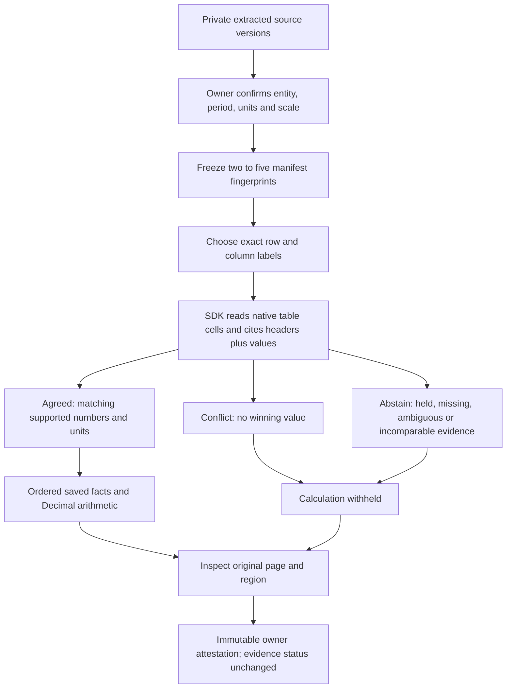

# Check the same numeric claim across reports

Workbench 0.4 brings the existing reconciliation SDK into the authenticated
document workspace. Choose exact source versions, state why their numbers are
comparable, then inspect agreement, disagreement or abstention with citations.
A conflicting report cannot be outvoted, and a calculation cannot turn an
unresolved fact into a released value.

This is a useful evidence-control workflow for document QA. It is not a new
language model, semantic contradiction detector or financial accuracy benchmark.

Workbench 0.5 builds on these saved results with [numeric claim audits](numeric-claim-audits.md).
Audits freeze explicit expected values and parent digests, advance in bounded steps,
and remain advisory. Deleting an evidence set also deletes its dependent audits.

## Walk through it

Use the existing [Document Workbench setup](document-workbench.md). No new key,
model-request consent, package or flag is needed. The document feature remains
disabled by default; parsing requires the locally built isolated Docker image.

Upload the reports, then open **Cross-document fact checks**. Give the evidence set
a name and enter its entity, reporting period, and metric definition/units/scale.
Select two to five extracted versions and explicitly confirm that they describe
comparable facts. Editing the scope or source selection clears that confirmation.
The application does not infer these semantics, verify a publisher, or authenticate
your assertion. Two different files need not be independent sources.

Creation freezes application version IDs and manifest fingerprints. New uploads
do not update an existing set. A deliberately different subset is a different set;
its agreement does not resolve or hide a conflict in the original set.

Choose a discovered table-label pair or enter the exact row and column labels.
The catalog is a convenience, not a claim that a pair is unique or usable. The
SDK requires unambiguous native table cells and records a row-header, column-header
and value citation per observed source. **Page …** opens that exact application
version and physical page in the source inspector, including versions sharing an
SDK logical document ID.

With reports showing Requests of 125, 125 and 150, the result is **conflict**, not
125 by majority vote. No reconciled value is released. Missing is not zero, and
neither newest-file preference nor currency conversion is applied. Same-byte files
under different names count as one raw artifact, not corroboration.

Select saved facts in operand order to calculate a sum, difference, ratio or
percent change. Percent change takes old then new. Only verified, agreed facts
can release a result; incompatible units and zero denominators also abstain.
Clients send saved IDs, not numeric overrides, expressions, tools or receipts.

The attention queue shows unresolved evidence, unreviewed agreed/calculated
results and owner-flagged work. An **inspected** attestation can clear review
attention for an agreed result. It cannot clear an unresolved conflict, change
its number, authorize a correction or select a winner. Reviews are immutable and
bound to the result digest. They are owner attestations, not independent approval.

## Private persistence and bounds

The existing private SQLite library stores set bindings, saved receipts and owner
notes in plaintext. Keep it outside Git and web roots, restrict OS access, and
protect backups. Migration only adds tables; existing uploads, version lineage,
answers and reviews are not rewritten.

- Two to five owned extracted versions per set; held sources remain visible and
  block a release. Owner-confirmed scope applies to every selected source.
- At least two distinct raw file hashes and complete in-scope coverage. Browser
  requests cannot relax this policy. Different hashes are not source-independence
  evidence; a `scalar` unit is not proof that metric definitions match.
- Up to 2,000 regions and 500,000 characters across a set; the existing parser
  limits are 400 regions and 100,000 characters per document.
- Twenty sets per owner, one hundred per library; twenty saved results per set,
  250 KB per result; up to eight ordered unique saved facts per calculation.
- At most 200 discovered label pairs are displayed, with explicit truncation.
  Literal labels can also be entered; no fuzzy semantic match is guessed.
- Mutations use SQLite write transactions. Identical retries reuse a set/result
  or review; stale context, changed review, cross-owner/cross-set IDs and quota
  failures are rejected. There are no automatic mutation retries or model calls.

Source deletion is blocked while a set references it. To remove the set, confirm
**Delete evidence set**: its saved results and reviews are deleted, but source
documents remain. Existing child-version guards still apply. Secure deletion is
not a promise of SSD, snapshot or backup erasure. This is a local bounded workflow,
not distributed immutable archival storage.

## API additions

All routes below are under `/workbench/documents/reconciliations`, require verified
owner authentication, reject extra JSON fields and return no-store responses.
Validation errors do not echo submitted evidence. A collection fingerprint binds
the context; it is not an authentication signature or a truth guarantee.

| Method and suffix | Purpose |
| --- | --- |
| `GET /` | Minimal owner evidence-set history |
| `POST /` | Confirm scope and freeze exact source versions |
| `GET /{set}` | Verified context, catalog, saved evidence, reviews and attention |
| `POST /{set}/facts` | Exact labels plus expected collection fingerprint |
| `POST /{set}/calculations` | Allowlisted operation and ordered saved-fact IDs |
| `POST /{set}/results/{result}/reviews` | Digest-bound immutable owner attestation |
| `DELETE /{set}` | Remove the set and dependent evidence, preserving sources |

The root uses no trailing slash. Reads verify saved receipts locally; they do not
dispatch agents, generate answers, call an embedding service or contact a provider.
The SDK's separate correction authority and model-planning APIs are not exposed.

## Verification and what remains

Authored API controls cover minority conflicts, aliases, missing/held/ambiguous
cells, unsupported numbers, unit mismatch, owner isolation, frozen membership,
stale snapshots, immutable review, tamper detection, concurrent idempotency and
atomic quotas. UI contracts cover explicit confirmation, literal text escaping,
application-version citation routing, ordered saved operands and review boundaries.

The Docker integration creates three authored native-table PDFs. Two show 125;
the third shows 150 with the table moved to physical page two. It must retain the
conflict after an inspected review and withhold arithmetic. A separately named,
explicit agreeing subset can calculate 100 to 125 as 25% without changing the
original conflict. This is an integration control, not held-out document accuracy.
Private local reports live under `data/evaluations/workbench-reconciliation-20261018/`.

The October 18 local checks passed **30 frontend tests**, **86 affected backend
tests**, and **246 SDK regressions**. Four host-Tesseract tests skipped; the
dedicated Docker integration ran English OCR successfully. Typechecking,
production build, Prettier, scoped Ruff, Compose validation and the read-only,
non-root Nginx HTTP smoke passed. Both generated table PNGs were inspected and
show the expected 125 versus 150 values with readable headers.

The first aggregate run passed 84 tests but failed the new integration's initial
PDF extraction. That run did not capture the worker error code, so its cause is
unconfirmed. A diagnostic isolated rerun passed, followed by the complete
86-test run. No automatic retry or relaxed extraction limit was added to conceal
the failure. An extraction failure remains visible as a failed library record.

The source-bound retrieval candidate was refreshed against a temporary prospective
public-source index without staging changes. Exact reproduction and the unchanged
regression gate are checked separately. Baseline/candidate NDCG remain 0.9594/0.9295
on five queries, so promotion stays rejected and serving keeps the fixed baseline.
This check does not measure document-answer quality. Run the ordinary tracked-source
check after intentionally tracking the new source files.

The checks used authored documents, actual local extraction, component tests,
builds, HTTP checks and rendered source PNGs. No live model calls were made.
Real-world OCR diversity, entity/period matching and semantic numeric interpretation
still require separate validation. See the [underlying SDK boundaries](evidence-reconciliation.md).
