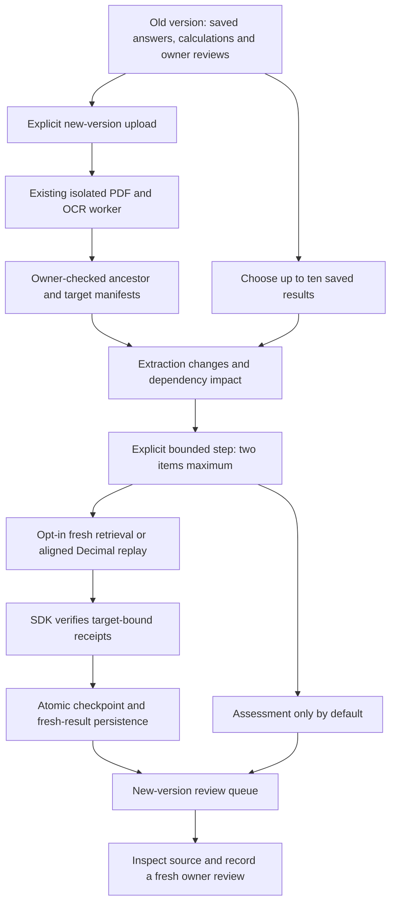

# Keep document answers current when the source changes

Workbench 0.3 connects the SDK's version-impact and revalidation workflow to the
private document library. A new report no longer has to leave yesterday's saved
answers looking current: compare the extracted evidence, assess dependencies,
explicitly rerun selected work, then inspect a new-version review queue.

The workflow uses local retrieval and deterministic tools. It does not add an
agent that can approve its own answers, or make citation validity a truth guarantee.

This guide records the 0.3 version workflow. Workbench 0.4 also connects a separate
[cross-document reconciliation workspace](document-workbench-reconciliation.md).
Frozen evidence sets block source deletion until those sets are explicitly removed.

## A useful walkthrough

Start the [Document Workbench](document-workbench.md). Upload a report, save a
question or table calculation, and inspect its source before recording a review.
Upload the replacement report with **New version of** explicitly set to the
earlier upload. The existing byte, page, parser and owner limits still apply.

Open the newer version. Under **Version impact & revalidation**, choose an
ancestor and select the saved results you want checked. Creation binds the exact
versions, source result digests, execution settings and result order. It does not
refresh anything. Identical creation retries return the same comparison.

Fresh retrieval and calculation replay default **off**. Leave them off for
assessment only, or enable them when creating a comparison. Settings are frozen
per comparison. A different execution choice creates a different comparison;
there is no hidden switch that changes an existing checkpoint's meaning.

Choose **Advance next two items**. Each request processes at most two saved items,
verifies the returned checkpoint, and persists it with fresh target results in one
SQLite transaction. A partial report explicitly shows how much remains unchecked.
You can reopen a saved comparison and resume after navigating away or restarting
the backend. A stale step fingerprint returns a conflict instead of replaying the
same step. Refresh before retrying after an uncertain response.

The review queue covers processed items only. It includes blocked work, unresolved
refreshes and fresh results that lack a supported new-version owner review—even
when the new answer text is unchanged. **Inspect fresh result and review** scrolls
to the normal source/citation and review workflow. No old review is copied.
A supported review removes that item from this application's attention queue; it
remains an owner attestation, not independent approval or a factuality certificate.
Unsupported and needs-review attestations remain visible for attention.

## What the change report means

The SDK aligns unique page content/anchors, literal text, bounded spatial overlap
and uniquely labeled table cells. The report distinguishes additions, removals,
relocation, modifications and uncertain matches, including numeric, unit, page,
address, extraction-method and confidence flags.

This is an **extraction-level** report, not a semantic or rendered-pixel diff.
`complete` means a bounded comparison finished over ready inputs; it does not mean
every region matched or that no meaningful change was missed. A new uncited
passage can still change the best answer. Even unchanged dependencies do not
authorize an old citation or review to represent a different version.

Answer refresh reruns retrieval against the target version. Calculation replay
requires unambiguous operands and row/column labels, preserving operand order
through supported reordering. Duplicate labels, held pages, unavailable alignment
or extraction-profile changes block replay rather than guessing. An answer can
refresh to an abstention; that remains a result to inspect, not a silent success.

## Explicit lineage, compatible migration

Every upload retains its own opaque application version ID, byte hash, manifest,
results and reviews. Linked versions share an SDK logical document ID. The parent
must be owned by the caller and already extracted. Comparison sources must be
ancestors of the target; sharing a filename or document family is not sufficient.

Existing 0.2 uploads migrate as independent roots. The migration does not rewrite
source bytes, manifests, receipts or reviews. Two already-independent uploads are
not retrospectively treated as versions of one another. If an identical stored
upload is requested under another parent, the request returns a conflict instead
of silently changing lineage. Do not delete existing evidence just to conceal
this distinction; use an intentional new upload when appropriate.

Deleting a parent with child versions is blocked. Delete leaves first if you
really intend to remove a version chain. Deleting a version also removes its
dependent comparisons/results/reviews through the existing private-library
deletion workflow. This is not immutable archival storage or backup erasure.

## Bounded local execution

- Up to ten selected source results and 2 MB of serialized saved-receipt input.
- Two items per explicit advance; zero to ten fresh answer attempts per comparison.
  A zero answer budget can still allow explicitly enabled deterministic tool replay.
- Extraction alignment is capped at 20,000 spatial comparisons per SDK diff.
- Checkpoints are private, server-owned records capped at 4 MB. Clients send only
  the expected fingerprint, never receipts, executable expressions or checkpoint JSON.
- At most twenty comparisons per owner and one hundred per library. Existing
  ten-document and twenty-results-per-document limits remain in force.
- SQLite serializes advancement with result writes. If a target result quota or
  checkpoint budget is exceeded, the entire step rolls back; no partial checkpoint
  is presented as completed work.

These are local built-in retrieval attempts, not provider requests, token usage
or a dollar-spend cap. No external embedding backend, selector, planner or model
adapter is installed by this path. There are no background model calls, automatic
advancement, retries, merges or publication.

The service owns synchronization over this local SQLite library. This is not a
distributed exactly-once job service. Checkpoints and hashes are integrity
bindings, not signatures, authenticated execution logs or publisher authentication.
Protect the database, temporary files and backups using the same controls as the
[document library](document-workbench.md). Saved questions, excerpts and notes
remain private evidence.

## API additions

All endpoints retain verified per-user authentication and no-store responses.
Extra JSON fields and stale bindings are rejected without echoing private input.

| Endpoint | Purpose |
| --- | --- |
| `POST /workbench/documents?name=...&parent_id=...` | Optional explicit parent on a new upload |
| `GET /workbench/documents/{id}` | Also returns owner-scoped family headers |
| `POST /workbench/documents/{target}/comparisons` | Freeze source/target fingerprints, selected result IDs and settings |
| `GET /workbench/documents/{target}/comparisons` | Minimal owner-scoped comparison history |
| `GET /workbench/documents/{target}/comparisons/{comparison}` | Verified progress, extraction changes, outputs and review queue |
| `POST /workbench/documents/{target}/comparisons/{comparison}/advance` | Explicit next step with expected checkpoint fingerprint |

New results use the existing digest-bound owner review endpoint. This does not
expose the SDK's separate correction authority or model-planning APIs. Cross-document
numeric reconciliation has its own scoped API and workflow in 0.4.

## Verification

The new controls cover lineage migration, owner isolation, stale versions and
steps, source/checkpoint bindings, assessment-only defaults, budgets, concurrent
advancement, atomic quota failure and review separation. UI contracts check that
creation does not automatically advance, literal evidence is escaped, partial
work is labeled, and fresh execution requires an explicit choice.

The Docker-backed control uses two authored PDFs: the replacement inserts a page,
reorders metric rows and changes the Requests value from 125 to 150. Revalidation
must calculate growth from 25% to 50%, cite physical page two, preserve the old
receipt and leave the new result unreviewed. This is an integration control, not
a held-out accuracy claim or live-model benchmark. Evidence is kept privately
under `data/evaluations/workbench-versions-20261018/`.

The October 18 local run passed 25 frontend transport/component tests, 63 affected
backend tests (including both real container integrations), and 246 underlying SDK
regressions. Four host-Tesseract checks skipped; OCR ran in the isolated image.
Typechecking, formatting, production build, Compose validation and the non-root,
read-only frontend HTTP smoke passed. Both authored version previews were visually
inspected. No live model requests, independent human answer-quality labels, Git
commits, pushes or cloud publication were produced by this iteration.

Source changes also required refreshing the deterministic retrieval artifact.
The small five-query holdout reports baseline NDCG 0.9594 versus candidate 0.9295;
the unchanged gate rejects promotion. Both retain recall/MRR 1.00. Serving remains
on the fixed baseline; these numbers do not measure document-answer quality.

Interactive browser/mobile visual QA remains unverified because the previous
browser security-policy rejection is still respected. No alternate browser or
control path is used to bypass it. Component tests and rendered source checks are
not a substitute for your manual interface/accessibility review.
