# Document Evidence Workbench

Workbench 0.2 connects a deliberately small part of the document SDK to the
authenticated browser: upload a PDF or image, inspect extraction gaps, retrieve
literal evidence, calculate from explicit table cells, and record an owner review.
It makes evidence inspectable; it does not promise that a retrieved passage is
the correct answer.

Workbench 0.3 adds [explicit version lineage and revalidation](document-workbench-versions.md):
compare extraction changes, rerun selected saved work in bounded steps, and review
fresh version-bound results without inheriting earlier approvals.

Workbench 0.4 adds [cross-document fact checks](document-workbench-reconciliation.md):
explicit scope and frozen source versions, exact-label numeric reconciliation,
guarded arithmetic and immutable owner reviews that cannot resolve conflicts.

Workbench 0.5 adds [numeric claim audits](numeric-claim-audits.md): check explicit
expected numbers/units against saved evidence, resume bounded batches, and export
a private evidence report. This verifies numeric consistency, not prose meaning.

Workbench 0.6 adds [change-aware audit replay](change-aware-claim-replay.md): keep
those assertions fixed, choose a comparable frozen target set and inspect support
changes from fresh receipts. Source audits and earlier owner reviews stay separate.

Workbench 0.7 adds [evidence-fragility stress tests](evidence-fragility-stress-tests.md):
omit each source in a separate diagnostic view, keep assertions and corroboration
policy fixed, and inspect support loss or selective-evidence risk. Original
sources, audits and reviews remain unchanged.

Workbench 0.8 adds [portable offline replay bundles](portable-claim-replay.md):
explicitly download the full private extraction snapshot and every completed
numeric check, then recompute them with the SDK without the service. Original
bytes and owner reviews are not exported; source authenticity is not established.

Workbench 0.9 adds [source-backed replay](source-backed-replay.md): explicitly
hash and re-extract one stored original, compare its fresh manifest with the
frozen source, then reproduce original numeric checks on an exact ready match.
It uses a runtime lease shared with uploads and preserves all stored evidence.

Workbench 0.10 adds [PDF cell concordance](pdf-cell-concordance.md): blind PDFium
reads of the physical rectangles behind cited native table headers and values.
It detects text/location disagreement without changing audit verdicts, rerunning
OCR or turning matching extraction into approval. Rebuild the dedicated image
to include the new fixed worker program.

Workbench 0.11 adds [pixel-backed cell checks](pixel-evidence-concordance.md):
explicitly render cited native cells, use bounded local English OCR, and expose
visible/native disagreement with confidence and boundary withholding. This uses
the same shared runtime slot, does not change original upload OCR settings or
audit verdicts, and requires the rebuilt dedicated image.

```mermaid
flowchart LR
    UI[Documents workspace] --> Auth[Verified bearer identity]
    Auth --> Bounds[Type, stream and owner quotas]
    Bounds --> Library[Private SQLite library]
    Library --> Sandbox[Non-root Docker worker: no network or host mounts]
    Sandbox --> SDK[Existing spatial SDK and optional local OCR]
    SDK --> Evidence[Frozen manifest and raster previews]
    Evidence --> Query[Literal retrieval or explicit Decimal calculation]
    Query --> Verify[SDK receipt verification]
    Verify --> Inspect[Clickable citations and region highlights]
    Inspect --> Review[Immutable owner review bound to result digest]
```



## Try it locally

From the repository root, build the dedicated parser image:

```bash
docker build -f docker/Dockerfile.document-workbench -t agentforge-document-workbench:local .
```

Set these in the backend's ignored configuration, not in frontend variables:

```dotenv
ENABLE_USER_AUTH=true
WORKBENCH_DOCUMENTS_ENABLED=true
WORKBENCH_DOCUMENT_DB=data/workbench-documents/library.db
```

Run the existing backend **on the host**, with access to the local Docker CLI and
daemon. Start the frontend using its [quickstart](../frontend/README.md), sign in,
then choose **Documents**. No API key or model-request consent is needed for this
local extractive workflow. OCR is a separate upload checkbox and defaults off.
Build the image again after changing the SDK or worker implementation.

The standard Compose service does not contain a Docker CLI or socket mount for
this feature. Merely enabling the flag inside that service will not make parsing
work. This iteration intentionally does not grant a web-facing service the Docker
socket automatically. Use a trusted local operator account; do not expose this
controller to unrestricted public traffic.

## What you can inspect

The library shows the actual processing status: `processing`, `ready`, `held` or
`failed`. Each immutable upload has a SHA-256 byte version. Repeating the same
owner/name/bytes/OCR choice returns the same record; changing bytes or the OCR
choice creates another record. In 0.3, **New version of** explicitly links a child
to an owned, extracted parent; independent uploads are not inferred to be versions.
A failed leaf upload can be deleted and resubmitted.

Page previews contain re-encoded PNG pixels, not embedded original PDFs, HTML,
attachments or active document objects. Page status, extraction method and hold
reason remain visible. Citation buttons select the physical page and highlight
the **whole extracted region**. This is not word-level alignment. Held geometry
does not receive an evidence highlight.

Questions return the SDK's literal excerpts or an abstention. There is no model
planner, external embedding request, synthesized explanation or fallback provider.
Any held physical page blocks document-wide answers and calculations. The parser
does not silently drop difficult pages.

Open the regions to select native table cells. Their selection order determines
operand order: difference is first minus second; ratio is first divided by second;
percent change is old then new. The SDK checks arithmetic, compatible unit syntax,
operand identity and lineage. Scanned numbers are not automatically promoted to
calculation-ready native cells. Table labels, units and financial semantics are
not guessed, and selecting the wrong cells can still produce irrelevant arithmetic.

Results are saved with the exact request, document manifest, SDK receipt and result
digest. The reviewer explicitly inspects the source and chooses supported,
unsupported or needs review. The backend records the authenticated owner and
refuses a changed digest or overwritten review. Identical review retries are safe.
**This is an owner attestation, not independent approval, a truth certificate or
the SDK's separate reviewed-correction authority.**

## Execution and data boundaries

- Uploads: PDF/PNG/JPEG only; filename/type/signature checks; streamed 3,000,000-byte
  limit and 20-second receive deadline. Names are display metadata, never host paths.
- Extraction: at most 10 physical pages, 6 million input/render pixels per page,
  400 regions and 100,000 extracted characters. Local English OCR is optional.
- Worker: locally built image resolved to an immutable image ID; no image pull on
  requests; user 10001; network/IPC disabled; read-only root; no capabilities;
  no-new-privileges; 512 MiB RAM/swap ceiling, one CPU, 64 PIDs, 96 MiB tmpfs.
- Transfer: fixed controller programs, bounded file stdin and bounded stdout;
  no host bind mounts, archive extraction, shell command input, credentials or
  environment files in the worker. Parsing has a 90-second stage timeout and
  a 130-second controller deadline plus up to 10 seconds for forced cleanup.
- Cleanup: uniquely named owned containers are force-removed in `finally`;
  auto-remove and a 180-second container lifetime also bound abrupt controller loss.
  The default Docker/seccomp boundary is risk reduction, not VM-grade isolation.
- Storage: 10 documents per owner, 100 per library, one active extraction per DB,
  20 saved results per document, 200 KB per result, bounded preview output.
  A processing lease older than five minutes is marked interrupted on the next
  library interaction. Uploads do not form a distributed task queue.

The SQLite file contains originals, previews, questions, receipts and review notes
in plaintext. It defaults to an ignored private data directory; custom paths must
also be kept out of Git and web roots. Protect it with OS permissions and encrypted
storage. Owner checks apply to every document/result/preview operation; no raw-file
download or directory-browsing endpoint exists. Deletion cascades results/reviews
with SQLite secure deletion enabled, but is **not** an SSD, snapshot or backup
erasure guarantee. Do not delete a document unless you intend to remove its review
history too.

An interrupted browser request does not cancel extraction. Refresh the library
before retrying. Input and output files live only in controller temporary storage
or the container's tmpfs; private library content is not placed in frontend assets.

## API surface

All paths below sit under `/workbench/documents` and require verified per-user
authentication. JSON requests reject extra fields; validation errors do not echo
submitted text. Responses are no-store.

| Method and suffix | Purpose |
| --- | --- |
| `GET /` | Minimal owner library headers |
| `POST /?name=report.pdf&ocr=false` | Raw media body; bounded synchronous extraction |
| `GET /{id}` | Owner manifest and saved results/reviews |
| `GET /{id}/pages/{page}` | One sanitized PNG preview |
| `POST /{id}/queries` | Fingerprint-bound question or selected-cell calculation |
| `POST /{id}/results/{result}/reviews` | Digest-bound immutable owner review |
| `DELETE /{id}` | Delete an owned non-processing document and dependent records |

These are exact paths without a trailing slash on the library root. They are not
an arbitrary tool-execution API. Repository paths, OCR commands, model identifiers,
image names, user identities and document versions cannot be chosen by the browser.

## Base 0.2 verification and limits

The measurements below describe the base 0.2 snapshot. Current version-aware
workflow checks are recorded in the [0.3 guide](document-workbench-versions.md) and
current cross-report controls in the [0.4 guide](document-workbench-reconciliation.md).

The local verification exercises actual Docker PDF extraction, a ruled-table
calculation, raster re-encoding, OCR-off holds, OCR-on English extraction, malformed
PDF rejection and container cleanup. Authored API/UI tests cover owner isolation,
byte/type bounds, immutable review, stale fingerprints, idempotent records and
explicit actions. The CI workflow now includes the isolated document controls.
Local evidence is kept under `data/evaluations/workbench-documents-20261018/`.

On October 18, local checks passed 20 frontend transport/component tests and 53
affected backend controls, including the real isolated document integration. The
underlying SDK regression selection passed 185 tests with four host-Tesseract
skips; English OCR ran successfully inside the dedicated worker. Typechecking,
production build and the frontend's read-only, non-root Nginx HTTP smoke passed.
The authored source preview was visually inspected, including its ruled table;
this was a PDF rendering check, not browser layout QA.

The source-bound retrieval snapshot was refreshed without activating its learned
candidate: the five-query holdout reports baseline NDCG 0.9433 versus candidate
0.9295, so promotion remains rejected. Both retain recall/MRR 1.00. This is a small
repository-retrieval regression check, not evidence that document answers improved.

These controls do not establish real financial-task accuracy or OCR quality across
languages/layouts. No new provider calls or human answer-quality labels were
collected. SDK correction bundles and model planning remain SDK workflows, not
hidden browser features. Version-impact analysis and bounded local revalidation
are connected in the separate 0.3 workflow; cross-document numeric reconciliation
is now explicitly connected in 0.4, with its own scope, policy and review limits.
Financial answer coverage remains a separate quality
problem documented in the [live pilot audit](document-reasoning-audit-2026-10-17.md).

Frontend verification covered component interactions, request contracts,
typechecking, production assets and the static HTTP runtime.
