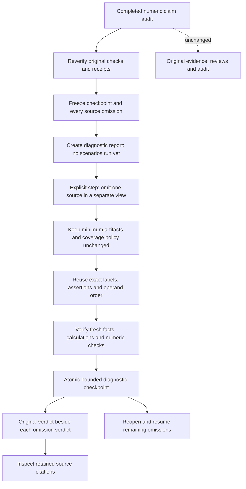

# Would the same numeric claim survive one missing source?

A supported number can depend on a surprisingly fragile evidence set. A conflict
can also disappear simply because the inconvenient report was left out.
Workbench 0.7 makes both cases visible with a leave-one-source-out diagnostic.
It rechecks a completed numeric audit against every single-source omission,
keeping the original policy, assertions and calculation recipes fixed.

This is a local evidence test, not another model or a source-ranking agent.
Nothing is deleted, the real audit is unchanged, and apparent support after an
omission is never permission to ignore the omitted source.



## Try it in the Workbench

Follow the [document setup](document-workbench.md), create an explicitly scoped
[frozen evidence set](document-workbench-reconciliation.md), and complete a
[numeric claim audit](numeric-claim-audits.md). No provider key or model-request
checkbox is required. The document runtime remains disabled until an operator
builds and configures it.

In the completed audit, choose **Open evidence stress tests**, give the diagnostic
a name, and choose **Create evidence stress test**. Creation freezes the source
checkpoint and the server's full omission order; it runs no omission scenario.
Choose **Run next source omission** for each step. Reopen the saved report to
resume after navigation or a backend restart. After an uncertain response,
refresh before retrying; stale checkpoints are rejected, not silently retried.

For three distinct reports showing Requests of 100 then 125, an assertion of
25% growth remains supported when any one report is omitted: two corroborating
artifacts remain. For only two reports, omitting either leaves one artifact.
The original two-artifact requirement still applies, so those variants withhold
the value. The diagnostic does not lower the threshold to manufacture stability.

Now let the third report show 150 instead of 125. The real audit is unresolved.
Dropping the dissenting report makes the two remaining reports agree at 125.
The matrix labels this **support_appeared_after_omission**: a warning about
selective evidence, not a repaired conflict or a recommended source exclusion.

Each matrix cell retains the original verdict next to the diagnostic verdict.
**Inspect retained evidence** opens citations from the remaining sources and
navigates their actual application document IDs and physical pages. Source names
and claim labels render as plain text. Pending cells are not passes. Support
counts count assertion/scenario cells, not publishers or independent studies.

## What the result does and does not establish

- `support_lost`: the original numeric assertion was supported but is no longer
  supported in this omission view.
- `support_appeared_after_omission`: an originally unsupported assertion becomes
  supported only after removing one source from the diagnostic view.
- `observed_value_changed`: both sides release a value, but value or unit differs.
- `verdict_changed` or `unchanged_verdict`: other verdict-category comparisons.
  Unchanged verdicts alone do not prove unchanged values or evidence quality.

“Numeric support survived” requires a supported baseline and completion of every
planned single-source omission. An unsupported baseline receives no stability
claim. Partial runs also receive no stability claim. No report has an answer-
approval field or an action that changes the real source set.

This test does not establish publisher truth, source independence, semantic
entailment, extraction accuracy, real-world robustness or causality. Different
file hashes do not prove independent provenance; identical raw artifacts still
count only once. It tests exactly one omitted source at a time, not arbitrary
combinations, paraphrases, model changes or out-of-distribution documents.
Retained sources can still share the same error.

## SDK 0.9: policy-preserving source views

`EvidenceSet.source_ids` returns stable source identifiers.
`EvidenceSet.without_sources([...])` creates a separate view with the same
reconciliation configuration and retained reader objects:

```python
# evidence is an existing, explicitly scoped EvidenceSet; query is its FactQuery.
original = evidence.lookup(query)
for source_id in evidence.source_ids:
    diagnostic = evidence.without_sources([source_id])
    fact = diagnostic.lookup(query)
    assert diagnostic.verify_fact(fact)
    # Compare conservatively; do not replace the original receipt or choose a winner.
assert evidence.verify_fact(original)
```

The SDK accepts a nonempty list/tuple of unique known identifiers and refuses to
remove every source. It preserves minimum artifact count, full-coverage policy
and extraction bounds. The original set is not modified. Reviewed readers retain
live expiry/revocation checks; the new view is not a copied approval. Receipts
remain bound to their own source context. This trusted Python API is not a sandbox
against a caller rewriting private objects.

## Persistence, API and limits

The service adds one private SQLite table and an owner/history index. Diagnostic
checks live in that table, not as saved evidence results. A full source set's
twenty-result capacity does not prevent a stress test or get consumed by it.
Reading a saved report recomputes its completed scenarios and compares them with
the checkpoint, rather than trusting stored verdicts alone.

- Two to five sources and up to ten original assertions; at most fifty
  assertion/scenario cells. Clients cannot choose only favorable omissions.
- One new omission scenario per explicit step; read-time verification can replay
  previously completed local checks. No models, provider requests or background
  workers are involved.
- Twenty reports per owner, one hundred per library; identical creates deduplicate
  even at quota. Checkpoints are capped at 150 KB and reports at 3 MB.
- SQLite serializes advancement; stale/concurrent steps reject or roll back.
  Existing file, parser, receipt and source quotas remain unchanged.
- Deleting a stress report preserves its source audit, saved evidence and files.
  Deleting the source audit or frozen set cascades dependent diagnostics. This is
  not an erasure guarantee for exports, disk snapshots or backups.

The authenticated, no-store routes sit under
`/workbench/documents/reconciliations/{set}/audits/{audit}/stress-tests`:

| Method and suffix | Purpose |
| --- | --- |
| `GET` root | Minimal owned diagnostic history |
| `POST` root | Freeze name and expected source checkpoint; no scenarios run |
| `GET /{run}` | Reverified matrix and retained-source observations |
| `POST /{run}/advance` | One new omission, requiring the current checkpoint |
| `DELETE /{run}` | Delete this diagnostic report only |

The root has no trailing slash. Strict requests reject policy overrides, source
selection and extra fields without echoing private values. Owner checks apply to
every operation. Fingerprints detect changes; they are not signatures against a
malicious database administrator.

## Verification scope

Authored SDK/API/component controls cover preserved thresholds, agreeing and
conflicting sources, raw artifact aliases, review revocation, fixed assertions,
lazy creation, explicit steps, partial reports, stale/concurrent requests,
restart/resume, ownership, quotas, tampering, rollback and deletion boundaries.

The actual Docker control extracts four authored PDFs. Three agree at 125;
the dissenting fourth shows 150 in a table on physical page two. Separate
agreeing and conflicting sets each run all three omission scenarios, recheck
both a fact and a percent-change assertion, navigate retained page-two citations,
and assert the original audits and saved results remain byte-for-byte unchanged
at the JSON level. These are integration controls, not a held-out financial
benchmark or proof of general answer accuracy.

Local run evidence is private under
`data/evaluations/workbench-evidence-stress-20261018/`.

The October 18 local run passed **42 frontend tests**, **146 affected backend
tests** including the actual Docker integrations, and **288 SDK tests**. Four
host-Tesseract checks skipped; English OCR passed in the Docker selection. A final
14-test stress-only rerun also passed with the stronger saved-result equality
assertion. These are explicit selections, not a claim that the entire repository
or every model configuration was retested.

Typechecking, production build, Prettier, scoped Ruff, SDK 0.9 wheel installation
outside the checkout, Compose validation and the non-root/read-only Nginx HTTP
smoke passed. The dissenting PDF's page-two PNG was inspected: table borders,
headers and the Requests 100/150 values were readable. That inspects source
rendering. The build and runtime checks used the existing local Workbench.

The deterministic retrieval artifact was refreshed against prospective public
source through a temporary index; exact reproduction and the unchanged strict
regression test passed with the real Git index unchanged. The five-query holdout
reports baseline/candidate recall 1.00/0.90, MRR 1.00/1.00 and NDCG 0.9594/0.8735.
Candidate promotion remains rejected, and serving retains the fixed baseline.
These metrics do not measure evidence-stress or numeric-check accuracy.

Syntax and relative-link scans passed across the versionable source. Configured
secret-value scans found no matches in that source or built frontend assets and
no private versionable paths. This is not an audit of every possible credential
or the full Git history. An initial restricted SDK test attempt hit a temp setup
error (14 passed, one setup error); explicit disposable-directory runs outside
that restriction passed. No production retry or parser-limit relaxation was
added.

The checks made no provider calls and did not publish a cloud deployment.
