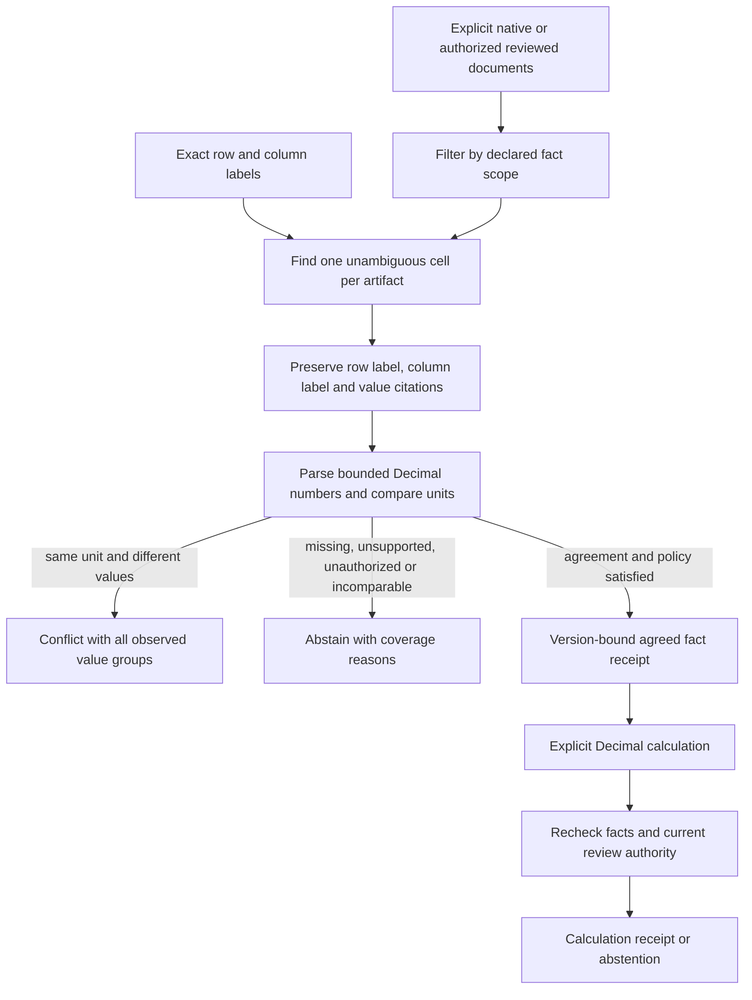

# Check numerical agreement before calculating

A quoted number can be perfectly traceable and still disagree with another
report. SDK 0.6 adds `EvidenceSet`: look up an explicitly named table fact across
selected documents, retain the label/value citations, and refuse to calculate
from unresolved evidence.

This is a deterministic numerical guard for a document/RAG application, not an
LLM that understands arbitrary contradictions. It matches exact row/column labels
inside a caller-declared scope. It does not choose the newest report, take a
majority vote, infer reporting periods, authenticate publishers, or establish
that matching reports are true.



## A complete lookup

Install `./sdk[multimodal]` from the full checkout. Supply existing local PDFs with
native ruled tables, or use `ReviewedRAG` readers for explicitly reviewed grids.
No OCR or network processing starts implicitly.

```python
from pathlib import Path
from agentforge_sdk import (
    EvidenceSet, EvidenceSource, FactQuery, MultimodalRAG, load_multimodal,
)

# The application asserts these reports describe comparable metrics, entities,
# reporting periods and scales. This string is NOT extracted or authenticated.
scope = "atlas:2026-Q1:request-counts"
sources = [
    EvidenceSource("operations", scope, MultimodalRAG(load_multimodal(
        Path("operations.pdf"), document_id="operations", version="q1"))),
    EvidenceSource("finance", scope, MultimodalRAG(load_multimodal(
        Path("finance.pdf"), document_id="finance", version="q1"))),
]
evidence = EvidenceSet(sources)
after = evidence.lookup(FactQuery(
    row_label="Requests", column_label="After", scope=scope,
))
assert evidence.verify_fact(after)
if after.status == "agreed":
    print(after.value, after.unit)
else:
    print(after.status, after.reasons)  # No winning value is supplied.
```

Each observed numeric cell has three citations, in order: the original first-column
row label, first-row column label, and value. Matching is case-sensitive, literal
and whitespace-canonical. It does not infer a multirow header or match synonyms.
Multiple matching tables, duplicate matching labels and incomplete grids are
ambiguous. Any incomplete physical page holds the entire source, as elsewhere in
the spatial SDK. Flat OCR text does not become a table automatically.

`ReviewedRAG.citation(region_id, quote=None)` now provides the same explicit
literal lookup as `MultimodalRAG`, while preserving reviewer origin, approval and
original-page lineage. It checks source bytes and current authorization before
and after access. Reconciliation retains these wrappers; it never strips them
into apparently machine-extracted evidence or issues a review approval.

## Three outcomes, no silent winner

| Status | Meaning |
| --- | --- |
| `agreed` | All observed comparable values agree and the configured coverage/artifact policy passes. |
| `conflict` | Observed values in the same recognized unit disagree; no majority or latest-version rule resolves them. |
| `abstained` | Coverage, scope, extraction, authority, ambiguity, number syntax or units prevent an agreed result. |

An observation records `observed`, `missing`, `out_of_scope`, `held`, `ambiguous`,
`unsupported_number` or `unauthorized`. Missing is not zero. Out-of-scope evidence
does not vote. A conflict can coexist with other coverage problems: all reasons
remain in the receipt, and no result is released.

The default requires two distinct **raw file hashes** and complete coverage among
in-scope sources. Aliases of one exact file cannot satisfy that count. Different
serializations or metadata-only copies can still have different hashes: this is
not content deduplication, independent-source corroboration, or confidence.
The application owns source selection and should not treat a file count as truth.

```python
from agentforge_sdk import ReconciliationConfig

# Explicitly allow a single artifact, or allow missing facts in some sources.
# Neither setting bypasses held extraction, ambiguity or unavailable authority.
config = ReconciliationConfig(
    min_distinct_artifacts=1,
    require_complete_coverage=False,
)
```

## Calculate only from checked facts

```python
before = evidence.lookup(FactQuery(
    row_label="Requests", column_label="Before", scope=scope,
))
growth = evidence.calculate("percent_change", [before, after])
assert evidence.verify_calculation(growth)
if growth.status == "calculated":
    print(growth.value, growth.unit)
else:
    print(growth.reason)
```

Supported tools are `sum`, `difference`, `ratio` and `percent_change`; operand
order is explicit. The shared numeric implementation uses 50-digit Decimal
precision and ROUND_HALF_EVEN, including the existing single-document tools.
Percent change is `(new - old) / abs(old) * 100`. Duplicate fact queries cannot be
counted twice. Unit mismatches and zero denominators abstain. Unresolved facts
block calculation, including a conflict with a large agreeing majority.

The parser supports bounded plain dot-decimal numbers, USD/EUR/GBP codes or
symbols, and a percent suffix. Equivalent forms such as `125` and `125.0` compare
equally. Comma grouping, locale guessing, exponent notation, dates, compound units,
percent-plus-currency and conversion are unsupported. `scalar` means no explicit
recognized unit, not proof that two metrics have compatible physical dimensions.
Metric definitions, scale annotations and the meaning of a requested calculation
remain caller responsibilities.

Facts are rechecked before and after successful arithmetic. Reviewed revocation,
expiry or source changes invalidate earlier facts/calculations. Invalid inputs
return `unverifiable_fact` with fingerprints but no copied source facts or values.
For this special diagnostic receipt, verification requires the original inputs:
`evidence.verify_calculation(result, facts=original_facts)`. Ordinary results and
unresolved/unit/zero-denominator abstentions retain their input facts and verify
without that argument.

## Bounds and trust

A set contains 1-16 explicit sources, with 8,000 total regions and two million text
characters by default; configuration caps are 16,000 and eight million. Table
addresses and label indexes are built once. A calculation accepts at most 16
unique fact queries; non-sum tools require two.

Lookup, verification and arithmetic call no selector, embedding backend or LLM.
They add no model download, automatic persistence, telemetry or mandatory
dependency. These are in-process work bounds, not a hostile-document sandbox or
hard memory/latency guarantee. Keep documents, receipts and review capabilities
inside the application's existing trust boundary. Receipts contain excerpts and
values; protect serialized output. Fingerprints are integrity bindings, not
signatures or billing/approval proof.

The set is bound to its configured source contexts and scope assignments. It does
not discover newer reports or mutate a `RevalidationBatch`. Plain extracted
readers retain frozen-manifest trust; they do not reread source files. Reviewed
readers retain their current process-local approval and source-file checks. No
API can promise an approval will remain valid after it returns.

## Reproduce

```bash
python -m pytest tests/test_evidence_reconciliation.py -q
python -m evals.evidence_reconciliation_evaluation \
  --output-dir data/evaluations/evidence-reconciliation/example
```

These authored PDFs exercise agreement, a page-two disagreement, numeric replay,
unit conflict, duplicate labels and artifact aliases with actual extraction.
They do not measure real-world semantic contradiction recall or factuality.
See the [execution audit](evidence-reconciliation-audit-2026-10-17.md).

SDK 0.9 adds [`source_ids` and policy-preserving omission views](evidence-fragility-stress-tests.md).
They support diagnostic leave-one-source-out checks without relaxing thresholds,
mutating the original collection or losing retained readers' review authority.
The Workbench exposes a separate bounded matrix; neither path chooses a winning
source when the original evidence conflicts.
