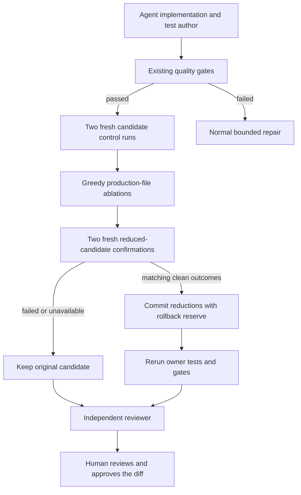

# Execution-guided patch minimization

AI fixes can pass tests while also carrying unrelated edits. This opt-in step asks
a concrete review question: can a production-file change be restored to its
original state while the same tests still pass? It turns that question into a
bounded execution experiment before the independent reviewer sees the final diff.



## How it works

The minimizer captures the filtered candidate manifest and the original repository
digest. It reads original production text from the workspace's immutable baseline
snapshot, not from a model response. Tests, non-Python configuration, `conftest.py`,
and recognized Python configuration/build filenames (`setup.py`, `noxfile.py`,
`fabfile.py`, `settings.py`, `config.py`) are not candidates for removal. Invalid,
oversized, ambiguously decoded, secret-bearing, or instruction-tainted source is
excluded. Other Python files can still contain configuration or side effects;
the filename exclusions are conservative heuristics, not semantic classification.

Two fresh Docker runs first establish a clean candidate control. A fixed pytest
harness requires at least one case and captures hashed identities and setup/call/
teardown outcomes. Skips, xfails, fixture errors, collection errors, and empty
collections cannot authorize a reduction. At most 200 cases are supported.

Eligible changed Python files are tried in deterministic path order. Each proposal
restores one more original file, or removes a newly added file, in fresh copies.
Accepted removals accumulate only when two runs agree and exactly the original
control test identities pass. The final combined proposal gets two additional
confirmation runs. Tests and all other filtered files must retain their expected
bytes; a test run that modifies them is invalid evidence.

Only then are the accepted restorations applied to the candidate workspace.
Commit checks source bindings and requires a strictly smaller unified diff.
Failure restores the previous candidate; a failed rollback or source drift blocks
the workflow rather than launching more repair. Every mutation attempt, including
rollback, consumes the existing workflow write budget. Original repositories are
never edited.

The normal owner command and quality gates rerun after mutations. Counterfactual
regression verification, when enabled, then checks the reduced patch. Independent
review and human approval remain mandatory. Provider holds prevent the optional
experiment from starting, and failed prerequisite gates do not run ablations.

## Enable deliberately

This is off by default and supports `verified_pr`, `repair_tournament`, and
`adaptive_supervisor`, not the standalone single-agent workflow. Unsupported
service/benchmark combinations are rejected before execution or checkpoint creation.

```dotenv
CODE_AGENT_PATCH_MINIMIZATION_ENABLED=true
CODE_AGENT_PATCH_MINIMIZATION_MAX_FILES=3
CODE_AGENT_PATCH_MINIMIZATION_TIMEOUT_SECONDS=180
```

Restart both API and worker after changing configuration. Use the trusted image
from `docker/Dockerfile.code-sandbox`; no new sandbox dependency is required.
Networking must stay off and Python must be operator-allowlisted. Current owner
commands are restricted to `python -m pytest -q`, `python3 -m pytest -q`, or
`pytest -q`. Custom commands abstain instead of being rewritten silently.

Defaults admit at most three eligible file changes and ten completed trial runs
(two controls, up to six ablations, two confirmations). The hard file cap is six,
giving at most sixteen completed trials per review round. At most half the
remaining workflow writes are admitted so rollback has headroom. Files are bounded
at 100,000 source characters within the existing copy/file/repository limits.

The local time limit and remaining workflow deadline are soft admission limits,
with thirty seconds reserved for verification/cleanup and each test command
capped at thirty seconds. Docker startup, copy, and cleanup add latency and can
outlast admission estimates. Repeated rounds and parallel tournament teams can
multiply that work. No extra model call is made by the minimizer itself; this is
not a promise of cheaper total inference or faster repairs.

The instrumentation harness disables ambient pytest options and third-party
plugin autoload. Repository configuration/hooks still run in the container, and
their behaviour may differ from the unchanged owner command. Plugin-heavy suites
can abstain. There is no runtime package installation or host-execution fallback.

## Reviewable evidence and comparisons

Each verification round retains `patch_minimization`: status/reason, original and
candidate digests, owner-command digest, eligible/removed paths, restored-content
digests, bounded hashed test outcomes, repeat receipts, mutation attempts, patch
character counts, elapsed time, and an evidence fingerprint. JSON/Markdown PR
dossiers expose this without storing raw test logs or original source in the report.
Ordinary trajectories retain their existing private-source/output risks.

Benchmark outcomes, resumed checkpoints, reports, and release cards preserve
`patch_minimized_cases`, `minimization_removed_file_changes`,
`minimization_completed_trials`, and status counts. These describe accepted
optimization actions and completed receipts in each case's latest retained result,
not discarded retries, interrupted probes, or final net savings across later
repairs. Tournament output exposes the selected team's evidence, not every losing
team's ablation. Missing/invalid completed-workflow evidence withholds publishable
quality metrics rather than treating an unproven reduction as a success.

```bash
python -m evals.patch_minimization_evaluation --output data/evaluations/patch-minimization/controls.json
python -m code_agent.benchmark_release validate evals/experiments/patch_minimization_matrix.json
```

The locked smoke matrix changes only this flag between two otherwise identical
verified-PR variants. After Docker and provider access are available, the following
is an explicitly billable live comparison:

```bash
python -m code_agent.benchmark_release run evals/experiments/patch_minimization_matrix.json
```

Or add `--patch-minimization` to the coding evaluation CLI. Compare actual final
patch size alongside resolution, regressions, latency, calls, and cost per resolved
issue; shrinking patches is not a replacement for those quality metrics.

An optional real-container drill uses only an authored repository and no model:

```bash
python -m evals.patch_minimization_evaluation --docker --output data/evaluations/patch-minimization/docker.json
```

## Evidence limits

This is greedy **file-level** minimization, not statement-level delta debugging,
global minimality, or a proof of semantic equivalence. Uncovered acceptance criteria
can be lost while tests pass. Small path limits and deterministic ordering can miss
better combinations. Two repeat runs do not statistically establish freedom from
flakiness. Malicious repository hooks can forge receipts; digests detect drift,
not authenticity. Keep independent review and a meaningful test oracle.

Eight authored controls test the acceptance predicate, not live repair quality.
Separate tests execute the fixed harness on trusted literal host fixtures and test
the complete controller with scripted Docker outcomes. That host execution is
test-only, never a fallback for user repositories. The Docker drill on this checkout
reported unavailable and preserved the candidate. No real-model quality, review
time, or cost improvement is claimed.

## Local verification — October 4, 2026

The affected suite passed 387 tests with seven skips on Python 3.13 and 382 with
twelve skips on Python 3.11. An additional security/retrieval/dispatch/service
suite passed 137 tests on Python 3.13. The focused controller/evaluation/checkpoint
suite passed 66 tests with one Docker skip and reached 97.38% combined
statement/branch controller coverage. The embedded harness string is excluded from
that coverage metric; its two trusted literal host-fixture cases passed separately
on both versions. Five earlier spectrum-harness cases skip on Python 3.11 because
its isolated interpreter lacks Coverage.py. Other skips require Docker or Windows
directory-symlink support.

All eight authored minimization controls passed, and the paired five-task matrix
validated as frozen. The optional Docker drill reported `unavailable`, completed
no trials, made no mutations, and retained the same candidate digest and diff.
This is not an end-to-end container success or a paid-model benchmark result.

The source-bound retrieval artifact reproduces exactly on Python 3.11 and 3.13.
Its five-query holdout retains Recall@8/MRR `1.00`, but learned NDCG@8 `0.9433`
is below fixed-weight NDCG@8 `0.9594`; promotion is rejected. The refreshed
artifact is a reproducible candidate, not an activated serving policy.

The harness uses the public [pytest reporting hooks](https://docs.pytest.org/en/stable/reference/reference.html).

Later October 4 follow-up: the real Docker drill removed the authored unnecessary
`support.py` change across six repeated trials while retaining the essential fix.
The live smoke run retained its only production-file change; no shrinkage or
coding-quality gain is claimed for that task. See the
[full audit](live-upgrade-audit-2026-10-04.md) for source integrity, patch replay,
and the still-held real-task/provider paths. Earlier Docker failures remain historical.
