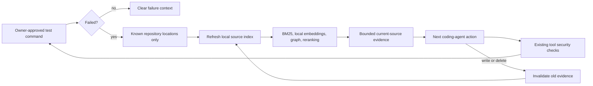

# Execution-guided code retrieval

## What changed

A bug report is often less precise than the first failing test. Previously, the
coding workflow selected its initial context from the issue and kept that pack
through the implementation loop. The agent could read and search more files, but
retrieval itself did not react to execution evidence.

The opt-in execution retriever adds that feedback loop. Before the next action-model
call, it extracts recognizable failure locations, retrieves relevant current source,
and supplies a separate bounded evidence message. It does not propose a patch or
claim to diagnose the root cause. The model still has to inspect, edit, and verify.



## How it works

- Location extraction recognizes Python traceback frames, pytest failure paths, and
  `file:line` locations for TypeScript, JavaScript, Java, Go, and Rust. Paths must
  exist in the filtered workspace index. Traversal, external absolute paths, and
  ambiguous basename matches are ignored. This is a bounded parser, not complete
  support for every test framework, source map, or compiler diagnostic.
- Queries contain validated paths and fixed retrieval facets. Exception messages,
  assertion values, and arbitrary log instructions are not copied into the query.
  Existing observations still contain bounded test output; the whole trajectory
  is not content-free.
- Retrieval combines BM25, local hashing embeddings, dependency-graph signals, and
  feature reranking. It ignores optional remote/neural backend settings and fusion
  artifacts. No provider call or model download is added. The execution index uses
  Python AST/bounded fallback parsing; the initial code-intelligence index retains
  its existing configured parser, including optional Tree-sitter.
- File hashes allow unchanged parsed documents and embeddings to be reused. A write,
  delete, or newly observed test result triggers reconsideration. Replanning with
  unchanged observations reuses the pack. A new test result can consume a refresh
  even if its text is identical, because tests may have changed workspace files.
- Old dynamic evidence is cleared before refresh. If retrieval fails, a file is
  deleted, or the cap is exhausted, stale dynamic source is not sent again.
  The original issue-context remains available; current dynamic snippets explicitly
  supersede its snippets for the same paths.
- Retrieved content is untrusted and participates in existing action-policy taint
  checks. Packs with detected secret patterns are withheld. Injection taints are
  recorded for the owner-approval boundary; detection is heuristic, not a guarantee
  that every secret or injection can be recognized.

## Opt in

The default remains disabled. Configure both the API and separately deployed worker
consistently, then restart them:

```dotenv
CODE_AGENT_EXECUTION_RETRIEVAL_ENABLED=true
CODE_AGENT_EXECUTION_RETRIEVAL_MAX_REFRESHES=4
CODE_AGENT_EXECUTION_RETRIEVAL_MAX_TOKENS=1024
```

These are also typed `SandboxPolicy` fields. The benchmark CLI exposes the switch:

```bash
python -m code_agent.evaluation evals/datasets/code_agent_smoke.jsonl \
  --repository-root tests/fixtures/code_repositories --workflow verified_pr \
  --execution-retrieval --output-dir data/evaluations/execution-retrieval-live
```

Caps apply **per coding stage**, including each implementation, test-author, and
repair stage, not globally across tournament candidates. The default cap is four
attempts; no-anchor, unsafe-content, and error attempts also consume it. Each attempt
indexes at most 1,000 files and 250,000 characters per file, subject to tighter
workspace limits, and selects at most six files. Balanced packing uses approximate
character-based tokens. The extra message increases prompt usage; retrieval is not
claimed to reduce total cost. Tournament reservations include the extra message;
actual provider usage is measured separately where supplied.

Provider holds are checked before retrieval. The stage deadline is checked after
local retrieval and before model admission. A background indexing thread is not
preempted mid-file on timeout/cancellation; existing outer workflow timeouts remain
relevant. This is bounded local work, not a hard real-time scheduler.

## Evidence receipts

`CodeAgentResult.execution_retrieval` records stage, iteration, trigger, status,
failure/query/context/index hashes, anchor paths, selected file hashes, approximate
tokens, parse/reuse counts, and latency. Source, failure text, and query prose are
not stored in this new receipt. Paths still reveal repository metadata and require
appropriate artifact access controls.

Verified-PR retains receipts across stages. Tournaments keep their existing
publication rule: only the winner's patch and associated retrieval receipts appear
in the final result. Non-winning stages' detailed retrieval receipts are not
retained in the published tournament report. A held tournament has no winning
retrieval evidence; this limits per-branch retrieval analysis in the current version.

Statuses are `selected`, `no_anchors`, `budget_exhausted`, `unsafe_context`, and
`error`. They are retrieval outcomes, not correctness or security certifications.

## Validation and the next real experiment

The credential-free runner uses six authored language fixtures with a deliberately
vague issue and ten near-identical distractor files:

```bash
python -m evals.execution_retrieval_evaluation \
  --output data/evaluations/execution-retrieval/controls.json
python -m code_agent.benchmark_release validate \
  evals/experiments/execution_retrieval_matrix.json
```

On the October 4 control run, all six supplied failure locations led to retrieval
of the target file, within the 1,024-token approximate cap. Static issue-only
retrieval selected none of these targets. That contrast is intentionally caused
by ambiguous fixtures and additional location information. It is **not** evidence
of a general retrieval gain, improved coding resolution, six-language execution
support, or lower live-model cost. The bundled Docker image is Python-focused.

Unit and scripted-agent tests cover location confinement, secret rejection,
untrusted-context taints, freshness after edits, budget invalidation, disabled
defaults, provider holds, and verified-PR receipt aggregation. CI runs these authored
controls and validates the frozen comparison matrix.

The frozen affected suite passed **162 tests with four skips** on each of Python
3.11 and 3.13. Additional security, retrieval-CI, and dispatch-control tests passed
**133 tests** on Python 3.13. The execution-retrieval module's combined
statement/branch coverage was **98.21%** (18 focused tests), not whole-project
coverage. Repository-wide Ruff and the retrieval artifact reproducibility check
passed. The four skips were three unavailable Docker checks and one Windows
directory-symlink check. A separate read-only Docker check confirmed the local
Linux engine pipe was absent; real-container verification could not be repeated.
These are scoped suites, not a claim that the entire repository test suite was run.

`evals/experiments/execution_retrieval_matrix.json` compares identical models,
verified-PR workflows, initial retrieval, five frozen smoke tasks, and sandbox limits,
with only execution retrieval enabled in the second arm. Validate first; execute
only after Docker/images, credits, and a spending limit are available. Replace smoke
tasks with an independently reviewed held-out real selection before claiming
real-world improvements. Configure prices instead of zero-price placeholders.

Compare paired resolution/regressions, calls, latency, total provider tokens, and
cost per resolved issue. Inspect receipts when localization fails. No paid model or
real coding-task comparison was executed for this upgrade; the previous
[real-task attempt](real-task-benchmark-attempt.md) remains the live evidence.
