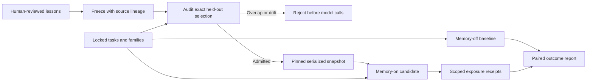

# Frozen repair-memory experiments

Repair memory is useful only if we can tell whether it helps on new tasks. A live
lesson database is a poor benchmark input: reviews, expiry, and revocation can
change it between cases, and an old lesson might already contain the evaluation
answer. This upgrade adds an explicit, private experiment boundary around the
[reviewed memory store](reviewed-repair-memory.md).

An owner exports active lessons with source-task lineage. The evaluator audits
that snapshot against the exact held-out selection, pins a serialized copy for
the run, and records memory exposure without publishing lesson text. Nothing is
automatically promoted into serving, and no model is trained by this feature.



## Prepare the private inputs

First approve lessons through the existing owner-only memory CLI. Each exported
active lesson then needs a lineage record keyed by its opaque lesson ID:

```json
{
  "LESSON_ID_FROM_APPROVAL": {
    "case_id": "training-issue-014",
    "family_id": "training-decimal-rounding",
    "dataset_sha256": "64_CHARACTER_CANONICAL_SOURCE_DATASET_SHA256",
    "issue": "The original reviewed training issue, not an evaluation issue.",
    "completed_at": 1791000000
  }
}
```

Replace both placeholders with real digests. `completed_at` is the source repair's
Unix timestamp; it must precede lesson approval, which must precede the snapshot
cutoff. Use stable, independently reviewed family IDs. This lineage is an **owner
attestation**, not an automatically authenticated link to an external issue tracker.
The digest binds the supplied lineage to the snapshot but cannot prove it is true.

Every selected evaluation case must have a nonblank `metadata.family_id`, and
every evaluation repository must be explicitly included in the snapshot, even if
its lesson list is empty. Add family labels before locking the evaluation dataset;
do not relabel overlapping tasks to pass the audit. Lineage must cover exactly the
active exported lessons, not expired, revoked, missing, or unrelated records.

```bash
python -m code_agent.memory_snapshot_cli freeze \
  --store data/code-agent/repair-memory.db \
  --project your-unique-deployment-project --namespace authenticated-user-id \
  --repositories sample \
  --lineage data/code-agent/private-lineage.json \
  --output data/code-agent/private-snapshot-v1.json

python -m code_agent.memory_snapshot_cli audit \
  data/code-agent/private-snapshot-v1.json \
  data/evaluations/private-heldout.jsonl \
  --output data/evaluations/private-memory-audit-v1.json
```

The freeze command prints the canonical `snapshot_sha256`, not a raw-file hash.
Freeze and audit outputs never overwrite an existing file. Keep these inputs and
outputs private under the ignored `data/` directories. The snapshot retains lesson
text, paths, timestamps, source IDs/families, and digests; it does not retain raw
source issues, patches, logs, or hidden reasoning. Normalized issue and five-word
shingle hashes can still reveal information through dictionary attacks. Hashing
is neither encryption nor an access-control mechanism.

## What the audit rejects

The auditor checks schema, repository scope, content binding, lesson IDs,
timestamps, bounded TTL, duplicate IDs, and detected unsafe lesson content. It
then rejects source-case, source-family, or exact source-dataset overlap; normalized
issue equality; and substantial five-word-shingle overlap with source issues,
lesson problems, or lesson bodies. Near-duplicate detection uses at least four
shingles and a 60% overlap threshold relative to the smaller set. Findings use
opaque lesson IDs, hashed evaluation IDs, and reason codes rather than issue text.
Large rejected selections stop collecting findings after reaching the cap.

These are conservative contamination controls, **not proof of semantic
independence**. Paraphrases, mislabeled families, undisclosed training data, hidden
patch duplicates, and dishonest lineage can evade them; harmless shared wording
can also trigger rejection. Reports explicitly set
`semantic_independence_proven: false`. Human dataset review remains necessary.

## Run a controlled comparison

The benchmark CLI accepts a snapshot only with its expected canonical fingerprint:

```bash
python -m code_agent.evaluation data/evaluations/private-heldout.jsonl \
  --workflow verified_pr \
  --memory-snapshot data/code-agent/private-snapshot-v1.json \
  --memory-snapshot-sha256 SNAPSHOT_SHA256_FROM_FREEZE \
  --validate-only
```

Validation makes no provider calls. Actual runs still need a working Docker
engine, prepared repositories/images, available credits, explicit model choices,
and reviewed price assumptions. Do not interpret zero default prices as free
inference. The supported memory experiment workflows are `single_agent` and
`verified_pr`; tournament/adaptive-supervisor snapshots are deliberately rejected.
Mutable memory remains forbidden in frozen benchmarks.

Use the existing [benchmark-release matrix](benchmark-release.md) to compare two
variants on the same locked case selection, model, workflow, retrieval settings,
image, and prices. Only the candidate adds these fields:

```json
{
  "name": "memory-on",
  "model": "YOUR_EXPLICIT_MODEL",
  "workflow": "verified_pr",
  "context_strategy": "hybrid_rerank",
  "repair_memory_snapshot": "../code-agent/private-snapshot-v1.json",
  "repair_memory_snapshot_sha256": "CANONICAL_SNAPSHOT_SHA256"
}
```

This is a configuration fragment, not a ready-to-run public matrix. Snapshot
paths resolve relative to the matrix file. Use an otherwise identical `memory-off`
baseline that omits both snapshot fields. Validate with
`python -m code_agent.benchmark_release validate YOUR_PRIVATE_MATRIX.json`, then
run with its `run` subcommand when the prerequisites and spend are approved.
Every candidate snapshot is audited before **any** variant calls a model.

The release layer already provides paired resolution deltas, bootstrap intervals,
regression, latency, model-call and cost evidence. Small samples, provider holds,
missing usage, and unconfigured prices do not become convincing improvement claims
just because the memory arm has a higher raw score. This iteration implements the
comparison path; it does not supply live memory-on/off results.

## Runtime and recovery boundaries

Each run uses an immutable serialized copy, not a database reader or repeated file
loads. Original snapshot-object mutation or database withdrawal cannot alter that
copy. Every implementation, test-author, and repair coding stage receives the same
pinned backend and retains bounded local lesson ranking. Retrieval is restricted
to the audited case ID and repository. Existing sandbox and approval policies stay
unchanged: historical advice is not current execution evidence.

TTL and active status are checked at the **export cutoff**. Expiry or revocation
after export does not withdraw content from an existing offline experiment. Stop
that experiment and discard/re-freeze its snapshot if a lesson must be withdrawn.
Production mutable-memory reads still check expiry/revocation at each planning
step. Neither path can retract text already sent to a provider.

Snapshot and audit fingerprints enter the run configuration and checkpoint
binding. Resume re-audits the selection; changed snapshot content or a changed
selection cannot silently resume the old experiment. Receipts record scoped
lesson IDs/scores, query/context/snapshot digests, stages, and approximate token
counts. Missing, out-of-scope, malformed, or wrong-snapshot exposure evidence holds
quality publication as `memory_evidence_invalid` and withholds cost per resolution.
Receipts and digests detect accidental drift, not a malicious host forging them.

## Verification

```bash
python -m evals.memory_snapshot_evaluation \
  --output data/evaluations/memory-snapshot/controls.json
```

Eight authored controls cover independent admission, case/family/exact/near-issue
and lesson-text overlap rejection, frozen reads after live-store deletion, and
snapshot-bound receipts. They use scripted verified-repair evidence, make zero
provider calls, and measure neither live coding resolution nor semantic independence.
CI runs and uploads this control report. Unit tests additionally cover immutable
payloads, corrupt artifacts, missing lineage/families/repository coverage, dataset
overlap, pre-checkpoint rejection, receipt drift, CLI redaction/non-overwrite,
verified-PR stage wiring, and paired matrix preflight.

On October 4, the frozen-source affected suite passed **233 tests with four skips**
on each of Python 3.11 and 3.13. Another **133 security/retrieval/dispatch tests**
passed on Python 3.13. The two new snapshot modules reached **95.15% combined
statement/branch coverage** with 34 focused tests; this is not whole-project
coverage. All eight snapshot controls and eleven existing memory controls passed,
along with repository-wide Ruff, compilation, diff checks, and refreshed
retrieval-artifact reproducibility. Three Docker checks and one Windows symlink
check were skipped. The whole repository suite was not rerun, and no paid model
calls or real memory-on/off coding-task comparison were executed.
