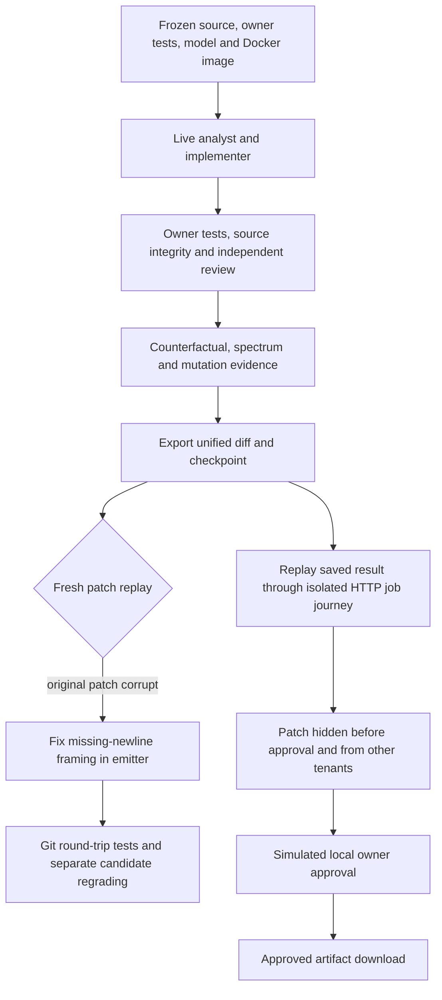

# What worked when we actually ran it

This audit covers the repository's implemented research, coding, retrieval,
learning, safety, and evaluation subsystems. It combines the full test suite,
credential-free CI commands, real Docker execution, a small live Groq pilot,
and user-style HTTP checks. It is **not** a claim that every feature has passed
a live production test. The live pilot found important gaps that unit tests did
not reveal.

## Results at a glance

| Check | Observed result | Evidence level |
|---|---|---|
| Initial complete suite, Windows/Python 3.13.9 | 1,187 passed, two failed, one skipped; 28m 39s | All configured pytest test paths, not selected tests |
| Two failing groups after correction | 80 passed | Includes real Docker spectrum and stale-bytecode checks |
| Patch portability and affected integrations after repair | 51 passed, including five new exact-byte cases | Git replay, coding, queue, verified PR, scoring, checkpoints |
| Post-repair controller and retrieval checks | 154 passed | Mutation, counterfactual, minimization and retrieval integrations; not additional unique tests |
| Deduplicated test inventory | 1,194 passing identities, one skipped, across 84 modules | Combined original run and targeted rechecks; **not a second full-suite run** |
| Initial complete-suite coverage | 75.66% combined statement/branch coverage | Before the later patch-emitter repair; not 100% branch coverage |
| Credential-free CI commands | 62/62 passed after correcting two audit-runner argument mistakes | Original failed receipts retained; controls are mostly authored/synthetic |
| Real-container counterfactual drill | Passed; four repeated trials | Original assertions fail, patched assertions pass, sources unchanged |
| Real-container minimization drill | Removed an unnecessary `support.py` change; six trials | Essential fix retained, repeated test identities preserved |
| Real-container mutation drill | One mutant killed, zero survived/invalid; four trials | Assertion sensitivity on an authored boundary fixture |
| Local HTTP journey | 17/17 checks passed | Real service routes; replayed live result, simulated isolated approval |
| Live coding smoke task | Internal workflow completed; original exported patch did not apply | Live model + real Docker; packaging defect discovered by independent replay |
| Same generated code after framing-only repackaging | Four owner tests and an additional 20-combination boundary grid passed | Fresh Docker; no additional inference or code-content changes |
| Adaptive supervisor live follow-up | Failed closed on a provider schema rejection | Initial minimal team attempted; other teams deliberately not dispatched |
| Real Requests issue | Bug reproduced locally; live inference held by the input reservation limit | No generated fix and no official SWE-bench score |
| Ruff and Python compilation | Passed | Static validation, not model quality |

The single suite skip is Windows directory-symlink support. SQLite resource
warnings were also observed; they are not test failures, but connection lifecycle
cleanup remains worth investigating.

## The coding journey we checked



The HTTP check used FastAPI's in-process test client, real authentication,
SQLite job storage, artifact storage, and the worker. Its solver returned the
already-generated live result to avoid paying for another task. It tested
registration/login, unauthenticated rejection, submission, idempotency, polling,
dossiers, audit events, tenant isolation, pre-approval withholding, and approved
download. **It was not a browser test, a deployed service test, or a fresh live
worker inference run.** The approval was an audit simulation, not the owner's
production decision. The service used an in-memory research checkpointer because
the installed environment could not import the optional SQLite saver; the coding
queue itself was durable SQLite.

## Which agents actually ran?

The first smoke run used the real `VerifiedPRAgent` and `CodingAgent`, with an
explicitly injected Groq client. It made eight accepted model calls: one analyst,
six implementation actions, and one reviewer. The implementation repeatedly wrote
files and reached its iteration bound. Fresh verification subsequently accepted
the resulting candidate, but **the test-author specialist did not run**. The
implementer itself added the boundary tests. This is evidence of a working
verification path, not evidence that all four specialist roles executed.

Its receipts include execution-guided context, repeated Ochiai localization,
edit invalidation, loop monitoring, counterfactual discrimination, file-level
minimization, and enforced mutation sensitivity. Minimization retained the
essential file; it did not shrink this particular patch. The selected mutant was
killed twice. Ruff was skipped because the fixture already had baseline lint
failures, and changed-line coverage was skipped because the chosen owner command
did not collect coverage. Those skips must not become claimed passes.

The adaptive follow-up used the actual `RepairTournament` adaptive path. It
dispatched `candidate-1` with the minimal perspective. Groq rejected the analyst
JSON for a missing required field. Diagnosis recorded `provider_error`, no winner
was released, the original source remained unchanged, and candidates 2/3 were
marked `not-dispatched:provider_error`. Boundary and compatibility teams therefore
have **offline orchestration coverage, not successful live execution evidence**.
No fixed-three-team versus adaptive quality/cost winner was measured.

## Live provider accounting and limitations

The owner confirmed a Groq Free-plan account. This audit admitted **11 requests**
within a shared 40-request ceiling: eight accepted completions and three HTTP 400
schema rejections. The accepted completions reported **13,327 input + 1,863 output
= 15,190 tokens**. Rejected requests returned no usable usage; aggregate usage is
incomplete. Zero-price placeholders are not measured dollars or invoice proof.

The model was `openai/gpt-oss-20b` **served by Groq**, not OpenAI. The completion
cap was 2,048 tokens, SDK retries were disabled, requests were paced by conservative
61-second token reservations, tracing was disabled, and authentication/quota/rate
failures would hold the pilot. No paid provider fallback was used. The earlier
402-token readiness probe belongs to the separate historical readiness record.

The pilot installed `langchain-groq==1.1.3` into an ignored audit dependency
directory. It added an explicit compact JSON schema to the model prompt and bound
Groq's JSON-schema response format. Even then, the later analyst response omitted
`test_strategy` and was rejected. Successful calls do not establish reliable
structured output across roles. Provider support was checked against the
[Groq documentation](https://console.groq.com/docs/structured-outputs); the observed
rejections, rather than advertised support, determine this audit's outcome.

The stock coding-model selector recognizes older name prefixes, not an explicit
`groq:openai/gpt-oss-20b` identifier. The audit's factory injection bypassed that
selection gap; it did **not** fix the public configuration path. Some telemetry
also classified that identifier as OpenAI. Explicit provider routing and matching
telemetry need attention before calling this the normal Groq user journey.

## The real issue, without inflated benchmark claims

The selected issue was `psf__requests-1963`, checked out at
`110048f9837f8441ea536804115e80b69f400277`. A local offline adapter reproduced the
reported POST → 303 GET → 307 incorrectly-POST transition. After correcting a
missing `release_conn()` method in the **audit fixture**, baseline execution gave
one expected assertion failure and three passing controls. Requests production
code was not manually repaired. The earlier incompatible-Python and defective
fixture receipts remain retained, not counted as valid bug baselines.

The trusted pilot image used Python 3.11.14 plus frozen compatibility scaffolding
for the historical Requests checkout. Its owner oracle and pytest configuration
were frozen before the later live plan; generated candidates could not silently
replace those files in independent grading. There was no hidden official test
patch or gold solution in the agent inputs.

The default 4,096-token retrieval pack exceeded the pilot's conservative per-call
reservation when combined with prompts/schema and reserved completion. Admission
held before any real-issue inference. No patch was generated. The compact adaptive
follow-up was a separately frozen **smoke** plan, not a retry counted as a real
issue solution. The Requests fixture is local grading, not official SWE-bench
evaluation. The remaining two selected Requests issues were not executed.

## Upgrade coverage map

Every collected test identity and every CI command is listed in the private
`audit-inventory.json`. This table groups them by implementation so that a green
suite cannot be confused with live-provider validation.

| Implementation group | What was checked in this audit | Remaining live boundary |
|---|---|---|
| Research graph, routing, clarification, rewrite, web approval, tool paths | Agent quality/security tests, routing experiments, API contracts | No complete live 18-node research study; paths are conditional, not all run on one query |
| Tree-sitter and incremental indexing | Code-intelligence tests across supported language fixtures | Live smoke parsed Python; no live repairs in all six languages |
| BM25, semantic fusion, reranking, decomposition, compression and deduplication | Context evaluation/learning, dashboard, token-budget, span and robustness studies; live smoke receipt | Smoke used hashing semantics and feature reranking, not neural embeddings/cross-encoder inference |
| Learned retrieval and hard negatives | Exact source-bound artifact reproduction and five-query non-regression report | Candidate remains held; no general retrieval-quality claim |
| Evidence conflicts, independence, freshness and injection quarantine | Evidence-quality controls and red-team tests | Authored data, not an independent real-source accuracy study |
| Grounding and uncertainty/conformal abstention | Claim/citation gates, calibration, missing-evidence and high-risk controls | No new live factuality benchmark |
| Adaptive compute, PRM and verifier ensembles | Budget/selection controls, artifact checks, uncertainty and OOD tests | Synthetic/controlled transitions, not general reasoning performance |
| Search, world model, offline RL and distillation | Planning, rollout, safety-mask, conservative promotion and compute-curve controls | No new real held-out model quality experiment |
| Execution replay, recalibration and prospective validation | Lineage, exposure, chronological families, delayed labels and source revocation | No real future-family outcome collection |
| Reviewed preference, shadow comparisons and deployment rollback | Explicit reviewed-label requirements, synthetic studies, signed leases and revocation controls | No real human reviews manufactured; no serving activation |
| Process supervision, reviewed verifier uncertainty and step-to-answer shadows | Independent label contracts, family bootstraps, selective-risk and outcome gates | Synthetic controls only; no production lift claimed |
| Long-term research memory and poisoning defenses | Consent, tenant, lifecycle, TTL, deletion/correction and security tests | No cross-session live memory-quality study |
| Inference gateway, contextual bandit, semantic cache and online monitoring | Budget/cache isolation, routing artifacts, fault injection and rollback controls | No provider load/failover or production traffic experiment |
| Coding sandbox and workspace security | Actual non-root/offline/read-only Docker checks; path/secret guards | Not proof of protection against every kernel/container escape |
| Analyst/implementation/test author/reviewer and fixed tournaments | Contract tests and authored tournament controls; analyst/implementation/reviewer live | Test author and fixed-team challenge reviewer not successfully exercised live |
| Adaptive dispatch, diagnosis and stopping | Scripted comparisons and one actual provider-error stop | No successful live repair-team comparison or cost-per-resolution estimate |
| Reviewed dispatch learning and active supervision | Synthetic labels, release/holdout/leak and shadow controls | Advisor not activated; no fabricated reviewer annotations |
| Execution retrieval and spectrum localization | Authored controls, real Docker spectrum test, live smoke association/invalidation | Association is not causal correctness proof |
| Reviewed repair memory and frozen snapshots | Tenant, retention, immutable snapshots, overlap/leak and benchmark binding | Repair memory disabled for this live pilot |
| Counterfactual assertions, patch minimization and mutation sensitivity | Authored controls plus real-container drills and live smoke receipts | Tiny conditional measurements, not repair-quality lift |
| Cycle guard, provider circuits and benchmark checkpoints | Loop controls, fault tests, live admission holds and successful smoke replay without new calls | Interrupted/missing provider usage remains explicit |
| Dossiers, artifact integrity, human approval and tenant isolation | Coding queue tests and 17 actual HTTP route checks | Cached result and simulated approval; no GitHub write or actual owner decision |
| Benchmark/release, SWE-bench adapter, dashboards and observability | Dataset locks, scoring, release matrices, schema/trace/privacy and dashboard tests | No official grading, deployed dashboard/UI test or full workflow release |
| Post-training and failure flywheel | Data export, leak boundaries, manifest and lifecycle tests | No GPU fine-tuning or fresh trained model deployed |
| Service hardening and deployment assets | Authentication/rate/size/SSE contracts, compilation and static checks | No PostgreSQL, Redis, Neo4j, Kubernetes or cloud production validation |

## Repairs made during verification

The workspace emitter now splits source text on LF and emits Git's
`\ No newline at end of file` marker. This preserves CRLF content, missing final
newlines, Unicode line separators inside strings, and boundaries between files.
Five independent Git round-trip cases test exact source bytes without executing
generated functions on the host. The original corrupt live artifact is retained.
Its successful independent regrade is explicitly a **post-hoc framing repair**,
not an unmodified successful transport or an additional model-generated solution.

The stale-bytecode Docker test now creates its source with explicit LF, preserving
the same-size/mtime invariant on Windows. The spectrum integration test accepts
`CODE_AGENT_TEST_IMAGE` so that a separate trusted audit image can be used without
overwriting the owner's existing sandbox tag. No security gate or promotion
threshold was relaxed.

The packaging source change required refreshing the source-bound retrieval
candidate and matching report. The five-query learned NDCG remains `0.9433`
versus fixed-weight `0.9594`, so promotion is still rejected. Serving remains
fixed-weight. The refreshed artifact fingerprint is
`03912cf0be07a8c69c381cb6a2b7589a6a064c104673b7ce99bcad3323194d74`.
Exact reproduction passed on both Python 3.11 and 3.13; the CI review-card
command still reports a quality hold, not serving approval.

## Reproduce and inspect

Run the complete suite from the repository root with the declared development
dependencies installed:

```bash
python -m pytest -q --cov --cov-report=xml --junitxml=test-results.xml
python -m ruff check agent client code_agent evals post_training schema service tests scripts
python -m compileall -q agent client code_agent evals post_training schema service tests scripts
```

The full offline command list is in [.github/workflows/ci.yml](../.github/workflows/ci.yml).
Docker must be reachable and the image must contain the pinned sandbox dependencies.
For a separate trusted image, set `CODE_AGENT_TEST_IMAGE` before the spectrum test;
this setting only selects that integration test's allowlisted image.

Docker's original image was preserved. A network dependency build stalled, so a
separate image was built from predownloaded pinned wheels with installation
networking disabled. Only the audit's stalled build client was stopped; images,
volumes, unrelated containers and Docker Desktop were not deleted/reset.

Local evidence is Git-ignored under `data/evaluations/live-audit-20261004/`:

- `full-tests.xml`, `coverage.xml`, `docker-rechecks.xml`, and `patch-portability-recheck.xml`;
- `post-repair-controller-rechecks.xml` and `credential-safety.json`;
- `offline-audit.json`, `offline-check-corrections.json`, `audit-inventory.json`, and per-command logs;
- `counterfactual-docker.json`, `minimization-docker.json`, and `mutation-docker.json`;
- the frozen live plans, manifests, per-case checkpoints, trajectories and patches;
- `independent-ttl-regrade-exact-bytes.json` and `independent-ttl-regrade-repackaged.json`;
- `real-readiness-py311-fixed-oracle.json` and the retained earlier failed fixtures;
- `http-journey.json`, the isolated HTTP databases, and source-bound retrieval refresh outputs.

Do not replay the private live helper casually: it makes provider requests and
its manifest guard is intentional. Keep checkpoints and losing attempts intact.
The key stays in the ignored `.env`; because it was pasted into chat, revoke it
after this run. No key, auth token, private repository, generated patch or runtime
database is included in this guide. Nothing was committed, pushed or activated.

## What must happen before saying “everything works live”

First close the explicit-provider/structured-output integration gap and confirm
the normal API → worker path with every intended specialist. Then freeze a
compatible real-task budget/environment and run all three workflows on identical
tasks with independent official grading. Research retrieval, moderation, signed
learning studies and infrastructure each need their own credentials or genuine
reviewed inputs; they cannot be honestly substituted with scripted labels.

Until then, describe this as a broadly tested reference platform with a measured
live smoke pilot and documented failures—not a production-certified system or a
state-of-the-art coding benchmark result.
