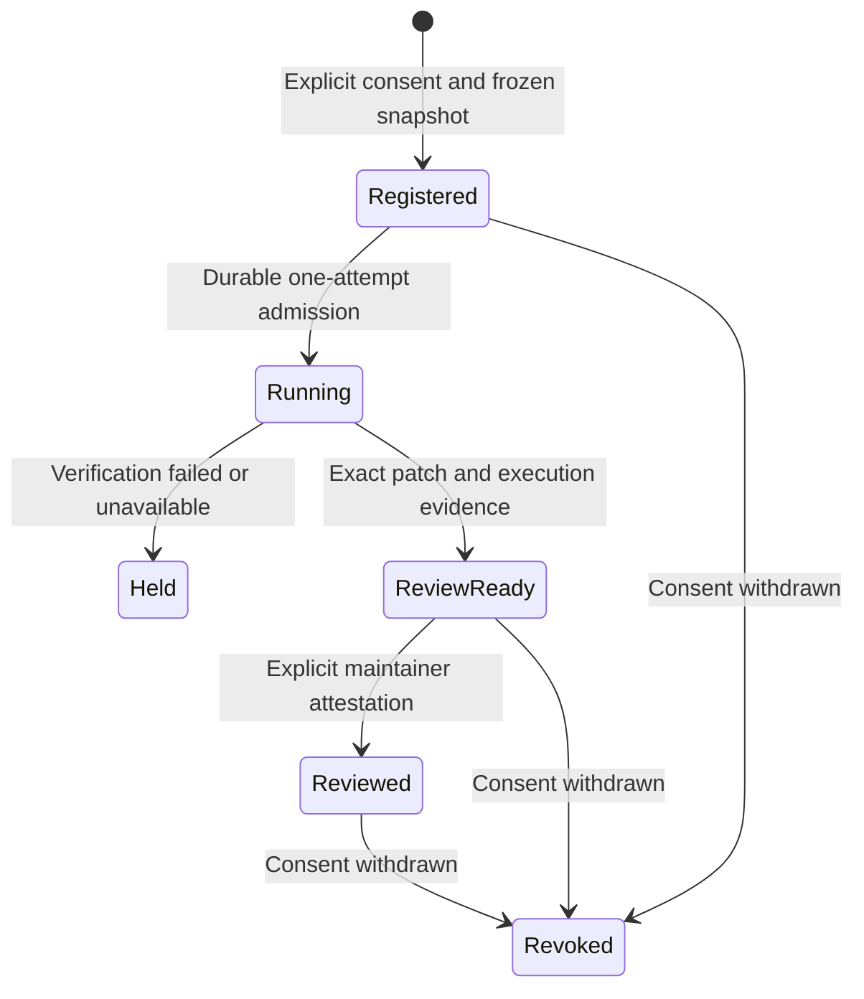

# Maintainer migration pilots: separate execution from adoption

A verified patch and a maintainer accepting that patch are different outcomes.
This workflow wraps the existing UpgradePilot migration runner in a consented,
revision-bound lifecycle. It records what actually happened without opening a
pull request, contacting anyone, pushing a branch, merging or deploying.



## Scope of this release

The migration engine still supports its existing pinned Pydantic 1.10.24 → 2.12.4
profile, real bump-pydantic 0.8.0 baseline and optional budgeted repair team.
Generated counterexample discovery and a separate final gate are enabled for
pilot execution. This wrapper does not add arbitrary dependency support.

That profile is a reproducible testbed, not a claim about the most useful current
migration opportunity. The upstream [bump-pydantic repository](https://github.com/pydantic/bump-pydantic)
is archived. Choose another profile only after a maintainer identifies a real
need and the profile's environment, oracle and comparison have been implemented
and reviewed. Do not promise support by editing a metadata label.

**No external maintainer participation or accepted fix is supplied by this
implementation.** The lifecycle control uses owned authored fixtures and marks
its consent/review records synthetic. Genuine pilots require people outside this
local execution to consent and review results.

## Register a real pilot

Create a private local snapshot under `repositories/<name>/`; cloning is a manual
owner-controlled step. Keep consent, owner specifications and review records
outside any agent-visible snapshot. The request contains:

- A unique pilot ID matching the migration specification's task ID.
- Repository URL, exact upstream commit, bounded license file and identifier.
- Explicit matching maintainer consent, an evidence reference and the allowed
  scope (`local_verification_only`). Consent defaults to not granted.
- Optional authorization to publish a **content-free summary**, defaulting to
  false. Raw source, patches, contracts and receipts are not public exports.
- The existing strict `MigrationSpec`; no model request is authorized by JSON.

Use the private request shape in [the intake template](../examples/maintainer-pilot.request.json).
Its placeholders and ungranted consent intentionally cannot register a real pilot.

```bash
agentforge-maintainer-pilot register \
  --input data/maintainer-pilots/intake/request.json \
  --pilot-dir data/maintainer-pilots/project-a
agentforge-maintainer-pilot run \
  --pilot-dir data/maintainer-pilots/project-a
agentforge-maintainer-pilot status \
  --pilot-dir data/maintainer-pilots/project-a
```

Registration hashes the complete filtered snapshot, license, plan, specification
and consent and resolves the prebuilt local image. The default run invokes the
codemod plus verification without provider calls. Live repair additionally needs
`--model provider:model --authorize-provider`, separately agreed provider/data
permissions and a spending limit enforced through the existing runner/account.
Never paste keys into a request or consent file. This implementation run did not
authorize live provider use.

An OS lock serializes operations. The running admission is persisted before any
possible model request. A completed **or interrupted** attempt cannot be rerun
implicitly. Investigate unknown usage and create a separately consented pilot
revision if another attempt is needed; this wrapper is not an exactly-once API
guarantee or the multi-arm [resumable study runner](crash-safe-migration-studies.md).

## Record a human outcome

After a maintainer reviews the exact candidate, prepare a private `PilotReview`
with the registration fingerprint, full migration-report fingerprint, patch
SHA-256, consenting maintainer handle, repository issue/PR evidence link and one
decision: accepted, changes requested, rejected or merged. A reported merge also
requires a PR URL and merge commit. Run:

```bash
agentforge-maintainer-pilot review \
  --input data/maintainer-pilots/intake/review.json \
  --pilot-dir data/maintainer-pilots/project-a
```

Only a review-ready, integrity-bound candidate can receive a review record.
Outcomes are immutable for that candidate; a new candidate belongs to a new pilot
revision. A review for another repository, maintainer, report or patch is rejected.
Stored report/diff tampering or snapshot changes block subsequent status/review.

Review identities and GitHub merge states are **self-reported attestations**;
the CLI does not authenticate them against GitHub. Summaries say
`maintainer_reported_decision` and `github_status_verified: false`. An authored
control's accepted outcome can never count as real maintainer acceptance.

`status --public` returns only a whitelisted content-free summary and requires
separate sharing consent. There is no uploader. To withdraw consent:

```bash
agentforge-maintainer-pilot revoke --pilot-dir data/maintainer-pilots/project-a
```

Revocation blocks further execution, review and summaries, including already
accepted outcomes. It remains possible after source drift. It does not delete
private records or retract anything a human previously published.

## Reproduce the implementation control

```bash
python -m evals.maintainer_pilot_evaluation \
  --output-dir data/maintainer-pilots/control-example
```

This runs actual Docker migration verification on an authored constraints
fixture, then checks duplicate-run protection, synthetic-review separation,
public-summary consent and withdrawal. It makes zero provider calls and zero
external writes. Its synthetic consent must not be used as evidence of adoption.
