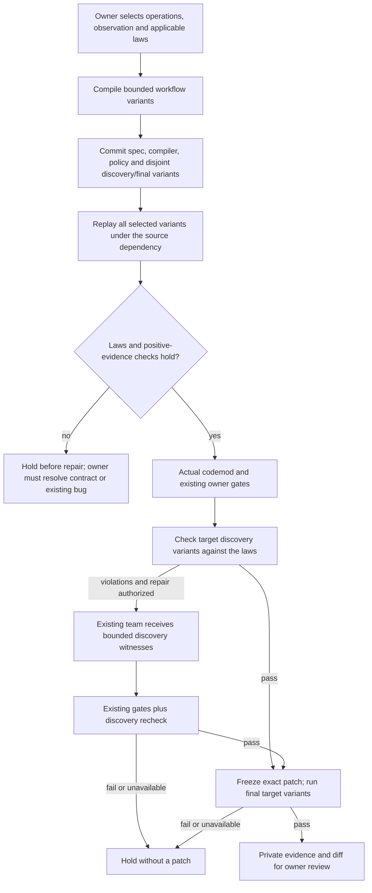

# Metamorphic workflow verification: agreement is not correctness

Old and new dependency versions can agree because both implementations are wrong.
They can also pass a short example while breaking a retry or a failed operation.
This optional UpgradePilot layer checks owner-declared workflow laws rather than
relying only on old/new output equality.

It combines deterministic sequence generation, source-oracle calibration,
positive-effect checks, structured repair evidence, and a withheld terminal
campaign. The existing coding team receives concrete failing workflows; this
does not add agents or model calls just to increase the agent count.



## Declare a law only where it is true

These are not universal assumptions about application behavior. An increment is
usually not idempotent; two operations may deliberately depend on their order.
The owner chooses applicable operations and a no-argument public observation
method that exposes the relevant state.

| Law | Generated experiment | Required evidence |
| --- | --- | --- |
| Idempotent retry | Observe, call once, observe, repeat the same call, observe | First call changes observed state; retry leaves it unchanged |
| Read noninterference | Observe, apply an operation, observe twice | Operation changes state; consecutive reads agree |
| Rejected-call rollback | Observe, call the rejected operation, observe | Exact declared exception occurs; observed state is unchanged |
| Commutative pair | Replay both operation orders in separate sessions | Each operation has an observable effect; final observations agree |

A seed contains a [session scenario](stateful-migration-verification.md), a law
and zero-based operation indices. Its final step is the observation. For example:

```json
{
  "scenario": {
    "scenario_id": "retry-example",
    "factory": "app.models:create_wallet",
    "steps": [
      {"method": "deposit", "args": ["12", 10]},
      {"method": "deposit", "args": ["37", 20]},
      {"method": "snapshot"}
    ]
  },
  "relation": "idempotent_retry",
  "operation_indices": [0, 1]
}
```

The compiler takes setup steps *before* each selected operation, inserts the
required observations/retry, and discards the later suffix. A commutative pair
selects the indexed operation and its immediate successor. Rollback seeds require
`expected_error`, such as `ValueError`; other laws reject that field.

The policy has `seeds`, a deterministic random `seed`, `discovery_cases`,
`final_cases` and `max_feedback_cases`. Up to eight seeds and eight positions per
seed fit within a 40 KB policy. Each compiled scenario must still fit the existing
12-step/12-KB session limit. Each set has one to eight relation cases; defaults
are four discovery and four final cases. An insufficient distinct pool holds
rather than quietly reducing the requested budget.

When budgets and the pool permit, both sets receive an example of each available
law. Reports publish the actual property inventory, not an invented coverage
percentage. Exact compiled scenario inputs cannot cross the discovery/final split.

## Calibrate the source instead of inheriting its bugs

Before the codemod or repair, the source version must satisfy every selected law,
including final variants. This controller-only calibration does not feed final
inputs to repair agents or tune the laws. A contradiction holds the run and
requires an owner decision and a new reviewed campaign. The system must not
silently change a preservation contract to make an existing bug disappear.

For positive operations, the observation must be non-null and show the required
effect. A no-op cannot pass an idempotency test by doing nothing twice. Both
operations in a commutative pair must have effects in both orders. Unexpected
application errors and missing effects are violations, not passing evidence.

These checks are conservative. A legitimate operation with no effect on the
chosen observation may hold; the owner should choose informative inputs and
state rather than disable the check. Equality of a projection is not proof that
hidden state, a database or an external service is unchanged.

## Keep execution isolated and final variants out of repair

The runtime reuses the attested image-owned session harness. It creates one
disposable Docker copy per phase and runs each scenario twice in fresh processes.
Paired operation orders never share a session. Dependencies are exact pinned
environments; application code is never imported on the host. Workspace mutation,
unstable repeats, timeouts, missing operations, bad factories and invalid or
oversized JSON hold the run.

Only verifier copies receive compiled scenario configurations. The repair
workspace receives neither the relation policy nor final variants. Keep the policy
outside the repository snapshot; the CLI rejects an internal policy path.
Programmatic callers must likewise keep withheld inputs out of source files,
tests and prompts. A public authored fixture is not a secret benchmark.

Discovery failures carry a generated scenario, typed observations and labels such
as `retry_not_idempotent` or `rejected_call_changed_state`. Prompt evidence is
bounded and trimmed as complete records. No final witness is included. Existing
provider consent, shared budgets, immutable owner files, scope controls and exact
patch replay remain required. Admission reserves time for discovery recheck and
final execution before spending repair calls.

The final target campaign is bound to the exact patch hash and cannot trigger
another repair. Passing it never overrides another failed gate or owner approval.
No repository is pushed, merged or deployed.

## Run the authored workflow

The feature reuses `agentforge-upgradepilot-sessions:local`; it adds no model
dependency or new image. Build that tag if it is not available:

```powershell
docker build -f docker/Dockerfile.upgradepilot -t agentforge-upgradepilot-sessions:local .
```

```powershell
python -m code_agent.upgrade_cli run `
  --repository tests/fixtures/upgrade_relations `
  --spec tests/fixtures/upgrade_relations/migration.json `
  --relation-policy evals/experiments/upgrade_relations.policy.json `
  --output-dir data/upgradepilot/relations-demo
```

No inference is enabled. This fixture intentionally holds with native exit code
`2`: ordinary owner checks pass, but V2 behavior violates the retry law. The wallet
is an authored integer-state example, not a production financial implementation.
Use a fresh output directory on every run; private reports remain under ignored
`data/upgradepilot/`.

The policy composes with `--session-policy`, `--counterexamples` and
`--schema-policy`. Each gate stays independent. The frozen three-arm study accepts
`relation_policy` per task, commits the campaign with the pinned spec/image,
checks it again before admission, and records final relation violations separately.
Source calibration applies to all arms; only the discovery-enabled arm supplies
relation witnesses to repair agents.

## Verification and honest scope

The frozen controls cover codemod-only failure, compatible scripted repair,
discovery-only overfitting, a source bug shared across versions, and a revoked
campaign. Run them with:

```powershell
python -m evals.upgrade_relation_evaluation --output data/evaluations/upgrade-relations/controls.json
```

The October 16 local regression run passed **212 selected tests**, with zero
failures, errors or skips in **199.52 seconds**. It includes the new law/controller
tests and existing session, schema, coding-agent, security, delivery and provider
tests. This is not a full-repository test run. Standalone Docker control results
and CLI receipts are recorded separately.

One additional Docker test passed in 11.83 seconds, with no skips: source and
target traces matched exactly, yet both violated the rollback law. That is direct
execution evidence for the gap this feature addresses, not just an inference
from the fixture source. The two test receipts cover **213 distinct tests**.

All **5/5 frozen Docker control expectations** passed:

| Control | Observed outcome |
| --- | --- |
| Codemod only | Owner gates passed; one generated retry law failed; held with zero agent calls |
| Compatible scripted repair | Six scripted calls; all four discovery and four final relation cases passed |
| Discovery-only overfit | Six scripted calls; discovery passed; one final retry case failed; no patch released |
| Invalid source oracle | Two rollback laws failed in source calibration; zero agent calls |
| Revoked campaign | Held at preflight; zero agent calls |

Each set contained one case for every supported law. A commutative case executes
two separate orderings, so relation-case counts are not process or scenario counts.
The control runner observed no final case/scenario IDs in model messages. No live
provider was invoked. The actual CLI also returned native exit code `2`, saved a
fingerprint-verified hold report, released no diff and preserved the source.

Private receipts live under `data/evaluations/upgrade-relations-20261016/`:
`selected.xml`, `agreement.xml`, `controls-first.json` and `cli-receipt.json`.
Host coverage for the law compiler/runtime, session runtime and study scope was
80% combined in the selected run; separate control executions and image-owned
probe execution were not included in that host coverage calculation. No project
coverage threshold changed.

The retrieval candidate was retrained and exactly reproduced against prospective
public-source filenames, using a temporary index without changing the real Git
index. Artifact `fed164c65db7ff6d4029ae8825f0822fdd1b214f08ca6750f5f7862fca0f04cc`
binds index `5935e4a42d7b20e00438fa4cbc3c3e0df36909cde243853f38de9f4153c816e0`.
Its unchanged five-query quality gate still rejects promotion: learned NDCG
`0.9433` versus baseline `0.9594`, despite 88.64% training pair accuracy on 44
pairs. Serving remains on the baseline. After tracking intended public source,
run the ordinary exact check; local prospective-index checks do not establish
green GitHub CI.

The new offline CI controls have their own 20-minute job instead of extending
the existing main test job's time budget. Workflow syntax was checked locally;
no GitHub workflow was dispatched or observed in this iteration.

Those retrieval fingerprints belong to the earlier metamorphic iteration. The
[crash-safe study guide](crash-safe-migration-studies.md) records the subsequent
source refresh and the unchanged rejected-promotion result. Frozen comparisons
now use its recoverable numbered-attempt artifact layout.

The authored controls test law sensitivity, orchestration and isolation—not
general repair accuracy, concurrency, distributed exactly-once delivery, real
repository success, training improvement or production impact. There is no learned
semantic oracle or LLM judge: owners supply laws and deterministic execution
checks their observed consequences.

See [UpgradePilot](upgradepilot.md), [stateful replay](stateful-migration-verification.md),
[schema-guided inputs](schema-guided-migration.md), and
[reference/mutation oracle calibration](oracle-calibration.md). The last is a
separate coding-agent reference-test feature, not repackaged as this upgrade.
