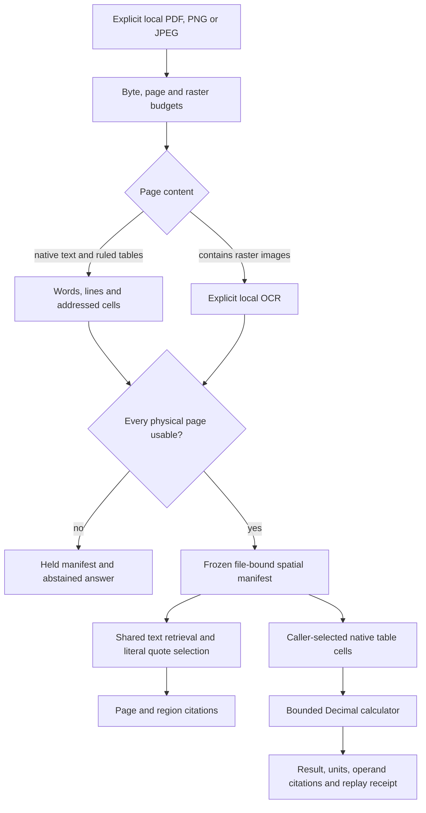

# Evidence you can point to on the page

A page number is useful, but it is not enough when an answer depends on one
table cell or a line in a scan. The optional multimodal SDK adds local PDF/image
extraction, spatial citations and a small, replayable calculation tool. The
existing text-only SDK remains available without these dependencies.

This is a bounded document-evidence implementation, not a general vision agent.
It reads native PDF text and ruled rectangular tables, and uses caller-installed
Tesseract for raster text. It does **not** interpret charts, diagrams, handwriting
or photographs, infer scanned table grids, or generate unrestricted summaries.



## Install and ask a document

From the complete repository checkout:

```bash
python -m pip install './sdk[multimodal]'
```

For a full-platform environment, use `python -m pip install '.[document-multimodal]'`
instead. Choose one distribution per environment; they share the same Python
namespace. No package has been published. The optional dependencies are
pdfplumber, PDFium and Pillow; importing `agentforge_sdk` does not load them.
Tesseract and its language data are installed separately by the application
owner. For example, on Debian/Ubuntu:

```bash
sudo apt-get install tesseract-ocr tesseract-ocr-eng
```

```python
from pathlib import Path
from agentforge_sdk import MultimodalRAG, TesseractOCR, load_multimodal

document = load_multimodal(
    Path("report.pdf"), document_id="report", version="reviewed-r1",
    ocr=TesseractOCR(),  # Explicit local processing, not a cloud fallback.
)
for page in document.pages:
    print(page.page, page.status, page.reason)

rag = MultimodalRAG(document)
result = rag.answer("What recovery time does the report state?", top_k=1)
assert rag.verify_answer(result, question="What recovery time does the report state?")
print(result.status, result.answer)
```

Omit `ocr` to require native text only. A page containing any embedded raster
image requires OCR, even when it also has native text. This conservative rule
avoids silently discarding image evidence, but also OCRs decorative logos and
does not recover table structure on those pages. Digital pages without images
use native extraction; the OCR backend is not called for them.

The runnable CLI accepts one explicit document and prints excerpts only when
invoked by the caller:

```bash
python examples/multimodal_evidence.py report.pdf --ocr --question 'What is the recovery time?'
```

## What a citation proves

`SpatialCitation` contains the document receipt fingerprint, raw file SHA-256,
caller-supplied source/version, one-based physical page, region ID, quote, quote
offsets and bounding box. Native table cells also have a table ID and zero-based
row/column address. Native extraction has no invented confidence score; OCR
regions retain the **minimum word confidence** of their line.

Boxes use normalized `[0, 1]` coordinates with a **top-left origin** on the
supported displayed page. A box encloses the whole extracted line or table cell,
not just the quote's glyphs. Quote offsets refer to canonical `Region.text`, not
raw PDF bytes, original whitespace or the text SDK's normalized chunk offsets.
Extraction collapses whitespace. Page dimensions are PDF canvas units for PDFs
and pixels for image inputs. Rotated/cropped PDF coordinate frames and rotated
EXIF image orientation are held instead of receiving guessed geometry.

For table retrieval, the first row and first column provide lexical context hints.
A lookup such as `Revenue Q2` can retrieve the corresponding value. Its answer
cites the original row-label, column-label and value cells **separately**, never
the joined indexing text as a fictitious page quote. This is a bounded header
convention, not learned header detection; tables with other schemas need manual
selection. `top_k` counts selected evidence records; one contextual cell may
produce three spatial citations, with duplicates removed. Short cells and labels
must fit the configured quote/chunk budgets to receive this context expansion.

`verify_citation` checks these bindings against this immutable manifest.
`verify_answer` also checks the shared text receipt and the optional supplied
question. They do not authenticate a publisher, prove OCR transcription accuracy,
guarantee answer relevance or establish the document's factual truth. These
hashes are integrity bindings, **not signatures**: a caller who controls the
manifest can author and rehash another manifest. Do not accept unauthenticated
manifests as independent evidence of extraction.

## Calculate from cells, not generated expressions

Inspect `document.pages[n].regions` and choose exact cell IDs. The SDK deliberately
does not guess which rows a financial question intended.

```python
cells = {(r.row, r.column): r.region_id for r in document.pages[0].regions
         if r.kind == "table_cell" and r.table_id == "p1:t0"}
total = rag.calculate("sum", [cells[1, 1], cells[1, 2]])
if total.status == "calculated":
    assert rag.verify_calculation(total)
    print(total.value, total.unit, total.citations)
```

The tools are `sum` (1-32 distinct cells), `difference` (`a-b`), `ratio` (`a/b`),
and `percent_change` (`(new-old)/abs(old)*100`, IDs ordered `[old, new]`). The last
three require two cells. Arithmetic uses Decimal with 50-digit precision and
ROUND_HALF_EVEN. Values are canonical decimal strings, not binary floats.

Accepted numeric forms are plain dot-decimal numbers, optional USD/EUR/GBP
prefixes or currency symbols, and a trailing `%`. Units must match. Commas,
locale guessing, scientific notation, ranges and mixed currencies are held.
There is no currency conversion. Ratio returns a scalar; percent change returns
`%`. Sums/differences of percentage values retain `%` and express percentage-point
arithmetic, not compounded growth. Zero denominators abstain. Machine ingestion
admits only native table cells, never fabricated OCR grids. SDK 0.3 separately
supports [explicitly reviewed cell annotations](reviewed-document-evidence.md)
through an authorized `ReviewedRAG`, preserving their reviewer-supplied origin.

`verify_calculation` repeats the same bounded tool against the manifest and
compares the entire receipt, including operand citations and abstention reason.
This verifies arithmetic over the selected extracted values, not the business
meaning of the selection. There is no `eval`, generated Python or general tool
execution path.

## Fail closed, with inspectable reasons

Every physical PDF page appears in the manifest. Any held page disables
document-wide answering, citations and calculations; usable pages are not
quietly treated as a complete document. Reasons include `ocr_required`,
`ocr_failed`, `low_confidence`, `empty_page`, `unsupported_geometry`,
`ambiguous_table` and `budget_exceeded`.

Merged or empty native table cells hold the page. Unruled tables are not
automatically recognized as grids and may remain ordinary text. The current
line grouping does not promise semantic reading order for arbitrary columns.
OCR confidence is an engine heuristic, not a calibrated probability: the default
floor is 0.6 and applies to every returned word, not an average that hides a weak
numeric token. A confidently misread or completely missed word can still pass.
The single-block OCR profile is designed for simple printed text, not arbitrary
document layouts. Use manual review for important decisions.

Default bounds are 10 MB input, 50 physical pages, 12 million pixels per raster,
1,000 regions and 500,000 extracted characters. `ExtractionConfig` makes these
limits explicit. Tesseract uses a 30-second timeout per page, no retry, shell or
network fallback. TSV/stderr are checked after process exit and read within
fixed limits; the timeout limits duration, but temporary-file growth is **not a
hard disk quota**. Native parser/decompression work is also not a hard CPU/memory
quota. PDFium access is serialized because its native library is not thread-safe.

## Privacy and deployment boundary

Only explicitly supplied local files are read; symlinks/reparse points are
rejected. There is no directory crawl, `.env` load, automatic persistence,
telemetry, model download or provider call. OCR is local-only in this profile;
external OCR declarations are rejected. A custom adapter is trusted executable
application code, not a plugin sandbox. Custom text embeddings/selectors retain
the text SDK's explicit external-processing consent and unknown-cost rules.

Manifests, receipts and CLI stdout contain document excerpts. Keep them private
unless the document owner authorizes sharing. Default source labels are basenames,
not absolute paths. Use trusted OCR binaries and keep parser dependencies patched.
This in-process SDK is **not safe hostile-upload isolation**. Put untrusted
uploads in separately constrained workers with process deadlines, filesystem
and network restrictions, request limits and tenant authorization. The test
container is a verification environment, not that complete deployment.

## Reproduce the checks

Install the optional dependencies plus `pytest`, `pytest-asyncio`, `reportlab`
and `pypdf`, and provision local Tesseract/English data. Then:

```bash
python -m pytest tests/test_multimodal_sdk.py -q
python -m evals.multimodal_evaluation --output-dir data/evaluations/multimodal/example
python -m evals.document_sdk_packaging \
  --output-dir data/evaluations/multimodal/package \
  --multimodal-fixtures data/evaluations/multimodal/example/fixtures
```

The control runner requires actual OCR and fails rather than substituting a
mock if Tesseract is missing. Tests explicitly skip real-OCR cases on hosts
without it; the dedicated CI job provisions it. `docker/Dockerfile.document-sdk`
provides the tested Python 3.11 runtime; runtime checks can run with `--network
none`, a read-only checkout and a writable private evidence mount.

See [the implementation audit](multimodal-sdk-audit-2026-10-17.md) for actual
results. The corpus is small and authored. It is not a held-out real-document
benchmark, a measured improvement in general visual QA, or evidence of adoption.
Docling remains a possible future layout adapter; this release does not install
it or download its models. SDK 0.4 separately adds
[version impact and calculation replay](document-version-impact.md), comparing
extracted evidence rather than general visual semantics. The extraction
primitives follow the official
[pdfplumber geometry/table API](https://github.com/jsvine/pdfplumber),
[PDFium rendering API](https://pypdfium2.readthedocs.io/en/stable/python_api.html)
and [Tesseract TSV interface](https://tesseract-ocr.github.io/tessdoc/Command-Line-Usage.html).
