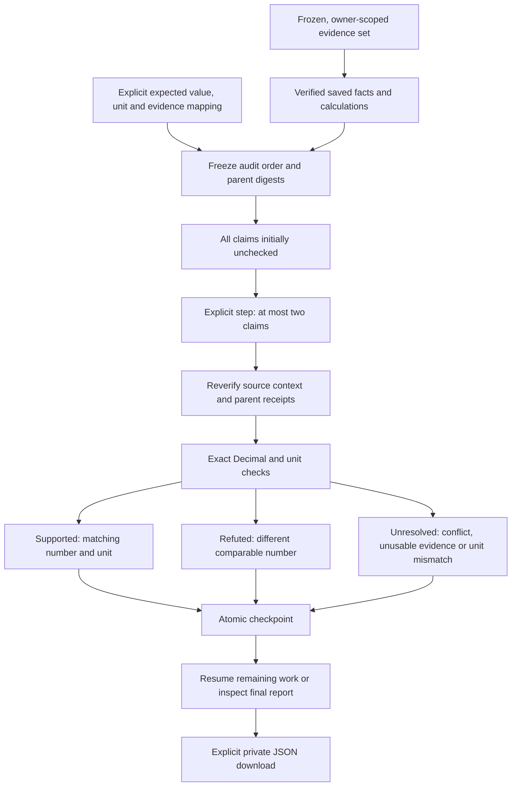

# Verify the number, not just the citation

A document answer can cite a real table and still state the wrong number.
Workbench 0.5 adds a small, explicit check for that gap: map a numeric assertion
to a saved reconciled fact or calculation, state its expected value and unit,
then inspect a supported, refuted or unresolved result.

SDK 0.8 exposes the same verifier without the web service. Neither path extracts
claims from prose or decides that a passage answers a question. This is an exact
numeric consistency check, not natural-language entailment or a truth certificate.

Workbench 0.6 adds [replay against changed evidence](change-aware-claim-replay.md)
to completed audits. Assertions remain fixed; target receipts and support changes
are recorded separately. Deleting a source audit also deletes its replay and stress reports,
but preserves the saved target evidence. The 0.5 verification counts below are
the historical base-audit record; the replay guide records the newer scope.

Workbench 0.7 adds [evidence-fragility diagnostics](evidence-fragility-stress-tests.md)
for completed audits: all single-source omissions under the same policy, with
separate retained-source citations and no changes to original audit verdicts.

Workbench 0.8 adds a separate [portable replay bundle](portable-claim-replay.md)
for completed audits, including full extraction manifests and every numeric
assertion. Unlike the report export described below, this requires a separate
full-snapshot acknowledgement and can be recomputed with SDK 0.10 alone. It does
not authenticate the source files or transfer owner reviews.

Workbench 0.9 adds [re-extraction from stored original bytes](source-backed-replay.md)
as a separate diagnostic. An internally consistent snapshot can fail this check;
an exact fresh match reproduces all original numeric verdicts without overriding
refutations, unresolved evidence or owner reviews.



## Try it in the Workbench

Use the [document setup](document-workbench.md), then create a
[frozen evidence set](document-workbench-reconciliation.md). Save the table facts
you need and, if relevant, a calculation. No provider key is needed; the document
feature remains operator-disabled until its isolated runtime is configured.
Rebuild the document worker image after updating the SDK.

Under the selected set, open **Numeric claim audits**. Give the audit a name.
For each claim, choose an exact saved result, enter a display label and supply a
decimal value and explicit unit. Add up to ten claims. A label such as
“Requests grew by 25%” is descriptive only: **you are asserting the mapping to the
selected growth calculation**, and the application does not prove that semantic
mapping. An incorrectly mapped claim can still pass its numeric check.

For a report showing Requests of 100 then 125, a saved percent-change calculation
returns 25%. A claim of `25` with unit `%` is supported; `50` with unit `%` is
refuted. A claim with unit `USD` is unresolved, not converted or treated as a
numerical contradiction. If the selected reports disagree, a matching individual
observation cannot make the reconciled claim supported.

**Create claim audit** freezes the order, assertions, collection fingerprint and
saved-parent digests. It does not run a step. **Check next two claims** checks at
most two and commits a new checkpoint. Navigate away or restart the backend,
reopen the saved audit and continue. After an uncertain response, refresh before
retrying; a stale checkpoint returns a conflict instead of advancing twice.

The report distinguishes pending claims from supported, refuted and unresolved
checks. “Complete” means every listed assertion was checked, not that it passed.
The all-supported summary requires completion and support for every claim. It is
advisory evidence, **not** a new release, patch-access or answer-serving authority.
Existing owner reviews cannot override these outcomes.

Expand a source observation to inspect its page/cell citation. Application version
IDs are retained, including linked uploads sharing a logical SDK document ID.
Arithmetic citations include the underlying operand facts, not invented geometric
coordinates for a derived result.

## Exact means exact

`25`, `+25` and `25.0` compare as equal Decimals. Expected values must be bounded
plain decimal strings; JSON floats, commas, currency symbols, exponents and
non-finite values are rejected. Units are separate: `scalar`, `%`, `USD`, `EUR`
or `GBP`. There is no currency conversion, scale inference or rounding tolerance.
`0.25` percent is not `25` percent. Rounded prose such as “about 33.3%” needs a
separately specified policy; this feature does not silently approve it.

A mismatch between otherwise usable comparable numbers is `refuted`. Unresolved
evidence, an unverifiable receipt or incompatible units is `unresolved` instead.
SDK diagnostic receipts can describe unverifiable evidence without releasing its
observed value. Verifying a diagnostic receipt means its check recomputes, not
that its claim is supported.

## Use the SDK verifier

Given an existing `EvidenceSet` and its two verified fact receipts:

```python
from agentforge_sdk import NumericClaim, check_numeric_claim, verify_numeric_claim

growth = evidence.calculate("percent_change", [before, after])
claim = NumericClaim(
    claim_id="request-growth",
    label="Requests grew by 25%",  # Display only, not parsed or semantically verified.
    expected_value="25",
    expected_unit="%",
)
check = check_numeric_claim(evidence, claim, growth, facts=[before, after])
assert verify_numeric_claim(evidence, check, growth, facts=[before, after])
print(check.status, check.reason)
```

The verifier rechecks evidence against the current frozen collection and review
authority. It imports no service/provider stack, performs no model request, and
retains the SDK's existing source and approval checks. Ordinary fact receipts
also work directly. A check is not a replacement for its source receipts.

## Storage, budgets and export

Audit state lives in the existing private SQLite database. Migration adds a table
and index; originals, manifests, receipts and owner reviews are not rewritten.

- Up to ten claims per audit; twenty audits per owner and one hundred per library.
- Two claims per explicit step; a 100 KB checkpoint limit and 3 MB serialized
  report/export limit. The browser bounds formatted downloads to 6 MB.
- Mutations use SQLite write transactions. Checkpoint failure rolls back the
  entire step. Repeated identical creation is idempotent, including at quota.
- Cross-owner/cross-set IDs, stale contexts, changed parent digests and altered
  checkpoints cannot be reused. Requests cannot supply verdicts, tolerances,
  executable expressions, citations or replacement receipts.

The JSON export is a separate, explicit read after a private-data acknowledgement.
It includes the selected assertions, progress, source headers, observed citations,
parent receipts and an unkeyed report digest. It omits original file bytes,
manifests, credentials, unrelated sets and review notes. Partial exports remain
clearly partial. Protect downloaded copies: the application cannot revoke them.

The digest detects changes; it is not a signature, publisher authentication or
standalone proof of the source files. Reverification requires the original
evidence context. Deleting an audit preserves saved evidence and sources;
deleting its evidence set cascades the audits. Secure deletion does not erase
external exports, SSD history, snapshots or backups.

## API and verification

Routes sit under `/workbench/documents/reconciliations/{set}/audits` and retain
verified owner authentication, no-store responses and content-free validation errors.
Use the root without a trailing slash.

| Method and suffix | Purpose |
| --- | --- |
| `GET /` | Minimal owned audit history |
| `POST /` | Freeze assertions and selected parent digests |
| `GET /{audit}` | Reverified state, progress, counts and source observations |
| `POST /{audit}/advance` | Next bounded step with expected checkpoint fingerprint |
| `GET /{audit}/export` | Explicit bounded private evidence report |
| `DELETE /{audit}` | Remove only the owned audit |

Controls cover exact arithmetic, strict inputs, conflict abstention, unit mismatch,
parent binding, restart/resume, concurrent stale-step rejection, rollback, quotas,
private export and literal UI rendering. The real integration extracts two authored
PDFs, follows a table moved to physical page two, saves a 25% growth calculation,
checks correct and incorrect assertions in separate steps, restarts the library and
exports the final evidence. These are integration controls, not real-world numeric
accuracy results or a model hallucination benchmark. Private local evidence is in
`data/evaluations/workbench-claims-20261018/`.

The October 18 local run passed **34 frontend tests**, **102 affected backend
tests** including the actual PDF/OCR integrations, and **269 SDK regressions**.
Four host-Tesseract tests skipped; English OCR ran in Docker. The SDK 0.8 wheel
built and installed into a disposable directory, then passed the existing
outside-checkout application check with network and platform/provider imports
blocked, including imports of the new claim API. No dependencies were downloaded
and no package was published. Typechecking, production build and Prettier passed.
The generated page-two table PNG was inspected: readable labels, Requests 100/125,
and the expected layout. This was source rendering QA, not browser-layout QA.

Scoped Ruff, Compose validation and the non-root, read-only static Nginx HTTP
smoke also passed. The configured-secret-value scan found no matches in public
source or built assets and no private versionable paths or broken relative links;
it is not a full Git-history or all-secrets audit.

The source-bound retrieval artifact was refreshed against a temporary prospective
public-source index, leaving the actual Git index untouched. Exact reproduction
and the unchanged strict regression-gate test passed in that prospective index. The five-query
baseline/candidate NDCG is 0.9594/0.9229; both retain recall/MRR 1.00. Promotion
remains rejected, with the fixed baseline still serving. This is a repository
retrieval regression check, not a document claim-accuracy result. Run the normal
exact check after intentionally tracking the new source files.

Verification used authored numeric claims, actual local PDF extraction,
component interactions and rendered source PNGs, without live provider requests.
