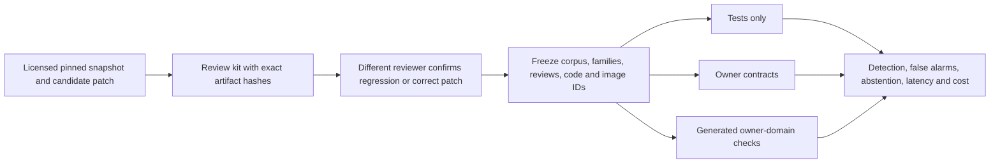

# A benchmark for patches that pass tests but change behavior

The benchmark asks a narrow question: given the same original repository,
candidate patch, owner expectations and execution image, which verification
strategy detects a behavioral regression? It does not measure how well an agent
generates patches, and it does not turn locally passing tests into a claim of
maintainer acceptance.

Three independently executed arms use the same frozen inputs:

1. Existing tests only.
2. Existing tests plus explicit owner contracts.
3. The same checks plus generated inputs inside owner-declared integer or structured JSON domains.

All arms are deterministic and provider-free in this release. This is not a
comparison against LLM-generated tests. Each arm executes its own fresh repeated
Docker copies, rather than reusing another arm's results or latency.



## Current dataset status

`evals/datasets/patch_regression_controls.json` contains **four authored controls**:
two regression patches and two equivalent refactors. They exercise a missing
boundary case and a JSON type change that ordinary Python equality overlooks.
They are implementation sensitivity controls, not historical patches, independent
reviews, model-generated patches or evidence of generalization.

**There are currently zero admitted independently reviewed real cases.** The
real-case intake and strict admission gate are implemented; a ten-case public
real-patch dataset remains an external curation/review milestone. Do not rename
the authored controls as real tasks to meet it. The checked-in `holdout` split is
public and therefore not a secret evaluation set. Real holdout reproductions
should stay private until the evaluation policy allows release.

## Run the authored comparison

```bash
python -m evals.patch_verification_evaluation \
  --output-dir data/regression-benchmark/control-example
```

This runs twelve case/strategy comparisons with actual Docker and checks the
expected control decisions. Expect no alarms from existing tests, one regression
detected by explicit contracts, both detected by generated-domain checks, and no
alarms for either correct patch. These are expected control outcomes, not a
real-world performance estimate. Evidence remains private and is never uploaded
by the command.

The separate [public upstream pilot](real-patch-validation.md) connects structured
generation and reduced-input replay to four pinned forward changes from three
projects. These source-verified development replays have no independent
artifact-bound review yet, so they are not admitted by this benchmark or counted
toward its real-case threshold. Source curation is not substituted for review.

The general CLI separates freezing from execution:

```bash
agentforge-regression-benchmark freeze \
  --input evals/datasets/patch_regression_controls.json \
  --output-dir data/regression-benchmark/frozen-controls
agentforge-regression-benchmark run \
  --input data/regression-benchmark/frozen-controls/freeze.json \
  --output-dir data/regression-benchmark/control-results
```

The repository root defaults to the current directory; `--root` selects another
local input root. Dataset paths are confined below it. Source/license/spec/patch
bytes, resolved image IDs, controller dependencies and benchmark code are bound
before execution. Drift before or during evaluation invalidates the comparison.
Every declared case remains in the report, including inconclusives.

## Admit a genuine case

Use the [dataset contribution guide](../evals/datasets/patch-regressions/README.md).
Supply a licensed local snapshot, pinned upstream commit, patch provenance,
owner-approved preservation scope and proposed label. A reversed historical fix
must be labelled `historical_reversal`, not an actual model failure.

```bash
agentforge-regression-benchmark review-kit \
  --input data/regression-benchmark/intake/case.json \
  --submitter-id actual-submitter \
  --output-dir data/regression-benchmark/review-case
```

The kit produces exact artifact bindings and an intentionally incomplete review
template. A different reviewer must inspect/reproduce the case and provide the
review identity, evidence URL and conclusion. Blank templates cannot be admitted.
Local identity/provenance records are attestations, not authenticated upstream
facts. The review must be reissued if any bound artifact changes.

For a reviewed corpus, freeze with `--minimum-real-cases 10`. Authored controls
cannot satisfy this threshold. A real corpus also needs correct-patch negative
controls, and a task family cannot cross development/holdout splits. Maintain
development and withheld corpora separately if labels/reproducers must remain
hidden from tuning or candidate generation.

## Reading the results honestly

Results separate authored and historical-real evidence, with additional per-split
metrics. Reports include detection rate, false alarms, decision coverage,
inconclusive counts, correct-negative clearance and tests-green eligibility.
Missing/inconclusive regression cases count as missed detections. False-alarm
bounds also show what unresolved negative cases could change; abstaining cannot
silently produce an impressive certainty claim.

Provider cost is zero because no model is called; Docker/CPU/infrastructure cost
is **unknown**, not free. Timings include the observed arm execution and are
descriptive, not statistically significant comparisons. No cost-per-resolved-issue
metric is claimed because this runner does not repair issues. A subset or custom
corpus is not an official SWE-bench result. No maintainer outcomes are inferred;
those belong to the [separate pilot workflow](maintainer-migration-pilots.md).
