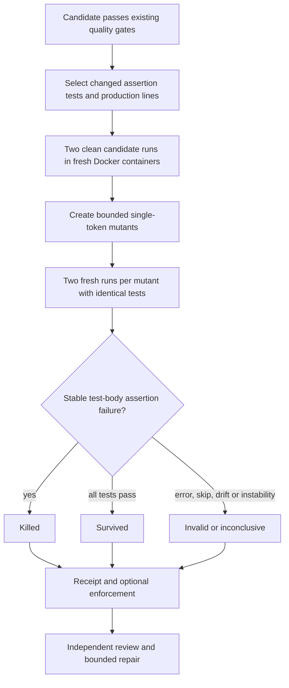

# Do the generated tests catch nearby bugs?

A regression test can fail before a fix and pass afterward yet miss a nearby
boundary error. Patch-targeted mutation testing asks a second question: if we make
one small, deliberate change to the patched function, do the new assertions notice?

The feature is Python/pytest-only and off by default. It adds execution evidence,
not another agent or a learned correctness score. The controller itself makes no
provider calls.



## What changes, and what stays fixed

The planner considers operators on added/replaced Python production lines inside
function bodies, including async functions and methods. Supported changes shift
comparison boundaries, flip equality, swap a small set of arithmetic operators, or
flip boolean literals. AST locations identify candidates; token offsets replace
only the selected token. Comments, Unicode text, line endings, and unrelated
formatting are preserved. Module-level values, function defaults, test paths,
recognized configuration filenames, and secret/injection-tainted files are excluded.
Configuration detection is conservative filename filtering, not complete semantic
classification. Pure deletions and patches without supported operators can abstain.

Only eligible changed/new synchronous assertion-test functions count. Fixture-only,
import-only, and unchanged tests cannot supply this evidence. The fixed harness
executes selected test files, but receipts classify eligible functions and preserve
parameterized identities. The ordinary owner-supplied suite remains a separate gate.

Every trial uses a fresh, filtered Docker copy. Controls and mutants use identical
test bytes and harness manifests. Copied production bytes must match the planned
mutation; post-run source hashes must remain unchanged. Neither the original
repository nor the candidate patch is mutated. There is no host-execution fallback.
Timeouts, exceptions, skipped tests, changing identities, and unstable repetitions
are not counted as detections. Cancellation waits for the in-flight blocking action
before cleanup; a wall-clock deadline is therefore a soft admission bound, not a
promise to interrupt Docker startup instantaneously.

## Enable it deliberately

```dotenv
CODE_AGENT_MUTATION_TESTING_MODE=off
CODE_AGENT_MUTATION_TESTING_MAX_MUTANTS=3
CODE_AGENT_MUTATION_TESTING_MIN_MUTANTS=1
CODE_AGENT_MUTATION_TESTING_MIN_SCORE=1.0
CODE_AGENT_MUTATION_TESTING_TIMEOUT_SECONDS=180
```

Use `report` first. It adds advisory evidence to independent review, so it is not a
pure shadow experiment: a reviewer may respond differently. `enforce` requires a
complete, integrity-valid measurement meeting the owner's count and score thresholds.
Insufficient targets, unavailable execution, and invalid trials hold enforcement.
Source-integrity failures always block, including report mode, and stop further
repair attempts. Bad prerequisite gates prevent mutation execution entirely.

The default cap is three mutants: two controls plus six mutant trials, up to eight
fresh containers per review round. The hard cap is six mutants/fourteen trials.
The local timeout is bounded by the workflow deadline, each command is capped at
thirty seconds, and trial admission reserves thirty seconds for later verification.
Across repairs or returned tournament branches this can add significant latency.

```bash
python -m evals.patch_mutation_evaluation --output data/evaluations/patch-mutation/controls.json
python -m evals.patch_mutation_evaluation --docker --output data/evaluations/patch-mutation/docker.json
python -m code_agent.benchmark_release validate evals/experiments/patch_mutation_matrix.json
```

The first command is nine authored, provider-free contract controls; it does not
execute repository code. `--docker` adds a real-container authored boundary drill
and exits unsuccessfully if execution is unavailable. It is not a real-issue coding
benchmark. The frozen matrix compares off/report/enforce on five identical smoke
tasks; validating it does not run it. Single-agent workflows reject this option
before checkpoint creation because there is no independent test-author/review stage.

## Read the results carefully

PR dossiers retain policy, source/test/command hashes, mutant path/line/operator,
repeated outcome hashes, classifications, and a fingerprint. Mutant source and raw
test logs are not retained in the receipt or sent to repair models. Hashes establish
self-consistency and local lineage, not cryptographic authenticity against a malicious
receipt author.

Benchmark/checkpoint summaries and release cards retain measured-case counts,
killed/survived/invalid counts, and completed trials. These sum retained review-round
actions for the selected verification result, not final unique mutants or all losing
branches. Completed runs missing the configured evidence are withheld from resolution
claims and cost-per-resolution publication.

A killed mutant shows sensitivity to that perturbation under those tests. It does
not establish the oracle's correctness. An equivalent or intentionally valid mutant
may survive, so a strict threshold can reject a good patch. Selection is bounded and
not representative of every possible bug. Measure real frozen tasks, regressions,
latency, provider calls, and fully accounted cost before claiming improvement.

## Validation status

Later on October 4, Docker became available. The real-container drill measured
one killed mutant, no survived/invalid mutants, and four completed repeated
trials with unchanged source. The bounded live smoke candidate also killed its
selected mutant twice with enforcement enabled. Independent replay subsequently
found a separate missing-newline patch-framing defect; successful mutation
testing did not detect it. See the [full audit](live-upgrade-audit-2026-10-04.md)
for the original failure, framing repair, regrading, and live-provider limitations.
The earlier results below remain historical, not current Docker readiness.

The focused suite passed **42 tests with one Docker skip** and **90.61% combined
controller statement/branch coverage**. Controller and workflow tests cover surgical
replacements, repeated outcomes, receipt tampering, prerequisite gating, independent
review, integrity stops, benchmark publication, and release-card propagation.
Broader targeted verification passed **606 checks/eight skips on Python 3.13** and
**464 checks/thirteen skips on Python 3.11**. These are selected affected suites,
not a complete repository test run. Ruff, compilation, nine authored controls,
frozen-matrix validation, and exact retrieval-artifact reproduction passed.

Docker was unavailable in this iteration; the actual `--docker` drill reported
`unavailable` with no trials and unchanged source, and exited unsuccessfully as
intended. The real-container mutation drill and live coding-quality comparison
remain unverified. Earlier failed test-authoring runs were fixed and rerun, not
described as successful. The refreshed learned retrieval candidate still regresses
holdout NDCG, so fixed-weight retrieval remains the default. A separate one-request
Groq readiness probe succeeded, but did not execute its generated action; see
[the live-attempt record](real-task-benchmark-attempt.md).
