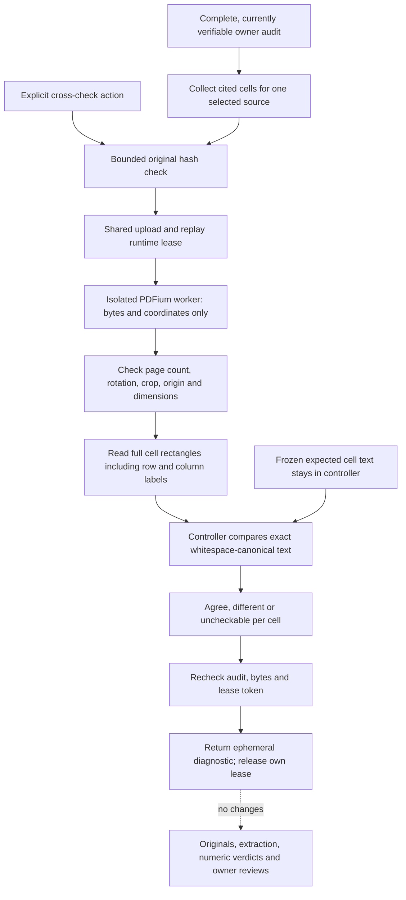

# Check the cited cells with a second PDF text engine

A replay can faithfully reproduce a parser's original mistake. Workbench 0.10
adds a different check: ask PDFium to read the physical rectangles behind an
audit's cited row labels, column labels and values, then compare its text with
the frozen extraction. This is a targeted extraction diagnostic for document
RAG, not another way to approve a claim.

The primary native-table path uses pdfplumber/pdfminer. The new path uses
[PDFium's bounded text API](https://pypdfium2.readthedocs.io/en/stable/python_api.html#pypdfium2.PdfTextPage.get_text_bounded).
It receives the original PDF bytes and coordinates, **not the expected text**.
The controller performs comparison only after the probe returns. PDFium is also
used by the existing preview renderer; this is a different **text engine**, not
an entirely independent document-processing system.

Workbench 0.11 adds a separate [rendered-cell OCR diagnostic](pixel-evidence-concordance.md)
for cases where native text engines agree but pixels differ. It requires its own
OCR consent and does not silently enable OCR in this native-text workflow.



## Try it

Use the [document setup](document-workbench.md), create a scoped frozen evidence
set, save a numeric fact or calculation, and finish its [claim audit](numeric-claim-audits.md).
The backend needs the Docker CLI and a running engine. Rebuild the existing
dedicated worker image to include the new fixed program:

```bash
docker build -f docker/Dockerfile.document-workbench -t agentforge-document-workbench:local .
```

Restart backend controllers on this version and refresh the Workbench. In the
completed audit, open **Cross-check cited cells with PDFium**, confirm local
execution, then choose **Cross-check** for one source. There is no work on panel
open, no all-source batch, no OCR option and no automatic retry. The model-request
checkbox and provider keys are not needed.

Reports exist only in the mounted UI. Navigation/context changes clear them;
there is no new saved diagnostic or attestation. Leaving aborts browser viewing,
not guaranteed server execution. The runtime slot remains owned until cleanup
or bounded expiry, so refresh before an uncertain manual retry.

## What the result means

| Result | Meaning |
| --- | --- |
| `all_cells_agree` | Every selected cited cell has matching full text at its expected physical location |
| `disagreement` | At least one cell has different nonempty text; inspect the original before using the extraction |
| `inconclusive` | No observed difference, but at least one cell is empty, over budget or geometrically unsupported |
| `no_cited_cells` | The selected source supplies no citations for the audit inputs; no probe runs |
| `unsupported_source` | The original is not a PDF; no probe runs |
| `unsupported_evidence` | A cited region is not a ready native table cell; no OCR/text fallback is attempted |
| `cell_budget_exceeded` | More than 60 unique cited cells; nothing is silently truncated |
| `probe_binding_mismatch` | Returned bytes, page count, request fingerprint or exact ordered cell/page list do not match |
| `extraction_failed` | A valid completed probe was not obtained; private parser errors are not exposed |
| `original_bytes_mismatch` / `original_outside_budget` | Stored original bytes failed the shared hash or storage-budget preflight; no probe runs |

Per-cell results distinguish `agree`, `different` and `uncheckable`. Counts never
turn an uncheckable cell into agreement. If differences and uncheckable cells
coexist, the overall result is disagreement and the uncheckable count remains
visible. A returned diagnostic is not necessarily a successful probe; inspect
its status, coverage and `probe_executed` field.

The comparison uses the **whole cell**, not the query's quote or a page-wide
substring match. Only whitespace is collapsed. Case, Unicode spelling,
punctuation, minus signs, currency/scale markers and numeric digits are not
silently normalized. For example, `1250` is different from `125`. The value and
its cited row/column labels are all included; repeated citations are checked
once, with no new source selection or inferred claim mapping.

Agreement does **not** rerun arithmetic or change supported/refuted/unresolved
numeric verdicts. `numeric_verdicts_rechecked`, `other_sources_checked`,
`publisher_identity_verified` and `release_authorized` remain false. Other
sources, uncited cells, surrounding footnotes, prose meaning and financial
interpretation are outside the diagnostic. There is no all-sources approval badge.

## Geometry and isolation

The supported frame is an unrotated, uncropped, zero-origin PDF page whose
MediaBox, CropBox, visible bounds and physical dimensions agree with the frozen
manifest to 0.01 PDF units. This tiny coordinate tolerance is not a text or
numeric-value tolerance. Unsupported or ambiguous frames are withheld rather
than guessed. Top-left normalized cell rectangles are explicitly converted to
PDFium's bottom-left PDF coordinates. No padding or search for a more convenient
matching location is applied.

No owner identifier or original filename is added to the probe request. It
contains the original SHA-256, physical page count and at most 60 opaque
region IDs, page numbers, dimensions and rectangles. It cannot choose another
file, URL, command, image or OCR engine. The response is bound to that request
and exact ordered targets; unkeyed fingerprints are integrity checks, not
signatures against a malicious host administrator.

The same hardened local runtime is reused: immutable local image resolution,
no request-time pull, network disabled, no host mounts, read-only root, non-root
UID, dropped capabilities, 512 MiB memory/swap ceiling, one CPU and 64 PIDs.
Originals remain at most 3,000,000 bytes and ten physical pages. Page text is
limited to 20,000 PDFium characters, the selected pages to 100,000 characters,
each returned cell to 4,000 characters, aggregate sample text to 100,000
characters, and worker output to 600,000 bytes. Input, output, stage deadlines,
container cleanup and the browser's fixed 180-second request deadline stay
bounded. No parser for uploaded originals runs in the API process.

The source operation reuses the owner/complete-audit/bundle preflight and shared
SQLite lease from [source-backed replay](source-backed-replay.md). It checks the
current audit, source bytes and own lease token again before returning, and
releases only its own token. An upload, replay or cell probe cannot bypass the
one-runtime-per-library slot. Reads remain available; the SQLite write lock is
not held while Docker parses. The lease is local-library coordination, not a
distributed or host-wide resource quota. Existing stale-processing cleanup
still applies; no new source/result/review table is introduced.

## API

Authenticated, operator-enabled, no-store endpoint:

```text
POST /workbench/documents/reconciliations/{set}/audits/{audit}/sources/{source}/crosscheck-cells
```

```json
{
  "checkpoint_fingerprint": "CURRENT_64_HEX_AUDIT_CHECKPOINT",
  "confirm_crosscheck": true
}
```

Confirmation must be literal boolean `true`; caller-provided text, coordinates,
targets, commands and OCR settings are rejected. Ownership, membership and
current complete-audit bindings are enforced before execution. A changed or
deleted context cannot return a successful result; busy work receives 429.

The report contains source/context fingerprints, resolved image/engine identity,
per-cell IDs, physical pages, statuses and counts. It returns **no expected or
observed cell text**, source bytes, fresh manifests, previews or private engine
errors. The SDK remains 0.10.0 unchanged; this new execution workflow is a
Workbench/service capability, not a new standalone SDK function.

## Evidence and limits

The actual-engine control authors two PDFs with Requests 100/125, one with its
table on physical page two. Both PDFs also contain an unrelated `125` elsewhere
on the page. Native PDFium checks agree on all three cited cells per source,
without changing stored evidence or either original numeric verdict.

A controlled SQL rewrite changes the frozen Current text to 999 and rebuilds a
consistent audit accepted by portable replay. The PDFium probe returns two
agreeing headers and one different value. A second control restores frozen text
125 but swaps its rectangle with Previous=100. The numeric audit still supports
125; the localized probe disagrees despite `125` existing elsewhere on the page.
A third, rotated PDF is marked geometrically uncheckable. These are authored
corruption/localization controls parsed by real engines, not measured accuracy
on customer reports or real-world attack-detection rates.

Different engines can still share errors, and the primary parser still chooses
the citation rectangles. Matching the wrong row in both engines, duplicate
labels, invisible PDF text layers, OCR errors, omitted footnotes and ambiguous
claim scope remain important limitations. This does not inspect pixels or
provide a third-party trust anchor. A disagreement is a review signal, not proof
of tampering; matching text is not proof of the correct business interpretation.

Private run evidence is under
`data/evaluations/workbench-cell-concordance-20261019/`. Verification covered
authored-fixture previews, component/API behavior, builds, HTTP smoke and PDF
rendering. It made no provider requests.

The October 19 final-code verification passed **217 affected backend tests**,
including all 41 new cases and the actual PDF/OCR/PDFium integrations. The
unchanged SDK selection passed **313 tests with four host-Tesseract skips**;
Docker OCR ran successfully. The frontend passed **62 tests across eleven files**,
typecheck, build and formatting. The final static image served HTTP 200 with the
existing security headers in a non-root, read-only, network-disabled container.
Compose validation and scoped Python lint/formatting passed. All 31 observed
parser cleanup commands in the final backend run succeeded, and no owned workers
remained. This is not a fix claim for the previous iteration's intermittent
local cleanup failures.

Syntax/link checks and a configured-secret-value scan of versionable source and
built assets found no matches or broken relative documentation links. That scan
is not a full-history credential audit or security certification. Retrieval
artifacts reproduced exactly against a temporary prospective source index,
without changing the real Git index. The five-query learned candidate remains
unpromoted: baseline/learned recall 1.00/0.90, MRR 1.00/1.00 and NDCG
0.9594/0.8820. The fixed serving baseline and quality gates are unchanged; these
repository metrics say nothing about PDF-cell accuracy. The CI job includes the
new tests, but no remote CI run, production traffic or universal PDF accuracy
claim is made here.
