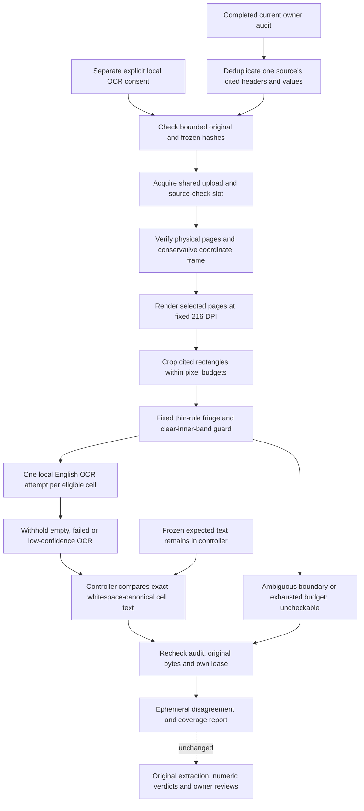

# Check what the cited PDF cells actually render

Two native text engines can agree on a PDF's hidden text while the page paints
something else. Workbench 0.11 adds a pixel-backed diagnostic: render the cited
cell locations from the stored original, run local English OCR on those crops,
then compare the observed words with the frozen extraction.

This complements [native PDF cell concordance](pdf-cell-concordance.md). It does
not replace the original audit, correct values automatically or become approval.
The worker receives original bytes and coordinates, not expected text. It uses
PDFium to render pixels and Tesseract to read them; it never creates a native
text-page handle or feeds extracted PDF text into OCR. PDFium is still a shared
renderer, not an independent publisher or a universally accurate visual judge.



## Try it

Start with the [Document Evidence Workbench](document-workbench.md), a scoped
frozen evidence set and a complete [numeric claim audit](numeric-claim-audits.md).
Rebuild the dedicated local image and restart backend controllers on this version:

```bash
docker build -f docker/Dockerfile.document-workbench -t agentforge-document-workbench:local .
```

In the completed audit, open **Cross-check rendered cells with local OCR**.
Read the limits, give separate local-OCR consent, then choose **Check pixels in**
for one original. Opening the panel does no work. The consent is separate from
the original upload's OCR flag: this action deliberately renders native cells
for a new diagnostic, but never changes that upload setting or stored manifest.
The model-request checkbox and provider keys are not needed.

The panel shows per-cell agreement, disagreement or uncheckable coverage,
minimum word-confidence values where available, rendered pages and actual local
OCR call counts. Reports are not saved; changing context or navigating away
clears them. Aborting the browser stops viewing, not guaranteed server execution.
There are no automatic retries, OCR-profile searches or external fallbacks.

## Read the result as a diagnostic

The overall statuses and original/context preflights follow the
[native cell checker](pdf-cell-concordance.md). `all_cells_agree` means every
selected cited cell has accepted matching OCR text; it is **not claim support**.
`disagreement` means at least one accepted OCR reading differs. `inconclusive`
means no accepted difference was found but some cells remain uncheckable.
Differences and uncheckable counts remain visible together.

Pixel-specific withheld cell reasons include:

| Cell status | Meaning |
| --- | --- |
| `boundary_ink` | A cell is too small or has ambiguous edge/inner-guard ink; no OCR attempt |
| `low_confidence` | At least one recognized word is below the fixed 0.60 floor; text withheld |
| `empty` | OCR returned no words; not an agreement |
| `ocr_failed` | Local OCR failed or timed out; no retry |
| `budget_exceeded` | Rendering, crop or scheduling budget prevents an accepted reading |
| `unsupported_geometry` | Physical page frame cannot safely bind to the frozen coordinates |

More than 12 cited cells returns `cell_budget_exceeded`; more than two selected
physical pages returns `page_budget_exceeded`. The source is not silently
truncated to a convenient subset. Native PDF table citations are required;
this does not infer scanned-table structure or relabel reviewed/OCR evidence.

Comparison still preserves case, punctuation, Unicode spelling, signs, currency
markers and numeric digits; only whitespace is collapsed. Row/column headers
are checked along with values. Confidence is a minimum over recognized words,
not a calibrated probability that the reading or business claim is correct.
Even high-confidence OCR can be wrong. A different OCR reading is a review
signal, not a mathematical refutation or proof of malicious text.

`numeric_verdicts_rechecked`, `other_sources_checked`,
`publisher_identity_verified` and `release_authorized` remain false. The original
claim may still be numerically supported by its frozen extraction while this
diagnostic disagrees with it. The check neither rewrites that verdict nor adds
an automatic release gate. Inspect the original and resolve the evidence in the
appropriate workflow before using it; this panel does not pick a winning value.

## Fixed rendering and boundary policy

The profile is `pdfium216-edge3-tesseract6-eng-v1`: 216-DPI PDFium rendering,
fixed single-block English Tesseract OCR, a three-pixel ruling fringe and a
0.60 minimum word-confidence filter. No caller can choose a DPI, crop, language,
OCR executable, expected text, image or command. The worker does not invoke a
vision API, download a model or use a hidden-answer prompt.

The supported page frame remains unrotated, uncropped and zero-origin, with
MediaBox/CropBox/bounds/dimensions matching to 0.01 PDF units. That is a coordinate
tolerance, not an OCR or numeric tolerance. Rendering uses the static PDFium
profile with form drawing disabled; it does not validate interactive form/widget
values, annotations, alternate layer states or every viewer's presentation.

Thin table rules caused empty OCR in the initial authored control. The final
worker applies **one fixed preprocessing policy**, not repeated tries. The outer
three-pixel strips must be uniformly light or uniformly dark away from corners.
Mixed edge ink is withheld. Another three-pixel inner guard must be clear. Only
then is that fixed outer fringe removed before OCR. Thick rules, clipped glyphs,
non-white guards and ambiguous marks are not erased to obtain a match.

This favors well-spaced, light-background, thin-ruled native cells. It will
withhold some legitimate shaded, tightly set or complex cells. Marks exactly
coincident with a ruling line/corner cannot reliably be distinguished from the
rule; the fringe is not a proof that every boundary pixel was semantically
checked. The primary parser still selects coordinates, so shared wrong-row
selection and uncited footnotes remain limitations. OCR is not visual reasoning
about table semantics, scope, scale or publisher truth.

The [Tesseract guidance](https://tesseract-ocr.github.io/tessdoc/ImproveQuality.html)
discusses segmentation and border sensitivity. The project's fixed guard,
resource limits and confidence floor are explicit local policy, not a benchmark
accuracy guarantee supplied by that documentation.

## Runtime and privacy

This uses the existing network-disabled, non-root, read-only Docker boundary:
immutable local image resolution, no request-time pull, no host mounts or
credentials, dropped capabilities, 512 MiB memory/swap, one CPU and 64 PIDs.
No untrusted uploaded original is parsed in the API process. Only the separately
authored test fixture is rendered on the host for source-preview diagnosis.

Originals stay bounded at 3 MB/ten pages. Pixel checks allow twelve unique cited
cells on at most two selected pages. A page render must fit six million pixels;
the whole probe must fit twelve million. A full cell crop must fit 500,000
pixels before preprocessing. Each eligible cell gets at most one four-second
local OCR attempt. A 50-second scheduling budget reserves four seconds before
starting another attempt; remaining cells are marked over budget. Existing
90-second worker-stage and controller/cleanup deadlines remain the outer bound,
including slow rendering. This is not a hard 50-second wall-clock guarantee.

The OCR word parser, per-cell text and aggregate/output bounds remain in force.
Results bind to original hash, page count, exact ordered targets, request digest
and fixed profile. Raster/OCR counters have consistency checks. The shared
SQLite lease excludes uploads, same-parser replay, native cell checks and pixel
checks without holding a write lock during parsing. Late source/audit/lease
changes prevent a successful report, and cleanup releases only the owned token.

The endpoint returns no expected or observed words, raw bytes, crops, fresh
manifests or private engine errors. It returns IDs, physical pages, statuses,
confidence metadata, counters, profile and image/engine identity. Original
previews, saved results and owner reviews are untouched. Hashes are unkeyed
integrity checks, not signed attestations against a malicious administrator.
The standalone SDK remains 0.10.0 unchanged; this is Workbench/service 0.11.0.

## API

Authenticated, operator-enabled and no-store:

```text
POST /workbench/documents/reconciliations/{set}/audits/{audit}/sources/{source}/crosscheck-pixels
```

```json
{
  "checkpoint_fingerprint": "CURRENT_64_HEX_AUDIT_CHECKPOINT",
  "confirm_local_ocr": true
}
```

Consent must be literal boolean `true`; missing/implicit consent and extra tool,
language or crop settings are rejected. Ownership, source membership, current
complete-audit bindings, original hashes and bundle budgets are verified before
execution. Busy work returns 429. The browser keeps the fixed 180-second local
request deadline and same authentication/no-store behavior as native checks.

## What was actually demonstrated

The real-engine integration authors four PDFs: two ordinary reports and two
hidden-text controls, with one of each placing its table on physical page two.
Each hidden control has invisible native `999` text in the Current cell and
visible vector-outline `125` at the same location. The outlines are drawn from
the bundled ReportLab Vera font using FontTools, a test-controller dependency;
FontTools is not installed in the document worker or used on uploaded fonts.

For each pair, the selected page-two original is checked; the other source stays
frozen, not independently pixel-checked. The application ingests these originals
without any SQL rewrite. Its primary
parser extracts 999, the numeric audit supports 999, and the PDFium native-text
checker agrees on all three cited cells. The pixel checker instead reads the
visible 125 and reports two agreeing headers plus one different value. The
ordinary 125 control agrees on all three cells. Source/result/review/audit rows
remain unchanged by each diagnostic. These are authored hidden-layer controls
parsed by real engines, not accuracy measurements on customer PDFs or detection
rates across unseen attacks.

The initial frame-induced inconclusive result, diagnostic profile comparison,
guarded-policy change and final run evidence are retained privately under
`data/evaluations/workbench-pixel-concordance-20261019/`. Verification covered
source/crop inspection, component/API behavior, builds, HTTP smoke and rendered
sources. It made no provider calls or hosted deployment.

The October 19 local final-code run passed **263 affected backend tests**,
including all 46 new cases and actual PDF/OCR/native/pixel integrations. The
unchanged SDK selection passed **313 tests with four host-Tesseract skips**;
Docker English OCR ran successfully. The frontend passed **69 tests across
twelve files**, typecheck, production build and formatting. The final static
image served HTTP 200 with the existing security headers in a non-root,
read-only, network-disabled container. Compose validation and scoped Python
lint/formatting passed. All 39 observed parser cleanup commands in the final
backend run succeeded, and no owned workers remained. This does not establish
a fix for the earlier iteration's unconfirmed local cleanup failures.

Syntax/link checks and a configured-secret-value scan of versionable source and
built assets passed; that is not a full-history credential audit or security
certification. Retrieval artifacts reproduced against a temporary prospective
source index without changing the actual Git index. The five-query learned
candidate remains unpromoted: baseline/learned recall 1.00/0.90, MRR 1.00/1.00
and NDCG 0.9594/0.8820. Serving and quality gates remain unchanged. These source
retrieval metrics do not measure OCR accuracy. The new tests are wired into CI,
but no remote CI or production-traffic result is claimed here.
