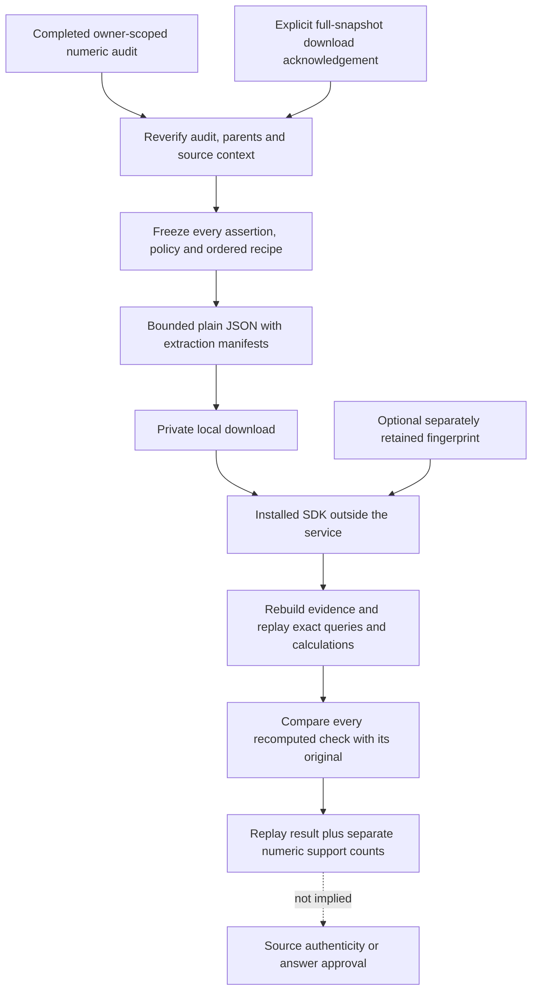

# Give a reviewer an audit they can actually replay

A JSON report is useful to read, but a reviewer should not need your running
service to recompute its numbers. Workbench 0.8 adds an explicit portable replay
download, and SDK 0.10 adds the offline verifier and command-line interface.

The bundle freezes extraction manifests, reconciliation policy, exact fact
queries, ordered calculation recipes and every original numeric check from a
completed audit. The verifier rebuilds the evidence set and recomputes each
check. It does not trust a saved `supported` flag just because its hash matches.

This is reproducibility of an **untrusted extraction snapshot**, not publisher
authentication, proof of accurate PDF extraction or approval to release an answer.

Workbench 0.9 adds a separate [source-backed check](source-backed-replay.md) using
stored originals and the isolated parser. It can detect a coherent extraction
rewrite that offline replay cannot, but does not change the portable verifier's
trust boundary or turn the same parser into an independent source authority.



## Review it from the Workbench

Use the [document setup](document-workbench.md), freeze an explicitly scoped
[evidence set](document-workbench-reconciliation.md), then complete a
[numeric claim audit](numeric-claim-audits.md). No provider account is needed.
Open **Portable offline replay bundle** beneath the completed audit.

Read the privacy notice and explicitly acknowledge downloading the full extraction
snapshot. This is separate from the existing audit-report checkbox: **uncited
extraction text is included**, not just the excerpts on screen. Choose
**Download private replay bundle**. The application shows the bundle fingerprint
and a command you can copy. Keep that fingerprint separately if you trust this
snapshot and want to detect replacement later.

The export includes all assertions, including refuted and unresolved ones. It
cannot select only favorable claims or reduce the corroboration threshold. It
does not advance the audit, run an omission/replay scenario, change reviews or
create another database record. Partial or stale audits cannot be exported in
this format. The older private audit JSON remains available with its original,
smaller scope; it is not silently upgraded into a full extraction export.

## Replay without the service

Install the SDK from this checkout or use its built wheel:

```bash
python -m pip install ./sdk
python -m agentforge_sdk.bundle_cli agentforge-claim-replay-bundle.json
```

The installed console command is also available:

```bash
agentforge-verify-claims agentforge-claim-replay-bundle.json
```

Neither command needs FastAPI, LangGraph, a database, Docker, OCR, a PDF parser,
an environment file or a model key. Only the explicit JSON input is read. No
source path, URL, tool command or code embedded in a bundle is executed or fetched.
Standard output is a bounded summary, not private claim labels or source text.

To pin a known snapshot, supply its separately retained fingerprint:

```bash
python -m agentforge_sdk.bundle_cli agentforge-claim-replay-bundle.json \
  --expected-fingerprint YOUR_RETAINED_64_HEX_FINGERPRINT
```

This compares the expected snapshot, not an independently authenticated publisher.
Copying a fingerprint out of an untrusted replacement bundle adds no authenticity.

| Result | CLI behavior |
| --- | --- |
| Every saved numeric check recomputes, even if some claims are refuted/unresolved | Exit 0, `replay_verified: true`, separate counts |
| Invalid, changed, unavailable, oversized or non-replayable bundle; wrong expected fingerprint | Exit 1 with content-free failure summary |
| Replay verifies, but `--require-supported` was supplied and any numeric assertion is not supported | Exit 2 with verified summary and support counts |

Argument-usage errors also use argparse's standard exit 2; they do not produce a
verified JSON summary. Applications should inspect both status and the JSON
`replay_verified` field rather than infer a numeric verdict from an exit code alone.

For example, an audit containing assertions of 25% and 50% over a verified 25%
growth calculation can replay correctly with one supported and one refuted
assertion. Exit 0 is correct: the original checks reproduced. Add
`--require-supported` only when your caller explicitly requires every numeric
assertion to match. Neither mode proves that the prose label maps to the right
metric or makes the output safe for automatic release.

## Use the SDK directly

Given an existing `EvidenceSet`, a `FactQuery` and an explicitly chosen claim:

```python
from agentforge_sdk import (
    ClaimReplayEntry, ClaimReplayRecipe, NumericClaim,
    build_claim_replay_bundle, check_numeric_claim,
    load_claim_replay_bundle, verify_claim_replay_bundle,
)

fact = evidence.lookup(query)
claim = NumericClaim(claim_id="requests", label="Requests are 125",
                     expected_value="125", expected_unit="scalar")
entry = ClaimReplayEntry(
    recipe=ClaimReplayRecipe(claim=claim, queries=(query,)),
    check=check_numeric_claim(evidence, claim, fact),
)
bundle = build_claim_replay_bundle(evidence, [entry])
serialized = bundle.model_dump_json()  # Private: includes uncited extraction text.
restored = load_claim_replay_bundle(serialized)
result = verify_claim_replay_bundle(restored,
                                   expected_fingerprint=bundle.fingerprint)
assert result.replay_verified  # Inspect numeric counts separately.
```

Calculation recipes specify an allowlisted operation and exact ordered queries.
There are no expressions, Python snippets, implicit unit conversions, tolerance
settings or automatic fact alignment. Source scope remains a caller declaration.
Loading validates shape and content bindings; **verification** additionally
rebuilds the collection and recomputes every original check.

For long-term reproduction, retain the SDK wheel and runtime versions alongside
the bundle. The protocol is not a promise that every future verifier implementation
will reproduce an old snapshot; a changed implementation must still recompute
matching checks, not silently trust or rewrite them.

`ReviewedRAG` objects and manifests with reviewed pages are deliberately refused.
The portable format cannot represent an application's reviewer keys, live expiry,
revocation or original-file checks. It does not downgrade an approval into plain
extraction. Ordinary frozen extraction snapshots retain their original trust
boundary, including the possibility of extraction mistakes.

## Limits and data boundaries

- Plain UTF-8 JSON, at most 3,000,000 bytes, five sources and ten assertions.
- At most 2,000 regions and 500,000 extracted characters across sources; up to
  eight unique queries per recipe. Existing source/configuration limits remain.
- Duplicate JSON keys, extra fields, duplicate claim/source IDs, changed receipts,
  wrong operand order and inconsistent collection fingerprints are rejected.
- Original file bytes, source-page images, credentials, owner review notes and
  unrelated audits/sets are omitted. Source metadata, scope, labels, values and
  **all extraction text of the selected sources** remain private content.
  Service/provider credentials are not attached automatically, but if a selected
  document itself contains a secret, its extraction text can contain that secret.
  Review the content before sharing; this is not automatic document redaction.
- The browser preserves the original UTF-8 response text within the same byte cap,
  rather than re-serializing coordinates such as `-0.0`. It revokes its blob
  URL, clears consent on checkpoint changes and aborts on navigation/unmount.
  A late response cannot trigger a download after leaving the panel.

Downloads cannot be revoked. Deleting an audit or source does not erase an already
exported snapshot. Protect local files and sharing channels. Use OS permissions
and encryption as appropriate; the bundle format itself is not encrypted or signed.

The authenticated export endpoint is an explicit
`POST /workbench/documents/reconciliations/{set}/audits/{audit}/replay-bundle`.
It requires the current `checkpoint_fingerprint` and literal boolean
`include_extraction_text: true`; strict validation rejects extra fields, claim
subsets and policy overrides without echoing private input. Responses are no-store.
A single read transaction binds the export to the same verified snapshot. There
is no schema migration, background job or automatic export.

## What a verified replay cannot claim

An attacker who rewrites manifests, recipes, claims and checks consistently can
produce a different internally consistent bundle. A trusted separate fingerprint
detects replacement of the expected snapshot; unkeyed digests alone do not detect
a dishonest author. The verifier therefore always reports
`source_files_authenticated: false`, `extraction_reexecuted: false` and
`release_authorized: false`.

Original file bytes are not included or re-parsed. Replay does not establish
source truth, independent corroboration, current report freshness, natural-language
entailment or financial correctness. The evidence-fragility and changed-report
workflows remain separate diagnostics; their results are not silently inherited
as approvals by this bundle.

## Verification

SDK/API/component tests cover unchanged checks and policy, fixed operand order,
all assertion outcomes, coherent replacement versus separately pinned snapshots,
duplicate-key/size/depth rejection, live-review-authority export refusal, stale and
cross-owner requests, full-snapshot consent, budget failures, offline replay after
source deletion and late browser responses. The SDK-only package check can replay
an API-produced bundle outside the checkout while blocking network, platform,
provider and optional PDF/image-parser imports.

The actual PDF integration exports the completed audit from two separately
extracted authored reports, one with its table on physical page two. It preserves
two supported and one refuted assertion, then replays the bundle independently.
These are controlled integration fixtures, not a live-model or held-out financial
benchmark. Run evidence is private under
`data/evaluations/workbench-claim-bundle-20261019/`.

On October 19, local verification passed **49 frontend tests**, **155 affected
backend tests** including the actual Docker PDF/OCR integrations, and **313 SDK
tests**. Four host-Tesseract checks skipped; English OCR passed inside Docker.
These are explicit regression selections, not every test or provider configuration
in the repository. Typechecking, production build, Prettier, scoped Ruff, Compose
validation and the non-root/read-only static Nginx HTTP smoke passed.

The SDK 0.10 wheel built and installed offline into a disposable target. An
application outside the checkout replayed the actual API-produced three-assertion
PDF bundle while blocking network sockets and platform, provider and optional
PDF/image-parser imports. It reproduced two supported and one refuted assertion,
rejected a wrong expected fingerprint and returned the expected exit 2 when
`--require-supported` was supplied. No package was published or dependencies
downloaded by this packaging control. The source-page PNG was inspected for
readable table borders, headers and Requests 100/125 on physical page two.

Source-bound retrieval artifacts were refreshed through a temporary prospective
index. Exact reproduction and the unchanged strict regression test passed, with
the actual Git index unchanged. On the existing five-query holdout, baseline/
candidate recall remains 1.00/0.90, MRR 1.00/1.00 and NDCG 0.9594/0.8735.
Promotion remains rejected and serving retains the fixed baseline. These metrics
do not measure portable replay or document-answer accuracy.

Syntax/link and configured-secret-value scans found no broken relative links,
private versionable paths or matches in public source and built frontend assets.
This is not an all-secrets or full Git-history audit. A preliminary adversarial
test run hit setup errors because automatically generated parameter IDs exceeded
Windows filename bounds; explicit short case IDs fixed that test-harness issue.
The final SDK selection passed. Docker was initially stopped; a normal hidden
application launch restored the engine. No Docker reset, data deletion, production
retry or parser-limit relaxation was used. No provider calls, staging, commits
or pushes were made in this iteration.

The verification combined source-preview inspection, component tests and the
local Workbench build. It did not publish a hosted deployment.
