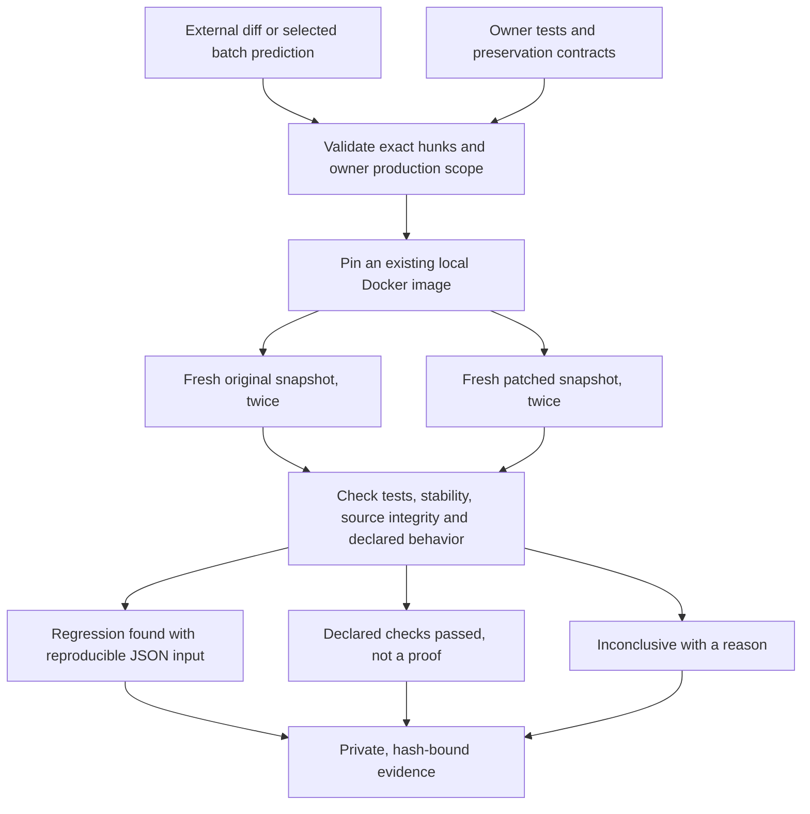

# AgentForge Verify: check a patch without adopting its coding agent

An agent can produce a patch that passes the existing tests and still changes a
public function's behavior. AgentForge Verify accepts that patch as data, runs it
in fresh offline Docker copies, and checks the behavior the repository owner
explicitly asked to preserve. It does not ask its own coding agent to write a
replacement patch or quietly repair a failed candidate.

This is the portable entry point to the existing sandboxed verification work.
It accepts ordinary unified diffs and the batch `preds.json` format produced by
[mini-SWE-agent](https://mini-swe-agent.com/latest/usage/swebench/). The adapter
reads only the selected prediction; it does not execute trajectories, invoke that
agent, authenticate its model label, or grade an official SWE-bench submission.



## Try the complete local example

Install the project and its existing dependencies with the normal quick start.
For an environment where those dependencies are already installed, refresh the
CLI entry points with `python -m pip install --no-deps --editable .`.
Build the existing execution image if it is not present:

```bash
docker build -f docker/Dockerfile.code-sandbox -t agentforge-code-sandbox:local .
python -m code_agent.patch_verify \
  --repository tests/fixtures/patch_verify \
  --spec tests/fixtures/patch_verify/fee-regression.json \
  --patch tests/fixtures/patch_verify/fee-regression.diff \
  --output-dir data/patch-verify/fee-example
```

The equivalent installed command is `agentforge-verify`. A new output directory
is required each time. This authored example should report `regression_found`
and exit with code 2: the existing tests exercise positive quantities, but the
patch changes the zero-quantity fee. `report.json` includes the exact generated
input, repeated observation hashes, command timings, pinned image, source/spec/
patch/controller hashes and the prediction-origin envelope. It intentionally
does not persist stdout, stderr, application return values, model reasoning or
credentials. Inputs and counterexamples may still be sensitive, so the entire
directory is private and ignored by Git.

Each new run also creates a local `.gitignore` and requests owner-only directory
permissions, so installed-tool use in another checkout does not depend on this
repository's ignore rules. This is not encryption or a substitute for host ACLs.
The checked-in authored fixtures use LF attributes for reproducible Windows/Linux
checkouts; externally supplied patches and source must meet the documented LF
profile too.

Use `fee-correct.json` and `fee-correct.diff` to exercise the passing path.
`--mode contracts` disables generated inputs; `--mode tests_only` runs only the
existing tests and remains behaviorally inconclusive even when those tests pass.
Only `checks_passed` returns CLI exit code 0. Invalid admission, missing execution
evidence and found regressions return 2. Malformed CLI inputs fail before execution.

For an existing mini-SWE-agent batch result, replace `--patch` with:

```bash
--predictions /private/path/preds.json --instance-id owner__repository-123
```

The corresponding original repository snapshot and owner specification must be
supplied separately. JSON mappings, record lists and single prediction records
are supported; JSONL and interactive trajectories are not. Duplicate JSON keys,
duplicate selected instances, null/empty patches and oversized inputs are rejected.

## What the owner declares

The specification has a task ID, editable production paths, existing test paths,
explicit JSON-call contracts and optional integer or structured JSON input domains. Setting
`preservation_authorized` is a statement of intended behavior, not a conclusion
inferred by an LLM. Only functions whose behavior should stay the same belong in
this specification. Leave intentionally changed behavior out and cover it with
separately reviewed acceptance tests.

Existing test paths may include bounded named pytest selectors such as
`tests/test_api.py::TestApi::test_boundary`. The file remains immutable; paths,
classes and test names are validated separately. Flags, parameter expressions
and arbitrary pytest arguments are not accepted. Named selectors let the
[upstream pilot](real-patch-validation.md) run relevant original test classes
without rewriting their assertions; selected tests are not the full upstream suite.

Explicit contracts may pass JSON positional/keyword arguments and name an exact
expected exception class. Generated inputs support a public unary integer
function over an owner-declared closed interval, or one structured JSON argument
from a bounded closed schema. Integer checks cover endpoints, adjacent values,
sign transitions and seeded interior samples. Structured checks add nested
objects/arrays, nulls, strings and scalar boundaries, with isolated confirmation,
greedy counterexample reduction and a source/patch/image-pinned replay spec.
See [structured regression discovery](structured-regression-discovery.md) for
the supported profile and optional owner-reviewed AI domain suggestions. Neither
generator claims arbitrary property inference or general LLM-generated test quality.

Every original observation must have the expected value/error kind. The checker
then compares canonical JSON results, preserving distinctions such as integer
`2` versus float `2.0`. Exceptions from function calls are distinguishable from
import, timeout and serialization failures. Module state is shared among cases
inside one probe process, so repeatability is not a substitute for the separate
[stateful migration checks](stateful-migration-verification.md).

## Execution and scope boundaries

- Existing LF UTF-8 Python source edits only; no file creation/deletion, renames,
  symlink modes, binary patches, fuzzy context application or dependency installs.
- Patches cannot edit tests, `conftest.py`, `setup.py`, secret/runtime paths or
  files outside the owner's production scope. Exact hunk positions/counts and
  original bytes must agree before Docker starts.
- Four fresh non-root, resource-limited, network-disabled containers run the
  original and candidate twice. Repository code is never imported on the host.
  The immutable image must already exist locally; there is no implicit pull.
- Pytest plugin autoload and cache writes are disabled. Zero tests, skips, xfails,
  collection errors, changed test populations and unstable repeats cannot yield
  passing evidence. Unsupported dependencies must be prepared in a reviewed image.
- Interrupted threaded Docker operations settle before cleanup. No provider key
  is loaded and there are no provider calls in this verifier.

Hashes detect drift, not malicious host tampering. Repository hooks/application
code still execute in the container and could forge local receipts. Docker is
not a complete hostile-code isolation boundary; use an additional VM boundary
for untrusted public submissions. Passing evidence covers only the selected
tests and declared contracts, not general semantic equivalence or safe merging.

See [the regression benchmark](patch-regression-benchmark.md) for paired
comparisons and [maintainer pilots](maintainer-migration-pilots.md) for separately
recorded human outcomes.
