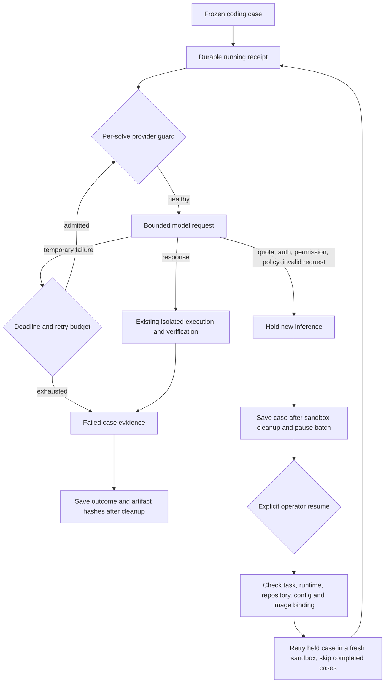

# Provider-aware inference and recoverable coding benchmarks

An agent should not interpret an exhausted API balance as a difficult coding problem.
This upgrade came from a real failed probe: Docker was ready, but the provider returned
`credit_balance_exhausted`. Retrying that request or launching another specialist could
not repair the infrastructure.

## What happens now



The coding loop distinguishes temporary rate limiting from quota exhaustion using
structured codes and HTTP status. Temporary failures permit at most three attempts
per planned action. Backoff starts at 0.5 seconds plus bounded jitter, honors `Retry-After` (numeric or
HTTP-date), and declines a retry if the delay exceeds eight seconds or cannot fit the
task deadline. An unknown local exception is not automatically retryable. Provider
SDK retries are disabled so they do not multiply application-managed attempts.

Analysis, implementation, test authorship, review, repair, and tournament inference
share a terminal hold within their solve. No later specialist can dispatch another
request after a terminal failure. The tournament also blocks winner publication if
another branch encounters such a failure. Calls already in flight may finish; this
is not a global distributed circuit breaker or a promise of recalling paid requests.
Each new solve starts with a fresh guard. No model substitution, provider failover,
credential repair, or billing change happens automatically.

`provider_failures` contains category, whitelisted code, HTTP status, bounded retry
delay and controlled stage. It never copies provider messages, raw response bodies,
headers, credentials or request IDs. Existing trajectories still contain issue,
repository, patch and tool evidence; keep these artifacts private.

## Start and recover a benchmark

Use one model per durable run and choose an unused directory under the ignored local
evaluation root. The following example uses authored smoke tasks, not official
SWE-bench scoring:

```bash
python -m code_agent.evaluation evals/datasets/code_agent_smoke.jsonl \
  --repository-root tests/fixtures/code_repositories \
  --workflow verified_pr --model gpt-4o-mini \
  --checkpoint-dir data/evaluations/provider-recovery/smoke-v1
```

After restoring access to the *same configured provider*, repeat that command with
`--resume --retry-provider-hold`. A crash or cancelled in-flight case requires
`--resume --retry-interrupted` instead. If both conditions exist, both retry flags
are required. Completed cases, including ordinary unsuccessful repairs, are reused;
they cannot be cherry-picked for another attempt through resume.

Recovery happens between cases. A retried case starts from the original repository
in a new sandbox; it does not restore a partially edited agent workspace. Every
attempt has a separate artifact directory, so prior evidence is not overwritten.
The journal is atomically replaced after an fsync. An exclusive native file lock
prevents two local runners from using the same journal and is released by the OS
after process exit. A cleanup failure leaves the attempt interrupted.

Resume checks the ordered task dataset, configuration, source repository hashes,
coding runtime Python sources, retrieval-candidate artifacts, retrieval environment
settings, Python/OS/architecture, provider SDK and parser package versions, hashed backend settings, and inspected
Docker image identities. Changed inputs or corrupted journal/attempt artifacts fail
before inference. Store immutable image references for strong operator control:
binding checked image identities does not prevent another process from retagging an
image during execution. Local hashes detect accidental drift, not a malicious host
owner who rewrites both content and hashes. There is no encryption, signing,
cross-host lease, or exactly-once inference guarantee.

A configured model name does not freeze a remote provider's weights. Pin available
model snapshots and local neural artifacts when preparing a publishable comparison.

## Honest reporting

A provider hold pauses the remaining batch, marks pending cases `not_run`, and retains
the full selected-case denominator. The CLI exits nonzero and shows null quality
scores; the comparison dashboard excludes paused/retried runs. A matrix stops before
dispatching the next variant. Release generation rejects incomplete or retried runs.
For backward compatibility, report JSON still has numeric aggregate fields: consumers
**must check `quality_metrics_valid` before displaying them as quality scores**.

All retained scored attempts contribute their known calls, tokens and estimated
costs. An interrupted request may already have been billed: its unknown usage remains
explicit and accounting is not marked complete. Cost per resolved issue is withheld
for paused or retried runs. A successfully recovered multi-attempt case is not
presented as Pass@1; use a new preregistered, uninterrupted run for a quality release.
Prices remain operator-supplied, not hardcoded or inferred from missing usage.

## Validation boundaries

The frozen final affected/retrieval suite passed **135 tests with four skips** on
both Python 3.11 and Python 3.13: three Docker skips and one Windows directory-symlink
skip. Docker's engine pipe was unavailable during this
iteration, so the new container recovery test was not executed locally. No paid model
requests were made. Repository-wide Ruff passed. These are reliability checks, not
a new real-task benchmark result.

The isolated new-module run passed 37 tests with one Docker skip and measured 88.6%
combined statement/branch coverage (provider reliability: 98%; checkpoint journal:
83%). This is focused coverage, not whole-project coverage. An initial broader
Python 3.13 run used a Python 3.11 dependency overlay and failed the exact retrieval
check when its native parser could not load. Removing that incompatible overlay
restored native parsing: the complete retrieval/intelligence suite passed 22 tests
with one Windows directory-symlink skip. The quality/reproducibility gates were not
weakened to accommodate the environment mismatch.

The broader native Python 3.13 run collected before the final hardening produced
836 passes, six skips and one source-bound artifact failure while source/artifact
refreshes were still in progress. The frozen 135-test rerun includes that exact check
and passes. These records do not claim a pristine all-green full-suite rerun or a
completed GitHub CI run; run CI on the reviewed, committed snapshot before merging.
Full Python 3.11 collection also encountered the host's missing `numexpr` dependency;
the final coding/retrieval suite above runs successfully in its available environment.

`tests/test_provider_reliability.py` checks code/status precedence, redaction,
deadline-aware retries, specialist stopping, shared-budget admission and in-flight
behavior. `tests/test_benchmark_checkpoint.py` checks hold/crash recovery, unsuccessful
case reuse, accumulated costs, source/dataset/config/image drift, artifact corruption,
exclusive locks, cleanup failures and publication holds. A Docker integration test
executes an authored failing test, applies a scripted patch, verifies it in the
container and confirms resume makes no additional model calls. It skips explicitly
when Docker is unavailable. None of these controls establish live coding-quality
improvement; they establish reliability behavior.

Provider retry rules were checked against the official
[error guidance](https://developers.openai.com/api/docs/guides/error-codes) and
[rate-limit guidance](https://developers.openai.com/api/docs/guides/rate-limits).
