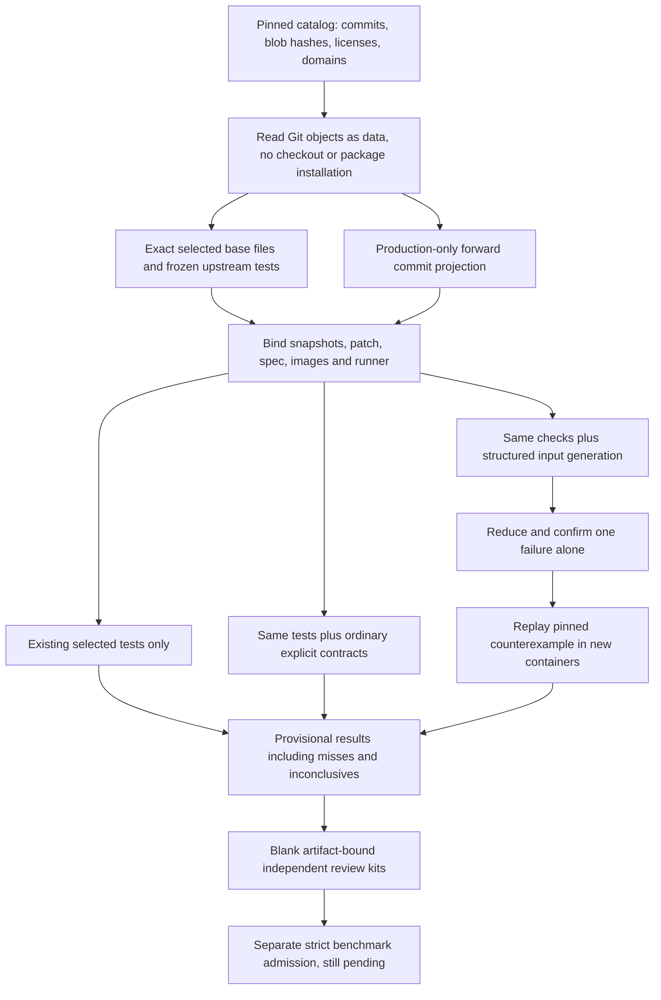

# Does structured discovery work beyond our examples?

The authored cart example proves the verifier can find a planted regression.
It does not prove the same approach is useful on upstream changes. This pilot
connects the structured verifier to four pinned, real forward changes from
three public Python projects, preserving their selected existing tests and
tracking every source and license byte.

This is a **public development replay, not an independently reviewed benchmark**.
The cases were selected with knowledge of their history. Labels and preservation
domains are local curation assumptions, informed by public upstream evidence;
they are not signed upstream-owner approval. None counts toward the existing
independent-review admission threshold. That gate remains unchanged.

## The four cases

| Project and candidate | Proposed label within the declared domain | Preservation scope |
|---|---|---|
| [Boltons `af6ab9f`](https://github.com/mahmoud/boltons/commit/af6ab9fb9d5da8094f09e789ce81d65854274410) | Regression | Previously handled plurals ending in `-ses`, excluding the intentionally changed `chances` behavior |
| [Humanize `fb61d5a`](https://github.com/python-humanize/humanize/commit/fb61d5aae902e4526cd733a90d7a96ecded11b0e) | Regression | Native numeric file sizes below 1,000; formatting should remain unchanged |
| [Humanize `a178851`](https://github.com/python-humanize/humanize/commit/a178851b369e303242749b60badaef697480375a) | Preservation control | Native Python numbers, not the NumPy integer overflow that this change addresses |
| [more-itertools `bc8c7ac`](https://github.com/more-itertools/more-itertools/commit/bc8c7acad2bcf9e0dc93f45c79a19d61794da012) | Preservation control | `only()` on empty/singleton nested JSON values and ValueError-class behavior for longer lists |

The Boltons [follow-up fix](https://github.com/mahmoud/boltons/commit/89bb0a8b96e765b464f3e31c171f55360bd3fe7c)
and Humanize [float-format fix](https://github.com/python-humanize/humanize/commit/11e62eeedb8990298c3612af82376dc2344d24f8)
provide public evidence for the proposed regression labels. We replay the
actual earlier forward changes—not hand-written mutations or reversed fixes.
Calling a control “correct” means no violation is expected within its declared
scope, not that every part of its upstream commit is certified correct.

The checked-in [catalog](../evals/datasets/upstream_patch_pilot.json) contains full
base/candidate commit IDs, original and local paths, SHA-256 source/license
hashes, candidate hashes, exact test selectors, domains and expected strategy
decisions. All cases are public development data. There is no hidden holdout,
repository-disjoint evaluation or generalization claim.

## What is actually compared



Each strategy executes independently in fresh offline Docker containers. Four
initial trials repeat original and candidate behavior. A generated structured
failure is reduced and confirmed alone; the pilot then runs its exported replay
specification through another four fresh trials. Tests-only passing means “no
alarm from these selected tests,” not behavioral equivalence.

Selection and projection are explicit:

- Boltons uses the unchanged base `tests/test_strutils.py` module. Its historical
  code needs `collections.Mapping`, so it runs in a separate Python 3.9 image.
- Humanize uses the unchanged base `tests/test_filesize.py` module. Its `src/`
  layout is mapped to the snapshot import root without changing module bytes.
  A small, recorded `_version.py` build-metadata shim supplies the generated
  version constant absent from Git; it does not implement formatting behavior.
- more-itertools uses the unchanged base `tests/test_more.py::OnlyTests` class.
  Named class/function selectors are accepted as bounded data; flags, parameter
  expressions and arbitrary pytest arguments are not.
- Candidate patches include only the declared production files. Upstream test,
  configuration and unrelated changes are listed as excluded paths in
  `UPSTREAM-PROVENANCE.json`. This is **not execution of each entire commit or
  its complete upstream test suite**. No existing test assertion is rewritten.

The legacy runtime is end-of-life and **must not be deployed as a service**.
Its base image digest is pinned, execution is non-root/network-disabled and
resource-limited, and the resolved local image ID is frozen per case. Docker
shares the host kernel; public hostile workloads still need stronger isolation.
The maintained cases use the normal Python 3.12 coding sandbox. Rebuilding an
image may change its dependencies/ID; a new study is then required.

## Reproduce the pilot

Install the normal project dependencies, then build both execution images:

```bash
docker build -f docker/Dockerfile.code-sandbox -t agentforge-code-sandbox:local .
docker build -f docker/Dockerfile.upstream-legacy -t agentforge-upstream-legacy:local .
python -m code_agent.upstream_pilot prepare \
  --input evals/datasets/upstream_patch_pilot.json \
  --output-dir data/regression-benchmark/my-upstream/prepared \
  --allow-download
python -m code_agent.upstream_pilot run \
  --input data/regression-benchmark/my-upstream/prepared/study.json \
  --output-dir data/regression-benchmark/my-upstream/results
```

Use fresh output directories. Downloading public Git history requires the
explicit prepare-time flag; execution never downloads, installs upstream
packages, loads a provider key or contacts a model. Caches verify their origin
URL. Git commit/blob object IDs, full first-parent relationships, expected
SHA-256 file bytes, regular-file modes and byte limits are checked. Symlinks,
binary blobs, changed files and unsupported patch forms fail admission.
Original license bytes are preserved, including CRLF where present.

This project's ignore rules cover the default Git cache. When using the module
from another checkout, explicitly ignore that cache or place it inside an
already-private directory; the per-run output directory protects itself with a
local ignore file, but does not change the other checkout's global ignore rules.

The Git cache is a data cache, not a checkout. No upstream module, setup file or
repository hook runs on the host. SHA hashes detect drift; they are not a
cryptographic maintainer signature or proof against a malicious controller.

Preparation writes per-case snapshots, scoped patches, specs, intake records,
review kits and `study.json`. Execution checkpoints every case/strategy receipt,
retains misses/inconclusives, and writes `results.json`, private replay specs
and replay confirmations. The separate `public-summary.json` excludes raw
inputs, code and counterexamples. Any changed frozen artifact, image or runner
invalidates a study rather than silently mixing observations.

The [manual workflow](../.github/workflows/upstream-patch-pilot.yml) runs the same
commands only after explicitly opting into public replays. Ordinary PR CI runs
offline intake/selector tests, not network downloads of external repositories.
Only the input-free summary is uploaded by the manual workflow. No workflow was
dispatched by the local implementation task.

## How to interpret the evidence

Provisional metrics include detection rate, false alarms, negative-clearance
rate, decision coverage, inconclusives and observed latency for the same frozen
cases. Every declared case stays in its denominator. An unresolved negative
does not become a confirmed non-alarm; false-alarm bounds retain that uncertainty.
Provider cost is zero because the runner calls no model. Infrastructure cost
is unknown, not zero. Small, selected public cases do not support statistical
claims of superiority or a production detection-rate estimate.

For independently reviewed results, a different reviewer must reproduce each
case, inspect the exact scope/provenance and fill the artifact-bound review
record. The prefilled submitter is explicitly automated curation; reviewer
identity and evidence URL stay blank. Use the existing
[review-kit and strict freeze workflow](patch-regression-benchmark.md) with the
intake files. New labels, domains, source or patches require fresh review.
The four public replays do not automatically satisfy a ten-case reviewed-corpus
milestone, and they establish no model-generation quality or maintainer adoption.

See the [local results record](real-patch-validation-2026-10-17.md) for the actual
completed run and the [structured discovery guide](structured-regression-discovery.md)
for reduction and replay boundaries.
