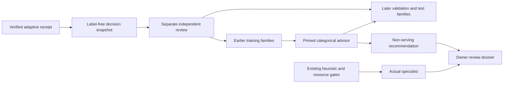

# Reviewed specialist-dispatch learning

The adaptive coding supervisor routes failures with an inspectable heuristic. This
upgrade asks whether independently reviewed dispatch decisions can support a small
learned advisor. It closes the data-to-evaluation loop without letting an experimental
model choose which repair team runs.

The advisor is a family-balanced categorical model, not an LLM fine-tune or reinforcement
learner. It learns integer vote counts for exact combinations of coarse execution features.
Its support is visible and its artifact is reproducible. Unfamiliar contexts produce
abstentions rather than extrapolation.



## What the advisor sees

Only a recoverable diagnosis category, the already-used role mask, coarse changed-file
and patch-size buckets, and remaining logical-call headroom enter the model. The exporter
retains no issue text, code, raw logs, patch contents, test outcomes, or preferred role.
It exports a snapshot only for a failure that actually led to another admitted specialist.
Terminal failures and resource-blocked successors produce no training row.

Snapshots carry receipt, policy and operator-declared scope digests. Family and reviewer
IDs must be bounded pseudonyms: do not put customer names or credentials in them. The
observation timestamp is operator supplied, not an attested event timestamp.

One task family contributes at most one vote per context, even if it has many attempts.
Conflicting labels for the same family/context are rejected. Used specialists are masked
out. Recommendations require enough supporting families, smoothed label agreement, a
margin over the next role, and a Wilson lower bound on empirical review agreement.
Agreement is **not** the probability of fixing the coding issue.

## Build a reviewed dataset

Use fresh outputs. Commands never overwrite existing artifacts and refuse project-source
output paths. The intended local output area, `data/evaluations/`, is ignored by Git.

```bash
python -m code_agent.dispatch_learning_cli export --report data/evaluations/run/repair-tournament.json --family-id issue-family-001 --scope-sha256 <64-hex-scope-digest> --observed-at 2026-10-01T12:00:00Z --output data/evaluations/dispatch-learning/pending-001.json
python -m code_agent.dispatch_learning_cli review --snapshot data/evaluations/dispatch-learning/pending-001.json --record-id <exported-record-id> --preferred-role boundary --reviewer-id reviewer-01 --independent-review --label-source human --reviewed-at 2026-10-01T14:00:00Z --split train --output data/evaluations/dispatch-learning/reviews/review-001.json
python -m code_agent.dispatch_learning_cli train --dataset data/evaluations/dispatch-learning/reviews --output-dir data/evaluations/dispatch-learning/study-v1
```

The receipt input is a saved `RepairTournamentReport`, not a whole job-result envelope.
Select exactly one exported snapshot using `--record-id` when necessary. Review writes
a separate file without editing the snapshot. Training accepts a directory of JSON
reviews, a JSON array, or JSONL. It requires all three splits from the same policy and
scope, with no duplicate decisions or task families crossing split boundaries.

Every training review must be available before any validation observation, and every
validation review before any test observation. These declared chronological boundaries
prevent future labels from entering training. Metadata cannot prove reviewer independence,
family identity or timestamp authenticity; the study owner must establish those externally.
Independent review and an explicit human/synthetic label source are mandatory.

The bundle contains `advisor.json`, `evaluation.json` and `review.md`. Supply custom
thresholds with `--thresholds` and freeze them before exposing the test split.
`--require-gate` exits nonzero when held. A passing human-reviewed study yields only
`ready_for_owner_review`, never serving activation. There is no activation command.

## Evaluate the right claim

Reports include family-macro coverage, accepted review agreement, heuristic agreement,
a family-level disagreement upper bound, and paired agreement deltas on the *same accepted
rows*. A deterministic 500-draw family bootstrap provides a descriptive paired interval.
No accepted rows means unavailable agreement and an error upper bound of one, not zero.

Risk/coverage curves apply stricter agreement filters to recommendations already accepted
by the primary guard. They do not relax support, margin or Wilson checks, refit the model,
or establish a causal policy comparison. Exact-context support is a coarse OOD check,
not semantic shift detection. The fitted artifact uses only training reviews; editing
held-out labels changes the report but cannot retrain its vote counts.

Review preference is not counterfactual coding utility: the unselected specialist did not
run. This iteration measures neither resolution lift nor dollar savings. Use the existing
[frozen coding comparison](adaptive-coding-supervisor.md#compare-it-honestly) for actual
execution outcomes. Do not reuse exposed test families to tune a new policy. This local
protocol has no external holdout-consumption ledger or signing authority.

## Observe in shadow mode

The default remains the existing heuristic with no advisor. On an already configured
adaptive worker, pin the artifact and declared study scope:

```dotenv
CODE_ADAPTIVE_DISPATCH_ARTIFACT=/operator-owned/path/advisor.json
CODE_ADAPTIVE_DISPATCH_POLICY_JSON={"advisor_shadow":{"artifact_fingerprint":"<advisor-fingerprint>","scope_sha256":"<64-hex-scope-digest>"}}
```

Replace placeholders with real digests. Keep the repair/verification policy identical to
training; its fingerprint excludes only shadow configuration. Changed policy or scope
abstains. Missing, malformed, oversized or incorrectly pinned artifacts record
`artifact_unavailable`. A broken advisor cannot change the served role. It makes no model
calls and receives no code or logs. Local scoring still adds some CPU work; this is not a
zero-latency claim.

Recommendations are recorded only after the next branch passes admission checks. Receipt
verification checks their context, role mask, baseline dispatch and pin. The dossier shows
the comparison alongside normal verification. Hashes detect changes but are not signatures
or proof that a real container executed the claimed work. Owner approval and all existing
fresh execution/security gates remain required.

## Credential-free controls

```bash
python -m evals.dispatch_learning_evaluation --output-dir data/evaluations/dispatch-learning/controls-v1
```

The control uses six training families and eight families in each later split. Six of eight
contexts in each later split are supported; two abstain as unseen. Accepted review agreement
is 100% at 75% coverage on deliberately repetitive synthetic labels. The result stays
**held**, makes no provider calls, and demonstrates only plumbing and guard behavior.
CI publishes this bundle; `--require-gate` deliberately fails for it. No Docker or
fixture-code host execution is needed for these controls.

For the next training round, [active dispatch supervision](dispatch-active-supervision.md)
adds budgeted review selection, blinded packets, explicit multi-reviewer consensus and
coarse shift audits. Its resolved labels are training-only; keep future evaluation
families separately frozen rather than treating targeted review as an unbiased test set.
