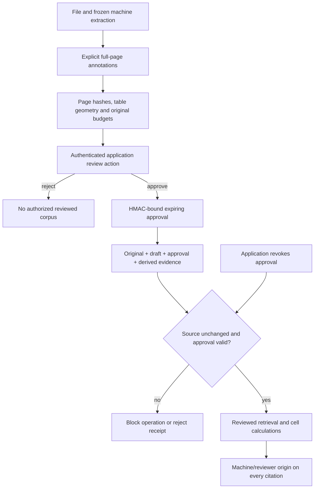

# Recover unusable evidence without hiding the correction

The multimodal SDK can hold an incomplete extraction. A real workflow also needs
recovery: an authorized reviewer checks the source, corrects a page, and the
application knows exactly which evidence now depends on that review.

SDK 0.3 combines full-page correction, manually reviewed table grids for scans,
source-bound approvals and expiring/revocable use. The original extraction stays
intact. Reviewer text is not relabelled as native extraction or given a fabricated
high OCR confidence. This is a developer SDK, not a review website, identity
service or automatic scanned-table model.



## Integrate the review boundary

Install `./sdk[multimodal]` from the complete checkout, or the built SDK 0.3 wheel.
No new mandatory dependency was added; signing uses the Python standard library.
The following application-provided variables are intentional: the SDK does not
manufacture a reviewer identity, fetch keys or perform a human review.

```python
from pathlib import Path
from agentforge_sdk import (
    PageCorrection, ReviewAuthority, ReviewedRAG,
    apply_review, load_multimodal, prepare_review,
)

source = Path("report.pdf")
original = load_multimodal(source, document_id="report", version="r1")
corrections: list[PageCorrection] = validated_editor_corrections
draft = prepare_review(original, corrections, rationale="Source checked and transcribed")

# Provision a distinct 32-64-byte random key per authorized reviewer securely.
authority = ReviewAuthority({authenticated_reviewer_id: securely_provisioned_key})

# Call only AFTER the application's authenticated review action.
approval = authority.decide(draft, reviewer_id=authenticated_reviewer_id,
                            decision="approve", lifetime_seconds=3600)
bundle = apply_review(original, draft, approval, authority=authority)
rag = ReviewedRAG(bundle, authority=authority, source_path=source)
answer = rag.answer("What does the report state?", top_k=1)
assert rag.verify_answer(answer, question="What does the report state?")
print(answer.result.status)
for citation in answer.citations:
    print(citation.origin, citation.reviewer_id, citation.spatial.page)
```

`ReviewAuthority` is a privileged application capability. Do not expose its
decision method through a generic agent tool or unauthenticated endpoint.
Possession permits decisions. There is no automatic approval path or
model-generated approval in this upgrade.

## What a correction contains

`PageCorrection` requires a one-based physical page, the fingerprint of the
original `EvidencePage`, nonempty `ReviewedRegionInput` annotations and the exact
`complete_page_review` attestation. Compute the page fingerprint with
`agentforge_sdk.models.fingerprint(page.model_dump(mode="json"))`.

Annotations contain canonical text and normalized top-left boxes. Table cells
also require a table ID and zero-based row/column address. There are no supplied
region hashes or confidence scores; the SDK derives content-bound region IDs.

Corrections replace a **whole page**, not selected convenient words. Review all
visible content relevant to the application's evidence scope, including labels,
units and footnotes. The SDK cannot prove that a reviewer did so: the attestation
is an application obligation, not machine-verified completeness. Other pages
remain unchanged; any remaining held page still disables document-wide answering
and calculations. Unsupported geometry and resource-limit holds cannot be
bypassed. Reviews target the original machine manifest, not a previous derivative.

Manual tables must be complete rectangular grids of at least two rows and two
columns, with unique addresses, consistent row/column boundaries and no overlapping
or reversed cells. Merged grids and empty cells remain unsupported. This makes
reviewed scanned-table calculations possible; **the grids are not inferred by
OCR or a vision model**.

## Keep the outer provenance receipt

`ReviewedEvidence` retains the original, draft, signed decision and derived
manifest. `ReviewedRAG` reconstructs that transformation, checks authorization
and verifies the actual source file. Ordinary `MultimodalRAG` rejects reviewed
manifests by default to prevent accidental loss of the review checks. Private
Python internals are not a sandbox against malicious application code.

`ReviewedAnswer.result` is the spatial answer; `ReviewedCalculation.result` is
the Decimal result. Their **outer** `citations` add machine/reviewer origin,
the original page fingerprint, and the reviewer/approval references for replaced
pages. The existing spatial citation is under `spatial`. Keep and verify the
outer receipt rather than dropping it and retaining only the inner result.
Expiry/revocation gates new SDK use and current receipt verification; it cannot
erase excerpts or bundles already returned to an application.

A replaced page is reviewer-supplied even when some text was copied unchanged.
An unmodified page retains machine origin. Calculations still require explicit
cell IDs and use the [same Decimal/unit rules](multimodal-evidence-sdk.md).

```python
cells = {(r.row, r.column): r.region_id for r in bundle.document.pages[0].regions
         if r.kind == "table_cell" and r.table_id == "review-table"}
change = rag.calculate("percent_change", [cells[1, 1], cells[1, 2]])
assert rag.verify_calculation(change)
authority.revoke(approval)
assert not rag.verify_calculation(change)
# New answer/calculation calls now raise ReviewError.
```

## Approval and deployment limits

HMAC-SHA256 binds the draft, reviewer ID, decision and issue/expiry times. Plain
rehashing cannot replace that signature. Approvals last 1 second to 1 day, with
a 1-hour default. Wrong/unknown keys, rejected decisions, future decisions, expiry
and local revocations are denied. Clock rollback is denied within an authority
instance. Keys are not serialized in bundles or automatic persistence.

Authorization and bounded source-file hash checks run before and after operations,
including after a custom text backend. Verification also checks current authority,
so an expired receipt does not imply currently authorized use. These checks do
not atomically lock external file mutations after the final check. Re-reading
the source has deliberate I/O overhead; no performance improvement is claimed.
Custom text embeddings/selectors retain the SDK's separate external-processing
consent rules. A review approval is not permission to send document data to a
provider. No external backend was used in these checks.

Revocation and observed clock state are **in-process**, not durable or shared
across workers. Restarting loses that state. Add synchronized revocation/key/
identity policy before multi-worker deployment. The local revocation set is
bounded at 10,000 entries and fails closed at capacity. Short leases do not
replace those deployment requirements.

HMAC proves possession of a shared key, not human identity or transcription
accuracy. A key holder can authorize new drafts. This is not publisher
authentication, public-key nonrepudiation, a legal signature or source truth.
The underlying parser still requires the isolation described in the multimodal
guide for hostile uploads. There is no cloud call or new ingestion endpoint here.

## Reproduce the checks

SDK 0.4's [version-impact layer](document-version-impact.md) can assess reviewed
dependencies and replay calculations through a newly authorized reader. It never
transfers an old approval, even when the corrected text is identical.

```bash
python -m pytest tests/test_evidence_review.py -q
python -m evals.evidence_review_evaluation \
  --output-dir data/evaluations/document-review/example
python -m evals.document_sdk_packaging \
  --output-dir data/evaluations/document-review/package \
  --review-evidence data/evaluations/document-review/example
```

The integration runner requires actual local Tesseract and optional image
dependencies. It uses explicitly authored annotations, a reviewer ID and a
public test-only key; no real human approval is claimed. Never reuse that key.
The installed-wheel check runs outside the checkout with network/platform
imports blocked. CI also reruns existing text/OCR tests. See the
[execution audit](reviewed-evidence-audit-2026-10-17.md).
