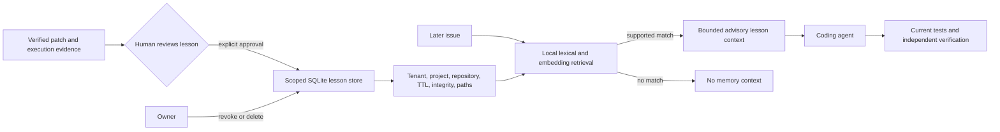

# Reviewed repair memory

## Why this is useful

Execution-guided retrieval helps an agent find code for the task in front of it.
Reviewed repair memory addresses a different problem: the next issue may repeat a
failure pattern the team has already fixed. An agent should be able to find that
lesson without treating an old patch as automatically correct for new source.

This upgrade adds local retrieval of short, human-reviewed repair lessons. It is
cross-task retrieval, **not model training** or an autonomous self-improvement loop.
The model cannot write, approve, or manage memory. Default behavior stays unchanged.



## Admission and isolation

An operator supplies a problem summary, a lesson, applicable paths, and a reviewer
identity. Approval requires a completed verified-PR result with a nonempty patch,
passing final execution, approved independent review, all mandatory quality gates,
unchanged original repository, security evidence, and no terminal provider hold.
Tournament results additionally require valid winning tournament evidence.

The lesson's applicable paths must be safe relative paths included in the verified
patch's changed files. The proposed lesson is rejected if existing heuristics detect
secret material or instruction injection. This does not guarantee detection of every
secret or malicious paraphrase; human review remains necessary.

Each record is scoped by a digest of **deployment project + authenticated tenant +
relative repository name**. The API and durable worker set the tenant from their
trusted user/job identity; `CodeTaskRequest` does not expose a namespace field.
Programmatic callers must explicitly supply `CodeTask.repair_memory_namespace`.
It is omitted from task serialization and does not give a model permission to choose
another tenant. The owner-only CLI is a trusted administrative interface, not an
authenticated multi-user API.

Use a unique deployment project ID for each authorized repository collection.
If an unrelated repository replaces an old one under the same relative name, change
the project ID or revoke its lessons. Paths and scope do not prove compatibility
with a new source revision. Lessons are advisory, and the agent must inspect and
verify current code independently.

## Retrieval behavior

Before each coding-stage planning step, an enabled agent reopens the store with a
read-only connection. Active records must pass scope, expiration, body-digest,
schema, timestamp, and safety checks. Applicable paths must still be present in the
filtered workspace. Unrelated issues or insufficient lexical support yield no pack.

Ranking combines normalized token overlap with local hashing-embedding cosine
similarity. These are deterministic local approximations, not a learned semantic
model or calibrated success probabilities. At most three lessons are selected,
with a combined 3,000-character JSON evidence budget. No model call or download is
added, but the extra context increases prompt usage. Tournament prompt reservations
include that message; actual provider token usage remains separately accounted for.

Memories are marked untrusted and participate in existing action-policy taint checks.
They cannot authorize shell commands, networking, test weakening, host edits, or
automatic patch application. Provider holds are checked before memory retrieval.
Missing/unreadable stores and invalid configuration add an unavailable/unscoped
receipt and let the existing workflow continue without memory.

Expiry and revocation are checked on each planning step. They cannot retract a
lesson already included in an in-flight provider request; bounded retries for that
same step reuse its messages. There is no mid-request revocation guarantee.

## Enable deliberately

The example configuration defaults to disabled. Set the same values in the API and
external worker, protect the host database, and restart both:

```dotenv
CODE_AGENT_REPAIR_MEMORY_ENABLED=true
CODE_AGENT_REPAIR_MEMORY_PROJECT=your-unique-deployment-project
CODE_AGENT_REPAIR_MEMORY_PATH=data/code-agent/repair-memory.db
```

The default directory is Git-ignored. No database is created by a runtime read;
the operator approval command initializes it. Library tasks use
`SandboxPolicy(repair_memory_enabled=True)` and a trusted namespace. Existing
execution-guided retrieval can be enabled independently or alongside memory.

Initialization rejects an existing unrelated SQLite database instead of adding
memory tables to a mistakenly selected job store or application database.

## Review, approve, and withdraw a lesson

Use a private trajectory containing a `case.repository` and `result`, or a durable
job export containing `request.repository`, `user_id`, and `result`. Repository
scope must match; a job's tenant must also match the supplied namespace. The command
validates the result but does not authenticate a copied file against an external
service. You are attesting that you reviewed its provenance and the lesson. It does
not replace the separate owner approval required to release a patch.

```bash
python -m code_agent.repair_memory_cli \
  --project your-unique-deployment-project --namespace authenticated-user-id \
  --repository sample approve \
  --trajectory data/evaluations/private-reviewed-trajectory.json \
  --problem "Incorrect decimal rounding for boundary amounts" \
  --lesson "Preserve decimal precision and verify boundary amounts against the current contract." \
  --paths billing/tax.py --reviewer owner-id --approve-lesson --ttl-days 30
```

The output contains an opaque lesson ID and scope digest, not the lesson text.
Revocation removes the active lesson text and leaves a scoped metadata tombstone;
hard deletion removes that row:

```bash
python -m code_agent.repair_memory_cli \
  --project your-unique-deployment-project --namespace authenticated-user-id \
  --repository sample revoke --lesson-id LESSON_ID

python -m code_agent.repair_memory_cli \
  --project your-unique-deployment-project --namespace authenticated-user-id \
  --repository sample delete --lesson-id LESSON_ID
```

`--store` can select another protected database and belongs before the subcommand.
TTL is 1–90 days, default 30. Capacity is 200 rows per scope and 5,000 globally,
including expired/revoked rows; operators explicitly delete unneeded records.
Runtime reads reject databases larger than 50 MB and oversized record bodies.
Duplicate lesson content within a scope is rejected rather than filling memory
with repeated near-identical entries.

## What is retained

The store contains the reviewed problem/lesson/path text, timestamps, and digests
of scope, reviewer identity, and verified-result evidence. It does **not** retain
raw patches, test logs, conversation transcripts, or hidden reasoning. Lesson text
can still contain confidential project details: SQLite is not encrypted, and a
digest is not an authorization mechanism or digital signature. A host owner could
rewrite the database and recompute hashes. Protect filesystem access and backups.
Deletion is not a promise of forensic erasure from backups, provider requests, or
previous trajectories; SQLite secure-delete is enabled for withdrawal operations.

`CodeAgentResult.repair_memory` records stage/iteration, status, scope/query/snapshot/
context digests, selected lesson IDs and retrieval scores, approximate context
tokens, and invalid-record count. It omits the lesson text. Verified-PR combines
receipts across stages; tournament publication retains only the winning result's
detailed receipts, following its existing publication boundary.

## Validation boundaries

```bash
python -m evals.repair_memory_evaluation \
  --output data/evaluations/repair-memory/controls.json
```

The authored control runner checks relevant retrieval, project/tenant/repository
isolation, TTL, unrelated-query abstention, missing-path abstention, explicit review,
modified-body rejection, revocation, and deletion. Its verified patch/review evidence
is scripted. It makes zero provider calls and does not measure coding success.

Unit tests additionally exercise rejected verification evidence, unsafe lessons,
capacity, read-only missing-store behavior, authenticated namespace propagation,
CLI redaction, revocation between model calls, and verified-PR receipt aggregation.
CI runs and uploads the authored control report.

On October 4, the frozen affected suite passed **199 tests with four skips** on
each of Python 3.11 and 3.13. An additional **133 security/retrieval/dispatch tests**
passed on Python 3.13. The two new memory modules reached **91.35% combined
statement/branch coverage** with 36 focused tests; this is not whole-project
coverage. All 11 authored controls, repository-wide Ruff, compilation, diff checks,
and refreshed retrieval-artifact reproducibility passed. Three Docker checks and
one Windows directory-symlink check were skipped. The whole repository suite was
not rerun, and no paid provider or real coding-task comparison was executed.

Frozen benchmark runners still reject mutable repair memory **before creating
checkpoint artifacts**. The subsequent [frozen snapshot upgrade](frozen-repair-memory.md)
adds owner-attested source lineage, overlap auditing, pinned offline content, and
paired memory-on/off experiment support for single-agent and verified-PR runs.
Unlike this live store, frozen experiments deliberately do not track later expiry
or revocation. A held-out real-task comparison remains unexecuted; neither set of
authored controls establishes live-model improvement.
