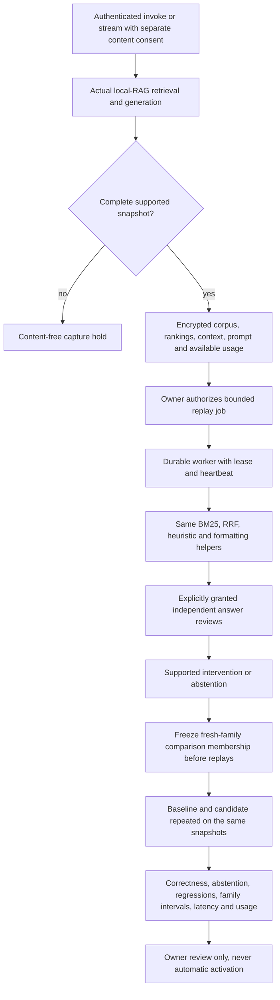

# Reproduce a failure from the application that actually answered

The first investigation adapter accepted a manually prepared document snapshot.
This upgrade connects the investigation to local RAG requests: it captures the
ranking and context actually used, preserves them privately, and runs controlled
comparisons without querying a changing external index.

This is a bounded integration, not universal production replay. It supports the
application's Chroma-hybrid and SQLite-fallback paths. It does not reproduce web
search, memory, evidence-adjudicated contexts, inference-gateway generation, or
arbitrary agent tools. Unsupported or incomplete captures return a content-free
hold. The served answer is not changed by capture or investigation.



## Capture a request

Configure private storage as described in [the investigation guide](ai-failure-investigation.md).
Runtime content capture has its own off-by-default switch:

```dotenv
INCIDENT_INVESTIGATION_ENABLED=true
INCIDENT_RUNTIME_CAPTURE_ENABLED=true
INCIDENT_LIVE_REPLAY_ENABLED=false
INCIDENT_WORKER_LIVE_ENABLED=false
INCIDENT_CAPTURE_TTL_SECONDS=86400
```

An authenticated caller can then send this to `/invoke` or `/stream`:

```json
{
  "message": "local: what is the authenticated request limit?",
  "incident_capture_consent": true,
  "incident_task_family": "limits-family-assigned-before-execution"
}
```

`/invoke` returns an `incident_capture` receipt with an opaque case ID or a hold
reason. SSE emits a separate `incident_capture` event before `[DONE]`. The private
family, corpus and prompts do not enter graph configuration or the ordinary
capture receipt. The request-local collector propagates into retrieval's worker
thread and disables inherited LangSmith capture for the consented graph call.
Existing application conversation storage has its own retention behavior; this
feature does not retroactively remove content stored by other subsystems.

Capture records the entire active bounded corpus, document-content hashes and
source labels, actual vector/BM25/fused rankings, selected order, reranker identity,
formatted evidence, exact generation input and system prompt, resolved model,
and reported generation/reranker usage where available. Missing usage stays null.
It records consented answers, not an automatic claim that every captured answer
is wrong. Subsequent repeated baseline reviews establish a reproduced failure.

To keep cases small, capture requires 1–20 documents, at most 8,000 characters per
document and 50 KB of document UTF-8 bytes, at most 6,000 context characters,
12,000 generation-input characters, and a 2,000-character system prompt. A larger
corpus is held, not silently truncated into an apparently complete reproduction.
Cache hits are also held: cached formatted text lacks the full source receipt.
Capture does not bypass the cache or make additional embedding requests. Requests
without incident consent retain their ordinary behavior.

## What a real-component replay means here

The replay uses production functions from `agent/local_rag.py`, not a second
implementation of their scoring formulas:

- BM25: `_bm25_rank_documents` over the frozen corpus.
- Hybrid RRF: `_rrf_fuse_rankings` with captured vector ranks and frozen settings.
- Heuristic reranking: `_heuristic_rerank` with the production candidate snippets.
- Packing: the same SQLite/hybrid formatters, or the bounded query-line-window
  intervention, retaining the captured order when packing alone changes.

The runtime baseline uses the exact captured evidence and generation messages.
Retrieval's intervention uses real BM25 instead of the captured retrieval result;
reranking uses the production heuristic instead of captured order; packing chooses
query-relevant lines instead of the original prefix; generation changes only the
system instruction to the evidence-only alternative. Everything outside the
selected component stays frozen, including the rest of the human-message template.

Vector replay means **reusing recorded embedding-search rankings**, not rerunning
the embedding service or proving embedding-model reproducibility. LLM reranker
outputs are captured, not secretly regenerated during preparation. Newly retrieved
documents absent from the captured reranked subset append in retrieval order.
These comparisons therefore establish conditional snapshot evidence, not the
effect of retraining embeddings or re-executing every production component.

Live runtime generation uses the research assistant's text-message contract and
captured temperature, rather than the manual adapter's structured answer wrapper.
Replays add declared completion caps and deadlines, disable SDK retries, and may
still vary across provider executions. They do not replay routing, approval,
grounding, or other downstream policy nodes. Changed final-answer postprocessing,
mixed sources, and multiple retrieval/generation passes hold automatic capture.

## Queue and worker

`POST /investigations/{id}/run` now returns **202 Accepted** after enqueueing;
the HTTP handler makes no model calls. An independently running worker may already
have claimed the job by the time it is polled. Start
a separate worker against the same private database and key:

```bash
python -m agent.incident_worker
# Process at most one available case:
python -m agent.incident_worker --once
```

The CLI reads the ignored `.env` without printing it. Poll
`GET /investigations/{id}` for job state and content-free trial progress.
`POST /investigations/{id}/cancel` cancels queued work or requests cancellation of
a running job. Every mutation checks the lease token, deadline and cancellation
flag. A heartbeat cancels in-flight execution after lost ownership or cancellation.
An already transmitted provider request may still run and be billed remotely.

Unstarted expired leases can be reclaimed. Once inference admission has begun,
expired leases become `interrupted_unknown_usage`, not fresh retries. A crash
between receiving a response and persisting it can lose its usage/result; this is
deliberately held rather than guessed. A cancellation retains the started trial
as uncertain evidence. TTL expiry and deletion also prevent further admissions.

Live work requires all of: global live replay enablement, explicit authorization
in the submission, and `INCIDENT_WORKER_LIVE_ENABLED=true` in the worker environment.
The existing per-case call/token reservations, timeout and expiry checks still
apply. These are not account-wide spending limits or an exactly-once external
provider transaction. The queue is single-host SQLite, not a distributed broker.

## Freeze the comparison before looking at replay outcomes

First obtain a supported diagnosis with independently reviewed live repeats.
Capture genuinely different task families using `incident_parent_id` on future
requests, or create fresh operator shadow snapshots with that parent. Same model,
prompt, application revision and base policy are required. Do not reuse the
diagnostic family or rename identical query/document content.

Before submitting any shadow jobs, register every already exposed child:

```http
POST /investigations/PARENT_ID/comparison
Content-Type: application/json

{"case_ids": ["FIRST_CASE_ID", "SECOND_CASE_ID", "THIRD_CASE_ID"]}
```

Registration freezes 3–50 unique families, source fingerprints and the candidate.
Already executed, queued, synthetic, foreign-owner or omitted exposed cases are
rejected. Membership cannot be replaced after inspecting results. This is a frozen
snapshot cohort, not proof of prospectively random traffic sampling: operators
can already know the original served answers when selecting captured cases. That
selection bias must be disclosed, and new studies need separately assigned cohorts.

Run baseline/candidate jobs, grant independent reviewers access, and record their
correctness, safety, rationale and optional `abstained` boolean for each repeat.
The latter is a human label, not a phrase-matching abstention detector.
`GET /investigations/PARENT_ID/comparison` then returns:

- family-macro baseline/candidate correctness and paired correctness difference;
- whole-family bootstrap 95% intervals, retaining negative or zero-crossing results;
- paired regression rate and explicitly reviewed abstention rates;
- descriptive trial p50/p95 latency and reported usage completeness;
- pessimistic/optimistic correctness bounds for missing families/reviews.

Deleted, expired, ambiguous, changed or revoked evidence never disappears from
the denominator. Unsafe candidates hold the report. `reviewed_comparison_complete`
only means the frozen results are available: it can include regressions and is
**not** a successful repair or a release approval. Billed dollar cost is null;
reported token counts are not a provider invoice. Three families are enough to
exercise the protocol, not establish a robust general-quality improvement.

Latency and usage are also separated by baseline and candidate. Snapshot
preparation time is reported separately from the timed generation call; these are
not whole-request or queue-wait latency measurements. Reported usage can omit
unreported provider-internal work and is never silently filled with estimates.

## Reproduce local controls

```bash
python -m evals.runtime_rag_evaluation --output data/evaluations/runtime-rag/controls.json
python -m pytest -q tests/test_incident_runtime.py tests/test_incident_http_runtime.py tests/test_incident_worker.py tests/test_incident_comparison.py
```

The authored SQLite study covers packing loss, an already-correct baseline and
absent evidence using actual retrieval/formatting, encrypted capture and a reopened
durable worker. It uses extractive generation and simulated labels, makes zero
provider calls, and must abstain from live repair recommendations. Tests cover
Chroma-rank capture with a vector-store double, HTTP/SSE with test-double generation,
lease fencing, crash/cancellation holds, and positive/negative comparison paths.
Those are not live embedding-service or real-user accuracy measurements.

Current-run receipts are kept privately under `data/evaluations/runtime-20261014/`.
On Python 3.13.9, the selected final checks were:

| Check | Observed result | Receipt |
|---|---|---|
| Focused incident/capture/worker/comparison suite | 42 passed, zero skips | `focused-final.xml` |
| Additional complete comparison HTTP journey | 1 passed, zero skips | `comparison-http.xml` |
| Affected research-agent suites, including invoke/SSE | 226 passed, zero skips | `research.xml` |
| Coding/provider/observability regressions | 97 passed, zero skips | `coding.xml` |
| Deduplicated selected test inventory | 364 distinct tests; two overlapping instances excluded | `verification-summary.json` |
| Eight incident modules measured by the 42-test focused suite | 90% combined statement/branch coverage; 92.88% statements, 79.53% branches | `focused-coverage.xml` |
| Actual SQLite/worker controls and manual snapshot controls | 3/3 and 5/5 passed; zero live provider calls | `controls-final.json`, `manual-controls.json` |
| Source-bound retrieval candidate refresh | Train, exact check and holdout exited 0; actual Git index unchanged | `retrieval-refresh-receipt.json` |
| Retrieval quality decision | Candidate NDCG 0.9433 below baseline 0.9594; promotion rejected | Checked-in fusion holdout report |
| Containment and documentation checks | No configured secret values in versionable files/new receipts; private paths ignored; local links valid | `private-data-safety.json` |

The selected-suite counts are not added to earlier upgrade totals or presented as
a full-project/GitHub Actions run. Earlier development checks are also retained;
the final inventory points to the successful current rechecks. The retrieval
refresh used a temporary prospective public-source index because the new files
have not been staged. After tracking them, run the normal exact artifact check;
the current narrower tracked-only local corpus will correctly report it stale.

Live provider reliability, independently reviewed diagnosis/repair accuracy and
real-world impact still require an explicitly budgeted study. No candidate is
activated, no provider key is added, and private incident data remains Git-ignored.
