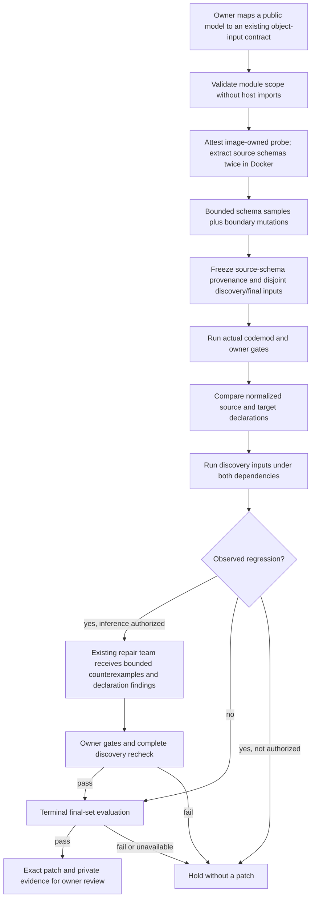

# Schema-guided migration: reach the fields an example never exercised

An empty order can pass every owner test while concealing a broken item model.
Changing the empty list into strings or nulls does not discover the item's field
names. This optional UpgradePilot mode reads an explicitly selected model's
validation schema inside Docker, then constructs nested inputs the example-only
generator could not reach.

It combines three checks: declared schema differences, observed old/new behavior,
and a separate terminal evaluation. None substitutes for owner review.

For multi-step workflows, the separate [stateful session gate](stateful-migration-verification.md)
can also check accumulated state and post-error observations. Schema-guided input
generation alone does not establish sequence correctness.



## Allowlist the model, not arbitrary imports

A small owner policy maps an existing positive contract to a public Pydantic class:

```json
{
  "targets": [
    {"seed_case_id": "empty-order", "model": "app.models:Request"}
  ]
}
```

The seed must call a public application function with exactly one JSON object and
no keyword arguments. Its model module must be inside the selected Python source
scope. The class must be a locally defined Pydantic model, not an imported alias
to an unrelated class. The owner asserts that this model belongs to that function;
the system does not infer the application's dynamic call graph.

Only a disposable workspace receives the reserved `upgradepilot-models.json`
policy. It remains protected from repair tools. Extraction imports application
code only inside the existing non-root, network-disabled, resource-bounded Docker
boundary. The probe's SHA-256 and the exact dependency version are checked, and
schema output must repeat across two fresh processes without changing workspace
content. Failures hold the run instead of substituting a host import or guessed
schema. Model methods can still contain untrusted code: containers are not VMs.

## Generate candidates, then measure their validity

The `schema-grounded-boundaries-v1` generator supports a deliberately bounded
subset: local `$defs`/`definitions` references, object properties and required
fields, aliases already published as property names, scalar types, numeric/string
bounds, enum/const, arrays, `anyOf`, and a single-reference `allOf` wrapper.

Examples include nonempty nested arrays, declared enum values and payloads that
omit optional properties. The campaign prioritizes schema-constructed candidates
before filling its fixed budget with boundary mutations. Original owner inputs
are excluded; discovery and final inputs remain distinct and fingerprint-bound.
Shrink search cannot execute final inputs.

Candidates are **not promised valid**. Custom validators and cross-field rules
may reject a schema-shaped payload. Reports distinguish actual source values
from source exceptions, alongside target outcomes and regressions. Identical
validation-error classes are preserved observations, not evidence that a valid
application path was exercised. This is input-shape reach, not branch coverage.

Limits are four models, 16 KB of emitted schema per model, 60 KB total output,
2,000 analysis nodes, generation depth eight, twelve object properties, and array
construction lengths up to four. Each model yields at most 48 direct samples;
only the first eight seed up to 256 mutations each. The ordinary campaign budget
remains 24 discovery and 16 final cases by default. Source-schema metadata and
the policy enter its commitment before any model admission.

Recursive/external references, general intersections, `oneOf`, discriminators,
pattern/format generation, typed additional-properties maps and larger structures
hold this profile. There is no silent fallback to the blind generator and no
claim of complete JSON Schema support. Bounded prefixes can miss important fields.

## A declaration is not a behavior guarantee

Comparison normalizes Pydantic's definition namespace and omits documentation-only
title/description/examples metadata. Actual properties with those names and
literal defaults remain intact. Required-field ordering is treated as a set;
added/removed required fields are reported explicitly. Other bounded changes
carry JSON paths and old/new value hashes. The report stops at 80 differences.

These are declaration findings, not a general compatibility verdict. A target
schema can be unavailable before repair; this is recorded, not reported as equal.
A successful candidate must permit stable final schema extraction. Intentional
changes still require a new owner-reviewed recipe/campaign; findings do not
create broad waivers or automatically modify serving behavior.

In particular, integer/string unions can publish the same JSON Schema before and
after migration while selecting different output types. The execution gate must
still catch that regression. Normalized schema equality never bypasses tests.

## Run the profile without inference

Build a separate local tag, preserving the original image:

```bash
docker build -f docker/Dockerfile.upgradepilot -t agentforge-upgradepilot-schema:local .
python -m code_agent.upgrade_cli run --repository tests/fixtures/upgrade_schema --spec tests/fixtures/upgrade_schema/migration.json --schema-policy tests/fixtures/upgrade_schema/schema-policy.json
```

The fixture should hold with exit code 2 and nested counterexamples. The
`--schema-policy` option implies counterexample verification. It does not grant
provider authorization. For optional live repair the existing explicit model,
provider authorization and account-budget requirements still apply. No live calls
were required to implement or verify this feature.

Private run artifacts are unencrypted local files under ignored `data/upgradepilot/`.
Schema defaults, enum values, counterexamples and patches may reveal application
details; review them before sharing. Ordinary traces do not receive schema bodies.

## Reproduce the authored ablation

```bash
python -m evals.upgrade_schema_evaluation --output data/evaluations/upgrade-schema/my-controls.json
python -m pytest -q tests/test_upgrade_schema.py tests/test_upgrade_schema_docker.py
```

One fingerprint-locked nested-order task compares blind discovery, schema-guided
discovery without inference, and schema-guided scripted repair. Discovery budgets
match and all arms use the same frozen final inputs. Blind discovery excludes
those final inputs as well. The analyst, implementer, test-author and reviewer use
fixture-aware scripted responses; these are workflow controls, not a live-model
success rate, independent human review or a real-repository benchmark. The ordinary
example-only generator and its existing frozen corpus remain unchanged by default.

The corpus uses UTF-8/LF-normalized text identity so Windows checkout line endings
do not create a false dataset change. A fourth negative control supplies a revoked
campaign commitment: extraction can run, but discovery and agent admission must
not. It is a safety control, not another independent migration task.

## Local verification: October 16, 2026

Host tests used Python 3.13.9; application imports and schema methods ran under
the pinned Python 3.11 migration image. These are selected local results, not a
whole-repository rerun or a new GitHub Actions result.

| Check | Observed result |
|---|---|
| Selected schema, migration, delivery, security and provider tests | 167 passed, zero failures or skips; 137.03 seconds |
| Frozen Docker controls | 4/4 expectations passed: three comparable arms plus campaign revocation |
| Blind discovery | 2/24 source-value cases, no discovery regression; the shared final set caught two regressions and withheld the patch |
| Schema-guided discovery | 13/24 source-value cases and four behavioral regressions found before any inference |
| Scripted repair | Six scripted calls; complete discovery recheck and all 16 final observations preserved |
| Declaration comparison | Request schemas normalized equal in the ablation, despite the behavioral regressions |
| Requiredness probe | Separate old/new Docker extraction over the original nullable-label declaration detected a newly required field |
| Revoked commitment | Held at source-schema extraction, zero agent calls, no patch |
| Actual CLI | Schema-guided provider-free hold; saved report fingerprint verified; original source unchanged |
| Artifact integrity | All four report fingerprints, accepted patch/final-evaluation binding and exclusion of the injected policy file checked |
| Privacy/static checks | Ruff, compilation, whitespace and local links passed; no configured secret values found in 512 versionable files or new audit/run artifacts |

The schema analyzer, schema runtime, input generator and pilot runner have 87%
combined host statement/branch coverage in the selected suite. The image-only
schema probe is exercised by Docker but is not counted in that host percentage.
This does not measure model accuracy or whole-project coverage.

The separate image was
`sha256:de108a0bbc300437600cc5c746adf6c70cda1616926f8f671b5864477e0b5084`.
The original `agentforge-upgradepilot:local` tag was preserved. No task sandboxes
remained after verification. Private receipts are under
`data/evaluations/upgrade-schema-20261016/`: `final-selected-v2.xml`,
`controls-final.json`, `retrieval-refresh-receipt.json` and
`private-data-safety.json`. The actual CLI receipt is under ignored
`data/upgradepilot/schema-cli-20261016/`.

Retrieval artifacts were refreshed against prospective public source using a
temporary index; the real Git index was unchanged. Exact reproduction passed.
The separate quality gate still rejected promotion: NDCG `0.9433` versus baseline
`0.9594`, despite `88.64%` pairwise training accuracy on 44 pairs. Serving remains
on the baseline. As explained in [code intelligence](code-intelligence.md), the
ordinary tracked-source check requires these new public source files to be tracked.

The control task and repair are authored. No live inference, independent human
review, real-repository migration, commit, push, external PR or deployment occurred.
The real-repository/live-model pilot still needs owner-selected snapshots, licensing
review, compatible images and a separately approved account budget.

## Schema-aware frozen pilots

An owner-supplied task in the [three-arm pilot request](counterexample-migration.md)
can include `schema_policy` alongside `spec`. Freezing and admission extract source
schemas in disposable Docker copies, even though they make no inference calls.
Source schema identity, generator version and input commitment are bound to the
frozen study. Source/license checks still run at every arm admission.

The migration runner also compares its actual campaign with the frozen commitment
before admitting a model. This guards against a custom schema method behaving
differently in the actual run workspace. A schema/source/generator change revokes
admission; missing usage and interrupted attempts remain explicit. The same final
inputs gate all arms, and final results never feed a subsequent repair attempt.

Real repository selection, permission/licensing review, representative contracts,
compatible dependency images and a separately approved live-model budget remain
necessary for a genuine pilot. Nothing here clones repositories, opens PRs,
commits, pushes, merges or deploys changes automatically.
