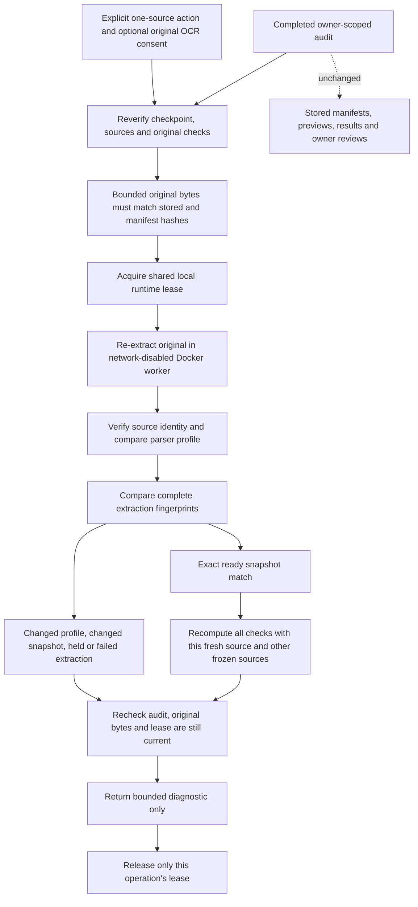

# Recheck the extraction against the original file

A portable audit can be internally consistent and still contain a rewritten
extraction. Workbench 0.9 adds a separate source-backed check: hash an original
already stored in the private library, re-extract its bytes in the isolated
runtime, compare the fresh manifest with the audit's frozen source, then replay
the numeric checks when the manifests match exactly.

This goes beyond [offline snapshot replay](portable-claim-replay.md), but it is
still **the same parser**, not an independent extractor or publisher verifier.
It can expose a snapshot that no longer reproduces from its stored original.
It cannot establish that the publisher is trustworthy or the parser interpreted
the original correctly in the first place.

Workbench 0.10 adds a separate [PDFium cited-cell cross-check](pdf-cell-concordance.md)
for native PDF table headers and values. That diagnostic uses a different text
engine and does not replace this same-parser full-manifest/numeric replay.



## Try it

Use the [document setup](document-workbench.md), a
[frozen evidence set](document-workbench-reconciliation.md) and a completed
[numeric claim audit](numeric-claim-audits.md). The host backend needs the local
Docker CLI, a running engine and the existing dedicated parser image. No model
key or model-request checkbox is needed. The feature remains behind the existing
operator-disabled-by-default document flag.

In the completed audit, open **Replay against original source bytes**. Confirm
local re-extraction, then choose **Re-extract** for one source. Each click runs
one source only. It does not start work for the remaining sources or rerun in
the background. If OCR was enabled on that original upload, separately allow
its configured local OCR. That checkbox cannot turn OCR on for an original that
was uploaded without it, change its language or choose a different OCR command.

The panel shows whether the original hashes matched, whether the extraction ran,
whether the profile and frozen snapshot matched, and how many numeric checks
reproduced. The resolved local image identifier is included when supplied by the
configured Docker runtime. A successful numerical replay keeps refuted and
unresolved verdicts; it does not convert them into support.

**Each result uses fresh extraction for the selected source and the existing
frozen snapshots for the others.** Re-extract other originals explicitly if you
want to inspect each one. There is no all-sources approval badge. Pending or
failed sources are not treated as matches.

Results live only in the current browser component and are not saved as new
evidence or review history. Navigating away clears them. Leaving the panel or
aborting the browser request does not guarantee server cancellation; refresh
before an uncertain manual retry. There are no automatic mutation retries or
hidden polling workers.

## Read the statuses literally

| Status | Meaning |
| --- | --- |
| `exact_snapshot_match` | Original bytes match, fresh extraction is ready, profile and manifest match, and every original numeric check reproduces |
| `original_bytes_mismatch` | Stored original bytes do not match the stored or frozen-manifest hash; parser not invoked |
| `original_outside_budget` | Empty, oversized or unsupported stored original representation; parser not invoked |
| `extraction_failed` | Runtime did not return a valid completed extraction; no value or private parser error is released |
| `extraction_held` | Fresh extraction has a held physical page; not accepted as a ready match |
| `profile_changed` | Extraction configuration, extractor identity or OCR backend differs; not silently normalized away |
| `snapshot_changed` | Source identity/profile match, but the complete extraction fingerprint differs |
| `runtime_binding_mismatch` | Returned extraction does not bind to the selected bytes, document identity, version, name or media type |

A changed snapshot is not automatically attributed to tampering: parser
nondeterminism and environment drift can also cause a mismatch. The diagnostic
does not select a winning extraction or overwrite the frozen one. Source identity
checks are local bindings, not evidence that the source came from an authenticated
publisher.

An exact match requires the **whole** manifest, including geometry, methods,
regions and extracted text. This is not fuzzy semantic equivalence or a tolerance
for small transcription differences. Existing numerical rules remain exact.

## Runtime and persistence boundaries

This uses the existing hardened parser: immutable local image resolution,
no request-time image pull, no network or host mounts, non-root execution,
read-only root, dropped capabilities, fixed input programs, bounded stdin/stdout,
512 MiB RAM/swap ceiling, one CPU and 64 PIDs. Existing stage/controller deadlines
and uniquely owned-container cleanup remain unchanged. The runtime also generates
its bounded page previews; they are validated and discarded, not saved over the
original previews. This is Docker risk reduction, not VM-grade isolation.

Original reads are limited in the SQLite query before copying a BLOB into the
controller. Maximum original size remains 3,000,000 bytes. The existing bundle
preflight caps the audit snapshot at 3 MB, five sources, ten assertions, 2,000
regions and 500,000 extracted characters. No caller-supplied files, paths, URLs,
commands, image names, model IDs or replacement receipts enter the request.

A new singleton lease table coordinates uploads and source replays across
controllers sharing this SQLite library. Only one extraction may occupy that
library's slot. Busy work returns 429 instead of spawning another parser. Reads
remain available. The lease is committed before parsing; no database write lock
is held while Docker runs. A five-minute expiry recovers abandoned leases, longer
than the runtime's normal bounded execution and cleanup. Cleanup deletes only
the operation's own token and cannot release a replacement lease.

After parsing, the audit, source context, original hash and lease are checked
again. Deletion, changed bytes, stale checkpoints and replaced/expired leases
prevent a successful response. No original, manifest, preview, result or review
is rewritten. Migration adds only the runtime lease table; there is no new saved
diagnostic table. Existing stale-processing cleanup still applies.

The lease is local to one library, not a distributed scheduler or a host-wide
quota across unrelated databases. Restart all backend controllers on this version
before relying on shared coordination; an older process does not know the new
lease contract. Private SQLite content remains plaintext and needs the existing
OS/storage protection. Matching local hashes do not provide encryption or an
erasure guarantee.

## API

Use authenticated
`POST /workbench/documents/reconciliations/{set}/audits/{audit}/sources/{source}/replay-original`
with:

```json
{
  "checkpoint_fingerprint": "CURRENT_64_HEX_AUDIT_CHECKPOINT",
  "confirm_reextract": true,
  "allow_original_ocr": false
}
```

The source must belong to this owned, complete and currently verifiable audit.
Confirmation must be a literal boolean `true`; extra fields and implicit consent
are rejected without echoing private input. OCR defaults off at the request
boundary and requires explicit permission when the upload's original mode used
it. A replay never changes that original mode.

The response is a no-store diagnostic with manifest/context fingerprints, status,
elapsed time, reproduced verdict counts and an unkeyed report digest. No original
bytes, fresh manifests, extracted excerpts, previews or owner notes are returned.
`publisher_identity_verified` and `release_authorized` are always false. The
browser uses the same fixed local proxy and authentication with a bounded
180-second request deadline, not arbitrary client-selected execution settings.

These reports are evidence from a trusted local controller, not remotely signed
attestations. A malicious administrator controlling the database, parser and
controller could forge the originals or reports too. SDK 0.10's portable verifier
is unchanged and still reports that it neither authenticates nor re-extracts
source files; these are separate workflows.

## Verification

Authored controls cover unchanged sources and original refutations; modified
bytes; empty/oversized BLOBs; profile drift; held, failed and incorrectly bound
extractions; strict confirmation and OCR consent; ownership and stale/partial
audits; concurrent replay/upload exclusion; expiry recovery; context changes
during execution; and token-safe cleanup. UI controls cover explicit one-source
execution, pending sources, no automatic retry and late-response cancellation.

The actual Docker control creates two PDFs showing Requests 100/125, one with
its table on physical page two. Both originals re-extract to the expected
snapshots, and supported/refuted numeric checks reproduce without changing any
stored source or audit row. A controlled direct database rewrite then changes
both extracted Current cells to 999 and rebuilds a consistent audit. Ordinary
portable replay accepts that internally consistent snapshot. Re-extracting its
unchanged original bytes returns `snapshot_changed` with zero reproduced checks.
That fixture is deliberately labeled corruption control, not an application
mutation endpoint or proof of real-world attack detection rates.

Run evidence is private under
`data/evaluations/workbench-source-replay-20261019/`. No live-model, financial
accuracy or independent-extractor benchmark is claimed. Verification included
authored page-preview inspection, component tests and the local Workbench build.

The October 19 local verification used Python 3.13 and Docker 29.8.1. The final
affected backend selection passed **176 tests**, including the actual PDF/OCR
integrations and all 21 new source-replay cases. The SDK regression selection
passed **313 tests with four host-Tesseract skips**; OCR ran inside the dedicated
Docker integration. The frontend passed **55 tests across ten files**, typecheck,
production build and formatting. The rebuilt static image served HTTP 200 with
the existing security headers in a non-root, read-only, network-disabled container.
Compose validation, scoped Python lint/formatting, syntax/link checks and a scan
for configured secret values in versionable source and built assets passed.
These are selected regression results, not a claim that every project subsystem
or every browser interaction was exercised.

The first broad backend run passed 174 cases but failed two existing PDF tests
because Docker cleanup could not be confirmed. Both passed in an isolated rerun;
the final full selection then passed with content-free cleanup instrumentation.
All 29 observed cleanup commands across those diagnostic runs succeeded, and no
owned parser containers remained. The initial cause is **unconfirmed**. No cleanup
deadline was relaxed, no production retry was added, and the initial failures
remain in the private run record. Treat this as an intermittent local-runtime
reliability limitation, not a demonstrated fix.

The source-bound retrieval artifact also reproduced exactly against a temporary
prospective source index; the real Git index was unchanged. Its five-query
holdout still rejects the learned candidate: baseline/candidate recall is
1.00/0.90 and NDCG is 0.9594/0.8735. The fixed baseline remains active. After
intentionally tracking new source files, run the ordinary tracked-source check
before committing. These metrics are unrelated to numeric-claim accuracy.
