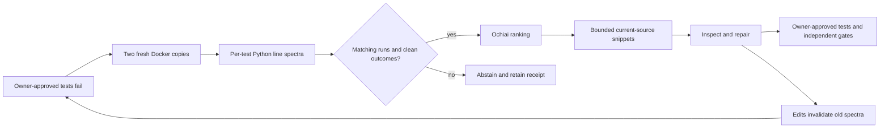

# Execution-spectrum fault localization

A traceback can end at an assertion in a test file, far from the faulty production
branch. This opt-in layer gives the repair agent a different kind of evidence:
which production lines were executed by failing tests, and which were also
executed by passing tests. It supplements retrieval; it does not decide correctness.



## What changes in the agent

After a failed owner test, a fixed harness runs pytest in two disposable copies of
the candidate workspace. Coverage contexts associate executed Python lines with
hashed test identities. Import-time code outside a test context is not attributed
to a test. Each line receives distinct passing/failing test counts, not execution
frequency. The harness checks production content against its manifest before and
after execution; the controller also checks copied-workspace integrity.

The ranker uses `ef / sqrt(F * (ef + ep))`: `F` is the number of failing tests,
`ef` is the number of those tests covering the line, and `ep` is the number of
passing tests covering it. A failing-only branch can outrank a common dispatcher.
A score of one is **not** a 100% probability that the line caused the failure.

Up to twelve ranked locations are considered for packing. Complete source lines,
one-line neighbours, deterministic ties, overlap deduplication, source-content
digests, and a configurable approximate token budget make the prompt inspectable.
Recognized secrets or instruction injection withhold the entire packed context.
Accepted context remains untrusted data at the existing tool-policy boundary.

A successful write/delete clears the old evidence on the next planning step.
Another probe requires a new failed owner test; passing tests clear the context.
Repeated reads reuse a source-bound result without spending another refresh.
Unobserved source drift abstains until a new owner failure is observed. Optional
instrumentation errors never become patch approval or substitute for final tests.

## Enable deliberately

The default is off. Rebuild the trusted image first: older local images do not
contain the newly pinned `coverage==7.15.2` dependency.

```bash
docker build -f docker/Dockerfile.code-sandbox -t agentforge-code-sandbox:local .
```

Set these values for both the API and worker, then restart those processes:

```dotenv
CODE_AGENT_FAULT_LOCALIZATION_ENABLED=true
CODE_AGENT_FAULT_LOCALIZATION_MAX_REFRESHES=2
CODE_AGENT_FAULT_LOCALIZATION_TIMEOUT_SECONDS=120
CODE_AGENT_FAULT_LOCALIZATION_MAX_TOKENS=768
```

These are per-coding-stage limits. Each refresh admits at most two sequential
fresh probes, with a command timeout capped at thirty seconds. The feature uses
the earlier of its own soft deadline and the stage deadline, reserving thirty
seconds in admission checks for planning/cleanup. Docker startup and cleanup have
their own bounded operations; this is not a hard real-time end-to-end guarantee.
Multi-stage and tournament workflows can multiply sandbox work. No additional
model call is made by the localizer itself, but prompt size and repair decisions
can change inference cost. Measure latency and actual provider usage.

Current support is deliberately narrow:

- Python production sources and canonical owner commands `python -m pytest -q`,
  `python3 -m pytest -q`, or `pytest -q`.
- Python must be an allowlisted executable; runtime networking must remain off.
- At least one passing and one failing test, with no skip/xfail or fixture errors.
- At most 200 collected cases, 20,000 covered line entries, 300 Python source files,
  100,000 characters per source, and 2,000,000 source characters overall, within
  the existing workspace limits. Test files and `conftest.py` are not ranked.
- No host fallback for user repositories, no package installation at runtime,
  and no subprocess/distributed coverage support.

Ambient pytest options, third-party plugin autoload, and Coverage configuration
are disabled for the instrumentation command. Repository test configuration and
hooks still execute in the container. Consequently this is a diagnostic probe,
not an identical replacement for the owner command. Dependency/plugin-heavy
suites can abstain or differ under instrumentation. Standard verification still
runs the unmodified owner command.

## Evidence and experiment path

`CodeAgentResult.fault_localization` contains per-stage receipts with status,
reason, source/command/context/spectrum digests, repeat digests, test counts,
packed locations and scores, approximate tokens, and elapsed time. These receipts
contain no snippets, raw failure bodies, or raw test identities. JSON/Markdown PR
dossiers retain the evidence. Full trajectories still contain other potentially
sensitive task output and require the existing private-artifact controls.

Benchmark outcomes persist localization status counts, including when checkpoints
resume. Reports and release cards expose `fault_localized_cases` and
`fault_localization_status_counts`. A selected receipt means context was prepared
for a planning call, not that a model understood it or that it fixed the issue.
These counts aggregate the latest retained outcome per case, not discarded retries.
Tournament results expose the selected team's receipts; these counts do not
claim to cover discarded teams.

Run credential-free controls and validate the paired experiment configuration:

```bash
python -m evals.fault_localization_evaluation --output data/evaluations/fault-localization/controls.json
python -m code_agent.benchmark_release validate evals/experiments/fault_localization_matrix.json
```

The locked five-task matrix changes only the localization flag between two
verified-PR variants. It is a smoke experiment, not an external benchmark. After
Docker and provider access are available, a live run is explicitly billable:

```bash
python -m code_agent.benchmark_release run evals/experiments/fault_localization_matrix.json
```

Or add `--fault-localization` to the existing coding-evaluation CLI. Check exposure
counts before attributing any difference to this feature. Report resolution,
regressions, cost per resolved issue, latency, calls, and confidence intervals;
unset prices and missing usage remain unavailable, not zero.

## What the tests establish

Eight authored controls check ranking, source binding, line deduplication, token
budgets, taint withholding, missing failing spectra, and deterministic ties. They
do not execute a repository or measure coding resolution. Separate unit tests run
the fixed instrumentation harness on trusted literal fixtures, including a known
faulty branch, skip/xfail, fixture errors, and collection errors. This test-only
host execution is not a production fallback. The real Docker test skips when the
engine/image is unavailable.

Controller coverage excludes the embedded harness string. Passing those checks
does not establish real-model accuracy, general fault-localization recall, or
real-world resolution gains. Two matching runs are a repeatability check, not a
statistical guarantee against flaky tests. Repository hooks can forge coverage or
receipts; digests detect drift, not authenticity. Correlated lines, incomplete
tests, asynchronous work, and test-oracle mistakes can all mislead the ranking.

### Local verification (October 4, 2026)

The affected suite passed 334 tests on Python 3.13 with six skips and 329 on
Python 3.11 with eleven skips. Five Docker checks and the Windows directory-symlink
check were skipped on both; Python 3.11 additionally lacks Coverage.py in its
isolated host interpreter, so five trusted-harness cases were skipped there. All
five harness cases ran on Python 3.13. Another 137 security/retrieval/dispatch/service
tests passed on Python 3.13. Controller statement/branch coverage was 100%; that
does not count the embedded harness as covered statements.

All eight authored controls and the two-arm dataset-lock validation passed.
Ruff, Python compilation, whitespace checks, and exact retrieval-artifact
reproducibility passed. The retrieval candidate and matching five-query holdout
were refreshed against the changed source corpus, without enabling serving fusion.
Docker execution and billable model comparisons were not run; no real-world
repair-quality gain is claimed.

Implementation references: [Coverage measurement contexts](https://coverage.readthedocs.io/en/7.15.2/contexts.html)
and [pytest reporting hooks](https://docs.pytest.org/en/stable/reference/reference.html).

Later October 4 follow-up: the real Docker spectrum integration passed using a
separate trusted image containing Coverage.py. The original image was preserved;
its missing dependency caused the initial full-suite failure. The integration
test now accepts `CODE_AGENT_TEST_IMAGE` for this explicit image selection. The
live smoke receipts also show repeated Ochiai association and edit invalidation,
not a causal diagnosis or measured repair lift. See the
[full audit](live-upgrade-audit-2026-10-04.md) for the distinction.
