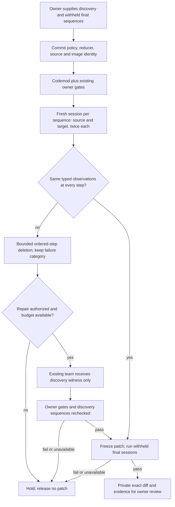

# Stateful migration verification: check what happens after the next action

A migration can preserve every isolated response and still break a workflow.
For example, adding a value may return `null` under both dependency versions,
while a later read reveals that one version stored a string instead of an integer.
An unsuccessful update can also raise the same exception but leave different state.

This opt-in UpgradePilot layer tests those sequences. It combines fresh-process
session replay, first-divergence diagnosis, bounded trace reduction, repair-agent
feedback, and a separate terminal session gate. It uses the existing coding team;
it does not add agents just to increase the agent count.

The next optional layer, [metamorphic workflow verification](metamorphic-workflow-verification.md),
generates variants from owner-declared retry, read, rollback and operation-order
laws. It calibrates the source oracle rather than treating old/new agreement as
correctness. The session replay below remains the shared execution primitive.



## The contract is a session, not a Python script

Each scenario names a public factory inside the allowed source scope. The factory
creates an in-memory session object; an ordered list names public methods with
finite JSON arguments. The controller never evaluates supplied Python, resolves
dotted attributes, or imports application modules on the host.

```json
{
  "scenario_id": "add-then-observe",
  "factory": "app.models:create_basket",
  "steps": [
    {"method": "add", "args": ["12"]},
    {"method": "snapshot"}
  ]
}
```

The policy has `discovery` and `final` lists, each containing one to four scenarios.
IDs and complete input sequences must be unique across both lists. A scenario has
at most 12 steps and 12 KB of JSON; the full policy is limited to 40 KB. These are
owner-authored scenarios, not automatically discovered workflow coverage.

Keep the policy outside the repository snapshot visible to repair agents. The CLI
rejects a policy path inside that snapshot. Programmatic callers must likewise
keep withheld inputs out of source files, owner tests and prompt context; no
controller can make a published test secret again. The public authored example
is deliberately not a confidential benchmark.

Only the disposable verifier copies receive `upgradepilot-session.json`, with
one scenario at a time. The repair workspace receives neither the policy nor the
final scenarios. Public factories and named methods are an execution allowlist,
not a proof that the application itself is safe: the Docker boundary still matters.

## Observe state without confusing it with process leakage

Every scenario starts a fresh interpreter for each dependency version, repeated
twice. Steps share the same object and process *within* that scenario. Module
globals and prior scenarios cannot seed a later scenario. Both image-owned
harness files are SHA-256 checked against controller source.

After every call, the harness immediately serializes and snapshots its return.
If the method returns a mutable list and the next action changes that list, the
earlier observation remains unchanged. JSON type differences remain significant.

Application exceptions are recorded by class and execution continues, so an
explicit subsequent `snapshot` can detect state left behind by a failed update.
Exception messages, hidden state and external side effects are not compared.
Owners must expose the state they care about through observation methods. An
all-error source scenario is held rather than counted as positive evidence.

The factory has a two-second deadline; each operation has one second, within the
overall command and task limits. Missing methods, factory failures, unstable
repeats, timeouts, non-JSON results, oversized output, changed workspace content,
or missing evidence hold the run. They never count as matching application errors.

## Give the repair team a smaller failure, not a final-test answer

Reports record the first divergent step, method, typed source/target results and
trace hashes. Ordered-step deletion tries to shorten a discovery failure while
preserving the divergent method and result/error category. It uses at most eight
candidate evaluations by default, capped at twelve. Each candidate is itself
replayed twice per version. This is bounded reduction, not a globally minimal
counterexample, and deleting setup steps may simply produce an unusable candidate.

Reduction skips any candidate identical to a final scenario. Repair prompts
receive bounded discovery witnesses only. Existing scope, immutable owner tests,
dependency-pin control, provider consent and exact patch replay still apply.
Admission reserves session recheck/final execution time before spending repair
calls; the existing monotonic task deadline remains the outer limit.

After repair, all discovery scenarios are replayed. The final set runs only after
the candidate passes the other gates, is bound to the exact patch hash, and cannot
trigger another repair attempt. Failure withholds the patch. A passing report
still requires owner review; nothing is merged, deployed or written upstream.

## Run locally

Build the dedicated tag without replacing existing migration images:

```powershell
docker build -f docker/Dockerfile.upgradepilot -t agentforge-upgradepilot-sessions:local .
```

The authored fixture has its final policy outside its repository snapshot:

```powershell
python -m code_agent.upgrade_cli run `
  --repository tests/fixtures/upgrade_sessions `
  --spec tests/fixtures/upgrade_sessions/migration.json `
  --session-policy evals/experiments/upgrade_sessions.policy.json `
  --output-dir data/upgradepilot/session-demo
```

No inference is enabled. This fixture is intentionally held with exit code `2`:
the codemod alone preserves the empty owner example but not the session behavior.
Use a new output directory for each run. Reports and any review-ready diffs remain
under ignored `data/upgradepilot/`; reports contain private observations and must
not be casually published.

Session verification can be combined with `--counterexamples` and `--schema-policy`.
Each gate remains independent. The frozen three-arm study accepts an optional
`session_policy` per task, commits it at freeze/admission, passes the same final
sequences to every arm and reports session regressions separately from single-call
regressions. Live study execution still needs separate provider authorization.

## What the controls establish

Run the fingerprint-locked authored comparison:

```powershell
python -m evals.upgrade_session_evaluation --output data/evaluations/upgrade-sessions/controls.json
```

The four expected outcomes are: codemod-only held by discovery; scripted compatible
repair passes; deliberately discovery-only overfit passes discovery but is held
by final sessions; revoked policy commitment admits no repair agent. The runner
also checks that final scenario IDs and fixture-specific withheld values did not
appear in the scripted model messages.

These controls test orchestration, isolation and gate sensitivity on one authored
workflow. They do not establish general repair accuracy, application coverage,
real-repository migration success, tenant/database isolation, concurrent/distributed
workflow correctness, model-training improvement or production impact.

## Local verification: October 16, 2026

| Check | Observed result |
| --- | --- |
| Selected migration, coding-agent, security, delivery and provider tests | 194 passed; zero failures, errors or skips; 197.84 seconds |
| Frozen actual-Docker workflow controls | 4/4 expected outcomes |
| Discovery witness | Six steps reduced to `add("12")` then `snapshot` in eight reduction evaluations |
| Compatible scripted repair | Six scripted calls; discovery recheck and all six final observations preserved |
| Discovery-only overfit | Six scripted calls; discovery passes, final observation differs, no patch released |
| Revoked commitment | Zero agent calls; held at preflight |
| Withheld fixture inputs in scripted model messages | Not observed |
| Live model calls and real-repository migrations | Zero calls; migration quality not measured |

Separate actual-Docker tests confirm fresh module/session state, immediate
snapshots of aliased mutable results, matching exceptions followed by divergent
state, and holds for missing methods, factory failures, non-JSON results,
oversized output, timeouts and workspace mutations. Existing schema, single-call
counterexample, frozen-study, owner-policy and provider regression tests are part
of the selected run. This is not a full repository test run or production proof.

Private receipts are `data/evaluations/upgrade-sessions-20261016/selected.xml` and
`controls-first.json`. Their test inventory and complete per-arm reports are more
useful than a headline count. Host-only coverage for the session policy/runtime,
runner and study scope is 72% combined; the standalone Docker controls were not
included in that host coverage run, and the image-owned probe is exercised in
Docker rather than imported on the host. No project coverage threshold changed.

The new local image resolves to
`sha256:a2c89a18896d00facbb430a1e0f44c6fb42dd0f900bafd4721a099e8a830c965`.
The older base and schema image tags retain their prior identities.

The source-bound retrieval candidate was also retrained, exactly reproduced and
evaluated using a temporary prospective public-source index; the real Git index
was unchanged. Candidate artifact
`c6c7e3139b9bfe8718e279681135d41e2aca86b15f486e746e5fe692be65709b`
binds index `74eab2b1e5df9c0945782805f302141628d74fc1bdc08feb1e87023042350b40`.
The unchanged five-query gate still rejects promotion: learned NDCG `0.9433`
versus baseline `0.9594`, despite 88.64% training pair accuracy. Serving remains
on the baseline. Run the ordinary exact check after tracking the intended new
public source files; prospective-index verification is not a claim of green CI.

Those fingerprints record the earlier stateful iteration. The subsequent
[metamorphic workflow guide](metamorphic-workflow-verification.md) records the
newer source-bound artifact and the unchanged rejected-promotion decision.

See [UpgradePilot](upgradepilot.md), [counterexample discovery](counterexample-migration.md),
[schema-guided discovery](schema-guided-migration.md), and [coding-agent policy](code-agent.md).
