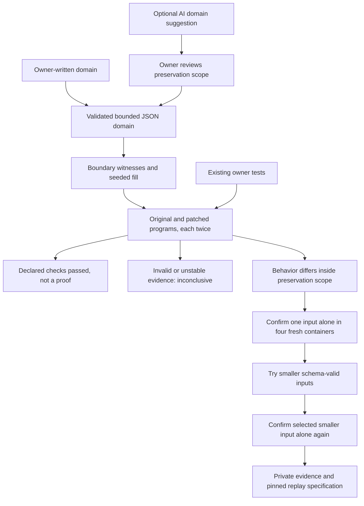

# Find the bug behind a green test run

Passing tests answer a narrow question: did the examples we already wrote still
work? They do not tell us whether a patch changed an untested boundary case.
This upgrade extends AgentForge Verify with structured input generation and
execution-guided counterexample reduction. The reference is the original
program, within behavior the owner explicitly says must be preserved—not an
LLM's opinion of the right answer.

For example, the authored shopping-cart patch changes `quantity` to
`quantity or 1`. Positive-quantity and empty-cart unit tests stay green. A
generated cart containing a zero-quantity item exposes the changed total.
The reducer removes distracting fields and items, then checks the smaller
input alone in fresh original and patched containers.



## Run it locally

Use the normal project environment and a working Docker engine. No provider
credentials are required. Build the reviewed offline sandbox once:

```bash
docker build -f docker/Dockerfile.code-sandbox -t agentforge-code-sandbox:local .
python -m code_agent.patch_verify \
  --repository tests/fixtures/patch_structured \
  --spec tests/fixtures/patch_structured/spec.json \
  --patch tests/fixtures/patch_structured/regression.diff \
  --output-dir data/patch-verify/cart-first-run
```

Use a fresh output directory for every run. A detected regression exits with
code **2**, not 0. Inspect the private `report.json` and
`reproducer.spec.json`. To replay just the independently confirmed input:

```bash
python -m code_agent.patch_verify \
  --repository tests/fixtures/patch_structured \
  --spec data/patch-verify/cart-first-run/reproducer.spec.json \
  --patch tests/fixtures/patch_structured/regression.diff \
  --mode contracts \
  --output-dir data/patch-verify/cart-replay
```

The replay specification pins the source snapshot, exact patch hash and local
Docker image ID. Changed source or patches are rejected before Docker execution;
an absent image is not pulled automatically. Replay deliberately selects only
the confirmed input; it is not a replacement for the full owner test campaign.

## Declare the behavior that must not change

Add `json_domains` to an existing owner specification. This fragment generates
one structured argument to `app:total`:

```json
{
  "json_domains": [{
    "domain_id": "cart",
    "entrypoint": "app:total",
    "samples": 16,
    "input_schema": {
      "type": "object",
      "additionalProperties": false,
      "required": ["items"],
      "properties": {
        "items": {
          "type": "array", "maxItems": 4,
          "items": {
            "type": "object", "additionalProperties": false,
            "required": ["quantity", "price"],
            "properties": {
              "quantity": {"type": "integer", "minimum": 0, "maximum": 5},
              "price": {"type": "integer", "minimum": 1, "maximum": 5}
            }
          }
        }
      }
    }
  }],
  "reduction": {"enabled": true, "max_rounds": 2, "max_candidates": 8, "max_seconds": 120}
}
```

The complete specification also requires owner source/test paths and
`preservation_authorized: true`. A domain can supply one positional JSON value,
or one keyword argument using `keyword`. It supports nulls, booleans, bounded
numbers, strings, arrays, closed objects, scalar enums and a nullable concrete
type. Integer inputs are Python integers, not booleans or integral floats.
This is a deliberately restricted profile, **not a complete JSON Schema validator**.
Unsupported keywords such as `$ref`, `pattern`, `oneOf` and remote schemas fail
admission rather than being silently ignored.

Limits include four JSON domains, 24 requested samples per domain, and 64
generated samples across integer and JSON domains. Existing explicit contracts
have a separate 40-case limit. Schemas have depth at most four, at most 48 nodes,
eight properties per object, six items per array, 64 characters per string and
a bounded encoded-input size. Finite domains may produce fewer unique cases
than requested. Boundary witnesses come first; seeded random values fill any
remaining sample slots. A small sample budget does not exhaust every combination.

Intentional changes must stay outside preservation domains and need separate
acceptance tests. If the original program raises an unexpected error for a
generated input, the campaign is **inconclusive**, not a proven regression.
For a domain intended to raise errors, declare `expected_kind: "error"` and
the exact `expected_error` class. The same original-vs-patch comparison applies.

## What reduction actually guarantees

The reducer picks one observed structured failure and first checks it **alone**
in four fresh containers: original twice, candidate twice. Search batches are
exploratory. A smaller candidate only replaces the current reproducer after its
own isolated four-container confirmation. This prevents a batch-order or
module-state effect from being presented as a standalone failing input.

Reduction removes optional fields, shortens arrays and strings, and simplifies
nested values without leaving the declared domain. Ordering uses canonical
UTF-8 byte length and a deterministic lexical tie-break. The result is a
**bounded greedy reduction, not a globally minimal input**. The report retains
the parent input hash, submitted search candidates, round/confirmation receipts,
timings and the final confirmed input. Only one structured counterexample is
reduced per campaign; other independently explicit/integer failures remain.

Even disabling reduction still requires isolated confirmation before exporting
a structured reproducer. If confirmation fails, no standalone reproducer is
exported. An exhausted search retains the last confirmed failure; it never
turns missing execution evidence into a pass. The reduction deadline controls
admission of new work and command timeouts. In-flight Docker operations settle
before cleanup, so it is not a hard wall-clock SLA.

## Optional AI assistance, without self-approval

`code_agent.patch_contracts.propose_domains` accepts an explicitly supplied
structured-output model client, selected source strings and a patch. It does
not construct a provider, read environment files, scan a repository or run
automatically. The caller must set `authorize_model=True`, explicitly approving
data sharing and possible spending. Only the selected bounded context is sent;
repository text is labelled untrusted, not treated as instructions.

The result is always `needs_owner_review`. A separate `ContractReview` and
`accept_reviewed_domains` step require explicit preservation confirmation and
an already-authorized owner specification. Existing checks are appended to,
not overwritten. Patch and selected-source hashes are checked at acceptance
and execution; stale or modified proposals are rejected. Reviewer names are
local attestations, **not authenticated human identities**. A caller can still
make a bad review, so this is not an automatic semantic oracle.

The helper records one model invocation, but provider-internal retries, request
usage and cost remain **unknown** for an arbitrary injected client. There is no
automatic retry or claim that a timed-out call was free. No live provider was
used to validate this upgrade; model integration tests use controlled clients.

## Isolation, privacy and evidence

All submitted Python runs in fresh non-root, network-disabled Docker copies.
The original repository is fingerprinted before and after. Existing tests,
stable repeat outcomes, unchanged test populations and valid reference behavior
are prerequisites for a behavioral finding. Skips, xfails, empty suites and
invalid receipts cannot count as success. No submitted module is imported on
the controller host.

Docker execution output is drained into bounded stdout/stderr tails instead of
being accumulated and truncated only afterward. The host retains a bounded
buffer per stream and tracks discarded byte counts. Killing a timed-out Docker
CLI is not proof its container process stopped; the sandbox still force-removes
its owned container during cleanup. This does not replace VM isolation for
hostile public submissions, and unkeyed hashes do not authenticate a malicious
controller or repository-forged receipts.

Reports omit application outputs and provider reasoning, but inputs, source
paths and replay specs may contain private data. They stay under ignored
`data/patch-verify/` directories with a local ignore file. Permission requests
are not encryption or a substitute for host ACLs. Review before sharing.

## Reproduce the controls

```bash
python -m pytest tests/test_patch_json.py tests/test_patch_contracts.py \
  tests/test_patch_replay.py tests/test_bounded_process.py tests/test_structured_patch_evaluation.py \
  tests/test_structured_patch_docker.py -q
python -m evals.structured_patch_evaluation \
  --output-dir data/patch-verify/my-structured-controls
```

The six expectations compare tests-only, explicit-contract and generated-input
arms on the hidden regression, then check an equivalent patch, an intentionally
changed function outside the preservation domain and an invalid original-input
domain. The controls use real Docker, not simulated execution. They are
**authored fixtures, not independently curated upstream bugs, maintainer
acceptances or evidence of general coding-agent quality**. The CI job runs
them without provider calls and does not upload raw private counterexamples.

See [the local verification record](structured-regression-audit-2026-10-16.md)
and [portable verification boundaries](portable-patch-verification.md).

The [real upstream pilot](real-patch-validation.md) uses this same generator,
reducer and replay mechanism on pinned public forward changes. Those development
replays are reported separately from these authored controls and from independently
reviewed benchmark cases.
