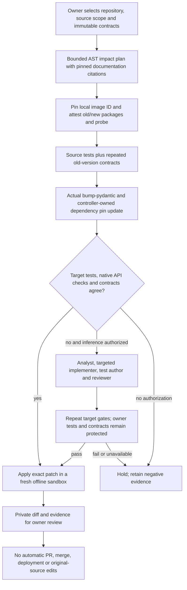

# UpgradePilot: migrate a dependency, then prove the observed behavior

The [maintainer-pilot wrapper](maintainer-migration-pilots.md) now adds explicit
consent, source/license/runtime bindings, durable one-attempt admission and
separate human-reported review records to this workflow. It does not expand the
supported dependency profile or imply that an external maintainer has participated.

Optional verification layers now include [generated counterexamples](counterexample-migration.md),
[schema-grounded inputs](schema-guided-migration.md) and
[stateful session replay](stateful-migration-verification.md), plus
[generated workflow laws](metamorphic-workflow-verification.md). They complement the
base owner contracts below rather than replacing them.

Frozen comparisons now have [crash-safe recovery](crash-safe-migration-studies.md),
with completed-arm reuse, saved-receipt adoption and conservative accounting for
interrupted requests. The single-task CLI remains a fresh-run workflow.

An import fix is not a successful application upgrade. A dependency can accept
the same input and return a different type, change which validator runs, or alter
the shape of an error while the existing test suite remains green.

UpgradePilot gives the existing coding team a specific job: migrate a bounded
Python package from **Pydantic 1.10.24 to 2.12.4**, compare it with the real
**bump-pydantic 0.8.0** baseline, and withhold the patch when owner contracts drift.
It is a first migration profile, not a universal dependency updater or a claim
that a model has outperformed the codemod on real repositories.



## What is implemented

- A non-executing AST planner identifies selected validator, Field, configuration,
  optional-default, union and serialization-method migration risks. It handles
  direct imports and aliases; it is not whole-program type inference.
- A small authored catalog links findings to the immutable Pydantic documentation
  commit `5c842dfc9c245fb37aa1f5ec5b55c1aed10bd7e6`. The reviewed migration file has
  SHA-256 `3a33c005259e6ede170df1904a168a4a64e8d8efc5b7fed360b65e5c000c05b7`.
  The runner does not fetch changing documentation during a migration.
- One dedicated image contains separate old-version, target-version and codemod
  environments. The base digest and dependency versions are pinned. Runtime uses
  a resolved immutable local image ID, no network, non-root execution, a read-only
  root filesystem, dropped capabilities and bounded CPU/memory/process/time use.
- Owner-defined JSON calls exercise public application functions under both
  versions. Application imports run only inside Docker, never on the host.
- The existing verified-PR team supplies optional schema-validated AI repair.
  One admission ledger bounds analyst/action/reviewer calls, conservative token
  reservations and time, reserving a final review call. Provider SDK retries are off.
- The original repository, owner tests, recipe and contract file remain unchanged.
  The dependency pin is controller-managed: model tools cannot edit it, while the
  reviewed host patch-replay controller can apply its exact, verified update.

The profile and codemod are versioned study choices, not recommendations to adopt
those versions for every application. See the pinned [migration guide](https://github.com/pydantic/pydantic/blob/5c842dfc9c245fb37aa1f5ec5b55c1aed10bd7e6/docs/migration.md)
and [codemod](https://github.com/pydantic/bump-pydantic) for upstream context.

## Try it without a provider key

Build the dedicated image; the build downloads pinned binary dependencies. Runtime
execution is offline, and does not install dependencies from the selected repository.

```bash
docker build -f docker/Dockerfile.upgradepilot -t agentforge-upgradepilot:local .

python -m code_agent.upgrade_cli plan --repository tests/fixtures/upgradepilot/union --spec tests/fixtures/upgradepilot/union/migration.json

python -m code_agent.upgrade_cli run --repository tests/fixtures/upgradepilot/union --spec tests/fixtures/upgradepilot/union/migration.json
```

The union baseline should **hold**, returning exit code 2: its ordinary test passes,
but a numeric-string input changes type. That is an expected negative result.
Use the `constraints` fixture instead to see a codemod-only verified patch.
`agentforge-upgrade` is the equivalent installed entrypoint after reinstalling the
editable project. No key is read by the provider-free CLI path.

Each run reserves a new directory under Git-ignored `data/upgradepilot/` before
execution. Existing files are never overwritten. It writes a private `report.json`
and, only for a successful reviewed-gate result, `migration.diff`. The report hash
binds the in-memory report including its patch; keep the diff beside the JSON when
checking that fingerprint. Do not publish private source or reports without review.

Patch files are written without platform newline translation. On Windows as well
as Linux, hash the saved diff's raw bytes rather than text read with newline
normalization; `patch_sha256` must match before applying it. Reconstruct the full
report by adding that UTF-8 patch as `patch`, then exclude `fingerprint` itself
when checking the canonical report fingerprint.

## Author the contract, not the answer

A recipe lists a bounded source package, an exact old dependency pin, fixed
pytest arguments, and public function calls:

```json
{
  "task_id": "my-model-upgrade",
  "family": "my-api-contract-family",
  "source_paths": ["app"],
  "test_command": ["-m", "pytest", "-q", "owner_checks.py"],
  "contracts": [
    {"case_id": "numeric-string", "entrypoint": "app.models:normalize", "args": [{"value": "7"}]},
    {"case_id": "invalid", "entrypoint": "app.models:normalize", "args": [{}], "expected_kind": "error", "expected_error": "ValidationError"}
  ]
}
```

The dependency file defaults to `requirements.txt` and must contain exactly one
`pydantic==1.10.24` line, without indirect constraints overrides. The controller
updates only that line to `pydantic==2.12.4`, preserving other bytes. This release
does not resolve arbitrary version ranges, rewrite Poetry/uv lockfiles or install
additional application dependencies. Larger applications need an owner-built
compatible image containing their dependencies and the attested harness/profile.

Source tests must pass before comparison. Source contracts must return a value or
the exact owner-declared exception class. Two fresh processes per version must
agree. Import failures, timeout and non-JSON serialization failures are unavailable
evidence, not acceptable API errors. The image-owned harness discards incidental
stdout/stderr without buffering it and bounds case count, inputs, results and time.

Canonical JSON hashes distinguish integers, strings, booleans and floating-point
values. Dictionary-key order is normalized. Exception comparison intentionally
checks the exception class, not version-specific message text or structured error
details; expose those details through an owner JSON function if they are part of
your API contract. Returned values must be JSON-compatible.

Some dependency changes are intentional. An owner can preregister an
`accepted_differences` entry with a case ID, exact old/new result hashes, pinned
rule ID and rationale. Only that exact pair is accepted. A model cannot change
the recipe, invent a waiver or silently weaken the tests. A changed recipe has a
new fingerprint and requires a fresh comparison. Existing behavior is a reference,
not proof that the old application was correct.

## Optional live AI repair

Live requests are disabled unless both a model and explicit CLI authorization are
supplied. Configure a valid credential privately in ignored environment storage;
do not paste it in chat. Inspect provider account limits and approve the study's
budget before using `--model groq:<account-supported-model>` or
`--model openai:<account-supported-model>` together with `--authorize-provider`.

The runner first tries the deterministic baseline. If that passes, it spends no
inference. Otherwise the existing four-stage team receives the pinned impact
plan and failed gates. Targeted edits require current byte hashes. All original
owner tests and out-of-scope files are protected; changes outside the selected
package and the controller's exact dependency update hold the result.

`max_model_calls`, `max_reserved_tokens`, command deadlines and the total task
deadline are bounded by the recipe. Missing provider usage remains null, billed
cost is not guessed, and unknown admitted spend is not silently refunded or retried.
Inherited LangSmith capture is disabled for migration model calls; provider
retention still follows the account's policy. Run artifacts are ordinary private
local files, not encrypted multi-tenant incident-store records.

These are per-run guards, not account-wide dollar limits. This first CLI is
synchronous and not a durable migration queue; a process crash is not transparently
resumable. The runtime-RAG investigation worker is a separate subsystem.

## Reproduce the frozen controls

```bash
python -m evals.upgradepilot_evaluation --output data/evaluations/upgradepilot/my-controls.json
python -m pytest -q tests/test_upgradepilot.py tests/test_upgradepilot_docker.py
```

The checked-in corpus is fingerprint-locked and authored, with three independent
migration families. It compares the actual codemod with scripted specialist
repairs, holding the image, original tests and contract cases constant:

| Family | Control purpose |
|---|---|
| Field constraints | Verify a case where the codemod is sufficient and no inference is needed |
| Union selection | Detect a semantic type change even though the migrated unit test passes |
| Validator context | Hold an incompatible signature and verify a targeted context-API repair |

Scripted repairs and reviews know the fixture-specific correction. Their success
is evidence that the pipeline detects and repairs its authored controls, **not**
an AI accuracy score, independent human review, maintainer adoption or superiority
over the codemod. CI builds the same profile, runs the controls and uploads the
report, including failures. No live provider execution is part of CI.

## Local verification: October 15, 2026

These are measured local results, not a claim that GitHub CI or the entire
repository has passed. Host tests used Python 3.13.9; migration application code
ran under Python 3.11 in the dedicated Docker image.

| Check | Observed result |
|---|---|
| Selected unit, Docker and affected coding/provider regression tests | 122 passed, zero failed or skipped; 127.69 seconds |
| Frozen migration study | 3/3 authored controls passed with the actual codemod and real container execution |
| Codemod-sufficient constraints case | Verified without model calls |
| Union and validator repair controls | Six scripted calls each; analysis, implementation, test-author and review stages completed |
| Actual CLI run | Constraints patch ready for owner review; source unchanged; zero model calls |
| Saved artifacts | Raw diff SHA-256 and reconstructed report fingerprint both verified |
| Host-module coverage | 82% combined for planner, models, contracts, runner and CLI; not whole-project coverage |
| Retrieval refresh | Exact reproduction passed against prospective public source; quality gate still rejected promotion |
| Static and privacy checks | Ruff, Python compilation, whitespace and local documentation links passed; no configured secret values found in 490 versionable files or new audit artifacts |

The image ID used was
`sha256:f624894d6b900586d415db27cabcc61d9a9b7198fc77d2c24108cde7c86efd46`.
The container-only probe was exercised by Docker runs, not included in that host
coverage percentage. CLI coverage is 41%; its successful command path was also
checked end to end outside the coverage-instrumented suite. A Windows patch-file
newline issue found during review was fixed and covered by a regression test.
An earlier restricted local test attempt stalled; the final selected suite was
rerun successfully with the pure-Python coverage tracer and working temp access.

Private receipts are under `data/evaluations/upgradepilot-20261015/`; the CLI
artifacts are under `data/upgradepilot/`. Both locations are Git-ignored. The local
source-bound retrieval refresh used a temporary prospective Git index, leaving
the actual index unchanged. See [code intelligence](code-intelligence.md) before
running the ordinary exact check with newly tracked files. No live inference,
independent human review, commits, pushes or external PRs occurred in this study.

## Limits and the first genuine field trial

The optional [counterexample-guided migration workflow](counterexample-migration.md)
adds generated discovery cases, bounded standalone-reproduced reductions, isolated
terminal evaluation and a frozen three-arm pilot runner. It does not change the
default owner-contract-only CLI path. Its authored controls and any later real
pilot must be reported separately from the original three-family study above.

[Schema-guided verification](schema-guided-migration.md) additionally reads owner-
allowlisted Pydantic models inside Docker to reach nested fields absent from owner
examples. Declaration changes and actual behavior remain separate checks. This
optional mode requires the dedicated schema image and does not alter default runs.

This release analyzes at most 500 Python files/2 MB, caps individual source files
at 200 KB, and accepts at most 50 bounded contract calls. It holds more than 90
owner-protected files. Native-V2 checks conservatively reject compatibility imports
and selected legacy APIs; they do not prove the absence of deliberate obfuscation.
Containers reduce risk but are not a VM isolation boundary. Package versions and
image identity are pinned; this is not a signed supply-chain attestation.

Fresh patch replay proves that the exact emitted bytes apply to a new filtered
copy and pass owner tests with the same image. Differential contracts are also
run repeatedly against the candidate. Finite tests, visible contracts and repeated
processes do not establish whole-program equivalence or malicious-patch resistance.

A credible public field trial still needs willing repository owners, licensed
source snapshots pinned before execution, disjoint task families, a frozen model
and budget, the same codemod baseline, separately reviewed held-out contracts,
and every attempted task retained. Report completion, contract regressions,
latency, usage completeness and owner review outcomes. Do not send unsolicited
automated PRs. New GPU training, public repository mutation and deployments are
not part of this implementation.
