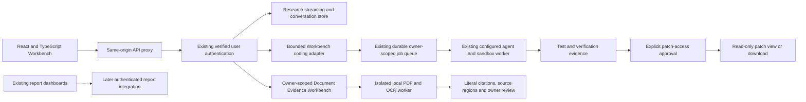

# One browser workspace for the existing agent backend

AgentForge had a research chat and several separate report dashboards, while
newer coding and document capabilities lived behind APIs, libraries and CLIs.
Workbench 0.11 connects research, coding review and bounded document evidence without moving AI execution into
the browser or pretending every experimental subsystem is ready to serve.

## Connected scope

Research supports authentication, conversation history, streamed text and actual
tool events. Web approval sends an explicit decision through the same conversation
so the backend retains its interrupt/checkpoint behavior. A stopped or incomplete
stream is not described as a successful execution.

Coding supports operator-allowlisted submissions, owner-scoped durable task
history, lifecycle polling, recorded tool observations, baseline/final tests,
verification reasons, dossiers and approval-gated patch access. It does not
merge, apply or push patches. Lifecycle transitions are polled, not presented as
live specialist-token streams. Observations appear only when the backend returns
them; the UI does not manufacture agent activity.

The [Document Evidence Workbench](document-workbench.md) adds private, bounded
PDF/image ingestion in a network-disabled local container; page and extraction-gap
inspection; literal answers; selected-cell calculations; and immutable owner review.
It is disabled until the operator builds/configures the dedicated runtime. No
model calls are used. Broader SDK workflows remain separate. Evaluations remain an
integration-status screen. The [0.3 version-impact workflow](document-workbench-versions.md)
adds explicit lineage, change reports, resumable local revalidation and new-version
owner review without copying old attestations. The [0.4 reconciliation workspace](document-workbench-reconciliation.md)
freezes explicitly scoped report versions, exposes exact numeric agreement/conflict
with citations, and blocks arithmetic on unresolved facts. An owner attestation
never changes the evidence status or chooses a winner. [Numeric claim audits](numeric-claim-audits.md)
add exact assertion checks against saved evidence, explicit bounded steps and private
report exports. They do not extract claims from prose or authorize answer release.
The [0.6 replay workflow](change-aware-claim-replay.md) rechecks the same assertions
on explicitly comparable new evidence and shows support transitions without
rewriting the source audit or inheriting its reviews.
The [0.7 evidence-fragility diagnostic](evidence-fragility-stress-tests.md) tests
all single-source omissions while preserving policy and original evidence. It
exposes support loss and selective-evidence risk; it never approves an answer or
recommends dropping a source.
The [0.8 portable replay export](portable-claim-replay.md) lets another application
recompute the completed audit with the SDK alone. It requires separate consent
for full extraction text and never presents snapshot consistency as source truth.
The [0.9 source-backed check](source-backed-replay.md) hashes and re-extracts each
explicitly selected stored original, compares its full snapshot and replays
numeric checks only on an exact ready match. It shares extraction capacity with
uploads and never changes the original evidence or approves an answer.
The [0.10 cell-concordance diagnostic](pdf-cell-concordance.md) reads cited native
PDF cells with a second text engine, without giving that worker expected text.
It checks row/column labels as well as values and reports disagreements or
uncheckable coverage without changing numeric verdicts or owner reviews.
The [0.11 pixel-backed diagnostic](pixel-evidence-concordance.md) renders those
locations and reads them with separately consented local OCR. Hidden native
text can disagree with the visible cell. Quality/boundary/budget holds stay
uncheckable; the original audit is never corrected or approved automatically.
Evaluations are not a way to expose arbitrary report directories or run
benchmarks. There is no claim that all project features are browser-accessible.

## Integration boundary

The existing service includes the new `/workbench` router under its verified
bearer middleware. The router independently rejects missing authenticated
identity; it does not accept a body/header user ID.

| Endpoint | Purpose |
|---|---|
| `GET /workbench/config` | Authorized repository IDs, coding model IDs, workflow and integration status |
| `GET /workbench/code/tasks?limit=30` | Up to fifty owner-scoped task headers, without result/patch/worker data |
| `POST /workbench/code/tasks` | Explicit repository/model allowlists, fixed test command, required idempotency key |

Existing `/stream`, `/store/*`, `/auth/*` and owner-checked `/code/tasks/{id}/*`
endpoints retain their roles. The browser uses authenticated POST streaming rather
than assuming the GET-only native EventSource API can call `/stream`. Invalid
Workbench payloads receive a content-free error rather than echoing their input.
Reads do not invoke model providers or workers.

The configured repository list is deliberately empty by default. It is a
server-wide submission allowlist, **not** a new private-repository tenant ACL or
a replacement for existing direct-API policy. Model configuration also does not
prove that the ID is currently available in a provider account.

The frontend uses memory-only tokens, same-origin `/api` URLs, no cookie
credentials, no redirect following and no automatic mutation retries. Expiry
and authenticated HTTP 401 responses end the browser session. Logout does not
provide server-side bearer revocation or cancel already-submitted jobs.

The model-request checkbox is a UI consent gate, not an account billing ceiling.
Task idempotency lasts across an unchanged manual retry in that mounted form,
not across refresh/navigation. A network failure requires checking history before
starting another task. Existing backend budgets and approval checks remain the
execution authority.

## Run and review

Follow the [frontend setup guide](../frontend/README.md). Streamlit remains
supported. The optional Compose profile adds a non-root, read-only Nginx frontend
at loopback port 8080, with a same-origin proxy, CSP and SSE buffering disabled.
It does not deploy anything to a cloud service or expose a public URL. Configure
TLS and operational authorization separately before remote deployment.

## Historical 0.1 verification record — October 17, 2026

For the 0.2 base scope and verification, see the
[Document Workbench guide](document-workbench.md). The record below describes the
earlier research/coding-only release; its counts and retrieval snapshot are historical.

The local TypeScript/production build passed. The UI suite passed thirteen tests
using authored HTTP responses. The backend suite passed thirty-four controls
across the Workbench, durable coding execution and service-hardening tests. Those
checks cover ownership, bounded history, fixed commands, allowlists, private
validation errors, stream completion, explicit consent, literal rendering,
idempotent retry and approval-gated patch viewing. They do not measure live-model
quality.
The authentication control also exercised the real service's signed bearer
middleware: a spoofed user header was rejected, and two separately signed
identities received their own configuration identity. It did not start the
service lifespan, workers or provider calls.

The development server and proxy both returned HTTP 200; the proxied health check
identified the authored fixture and zero provider/sandbox executions. A real
frontend Docker image built successfully. The final runtime and artifact checks
are recorded in the local evidence directory under
`data/evaluations/workbench-20261017/`.

The final static runtime also served HTTP 200 in a network-disabled, read-only
container as a non-root user. Nginx configuration, CSP/no-sniff/no-store headers,
and absence of source/`.env` files in the served directory were checked. The
production JavaScript bundle is about 79.9 kB gzipped. Configured-secret scans
found no matches across the public source set or the three built assets. Those
checks are not a full-history secret audit or a security certification.

Source changes required refreshing the deterministic retrieval artifact. Nested
frontend test directories and `.test`/`.spec` files are now excluded from the
source-only evaluation corpus, while real frontend source remains eligible. The
five-query holdout retains baseline NDCG 0.9594 versus candidate 0.9144: promotion
remains rejected for the 0.0450 regression. No threshold or serving default was
changed. Exact reproduction and the strict source-bound test are checked through
a temporary prospective index; the actual Git index is not modified.

The frontend verification covered component interactions, TypeScript, production
assets and HTTP security headers. All checks ran locally, without model requests
or a hosted deployment.
